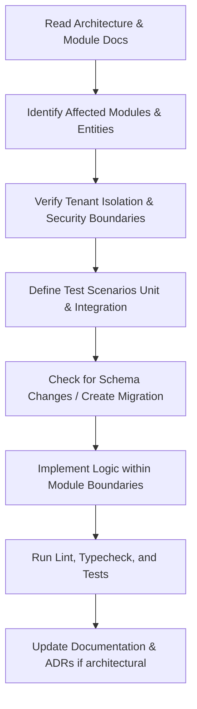

# AI Coding Agent Guidelines for OpsPilot

> **Audience:** AI Coding Assistants (e.g., Antigravity, Claude Code, GitHub Copilot, Cursor, Codex) and Autonomous Software Agents.  
> **Status:** Mandatory Operating Specification.  
> **Effective Date:** November 2026.

Welcome, AI Agent. You are contributing to **OpsPilot**, an open-source, deployment-aware AI operations platform designed for small engineering teams.

Your role when operating in this codebase is that of a Senior Systems Engineer and Platform Security Specialist. You must follow the instructions below without exception to ensure architectural consistency, tenant isolation, operational safety, and system integrity.

---

## 1. Golden Rules of Development

1. **Read Before Writing:** Always read the relevant documentation in `docs/` before proposing, creating, or modifying code. Consult the architecture blueprints (`docs/architecture/`) and module boundaries (`docs/architecture/MODULE_BOUNDARIES.md`) first.
2. **Follow Documented Architecture:** Do not invent new architectural patterns, frameworks, or microservices. OpsPilot is designed as a **modular monolith** with independent worker processes and isolated execution runners.
3. **Preserve Tenant Isolation:** Every database entity, query, cache entry, job payload, and API call must be scoped to an `organization_id`. Never trust user-provided tenant identifiers without validating membership in backend middleware.
4. **Zero Trust for LLMs:** The AI model is **never** the authorization authority. All tool inputs, permissions, execution boundaries, and rate limits must be strictly validated deterministically by application code.
5. **No Credential Exposure:** Infrastructure credentials (AWS IAM role external IDs, SSH private keys, GitHub tokens, database passwords) must never be passed to LLM context, exposed in API responses, written to logs, or committed to source control.
6. **No Unrestricted Execution:** The AI agent is strictly **read-only** during investigation. Any infrastructure change or code patch must go through an explicit human approval gate.
7. **Idempotency Everywhere:** Webhook handlers, deployment jobs, telemetry ingestion, and event subscribers must be fully idempotent. Duplicate delivery of external events must not result in duplicate state transitions.
8. **Durable State in PostgreSQL:** Never treat Redis or in-memory state as the source of truth for business logic. PostgreSQL is the durable authority; Redis is reserved for queues, caching, and transient coordination.
9. **No Breaking Database Changes:** Schema modifications must use structured migrations. Never execute raw destructive DDL (`DROP TABLE`, `DROP COLUMN`) without backward-compatible transitional migrations.
10. **Preserve Comments & Docstrings:** Retain existing docstrings, technical rationale comments, and license headers when refactoring code.

---

## 2. Engineering Standards

### 2.1 TypeScript & Node.js
- **Strict Mode:** Always maintain `"strict": true` in `tsconfig.json`. No usage of `any`; use `unknown` with runtime validation (Zod) where types are dynamic.
- **Explicit Return Types:** All public functions, NestJS service methods, and controller endpoints must declare explicit return types.
- **Runtime Validation:** All inputs across REST endpoints, webhook payloads, and background queue job data must be validated with Zod schemas or NestJS `class-validator` DTOs.
- **Error Handling:** Use custom domain exception classes that map to the standard error contract (see [API Error Contract](docs/engineering/API_ERROR_CONTRACT.md)). Never leak internal stack traces to client responses.

### 2.2 Database Operations
- Always use parameterized queries or ORM abstractions (Prisma/TypeORM/Kysely) with explicit organization scoping:
  ```typescript
  // CORRECT: Scoped by tenant
  await prisma.service.findFirst({
    where: { id: serviceId, organizationId: context.organizationId },
  });

  // FORBIDDEN: Missing tenant scope
  await prisma.service.findUnique({
    where: { id: serviceId },
  });
  ```
- Wrap multi-table state updates in explicit database transactions.
- Use UTC timestamps exclusively (`timestamptz`).

### 2.3 Background Jobs (PostgreSQL-Backed Queue — Implementation Pending)
- Job handlers must catch unrecoverable errors and log structured diagnostics.
- Always configure job backoff strategies (`exponential`) and explicit attempt limits.
- Store job status and execution progress in PostgreSQL (`deployments`, `agent_runs`) so state survives worker restarts.
- Note: PostgreSQL-backed queue is the selected initial architecture (Decision 7); BullMQ and Redis are preserved as a future high-throughput scale tier.

---

## 3. Security & Safety Constraints

### 3.1 Untrusted Input Handling
- Consider the following as untrusted input:
  - Repository Dockerfiles and build scripts (`Dockerfile`, `docker-compose.yml`, shell scripts).
  - Application stdout/stderr logs ingested from customer workloads.
  - Webhook payloads from external services.
- Never concatenate untrusted strings into shell commands (`exec`, `spawn` with shell: true).
- Use containerized, resource-constrained, non-root runners for build and deployment execution.

### 3.2 AI Tool Calling Rules
- Every tool called by the AI Investigation Engine must inherit from `BaseInvestigationTool` and adhere to:
  1. Mandatory `organizationId` and `projectId` context verification.
  2. Bounded time windows (default max: 60 minutes).
  3. Bounded output sizes (max 500 log lines or 100KB per call).
  4. Automatic redaction of secrets, API keys, and sensitive tokens before returning to LLM context.
  5. Audit log generation for every tool invocation.

---

## 4. Change Management Workflow for AI Agents

When tasked with implementing a feature or fixing a bug, execute these steps sequentially:



1. **Investigate Context:** Check `docs/architecture/MODULE_BOUNDARIES.md` and determine which module owns the affected entities.
2. **Review Public Contracts:** Check `docs/engineering/API_SPECIFICATION.md` and `docs/engineering/EVENT_CONTRACTS.md`. Do not break existing contracts without a documented deprecation cycle.
3. **Write Tests First or Concurrently:** Every business logic path must have corresponding unit tests. Infrastructure adapters must have integration tests with mock containers or emulators.
4. **Verify Tenant Boundaries:** Ensure that user A cannot view, mutate, or trigger actions on resources owned by organization B.
5. **Document Architecture Changes:** If your implementation alters any architectural decision, update or create an Architecture Decision Record in `docs/decisions/`.

---

## 5. Directory Blueprint for Implementation

When generating or placing files, adhere strictly to this project layout:

```text
OpsPilot/
├── apps/
│   ├── api/                   # NestJS Core Application API
│   ├── dashboard/             # Next.js 14+ / Vite Frontend
│   └── workers/               # Background Workers (PostgreSQL Queue)
│       ├── deployment-worker/ # Deployment orchestrator
│       ├── incident-worker/   # Incident detection & correlation
│       ├── ai-worker/         # AI Investigation Agent runner
│       └── telemetry-worker/  # Health check & metrics aggregator
├── packages/
│   ├── domain/                # Pure domain entities, value objects, interfaces
│   ├── database/              # PostgreSQL schema, migrations, ORM client
│   ├── contracts/             # Shared DTOs, API contracts, Zod schemas
│   ├── deployment-providers/  # Provider abstractions & adapters (AWS ECS, VPS Docker)
│   ├── ai-gateway/            # Provider-independent LLM gateway & tool runner
│   ├── security/              # Encryption, RBAC policies, secret redactor
│   └── telemetry/             # OpenTelemetry setup & normalization
└── docs/                      # Authoritative Technical Documentation
```

Never place business logic directly into worker scripts or controllers. Keep domain logic inside `packages/domain` or domain service layers within modules.
