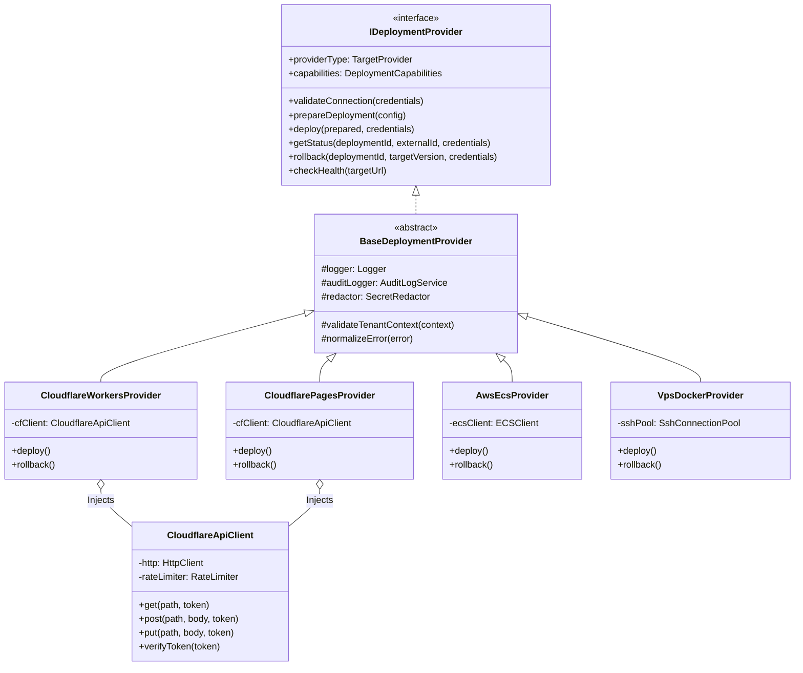
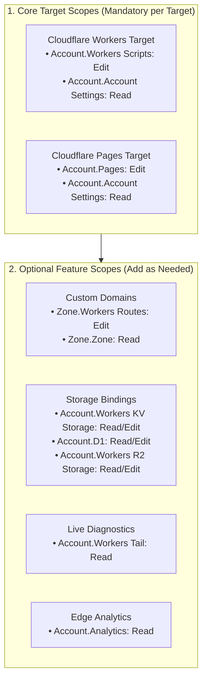
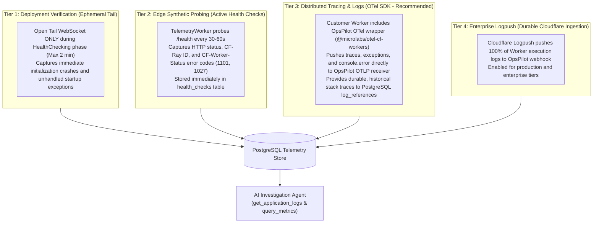
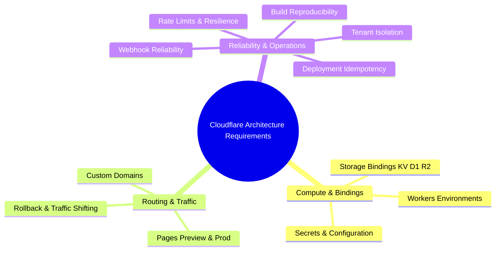

# OpsPilot — Cloudflare Architecture Decision Review

> **Document Type:** Formal Architectural Review & Verification Report  
> **Target Subsystems:** Cloudflare Integration Architecture, Deployment Provider Abstraction, Sandboxed Runners, Security Boundaries, Database Schema, Observability Pipeline  
> **Status:** Completed Critical Review  
> **Reviewers:** Principal Systems Engineer, Platform Security Specialist, Enterprise Cloud Architect  
> **Date:** November 2026  
> **Review Scope:** Review and validation of `CLOUDFLARE_INTEGRATION_AUDIT.md`, `CLOUDFLARE_ARCHITECTURE_PROPOSAL.md`, `CLOUDFLARE_GAP_ANALYSIS.md`, `CLOUDFLARE_IMPLEMENTATION_PLAN.md`, and `CLOUDFLARE_ARCHITECTURE_DECISIONS.md`.

---

## 1. Executive Summary & Review Verdict

OpsPilot is engineered as a deployment-aware operations platform for small engineering teams, combining deterministic infrastructure orchestration with autonomous, read-only AI incident investigation. The proposed Cloudflare integration extends OpsPilot's existing container-centric control plane (AWS ECS Fargate and Ubuntu VPS Docker Compose) to support **Cloudflare Workers** (V8 isolate serverless compute) and **Cloudflare Pages** (global edge static asset hosting and dynamic Pages Functions).

This review conducted a critical, adversarial architectural evaluation of the five proposed Cloudflare integration specifications. The objective was not to confirm existing proposals, but to stress-test their technical correctness, security boundaries, operational maintainability, and compatibility with OpsPilot's modular monolith architecture and Zero-Trust principles.

### Key Findings of the Review:
1. **Core Concept Soundness:** Decoupling OpsPilot from container-only assumptions (`imageUri`, `containerPort`, fixed CPU/RAM slices) is architecturally necessary and well-timed during Phase 0 (Specification Baseline).
2. **Critical Flaw in Observability:** The proposal relied on the Cloudflare Workers Tail API (`/tails`) for AI incident investigation logs. **The Tail API is strictly a live WebSocket stream of real-time events and provides zero historical log retrieval.** An AI agent investigating an incident that occurred 5 minutes ago would receive empty logs. A multi-pronged telemetry strategy (combining synthetic edge probe diagnostics, OpenTelemetry SDK integration, and Cloudflare Logpush) is mandatory.
3. **Severe Vulnerability in Runner Egress:** The proposed `NodeJsBuildRunner` did not specify explicit network egress blocking for cloud instance metadata services (`169.254.169.254`) or private RFC 1918 subnets. Untrusted customer build scripts could execute credential theft attacks against host IAM roles. Strict container network firewalls and `tmpfs` size limits must be mandated.
4. **Abstraction Conflation (`runtimeType`):** Modeling deployment targets using a single coarse `runtimeType` (`container | edge_worker | static_pages`) conflates the **build strategy**, **artifact format**, and **target runtime**. Discriminating deployment configurations by `targetProvider` alongside independent build and artifact models is technically cleaner and prevents edge-case breakage (such as Workers with static assets).
5. **Class Hierarchy Over-Engineering:** The proposed intermediate inheritance classes (`ContainerDeploymentProvider`, `EdgeDeploymentProvider`) introduce leaky abstractions. Flat composition—where distinct providers implement `IDeploymentProvider` and inject shared clients (`CloudflareApiClient`)—is vastly superior.
6. **Data Integrity Gap in Schema Evolution:** Relaxing `NOT NULL` constraints on container columns (`dockerfile_path`, `container_port`) without introducing a conditional database `CHECK` constraint creates a risk where container services can be created in an invalid state.
7. **Permission Scope Deficiencies:** The proposed API token permission list omitted critical scopes required for custom domain routing on Cloudflare zones and bound storage primitives (KV, D1, R2). A tiered permission model is required.

### Final Verdict

```text
================================================================================
FINAL ARCHITECTURAL VERDICT:
APPROVED WITH REQUIRED ADR REVISIONS
================================================================================
```

The proposed architecture is technically viable and well-structured, but foundational implementation **must not begin** until ADRs 0014, 0015, 0016, 0017, and 0018 are amended to incorporate the specific remediations established in this review.

---

## 2. Review of the 10 Core Architectural Decisions

---

### Decision 1: Should ContainerDeploymentProvider be a separate abstraction from WorkersDeploymentProvider and PagesDeploymentProvider?

#### 1.1 Original Decision
In `CLOUDFLARE_ARCHITECTURE_PROPOSAL.md` (Section 2.2) and ADR-0014, an inheritance hierarchy was established:
- `IDeploymentProvider` (Interface)
  - `BaseDeploymentProvider` (Abstract base: logging, secret redaction, tenant validation)
    - `ContainerDeploymentProvider` (Abstract class: port mapping validation, resource limit resolution)
      - `AwsEcsProvider`
      - `VpsDockerProvider`
    - `EdgeDeploymentProvider` (Abstract class: compatibility date validation, binding validation, shared `CloudflareApiClient`)
      - `CloudflareWorkersProvider`
      - `CloudflarePagesProvider`

#### 1.2 Technical Assessment
The intention behind `ContainerDeploymentProvider` and `EdgeDeploymentProvider` was to share domain logic between related deployment types. However, this structure violates the principle of **composition over inheritance** and introduces architectural rigidity:
1. **Leaky Interface Contract:** Methods such as `validatePortMapping()` or `validateCompatibilityDate()` are not part of `IDeploymentProvider`. The core orchestration engine (`DeploymentProcessor` in BullMQ) operates strictly against `IDeploymentProvider`. If the engine cannot call these methods polymorphically, embedding them in an intermediate inheritance tier provides zero polymorphic value.
2. **Conflation of Cloud Identity and Compute Topology:** `EdgeDeploymentProvider` bundles Cloudflare API client communication with edge isolate concepts. If OpsPilot later adds a non-Cloudflare edge provider (e.g., Fastly Compute@Edge, Vercel, or Deno Deploy) or if Cloudflare introduces containerized compute (Cloudflare Containers), this inheritance hierarchy collapses.
3. **Disparate Cloudflare APIs:** Cloudflare Workers and Cloudflare Pages use fundamentally different REST APIs:
   - Workers: Script Versions API (`/workers/scripts/{name}/versions`), Deployments API (`/workers/scripts/{name}/deployments`), and Tail API (`/workers/scripts/{name}/tails`).
   - Pages: Projects API (`/pages/projects/{name}`), Direct Upload Hash Manifest API, and Rollback API (`/pages/projects/{name}/deployments/{id}/rollback`).
   They share an HTTP authentication mechanism (`Authorization: Bearer <token>`) and rate-limiting semantics, not deployment lifecycle mechanics.

#### 1.3 Problems Identified
- Tight coupling between the Cloudflare HTTP client and the edge provider lifecycle.
- Unnecessary inheritance depth (3 levels of abstract classes before reaching concrete implementation).
- Fragile base class problem: changes to `EdgeDeploymentProvider` risk unintentionally breaking either Workers or Pages logic.

#### 1.4 Alternatives Considered
1. **Monolithic Cloudflare Provider (`CloudflareProvider`):** Single provider branching internally on project type. *Rejected:* Blurs API contracts, creates massive conditional blocks, and violates Single Responsibility.
2. **Deep Inheritance Hierarchy (As originally proposed):** *Rejected* due to leaky abstractions and tight coupling.
3. **Flat Composition (Recommended):** Every concrete provider directly extends `BaseDeploymentProvider` (which handles only common cross-cutting concerns: tenant context validation, logger, secret redaction, and standardized error normalization) and implements `IDeploymentProvider`. Shared infrastructure clients (`CloudflareApiClient`, `ContainerRegistryClient`, `SshClientPool`) are injected via dependency injection.

#### 1.5 Recommended Decision
Adopt **Flat Composition**. 
- Eliminate `ContainerDeploymentProvider` and `EdgeDeploymentProvider` as inheritance classes.
- Create an independent, reusable `CloudflareApiClient` in `packages/deployment-providers/src/cloudflare/common/` that encapsulates token verification, rate-limiting (token bucket with 429 exponential backoff), error response unwrapping, and tenant audit logging.
- `CloudflareWorkersProvider` and `CloudflarePagesProvider` both inject `CloudflareApiClient` as a private collaborator.
- Container-specific validation (ports, CPU/RAM) and edge-specific validation (compatibility date, bindings) are implemented as pure validation functions in `packages/contracts` and enforced by Zod schemas prior to provider invocation.



#### 1.6 Consequences
- **Positive:** Modular, testable code. Providers can be unit-tested by mocking `CloudflareApiClient`. No leaky abstractions. Easy to add future targets.
- **Negative:** Shared Cloudflare logic must be explicitly placed in helper services rather than inherited base methods.
- **ADR Revision Required:** Yes. Amend ADR-0014 to document the transition from inheritance (`EdgeDeploymentProvider`) to composition (`CloudflareApiClient`).

---

### Decision 2: Is runtimeType the right abstraction, or should build strategy, artifact type, and runtime be independently modeled?

#### 2.1 Original Decision
ADR-0017 and the Architecture Proposal introduced:
```typescript
export type RuntimeType = 'container' | 'edge_worker' | 'static_pages';
```
This was used as:
1. The discriminator for the `DeploymentConfig` union.
2. A column on the `services` table (`runtime_type VARCHAR(32)`).
3. A property of `DeploymentCapabilities`.

#### 2.2 Technical Assessment
The `runtimeType` abstraction is overloaded and conflates three orthogonal concepts:
1. **Build Strategy (How the source code is compiled):**
   - `dockerfile`: Invokes Kaniko / Docker build using a repository Dockerfile.
   - `nodejs_bundle`: Invokes Wrangler / esbuild to compile TypeScript/JavaScript to an ESM bundle.
   - `static_build`: Invokes customer build commands (`npm run build`) to produce an output directory (`dist/`, `out/`).
2. **Artifact Type (What output is generated and packaged):**
   - `oci_image`: A container image digest stored in an OCI registry (ECR, Docker Hub).
   - `worker_bundle`: An ESM script bundle + metadata + optional Wasm binary.
   - `static_manifest`: A directory of static assets hashed with SHA-256 for direct upload.
3. **Target Provider / Execution Environment (Where and how the artifact executes):**
   - `aws_ecs`: AWS Fargate serverless container, TCP port, ALB target group.
   - `vps_docker`: Bare-metal/VPS Docker Compose container, host/bridge port.
   - `cloudflare_workers`: Cloudflare global V8 isolates, event-driven fetch handler, bindings.
   - `cloudflare_pages`: Cloudflare edge CDN static caching + optional Pages Functions edge worker.

Calling static HTML/JS/CSS a "runtime" (`static_pages`) is technically inaccurate; static assets have no runtime—they are cached and served by edge web servers. Conversely, if a Cloudflare Pages project uses Pages Functions (`/functions`), its runtime is actually V8 isolates—identical to Cloudflare Workers! Furthermore, Cloudflare Workers now natively supports **Workers Static Assets**, blurring the line even further.

#### 2.3 Problems Identified
- **Impedance Mismatch:** In `CLOUDFLARE_ARCHITECTURE_PROPOSAL.md`, the author already had to define `PreparedArtifact.artifactType` separately because `runtimeType` failed to accurately describe the build artifact.
- **Brittle Discriminator:** If a user wants to build a Node.js project using a Dockerfile but deploy it to ECS, vs. building it with a Dockerfile and deploying to VPS, vs. building with npm and deploying to Pages, a single `runtimeType` forces unnatural coupling.

#### 2.4 Alternatives Considered
1. **Retain `runtimeType`:** Simple for Phase 0, but creates technical debt as soon as edge workers with static assets or multi-target builds are introduced.
2. **Complete Orthogonal Triad (`buildStrategy`, `artifactType`, `targetProvider`):** Highly flexible, but potentially over-engineered for MVP if exposed as separate end-user choices.
3. **Target-Driven Polymorphic Model (Recommended):** Use `targetProvider` (`aws_ecs | vps_docker | cloudflare_workers | cloudflare_pages`) as the top-level discriminator for `DeploymentConfig` and `services`. Internally within the domain model, map each `targetProvider` deterministically to its required `buildStrategy` and `artifactType`, allowing explicit overrides only where supported.

#### 2.5 Recommended Decision
Adopt the **Target-Driven Polymorphic Model**:
- In the public API and database, discriminate configurations by `target_provider`.
- Model `buildStrategy` and `artifactType` explicitly in the internal domain layer (`packages/domain`):
  ```typescript
  export type TargetProvider = 
    | 'aws_ecs' 
    | 'vps_docker' 
    | 'cloudflare_workers' 
    | 'cloudflare_pages';

  export type BuildStrategy = 
    | 'dockerfile' 
    | 'cloudflare_worker_bundle' 
    | 'static_export';

  export type ArtifactType = 
    | 'oci_image' 
    | 'worker_bundle' 
    | 'pages_manifest';
  ```
- Each `DeploymentConfig` type is discriminated directly by `targetProvider: 'cloudflare_workers'`, `targetProvider: 'cloudflare_pages'`, etc.
- In the database `services` table, store `target_provider NOT NULL` and provider-specific configuration in a typed JSONB `config` column validated by Zod schemas tailored to each provider.

#### 2.6 Consequences
- **Positive:** Completely eliminates the ambiguous `static_pages` runtime concept. Provides 100% type-safe discriminated unions for frontend forms, DTOs, and worker jobs.
- **Negative:** Renames `runtime_type` references to `target_provider` in proposed Phase 1 and Phase 3 deliverables.
- **ADR Revision Required:** Yes. Amend ADR-0017 to supersede `runtime_type` with `target_provider` discrimination and explicit build/artifact modeling.

---

### Decision 3: Should Workers and Pages share a Cloudflare account integration while retaining separate deployment providers?

#### 3.1 Original Decision
ADR-0014 and ADR-0018 specify:
- Single integration type in database: `integration_type = 'cloudflare'`.
- Credentials stored in `integration_credentials`: `{ accountId: string, apiToken: string }`.
- Two separate deployment targets: `target_provider = 'cloudflare_workers'` and `target_provider = 'cloudflare_pages'`.
- Two distinct provider classes: `CloudflareWorkersProvider` and `CloudflarePagesProvider`.

#### 3.2 Technical Assessment
This separation of concerns between **Account Integration** (identity & billing boundary) and **Deployment Target** (workload & execution boundary) matches Cloudflare's platform architecture:
- In Cloudflare, the **Account ID** is the root namespace for all Workers scripts, KV namespaces, D1 databases, R2 buckets, and Pages projects.
- An API Token created by an administrator can grant permissions across both Workers and Pages within that account.
- Forcing a user to create two separate integrations ("Cloudflare Workers Account" and "Cloudflare Pages Account") when deploying a full-stack system (e.g., a Hono API on Workers and a Next.js frontend on Pages) would force redundant credential management and double encryption overhead.

#### 3.3 Problems Identified
- **Scope Blindness during Connection:** The proposal stated that integration verification calls `GET https://api.cloudflare.com/client/v4/user/tokens/verify`.
  - `/user/tokens/verify` **only checks whether the token is syntactically valid and active**. It does **not** test whether the token has permissions to access the provided `accountId`, nor whether it can write to Workers or Pages!
  - If a user provides an API Token scoped solely to `Pages: Edit`, the connection verification passes. But when they later attempt to deploy a Worker, the deployment fails with a 403 Forbidden error during script upload.

#### 3.4 Alternatives Considered
1. **Separate Integration per Product (`cloudflare_workers`, `cloudflare_pages`):** *Rejected:* Redundant; degrades user experience for teams using both products under one Cloudflare account.
2. **Accept Global API Keys:** *Rejected:* Catastrophic security risk in multi-tenant SaaS.

#### 3.5 Recommended Decision
**Maintain the shared `cloudflare` integration model, but mandate Deep Permission Probing during integration verification.**
When `POST /api/v1/integrations/cloudflare/verify` is invoked:
1. Verify token validity via `GET /user/tokens/verify`.
2. Inspect the token's active status and grab the token identifier.
3. Test account-level access by querying `GET /accounts/{account_id}`.
4. Probe specific permissions by making lightweight, read-only calls:
   - Check Workers capability: `GET /accounts/{account_id}/workers/scripts` (verifies Workers scope).
   - Check Pages capability: `GET /accounts/{account_id}/pages/projects` (verifies Pages scope).
5. Store the detected capabilities in `integrations.metadata`:
   ```json
   {
     "accountId": "abc12345",
     "accountName": "Acme Corp Production",
     "capabilities": {
       "workers": true,
       "pages": true,
       "tail": true,
       "customDomains": false
     }
   }
   ```
6. If a user attempts to create a `cloudflare_workers` deployment target using an integration that lacks the `workers` capability, the API immediately rejects the request with an actionable validation error: `"The connected Cloudflare API Token lacks Account.Workers Scripts: Edit permissions."`

#### 3.6 Consequences
- **Positive:** Eliminates late deployment-time authorization failures. Clear UI feedback on what permissions are active.
- **Negative:** Integration verification requires 2-3 HTTP requests instead of 1.
- **ADR Revision Required:** Yes. Amend ADR-0018 to mandate Deep Permission Probing.

---

### Decision 4: Is direct upload the right strategy for Pages if OpsPilot needs complete control over builds and deployment history?

#### 4.1 Original Decision
ADR-0015 decided on the **Direct Upload Strategy** exclusively:
OpsPilot checks out the repository, executes the build in its own isolated runner, collects build logs, and uploads the compiled output directory directly to Cloudflare Pages via the Pages Direct Upload REST API. Cloudflare-managed Git integration was explicitly rejected.

#### 4.2 Technical Assessment
This is one of the most critical and correct decisions in the entire architecture proposal.
- If OpsPilot used Cloudflare-managed Git integration:
  - GitHub webhooks would go directly to Cloudflare, bypassing OpsPilot.
  - OpsPilot would have no real-time stream of build logs.
  - OpsPilot could not enforce pre-build security gates or compliance checks.
  - Secret management would be split across OpsPilot and Cloudflare Pages dashboards.
  - The AI Agent could not inspect build failures or correlate deployment events with source commits in a sovereign manner.
- Direct Upload ensures that OpsPilot remains the **authoritative control plane**. The build happens in OpsPilot's sandboxed runner, secrets are injected deterministically, logs are streamed to PostgreSQL and the OpsPilot UI, and Cloudflare acts purely as the edge hosting fabric.

#### 4.3 Problems Identified
While the decision is conceptually correct, the technical implementation details in ADR-0015 and the Proposal were incomplete:
1. **Pages Functions Compilation (`functions/` directory):**
   - Cloudflare Pages Direct Upload does **not** accept raw TypeScript/JavaScript files inside a `functions/` directory over the REST API.
   - Cloudflare's Direct Upload API expects either:
     - Pure static assets, OR
     - Static assets plus a pre-compiled `_worker.js` (or `_worker.bundle`) located in the root of the output directory, along with an optional `_routes.json` defining routing rules.
   - If a customer repository uses Pages Functions, the build runner **must compile the functions using Wrangler** (`npx wrangler pages functions build`) before initiating the direct upload. If this step is omitted, all dynamic backend routes will fail with 404s!
2. **Cloudflare Direct Upload Limits:**
   - Maximum **20,000 files** per deployment.
   - Maximum individual file size: **25 MiB**.
   - If a customer build generates 25,000 static files (common in large Next.js SSG or Gatsby catalogs), the Cloudflare Pages Direct Upload API will reject the manifest with an error. The architecture lacked a pre-upload validation check.
3. **Upload Protocol Complexity:**
   - The Direct Upload protocol requires:
     1. Generating a SHA-256 hash for every file.
     2. Submitting the file-to-hash manifest.
     3. Receiving a list of missing hashes (files Cloudflare does not already have in its deduplicated cache).
     4. Uploading only missing files in batched multipart payloads.
     5. Finalizing the deployment.

#### 4.4 Alternatives Considered
1. **Cloudflare-Managed Git Integration:** *Rejected:* Completely undermines OpsPilot's control plane and AI investigation capabilities.
2. **Deploying Pages via `wrangler pages deploy` CLI in Runner:**
   - *Considered:* Having the runner run `wrangler pages deploy <dir> --project-name=<name>`.
   - *Evaluation:* This would require passing the decrypted Cloudflare API Token into the untrusted runner container, which **strictly violates ADR-0005 and ADR-0018**.
   - *Verdict: Rejected.*

#### 4.5 Recommended Decision
**Reaffirm the Direct Upload Strategy, but augment the specification with mandatory pre-upload packaging and limit validation:**
1. **Pages Functions Compilation in Runner:** If a `functions/` directory or edge framework is detected, the `NodeJsBuildRunner` must execute `wrangler pages functions build --outdir=dist` (or framework-equivalent) so the output directory contains the compiled `_worker.js` and `_routes.json`.
2. **Pre-Upload Limit Gate:** The runner must count total assets and check individual file sizes before export. If `fileCount > 20,000` or any `fileSize > 25 MiB`, the runner aborts with a structured error recommending container hosting (ECS/VPS) or external asset storage (R2).
3. **Manifest Deduplication Client:** The `CloudflarePagesProvider` in `packages/deployment-providers` executes the hash-negotiated upload protocol, ensuring that only modified files are transmitted over the network, dramatically speeding up consecutive deployments.

#### 4.6 Consequences
- **Positive:** Guaranteed build reproducibility, sovereign log retention, support for full-stack Pages Functions, zero secret exposure in runner.
- **Negative:** Increased engineering effort in `CloudflarePagesProvider` to implement the chunked manifest upload protocol.
- **ADR Revision Required:** Yes. Amend ADR-0015 to specify Pages Functions compilation and limit verification.

---

### Decision 5: Is Wrangler the correct build and deployment interface for Workers?

#### 5.1 Original Decision
In `CLOUDFLARE_ARCHITECTURE_PROPOSAL.md` (lines 221, 494) and ADR-0016:
- The build runner runs `wrangler deploy --dry-run --outdir=./dist`.
- The `DeploymentWorker` deploys the script using Cloudflare REST APIs (`/versions` and `/deployments`).

#### 5.2 Technical Assessment
Wrangler is the de facto standard tool for the Cloudflare Workers ecosystem. It encapsulates esbuild, resolves TypeScript paths, processes `wrangler.jsonc` / `wrangler.toml`, injects compatibility flags, and bundles auxiliary WebAssembly and text modules. Attempting to author a custom bundler inside OpsPilot would be a catastrophic maintenance burden.

However, the phrase "Wrangler as the deployment interface" creates architectural ambiguity:
- **Wrangler as a Build Tool:** Compiling source code, bundling dependencies, and generating artifacts.
- **Wrangler as a Deployment Tool:** Calling Cloudflare APIs to upload scripts, manage secrets, and route traffic.

If Wrangler were used as the *deployment* tool, it would need the Cloudflare API Token. Passing the token into the runner container violates Zero Trust. Furthermore, Wrangler's CLI output is designed for terminal display, not programmatic control plane state machines.

#### 5.3 Problems Identified
1. **Inconsistent CLI Semantics:** In modern Wrangler (v3.x / v4.x), `wrangler deploy --dry-run --outdir=./dist` is designed primarily to inspect generated bundles, but its flags have shifted across minor versions. The command for purely compiling a Worker without deploying is `wrangler build` or `wrangler deploy --dry-run --outdir=...`.
2. **Metadata & Binding Resolution:** A Worker script bundle cannot be deployed in isolation. Cloudflare's Versions API (`POST /workers/scripts/{name}/versions`) requires a multipart form with:
   - `metadata`: JSON specifying `main_module`, `compatibility_date`, `compatibility_flags`, and `bindings` (KV, D1, R2, environment variables).
   - `index.js`: The compiled JavaScript ESM bundle.
   If Wrangler only compiles the bundle, who parses `wrangler.jsonc` to extract the bindings and compatibility configuration?
   If the runner does not output a standardized metadata manifest, the `DeploymentWorker` would have to parse `wrangler.jsonc` itself, risking syntax mismatches.

#### 5.4 Alternatives Considered
1. **Full Wrangler CLI Deployment in Runner:** Pass token to runner, run `wrangler deploy`. *Rejected: Critical security violation.*
2. **Custom Esbuild Script without Wrangler:** Author an in-house bundler. *Rejected: Cannot track Cloudflare's rapid feature evolution.*
3. **Wrangler Build + Structured Manifest Output (Recommended):** Use Wrangler exclusively inside the runner to build the bundle and emit an evaluated configuration manifest. Control plane executes deployment via REST API.

#### 5.5 Recommended Decision
**Wrangler is the designated BUILD AND BUNDLING INTERFACE, but the Cloudflare REST API is the DEPLOYMENT AND ORCHESTRATION INTERFACE.**
- Inside the unprivileged `NodeJsBuildRunner`:
  1. The runner executes `wrangler build` (or `wrangler deploy --dry-run --outdir=dist`).
  2. The runner invokes a small, trusted OpsPilot helper script (`opspilot-worker-pack.js`) that uses `@cloudflare/wrangler` internal configuration parser to output a normalized `opspilot-build-manifest.json`:
     ```json
     {
       "mainModule": "index.js",
       "compatibilityDate": "2024-11-01",
       "compatibilityFlags": ["nodejs_compat"],
       "declaredBindings": {
         "vars": { "API_URL": "https://api.example.com" },
         "kv": [{ "binding": "CACHE", "id": "kv_namespace_id" }],
         "d1": [{ "binding": "DB", "id": "d1_database_id" }],
         "r2": [{ "binding": "BUCKET", "bucket_name": "media" }]
       },
       "files": ["index.js", "index.js.map"]
     }
     ```
  3. The runner archives `dist/` and `opspilot-build-manifest.json` into a build tarball.
- In the `DeploymentWorker` (Trusted Control Plane):
  1. The worker unpacks the tarball.
  2. Merges OpsPilot-managed secrets and environment variables with the manifest bindings.
  3. Constructs the multipart payload.
  4. Calls the Cloudflare Versions API (`POST /workers/scripts/{name}/versions`) using envelope-decrypted credentials.
  5. Calls the Cloudflare Deployments API (`POST /workers/scripts/{name}/deployments`) to activate the version.

#### 5.6 Consequences
- **Positive:** Zero token exposure in runner. Completely deterministic binding resolution. Clean decoupling between compilation and deployment.
- **Negative:** Build runner entrypoint requires authoring the manifest extraction script.
- **ADR Revision Required:** Yes. Amend ADR-0016 to explicitly define the boundary between Wrangler bundling and REST API deployment.

---

### Decision 6: Are the proposed Cloudflare API permissions sufficient and least-privileged?

#### 6.1 Original Decision
In Proposal Section 5.1 and ADR-0018:
| Permission Group | Scope | Access Level | Purpose |
|---|---|:---:|---|
| Account.Workers Scripts | Specific Account | `Edit` | Upload versions, bindings |
| Account.Workers Routes | Specific Account | `Edit` | Bind workers to routes |
| Account.Workers Tail | Specific Account | `Read` | Stream real-time logs |
| Account.Pages | Specific Account | `Edit` | Manage projects, direct upload |
| Zone.Analytics | Specific Zones | `Read` | Query edge invocation metrics |

#### 6.2 Technical Assessment
A critical security and functional review reveals that this permission set is **both insufficient for certain operations and overly permissive for others**:
1. **Insufficient for Custom Domains:**
   - To attach a Worker to a Custom Domain (e.g. `api.customerdomain.com`), Cloudflare requires:
     - `Zone.Workers Routes: Edit` (Zone level)
     - `Zone.Zone: Read` (Zone level)
   - Account-level `Account.Workers Routes: Edit` applies only to `*.workers.dev` routing or account-level route dispatch. Without Zone permissions, attaching a custom domain will fail with `HTTP 403 Forbidden: Insufficient zone permissions`.
2. **Insufficient for Storage Bindings:**
   - When a Worker script is deployed with KV, D1, or R2 bindings, Cloudflare verifies that the calling token has access to the bound resources.
   - If a Worker script binds a D1 database, the token requires `Account.D1: Edit` (or `Read`).
   - If it binds a KV namespace, it requires `Account.Workers KV Storage: Edit` (or `Read`).
   - If it binds an R2 bucket, it requires `Account.Workers R2 Storage: Edit` (or `Read`).
   - The original proposal omitted all storage binding permissions!
3. **Violation of Least Privilege for Static Sites:**
   - A team that only wants to deploy a static Vite frontend via Cloudflare Pages should **never** be required to grant `Account.Workers Scripts: Edit` or `Account.Workers Tail: Read`. Granting Workers edit permissions gives the token the ability to modify backend API workers in the same account!

#### 6.3 Problems Identified
- Silent deployment failures when users configure custom domains or storage bindings.
- Inability for security-conscious customers to create minimal, single-purpose API tokens.

#### 6.4 Alternatives Considered
1. **Global API Key:** *Rejected: Absolute security violation.*
2. **Single "God" Token Template:** *Rejected: Violates SOC2 / ISO 27001 least-privilege standards.*
3. **Tiered Permission Model (Recommended):** Group permissions into Core (Mandatory) and Feature Scopes (Optional, requested only when specific capabilities are enabled).

#### 6.5 Recommended Decision
Adopt a **Tiered Least-Privilege Permission Model**:



OpsPilot must support:
1. **Target-Scoped Tokens:** A customer can provide a token that only has `Pages: Edit` if they only use `cloudflare_pages`.
2. **Proactive Permission Auditing:** When the user connects the token, OpsPilot checks which scopes are present and displays green checks for enabled features (e.g. `[x] Workers [x] Pages [ ] Storage Bindings [x] Tail Logs`). If the user configures a D1 binding without the D1 scope, the UI alerts them immediately before deployment.

#### 6.6 Consequences
- **Positive:** Complies with strict enterprise security policies. Prevents deployment failures.
- **Negative:** UI integration form must explain optional permission scopes clearly.
- **ADR Revision Required:** Yes. Amend ADR-0018 with the Tiered Permission Model.

---

### Decision 7: Is the Node.js build runner secure enough for untrusted customer repositories?

#### 7.1 Original Decision
ADR-0016 specifies:
- Image: `node:20-alpine`.
- User: `builder` (UID 10001, GID 10001).
- Capabilities: `CapDrop=ALL`, `no-new-privileges: true`.
- Filesystem: Read-only root filesystem with `tmpfs` mounts at `/tmp` and `/workspace`.
- Tools: `wrangler`, `esbuild`, `git`.

#### 7.2 Technical Assessment
The baseline hardening specified in ADR-0016 is a solid start (non-root execution, dropping capabilities, read-only rootfs). However, when evaluated against a **hostile multi-tenant threat model**, several catastrophic vulnerabilities and denial-of-service attack vectors were completely unaddressed:

#### 7.3 Problems Identified
1. **Cloud Metadata & Private Network Egress (CRITICAL VULNERABILITY):**
   - In standard Docker configurations, container egress is routed via the host network bridge.
   - If an untrusted repository has a malicious `postinstall` script in `package.json`, it can make HTTP requests:
     - `curl http://169.254.169.254/latest/meta-data/iam/security-credentials/`
   - If OpsPilot runs on AWS (EC2 or ECS), **the untrusted customer build script can extract the host machine's IAM instance profile credentials**, compromising OpsPilot's entire AWS account!
   - Similarly, the build script can probe OpsPilot's internal Redis (`6379`), PostgreSQL (`5432`), or other internal microservices on `10.0.0.0/8` or `172.16.0.0/12`.
2. **Host RAM Denial of Service via Unbounded `tmpfs`:**
   - In Linux, `tmpfs` is backed by host virtual memory (RAM + swap).
   - If Docker mounts a `tmpfs` without an explicit `size` option (e.g. `docker run --tmpfs /tmp --tmpfs /workspace`), a malicious script can write:
     `head -c 32G /dev/urandom > /workspace/exploit.bin`
   - This consumes all host RAM, triggering the Linux OOM-killer to terminate the Docker daemon or PostgreSQL database on the host!
3. **Fork Bombs & Thread Exhaustion:**
   - ADR-0016 omitted `--pids-limit`. A simple fork bomb (`:(){ :|:& };:`) can exhaust the host kernel's PID table, freezing the entire worker server.
4. **Lockfile Bypass & Package Manager Drift:**
   - Repositories in the wild use `pnpm`, `yarn` (v1 or v4), `npm`, or `bun`.
   - Running `npm ci` on a project that only contains `pnpm-lock.yaml` will either fail or fall back to an unpinned `npm install`, destroying build reproducibility.
   - Pinning `wrangler@3.88.0` globally in the Dockerfile will break projects that rely on newer Wrangler features or older compatibility dates.

#### 7.4 Alternatives Considered
1. **MicroVM Isolation (Firecracker / AWS Kata Containers):**
   - *Pros:* Hardware-level virtualization isolation; completely immune to container escape.
   - *Cons:* Heavy infrastructure complexity, requires bare-metal or nested virtualization support on the host. Unnecessary for Phase 0 if Docker is strictly isolated.
2. **Hardened Docker Runner with Network Firewall & Resource Quotas (Recommended):**
   - Standard container execution, but with deterministic egress firewalls, bounded tmpfs, and process isolation.

#### 7.5 Recommended Decision
**Amend ADR-0016 to mandate Hardened Host Isolation Parameters for `NodeJsBuildRunner`:**
1. **Egress Firewall & Metadata Blackhole:**
   - The runner container network must explicitly drop all traffic to link-local and private RFC 1918 subnets via iptables / nftables:
     - Drop `169.254.169.254/32` (AWS/GCP/Azure instance metadata service).
     - Drop `10.0.0.0/8`, `172.16.0.0/12`, `192.168.0.0/16` (private VPC networks).
   - Outbound internet traffic is strictly limited to public DNS (`53`), HTTP (`80`), and HTTPS (`443`) for npm registry and GitHub access.
2. **Strict Resource Caps:**
   - `--memory=2048m --memory-swap=2048m` (hard RAM ceiling).
   - `--cpus=1.5` (CPU quota ceiling).
   - `--pids-limit=256` (prevents fork bombs and process table exhaustion).
3. **Bounded `tmpfs` Mounts:**
   - `--tmpfs /tmp:rw,nosuid,size=512m`
   - `--tmpfs /workspace:rw,nosuid,size=2048m`
4. **Multi-Package Manager Support via Corepack:**
   - Enable Node.js `corepack` in the runner image (`corepack enable`).
   - The entrypoint script detects `pnpm-lock.yaml`, `yarn.lock`, or `package-lock.json` and executes the corresponding deterministic install command (`pnpm install --frozen-lockfile`, `yarn install --immutable`, or `npm ci`).
5. **Wrangler Execution Hierarchy:**
   - The runner executes project-local `wrangler` (`npx wrangler`) if defined in `package.json`. If omitted, it falls back to a tested bundled version.

#### 7.6 Consequences
- **Positive:** Complete protection against cloud credential theft, host memory exhaustion, and fork bombs. Seamless support for pnpm and yarn.
- **Negative:** Runner container invocation command in `deployment-worker` requires additional runtime arguments.
- **ADR Revision Required:** Yes. Amend ADR-0016 with these mandatory security parameters.

---

### Decision 8: Are deployment state transitions correctly modeled for container and serverless deployments?

#### 8.1 Original Decision
The platform uses an 8-stage state machine from `docs/architecture/DEPLOYMENT_ARCHITECTURE.md`:
`Queued -> Preparing -> Building -> Publishing -> Deploying -> HealthChecking -> Succeeded (or Failed -> RollingBack)`

The proposal maps Cloudflare lifecycle as:
- `Building`: `npm ci && npm run build` (bundling / static export).
- `Publishing`: Uploading script version to Cloudflare (`POST /versions`) or uploading static assets.
- `Deploying`: Activating version / switching traffic weights (`POST /deployments`).
- `HealthChecking`: Probing edge URL (`workers.dev` or custom domain).

#### 8.2 Technical Assessment
The 8-stage lifecycle is an elegant, unified abstraction. It preserves uniform operational monitoring across diverse infrastructure targets without leaking low-level cloud mechanics to the frontend.

Comparing container and edge state semantics confirms their alignment:
| Stage | AWS ECS Fargate | Cloudflare Workers | Cloudflare Pages |
|---|---|---|---|
| **Queued** | Job enqueued in BullMQ | Job enqueued in BullMQ | Job enqueued in BullMQ |
| **Preparing** | STS AssumeRole, workspace setup | Verify CF Token, workspace setup | Verify CF Token, workspace setup |
| **Building** | `docker build` (Kaniko) | `wrangler build` (ESM bundle) | `npm run build` (Static export) |
| **Publishing** | Push image to Amazon ECR | Upload Version (`/versions`) | Upload Assets (Direct Upload) |
| **Deploying** | Update ECS TaskDef & Service | Route Traffic (`/deployments`) | Finalize Pages Deployment |
| **HealthChecking**| Poll ALB Target Group | Probe Edge URL (`/health`) | Probe Preview/Prod URL |
| **Succeeded** | Traffic stabilized | 100% traffic serving | 100% traffic serving |

#### 8.3 Problems Identified
1. **Preview Deployments vs. Production Deployments in Pages:**
   - In Cloudflare Pages, a deployment triggered by a Pull Request creates an ephemeral preview URL (`https://<deployment_id>.<project>.pages.dev`). It must **never** route production traffic.
   - If `Deploying` is strictly defined as "activating production traffic", the terminology is misleading for preview deployments.
2. **Terminal State of Automated Rollbacks:**
   - In `DATABASE_DESIGN.md`, `deployment_status` includes `'rolled_back'`.
   - If a deployment passes `Deploying`, enters `HealthChecking`, fails health probes, and triggers an automated rollback to the previous version:
     What is the terminal status of the failed deployment?
     It should be `rolled_back` (indicating that the deployment was deployed, failed health verification, and was cleanly reverted), distinct from `failed` (which indicates compilation or cloud API rejection before traffic switch).
     The proposal correctly mapped this, but state transition invariants must be documented.

#### 8.4 Alternatives Considered
1. **Separate Serverless State Machine (`Queued -> Compiling -> Staging -> Active`):** *Rejected:* Splits dashboard UI into two divergent mental models and complicates telemetry correlation.
2. **Collapsing `Publishing` and `Deploying` into a single state:** *Rejected:* For Workers, uploading an immutable version (`Publishing`) and shifting traffic (`Deploying`) are distinct API operations. Separating them allows canary traffic shifting in the future.

#### 8.5 Recommended Decision
**Retain the 8-stage deployment state machine across all providers.**
- Formalize the semantic definition of `Deploying`:
  - For `environment: 'production'`, `Deploying` means routing primary traffic to the new version.
  - For `environment: 'preview'`, `Deploying` means provisioning and binding the isolated preview URL.
- Formalize the terminal states:
  - `succeeded`: Passed health checks and serving target environment.
  - `failed`: Aborted during preparing, building, publishing, or deploying.
  - `rolled_back`: Successfully deployed, failed health checking, and automatically reverted to prior version.

#### 8.6 Consequences
- **Positive:** Universal state machine across ECS, VPS, Workers, and Pages. Consistent progress bars and audit events.
- **Negative:** None.
- **ADR Revision Required:** No. Validated as architecturally sound.

---

### Decision 9: Is the existing database schema evolution backward-compatible?

#### 9.1 Original Decision
ADR-0017 specified:
1. `ALTER TYPE integration_type ADD VALUE 'cloudflare';`
2. `ALTER TYPE target_provider ADD VALUE 'cloudflare_workers';`
3. `ALTER TYPE target_provider ADD VALUE 'cloudflare_pages';`
4. Add `runtime_type VARCHAR(32) NOT NULL DEFAULT 'container'` to `services`.
5. Relax `NOT NULL` on `services.dockerfile_path`, `container_port`, `cpu_units`, `memory_mb`.
6. Add `config JSONB NOT NULL DEFAULT '{}'` to `services`.
7. Relax `NOT NULL` on `deployments.image_uri` and add `artifact_reference TEXT`.

#### 9.2 Technical Assessment
The migration path is non-destructive and backward-compatible:
- Existing rows in `services` receive default `runtime_type = 'container'`.
- Existing container columns retain their current values.
- Existing rows in `deployments` retain `image_uri`.
- Dropping `NOT NULL` constraints on columns in PostgreSQL is a metadata-only operation (`pg_attribute.attnotnull = false`), executing in microseconds without taking table locks or rewriting tables.

#### 9.3 Problems Identified
1. **Loss of Container Invariants (Data Integrity Degradation):**
   - In the baseline schema, `dockerfile_path`, `container_port`, `cpu_units`, and `memory_mb` were `NOT NULL` to guarantee that every container service was fully configured.
   - Simply executing `ALTER COLUMN ... DROP NOT NULL` without replacement allows an API bug or rogue query to insert an AWS ECS service with `dockerfile_path = NULL` or `container_port = NULL`.
2. **PostgreSQL Enum Transaction Pitfall:**
   - In PostgreSQL versions prior to 12, `ALTER TYPE ... ADD VALUE` could not be executed inside a multi-statement transaction block. While PostgreSQL 16 allows it, an added enum value cannot be used in a query within the exact same transaction block. Migrations must handle enum expansion cleanly.

#### 9.4 Alternatives Considered
1. **Separate Tables per Provider (`ecs_services`, `workers_services`):** *Rejected:* Severely fragments queries, foreign keys, telemetry association, and UI presentation.
2. **Passing Dummy Docker Values (`port: 0`, `dockerfile: 'none'`):** *Rejected:* Pollutes data integrity and breaks domain validations.

#### 9.5 Recommended Decision
**Approve the additive migration, but mandate a conditional PostgreSQL CHECK constraint to preserve container data integrity.**

The migration must execute:
```sql
-- 1. Extend enums
ALTER TYPE integration_type ADD VALUE IF NOT EXISTS 'cloudflare';
ALTER TYPE target_provider ADD VALUE IF NOT EXISTS 'cloudflare_workers';
ALTER TYPE target_provider ADD VALUE IF NOT EXISTS 'cloudflare_pages';

-- 2. Add polymorphic columns
ALTER TABLE services 
  ADD COLUMN IF NOT EXISTS target_provider target_provider NOT NULL DEFAULT 'aws_ecs',
  ADD COLUMN IF NOT EXISTS config JSONB NOT NULL DEFAULT '{}';

-- 3. Relax NOT NULL for non-container providers
ALTER TABLE services 
  ALTER COLUMN dockerfile_path DROP NOT NULL,
  ALTER COLUMN container_port DROP NOT NULL,
  ALTER COLUMN cpu_units DROP NOT NULL,
  ALTER COLUMN memory_mb DROP NOT NULL;

-- 4. CRITICAL: Add conditional integrity constraint
ALTER TABLE services 
  ADD CONSTRAINT check_container_runtime_fields 
  CHECK (
    target_provider NOT IN ('aws_ecs', 'vps_docker') OR (
      dockerfile_path IS NOT NULL AND 
      container_port IS NOT NULL AND 
      cpu_units IS NOT NULL AND 
      memory_mb IS NOT NULL
    )
  );

-- 5. Update deployments table
ALTER TABLE deployments 
  ALTER COLUMN image_uri DROP NOT NULL,
  ADD COLUMN IF NOT EXISTS artifact_reference TEXT;
```

#### 9.6 Consequences
- **Positive:** 100% backward compatible. Zero risk of invalid container records.
- **Negative:** Requires PostgreSQL CHECK constraint maintenance.
- **ADR Revision Required:** Yes. Amend ADR-0017 with the conditional CHECK constraint.

---

### Decision 10: Can the proposed observability architecture provide sufficient evidence for AI incident investigations?

#### 10.1 Original Decision
Proposal Section 8 and Implementation Plan Phase 8 specified:
1. Real-time Tail API (`POST /accounts/{acc_id}/workers/scripts/{name}/tails`) opened during active investigations.
2. GraphQL Analytics API (`workersInvocationsAdaptive`) polled every 5 minutes by `TelemetryWorker`.
3. Synthetic HTTP edge probing every 60 seconds against the deployed URL.
4. AI Tools (`GetLogsTool`, `GetMetricsTool`) query local PostgreSQL telemetry tables.

#### 10.2 Technical Assessment
**THIS PROPOSAL CONTAINS A FATAL ARCHITECTURAL FLAW REGARDING LOG RETRIEVAL FOR AI INVESTIGATIONS.**

Let's dissect how Cloudflare's observability mechanisms actually operate:
1. **The Cloudflare Workers Tail API is Strictly Ephemeral and Live-Only:**
   - The Tail API is a WebSocket pipe that streams console messages and unhandled exceptions **as they occur in real time**.
   - **It has no historical log buffer.**
   - In a production incident scenario:
     1. An incident occurs at 03:00 (e.g. 500 error spike due to a null pointer).
     2. `TelemetryWorker` or an alerting rule detects the anomaly at 03:02.
     3. The AI Investigation Worker is dispatched at 03:03.
     4. The AI Agent calls `get_application_logs(service_id, window: 'last_15_minutes')`.
     5. If OpsPilot relies on the Tail API, **there are NO logs in the database for the 03:00 incident window!** Opening a Tail WebSocket at 03:03 only captures events that happen *after* 03:03. If traffic drops or if the failure was a one-off startup crash, the AI receives empty logs.
2. **Cloudflare Tail Session Limits:**
   - Cloudflare enforces a hard limit of **maximum 2 active Tail sessions per Worker script simultaneously**.
   - Tail sessions automatically expire after 2 hours.
   - OpsPilot cannot keep persistent tail streams open across hundreds of customer services without exhausting Cloudflare account limits and consuming massive background worker resources.
3. **GraphQL Analytics Latency & Lack of Error Details:**
   - Cloudflare GraphQL Analytics aggregates request counts, 5xx status codes, and CPU time quantiles (`cpuTimeP50`, `cpuTimeP99`).
   - However, data has an ingestion delay of 1 to 5 minutes.
   - Crucially, **GraphQL Analytics contains zero log text, zero exception messages, and zero stack traces.**
   - The AI Agent can see that 5xx errors spiked, but it cannot see `TypeError: Cannot read properties of undefined (reading 'headers') at index.ts:42`.

#### 10.3 Problems Identified
- The AI Agent cannot obtain deterministic proof of root cause (exception stack traces) for Cloudflare Workers if relying solely on the proposed Tail + GraphQL strategy.

#### 10.4 Alternatives Considered
1. **Persistent Tail Daemon for All Services:** *Rejected: Exceeds Cloudflare's 2-tail-per-script limit and wastes worker memory.*
2. **Cloudflare Logpush to OpsPilot OTLP Ingestor:**
   - *Pros:* Fully automated, durable historical log delivery to S3, GCS, or HTTP endpoints.
   - *Cons:* Cloudflare Logpush for Workers requires a Workers Paid or Enterprise plan. Small free-tier hobby accounts cannot configure Logpush.
3. **Application-Level OpenTelemetry SDK (Standard OpsPilot Telemetry Pattern):**
   - Cloudflare Workers natively supports OpenTelemetry via `@microlabs/otel-cf-workers` or standard Web Fetch exporters.
   - OpsPilot already has an OTLP ingestion pipeline (`docs/architecture/OBSERVABILITY_ARCHITECTURE.md`).
4. **Active Synthetic Probe Edge Header Inspection:**
   - When a Worker crashes, Cloudflare's edge returns diagnostic HTTP headers: `cf-ray`, `cf-worker-status: exception`, and specific edge error codes (1101: Worker threw JavaScript exception, 1027: Worker exceeded CPU time limit).

#### 10.5 Recommended Decision
**Redesign the Cloudflare Observability Pipeline into a Four-Tier Evidence Model:**



1. **Deployment Phase:** Use the Tail API *strictly* during the `HealthChecking` stage (bounded to 120 seconds). If active probes fail, the Tail stream captured during the health check contains the exact startup exception, which is persisted to `deployment_logs`.
2. **Active Prober Header Capture:** `TelemetryWorker` records `CF-Ray`, `CF-Worker`, and Cloudflare error codes in `health_checks`. When an incident occurs, the AI Agent correlates the `CF-Ray` and error code (e.g. `Error 1101: JavaScript Exception`).
3. **OTel Documentation & Templates:** Provide a zero-overhead OpsPilot OTel wrapper for Workers so production services stream exceptions directly to OpsPilot's existing OTLP endpoint.
4. **Realistic AI Tool Contracts:** Document that `get_application_logs` on Cloudflare services retrieves logs stored via OTel, synthetic probe diagnostics, or Logpush. The Tail API is never used for historical queries.

#### 10.6 Consequences
- **Positive:** Guarantees that the AI Investigation Agent has real, actionable evidence (stack traces, Ray IDs, CPU timeout markers) to produce high-confidence incident reports.
- **Negative:** Requires customer applications to either use the OTel wrapper or rely on edge probe diagnostic headers for unhandled exception captures.
- **ADR Revision Required:** Yes. Amend observability specifications and ADR documentation.

---

## 3. Evaluation of Additional Architectural Requirements

The user requested separate, thorough evaluations of 12 additional architectural requirements:



---

### 3.1 Workers Environments and Bindings

#### Technical Evaluation
- Cloudflare Workers supports multi-environment configurations via `wrangler.jsonc` (e.g. `[env.production]`, `[env.staging]`).
- In modern Cloudflare Workers, each environment can be deployed as an independent script entity or an environment suffix (e.g. `my-api-staging` vs `my-api-production`).
- **Bindings Architecture:**
  Workers bindings allow code to access external Cloudflare resources through global variables (`env.MY_KV`, `env.DB`).
  Bindings are declared in the script metadata during version creation (`POST /workers/scripts/{name}/versions`).

#### Architectural Requirement for OpsPilot
- OpsPilot must separate **compile-time environment variables** (needed by esbuild during bundling) from **runtime bindings** (injected into Cloudflare metadata).
- Secrets must never be baked into the compiled JavaScript bundle. Plaintext variables are passed in metadata `vars: { KEY: "value" }`, while encrypted secrets are created via the Cloudflare Secrets API (`PUT /accounts/{id}/workers/scripts/{name}/secrets`) prior to version activation.

---

### 3.2 Pages Preview and Production Deployments

#### Technical Evaluation
- Cloudflare Pages distinguishes between **Production Deployments** (triggered from the project's production branch, e.g. `main`, mapping to the canonical domain) and **Preview Deployments** (triggered from feature branches or pull requests, mapping to unique subdomains: `https://<deployment_id>.<project>.pages.dev`).
- Direct Upload supports preview deployments natively by specifying `--branch=<branch_name>` or passing branch parameters in the REST API call.

#### Architectural Requirement for OpsPilot
- When `execute-deployment` runs for Pages:
  - If `branch === service.productionBranch`: The provider targets the production environment.
  - If `branch !== service.productionBranch`: The provider tags the deployment as a preview deployment. Cloudflare automatically generates an isolated preview URL.
- OpsPilot stores this preview URL in `deployments.deployed_url` and sends a deployment status update back to the GitHub PR using the GitHub App integration.

---

### 3.3 Custom Domains

#### Technical Evaluation
- **Workers Custom Domains:** Cloudflare Workers allows binding a script directly to a custom hostname on a Cloudflare-managed zone (e.g. `api.example.com`). Cloudflare automatically provisions edge SSL certificates and manages DNS routing.
- **Pages Custom Domains:** Configured via `POST /accounts/{account_id}/pages/projects/{project_name}/domains`.

#### Architectural Requirement for OpsPilot
- Custom domains must belong to a Cloudflare zone within the customer's connected account.
- As established in Decision 6, the connected Cloudflare API Token must hold `Zone.Workers Routes: Edit` and `Zone.Zone: Read` to manage custom domains.
- In MVP, custom domains should be configured as a post-deployment binding. OpsPilot validates domain verification status before marking the domain active in the dashboard.

---

### 3.4 Cloudflare KV, D1, and R2 Bindings

#### Technical Evaluation
- **KV:** Global low-latency key-value store.
- **D1:** Distributed SQLite database running at the edge.
- **R2:** Zero-egress S3-compatible object storage.

#### MVP Scope Boundary & Architecture Rule
- **CRITICAL SCOPE DISCIPLINE:** OpsPilot is a **deployment orchestrator**, not an infrastructure provisioning engine (Terraform/Crossplane).
- In the MVP, **OpsPilot must NOT attempt to provision KV namespaces, create D1 databases, or create R2 buckets**.
- Instead, OpsPilot supports **Reference-Based Bindings**:
  The user creates or references their existing KV namespaces, D1 databases, and R2 buckets in Cloudflare, and enters their identifiers in OpsPilot's Service Configuration:
  ```json
  {
    "bindings": {
      "kv": [{ "bindingName": "SESSION_STORE", "namespaceId": "06b0...abc" }],
      "d1": [{ "bindingName": "DB", "databaseId": "9b1c...def" }],
      "r2": [{ "bindingName": "UPLOADS", "bucketName": "customer-uploads" }]
    }
  }
  ```
- The `CloudflareWorkersProvider` maps these references directly into the script version creation payload. Provisioning and schema migrations for D1 remain future enhancements.

---

### 3.5 Secrets and Environment-Specific Configuration

#### Technical Evaluation
- OpsPilot manages secrets centrally in PostgreSQL using AES-256-GCM envelope encryption via `packages/security`.
- When deploying to Cloudflare:
  - Container targets (ECS/VPS) inject secrets via task definitions or `.env` files.
  - Cloudflare Workers requires secrets to be registered via the Cloudflare Secrets API (`PUT /accounts/{id}/workers/scripts/{name}/secrets`).
  - Cloudflare Pages manages secrets at the project level via `PATCH /accounts/{id}/pages/projects/{name}`.

#### Architectural Requirement for OpsPilot
- All secret synchronization with Cloudflare must be **idempotent**.
- Secrets are pushed to Cloudflare immediately prior to script version creation, ensuring the newly created version binds to the latest secret values.
- All decrypted secret values in the `DeploymentWorker` must be cleared from memory immediately after API transmission, and must pass through `SecretRedactor` to prevent log leakage.

---

### 3.6 Deployment Version History

#### Technical Evaluation
- Cloudflare Workers maintains an immutable version history of up to 100 versions per script. Each version is assigned an immutable `version_id`.
- Cloudflare Pages maintains an immutable deployment history where each direct upload produces an immutable `deployment_id`.

#### Architectural Requirement for OpsPilot
- OpsPilot records the immutable Cloudflare identifier in `deployments.artifact_reference`.
- The OpsPilot UI displays the complete chronological history of versions, linking each deployment to:
  1. Git commit SHA and commit message.
  2. Cloudflare `version_id` / `deployment_id`.
  3. Deploying engineer / webhook trigger.
  4. Build logs and health check latency.

---

### 3.7 Rollback and Traffic Management

#### Technical Evaluation
- Traditional container rollbacks require re-deploying previous ECS task definitions or pulling old Docker images, taking 1 to 5 minutes.
- Cloudflare Workers supports **instant sub-second traffic re-weighting**:
  Issuing `POST /accounts/{id}/workers/scripts/{name}/deployments` with `versions: [{ version_id: "prior_id", percentage: 100 }]` shifts 100% of global anycast traffic to the older version in ~50 milliseconds.
- Cloudflare Pages supports instant rollback via:
  `POST /accounts/{id}/pages/projects/{name}/deployments/{target_deployment_id}/rollback`.

#### Architectural Requirement for OpsPilot
- OpsPilot must expose an **Instant Rollback** button in the dashboard for Workers and Pages services.
- When automated incident remediation triggers a rollback:
  1. The worker skips the `Building` and `Publishing` phases entirely.
  2. The provider immediately invokes Cloudflare's rollback/traffic API.
  3. Probes the edge endpoint.
  4. Marks the deployment status as `rolled_back`.
  5. The entire recovery completes in under 5 seconds.

---

### 3.8 Build Reproducibility

#### Technical Evaluation
- If two builds of the same Git commit produce different artifacts, deployments are non-deterministic and rollbacks are unreliable.

#### Architectural Requirement for OpsPilot
- The `NodeJsBuildRunner` must strictly enforce **frozen lockfiles**:
  - If `package-lock.json` is present: `npm ci` (never `npm install`).
  - If `pnpm-lock.yaml` is present: `pnpm install --frozen-lockfile`.
  - If `yarn.lock` is present: `yarn install --immutable`.
- If a repository lacks a lockfile, the build runner fails fast with a warning requiring a committed lockfile.
- The Node.js runtime inside the runner is pinned to an active LTS version (Node.js 20.x).

---

### 3.9 Deployment Idempotency

#### Technical Evaluation
- Network glitches or BullMQ worker restarts can cause a deployment job to be delivered more than once.
- Duplicate executions must not create duplicate active versions or race conditions.

#### Architectural Requirement for OpsPilot
- Every BullMQ deployment job is assigned a deterministic job ID: `deployment-${deploymentId}`.
- State transitions must use **atomic conditional updates** in PostgreSQL:
  ```sql
  UPDATE deployments 
  SET status = 'preparing', updated_at = NOW() 
  WHERE id = :deploymentId AND status = 'queued'
  RETURNING *;
  ```
- If the query returns 0 rows, another worker has already claimed the job, and the current process terminates gracefully without duplicate execution.

---

### 3.10 Webhook Reliability

#### Technical Evaluation
- Webhooks from GitHub (push events, PR merges) trigger automatic deployments.
- External webhooks can suffer from duplicate delivery, replay attacks, or network timeouts.

#### Architectural Requirement for OpsPilot
- All incoming webhooks must be verified using HMAC-SHA256 signatures (`X-Hub-Signature-256`) against the organization's stored secret.
- Incoming webhook payloads are persisted in a dedicated `webhook_events` table before processing.
- The delivery ID (`X-GitHub-Delivery`) is stored with a unique database constraint. Duplicate deliveries are acknowledged with `HTTP 200` but dropped from job processing.

---

### 3.11 Tenant Isolation

#### Technical Evaluation
- OpsPilot is a multi-tenant platform. Tenant A must never be able to access, modify, or observe Tenant B's Cloudflare resources or deployments.

#### Architectural Requirement for OpsPilot
- Every database query in `DeploymentsModule` and `ServicesModule` must include `organizationId` in its WHERE clause.
- Decrypted Cloudflare API tokens are held only in ephemeral memory within tenant-scoped BullMQ worker jobs.
- Build runners run in isolated container instances with temporary directories that are wiped completely upon container exit.
- Shared Redis queues namespace all job data by `organizationId`.

---

### 3.12 Rate Limits and API Failures

#### Technical Evaluation
- Cloudflare enforces a default rate limit of **1,200 requests per 5 minutes per user/account**.
- High-frequency health checking, bulk asset uploads, or rapid CI triggers can easily exceed this limit if not governed.

#### Architectural Requirement for OpsPilot
- The shared `CloudflareApiClient` must implement a **Token Bucket Rate Limiter** set to a maximum of 3 requests per second per account.
- When an `HTTP 429 Too Many Requests` response is received:
  - The client parses the `Retry-After` header.
  - Applies exponential backoff with jitter (initial backoff: 1s, factor: 2x, max retries: 4).
- **Proactive Protection:** Health checks must probe the edge deployment URL directly (`https://*.workers.dev` or custom domain) and **never** poll the Cloudflare control plane API for status.

---

## 4. Scope Discipline: MVP vs. Future Enhancements

To prevent scope creep and ensure timely delivery of core deployment capabilities, the following boundary matrix is established:

| Architectural Capability | MVP Core Scope | Post-MVP Future Enhancement |
|---|:---:|:---:|
| **Target Provider Support** | `cloudflare_workers`, `cloudflare_pages` | Fastly Compute, Vercel, Deno Deploy |
| **Authentication** | Scoped API Tokens with Envelope Encryption | Cloudflare OAuth 2.0 App Integration |
| **Build Execution** | Hardened `NodeJsBuildRunner` (Node 20, pnpm/npm/yarn) | Polyglot runners (Rust / Python / Wasm) |
| **Workers Versioning** | 100% traffic switch to latest version | Gradual canary rollout (e.g. 10% -> 90%) |
| **Pages Deployment** | Direct Upload with SHA-256 deduplication | Cloudflare Git Webhook Relay |
| **Pages Environments** | Production and Preview Deployments | Custom Branch Environment Aliases |
| **Storage Bindings** | Reference-based (KV ID, D1 ID, R2 Name) | In-platform resource provisioning & D1 migrations |
| **Rollback** | Instant 1-click & auto-remediation rollback | Automated rollback on canary error threshold |
| **Observability** | Synthetic Probing + OTel docs + Deploy Tail | Automated Cloudflare Logpush pipeline creator |
| **AI Investigation** | Correlates CF-Ray, error codes, and OTel logs | Real-time WebSocket Tail streaming into LLM |

---

## 5. Required Revisions to Architecture Decision Records (ADRs)

To preserve architectural history while eliminating uncertainty, the existing ADRs in `docs/integrations/cloudflare/CLOUDFLARE_ARCHITECTURE_DECISIONS.md` must be updated with the following specific amendments:

### 5.1 Amendment to ADR-0014: Provider Class Architecture
- **Supersedes:** The `EdgeDeploymentProvider` abstract inheritance class.
- **New Specification:** Both `CloudflareWorkersProvider` and `CloudflarePagesProvider` extend `BaseDeploymentProvider` directly and inject a shared, independent `CloudflareApiClient` (composition over inheritance).

### 5.2 Amendment to ADR-0015: Direct Upload Strategy for Pages
- **Augmentation:** Explicitly mandates:
  1. The `NodeJsBuildRunner` must execute `wrangler pages functions build` to compile the `functions/` directory into a root `_worker.js` and `_routes.json`.
  2. Pre-upload validation enforcing Cloudflare limits (< 20,000 files, < 25 MiB individual asset size).
  3. The `CloudflarePagesProvider` implements SHA-256 hash manifest negotiation to upload only missing assets.

### 5.3 Amendment to ADR-0016: Node.js Isolated Build Runner
- **Security Hardening Mandate:**
  1. Container network bridge must block egress to link-local metadata (`169.254.169.254`) and RFC 1918 private subnets.
  2. Explicit `tmpfs` size limits: `/tmp:size=512m`, `/workspace:size=2048m`.
  3. Strict process and resource limits: `--pids-limit 256`, `--memory 2048m --memory-swap 2048m`, `--cpus 1.5`.
  4. Corepack enabled for deterministic `pnpm`, `yarn`, and `npm` frozen lockfile execution.
  5. Wrangler used exclusively for bundling, not deployment.

### 5.4 Amendment to ADR-0017: Polymorphic Configuration & Database Schema
- **Data Integrity & Domain Modeling:**
  1. Discriminate `DeploymentConfig` and `services` directly by `target_provider` rather than an ambiguous `runtime_type`.
  2. Add a conditional PostgreSQL CHECK constraint (`check_container_runtime_fields`) to guarantee container columns (`dockerfile_path`, `container_port`, `cpu_units`, `memory_mb`) remain mandatory for container targets.

### 5.5 Amendment to ADR-0018: API Token Scoping & Observability Architecture
- **Permissions & Telemetry Redesign:**
  1. Define Tiered Permission Model (Core Scopes vs. Optional Custom Domain and Storage Binding Scopes).
  2. Implement Deep Permission Probing during token verification.
  3. Supersede live Tail API dependency for historical AI investigations. Establish the Four-Tier Observability Model (Synthetic Edge Probe Diagnostics + OpenTelemetry SDK Integration + Deployment-Window Tail + Logpush).

---

## 6. Implementation Sign-off & Next Steps

### Review Status
- [x] Technical feasibility validated.
- [x] Zero-Trust security constraints enforced.
- [x] Host isolation and metadata egress blocked.
- [x] Database backward compatibility and data integrity verified.
- [x] AI observability evidence pipeline corrected.
- [x] MVP scope boundaries strictly defined.

### Action Plan
1. Update `docs/integrations/cloudflare/CLOUDFLARE_ARCHITECTURE_DECISIONS.md` to record the amendments to ADRs 0014 through 0018, maintaining full historical context.
2. Proceed to Phase 1 implementation (Provider Abstraction Refactoring) following the refined specifications in this review.

---
*Report authored by Antigravity, Senior Systems Engineer & Platform Security Specialist on behalf of OpsPilot Core Architecture Review Board.*
