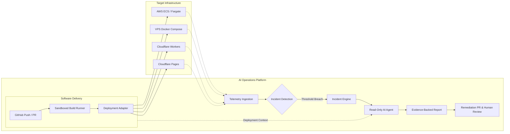

# OpsPilot

> **Deploy confidently. Understand failures faster. Resolve incidents with less manual investigation.**

OpsPilot is an open-source, deployment-aware AI operations platform designed specifically for small software engineering teams (2–20 engineers). It connects the software delivery lifecycle with production operations, marrying deployment history with runtime telemetry to detect incidents, investigate root causes using controlled AI agents, and propose human-approved remediation pull requests.

---

## ⭐️ Project Foundation & Engineering Blueprint

OpsPilot is currently in the **Foundation & Specification Phase**. Before core application and feature implementation begins, the engineering foundation, cryptographic security, monorepo architecture, and quality governance have been established:

- [**Project Architecture Final Review**](docs/PROJECT_ARCHITECTURE_FINAL_REVIEW.md) — Authoritative final review report establishing architecture corrections, runner security, cryptographic standards, and approval readiness.
- [**Project Foundation Blueprint Reconciliation Report**](docs/PROJECT_FOUNDATION_RECONCILIATION.md) — Master reconciliation report resolving repository evidence, final package ownership, technology matrix, and open questions.
- [**Project Foundation Audit Report**](docs/PROJECT_FOUNDATION_AUDIT.md) — Ground-truth audit of repository state and formal verification of the 10 adversarial audit findings (`SEC-01` through `UI-01`).
- [**Project Foundation Architectural Decisions**](docs/PROJECT_FOUNDATION_DECISIONS.md) — Canonical decisions on package boundaries, NIST SP 800-57 envelope encryption, and Apache-2.0 licensing.
- [**Project Foundation Remediation Plan**](docs/PROJECT_FOUNDATION_REMEDIATION_PLAN.md) — Dependency-ordered sequencing of the 10 pre-implementation blockers into governance tiers.
- [**Canonical Repository Structure**](docs/REPOSITORY_STRUCTURE.md) — Package responsibility matrix, dependency boundaries, inclusions, and exclusions.
- [**Phased Implementation Roadmap**](docs/PROJECT_IMPLEMENTATION_ROADMAP.md) — Granular 8-phase execution roadmap (Phases 0–7) with scope, atomic commits, and exit criteria.

---

## The Problem

Small engineering teams rarely have dedicated platform engineers or 24/7 SRE staff. When production incidents occur, engineers scramble across a fragmented landscape:
- Checking recent GitHub commits and merged PRs.
- Inspecting AWS CloudWatch logs, Cloudflare dashboards, or logging into VPS instances via SSH.
- Correlating elevated 500 error rates with Docker container status and resource spikes.
- Guessing which configuration change or dependency update introduced the regression.

This fragmented troubleshooting wastes critical engineering hours, increases Mean Time to Resolution (MTTR), and leads to high-stress debugging sessions.

## The OpsPilot Solution

OpsPilot bridges the gap between deployments and operations into a single cohesive control plane:

---

## Supported Deployment Targets

OpsPilot supports multi-cloud and serverless deployment targets through decoupled provider adapters:

1. **AWS ECS / Fargate:** Serverless container orchestration for scalable production workloads.
2. **VPS Docker Compose:** Simple, cost-effective container deployments for single-node instances via SSH.
3. **Cloudflare Workers:** Global serverless edge compute with zero-cold-start execution.
4. **Cloudflare Pages:** Static and full-stack web applications deployed to Cloudflare's global edge network.

---

## Architectural Principles

1. **Strict Multi-Tenant Isolation:** Every database entity, query, cache entry, job payload, and API call is scoped to an `organization_id`.
2. **NIST SP 800-57 Envelope Encryption:** All infrastructure credentials are encrypted with unique per-record 256-bit DEKs wrapped by a Master KEK, using AES-256-GCM authenticated encryption with tenant context as AAD.
3. **Control Plane vs. Execution Plane:** Strict isolation firewall separating high-trust management (database, secrets, API) from zero-trust execution (sandboxed build runners and task workers).
4. **Zero Trust for LLMs:** The AI agent is strictly read-only during investigation. All remediation actions require human approval on generated pull requests.
5. **PostgreSQL as Durable Authority:** Redis and in-memory state are used strictly for queues and transient caching. PostgreSQL is the durable authority for all business logic and deployment state.

---

## Documentation Quick Links

Explore the authoritative documentation suite in [`docs/`](docs/):

- **[Project Foundation & Blueprint](docs/README.md)**
  - [Foundation Audit](docs/PROJECT_FOUNDATION_AUDIT.md)
  - [Foundation Decisions](docs/PROJECT_FOUNDATION_DECISIONS.md)
  - [Foundation Remediation Plan](docs/PROJECT_FOUNDATION_REMEDIATION_PLAN.md)
  - [Repository Structure](docs/REPOSITORY_STRUCTURE.md)
  - [Implementation Roadmap](docs/PROJECT_IMPLEMENTATION_ROADMAP.md)
- **[System Architecture](docs/architecture/)**
  - [System Architecture Blueprint](docs/architecture/SYSTEM_ARCHITECTURE.md)
  - [Architectural Project Boundaries](docs/architecture/PROJECT_BOUNDARIES.md)
  - [Control Plane vs. Execution Plane](docs/architecture/CONTROL_PLANE_AND_EXECUTION_PLANE.md)
  - [Module Boundaries & Domain Interfaces](docs/architecture/MODULE_BOUNDARIES.md)
  - [Security Architecture](docs/architecture/SECURITY_ARCHITECTURE.md)
  - [Architecture Decision Records (ADRs)](docs/decisions/README.md)
- **[Engineering & Standards](docs/engineering/)**
  - [Engineering Standards](docs/engineering/ENGINEERING_STANDARDS.md)
  - [Coding Conventions & TypeScript Guide](docs/engineering/CODING_CONVENTIONS.md)
  - [Git & Commit Conventions](docs/engineering/GIT_AND_COMMIT_CONVENTIONS.md)
  - [Testing Standards](docs/engineering/TESTING_STANDARDS.md)
  - [CI/CD Standards](docs/engineering/CI_CD_STANDARDS.md)
  - [Documentation Standards](docs/engineering/DOCUMENTATION_STANDARDS.md)
- **[Development & Testing](docs/development/)**
  - [Local Development Guide](docs/development/LOCAL_DEVELOPMENT.md)
  - [Environment Configuration Catalog](docs/development/ENVIRONMENT_CONFIGURATION.md)
  - [Test Strategy & Test Architecture](docs/testing/TEST_STRATEGY.md)
  - [Release Process](docs/releases/RELEASE_PROCESS.md)

---

## Community & Governance

- [Contributing Guide](CONTRIBUTING.md) — Developer setup, workflow, and pull request guidelines.
- [Code of Conduct](CODE_OF_CONDUCT.md) — Contributor Covenant Code of Conduct.
- [Security Policy](SECURITY.md) — Vulnerability reporting and confidential disclosure procedures.
- [Project Governance](GOVERNANCE.md) — Decision-making framework and maintainership model.
- [Support & Community](SUPPORT.md) — Discussion forums, issue tracking, and getting help.

---

## License

OpsPilot is open-source software licensed under the **Apache License 2.0 (`Apache-2.0`)**. See [LICENSE](LICENSE) and [ADR-0013: Open-Source License Selection](docs/decisions/ADR-0013-open-source-license-selection.md).
