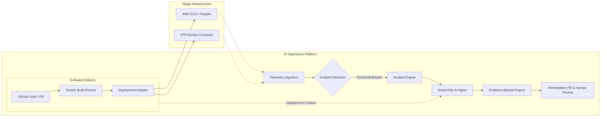
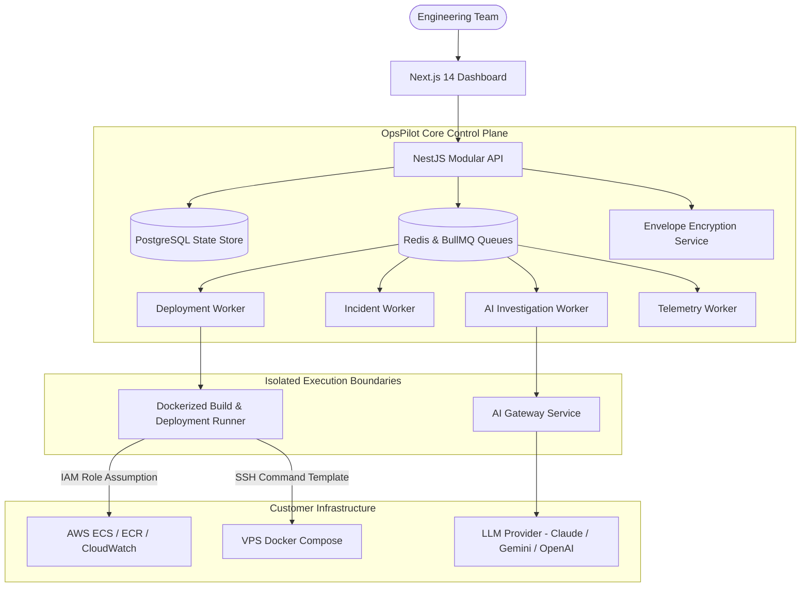

# OpsPilot

[](https://github.com/anwar/OpsPilot/actions)
[](docs/decisions/ADR-0013-open-source-license-selection.md)
[](docs/product/PRODUCT_OVERVIEW.md)
[](https://www.typescriptlang.org/)
[](https://nodejs.org/)

> **Deploy confidently. Understand failures faster. Resolve incidents with less manual investigation.**

OpsPilot is an open-source, deployment-aware AI operations platform designed specifically for small software engineering teams (2–20 engineers). It connects the software delivery lifecycle with production operations, marrying deployment history with runtime telemetry to detect incidents, investigate root causes using controlled AI agents, and propose human-approved remediation pull requests.

---

## The Problem

Small engineering teams rarely have dedicated platform engineers or 24/7 SRE staff. When production incidents occur, engineers scramble across a fragmented landscape:
- Checking recent GitHub commits and merged PRs.
- Inspecting AWS CloudWatch logs or logging into VPS instances via SSH.
- Correlating elevated 500 error rates with Docker container status and resource spikes.
- Guessing which configuration change or dependency update introduced the regression.

This fragmented troubleshooting wastes critical engineering hours, increases Mean Time to Resolution (MTTR), and leads to high-stress debugging sessions.

## The OpsPilot Solution

OpsPilot bridges the gap between deployments and operations into a single cohesive control plane:



---

## Key Capabilities

- **Unified Multi-Target Deployments:** Deploy containerized applications seamlessly to **AWS ECS/Fargate** or standard **Ubuntu VPS** instances running Docker Compose using a common deployment contract.
- **Deployment-Aware Observability:** Automatically correlates deployment lifecycles, commit metadata, and environment updates with container metrics, application logs, and HTTP health check status.
- **Automated Incident Detection:** Instant threshold and anomaly evaluation for failing health checks, crash-looping containers, memory exhaustion, and 5xx error spikes.
- **Read-Only AI Investigation Agent:** Leverages a provider-independent AI gateway to correlate logs, metrics, commits, and recent deployments. Generates verifiable, evidence-backed hypotheses without hallucinating actions or possessing direct infrastructure write permissions.
- **Safety-First Human Approval:** Autonomous remediation proposals (code diffs and configuration rollbacks) are prepared as Git branches and GitHub Pull Requests for human engineering sign-off.
- **Enterprise-Grade Tenant Isolation:** Built from the ground up for strict multi-tenancy, complete organization boundary enforcement, encrypted credentials at rest (envelope encryption), and immutable audit trails.

---

## System Architecture

OpsPilot is designed as a **Modular Monolith** paired with isolated background workers and dedicated build/deployment execution runners. This delivers high developer velocity and lower operational overhead while ensuring untrusted build execution never compromises the core control plane.



---

## Technology Stack

| Layer | Component | Selection & Rationale |
|---|---|---|
| **Frontend** | Web UI Dashboard | [Next.js](https://nextjs.org/) (App Router), TypeScript, Tailwind CSS, Shadcn UI |
| **Backend API** | Control Plane API | [NestJS](https://nestjs.org/), Node.js 20 LTS, TypeScript, Fastify adapter |
| **Primary Database** | Relational Store | [PostgreSQL 16](https://www.postgresql.org/) (Durable authority for all business entities) |
| **Queue & Caching** | Transient State & Jobs | [Redis 7](https://redis.io/) + [BullMQ](https://docs.bullmq.io/) (Asynchronous orchestrator) |
| **ORM / Migration** | Database Access | [Prisma](https://www.prisma.io/) or [Kysely](https://kysely.dev/) (Type-safe migrations & queries) |
| **Telemetry** | Observability Standard | [OpenTelemetry](https://opentelemetry.io/) Collector & standardized OTLP ingestion |
| **Deployment Targets** | Cloud & VPS | AWS ECS (Fargate) + ECR; Ubuntu VPS (Docker Engine + Docker Compose) |
| **AI Integration** | Investigation Engine | Custom Provider-Independent AI Gateway (Gemini 1.5/2.0, Claude 3.5, GPT-4o) |
| **IaC** | Self-Hosted Infra | [Terraform](https://www.terraform.io/) modules for AWS deployment |

---

## Current Project Status

> [!IMPORTANT]
> **Status: Specification & Architectural Foundation (Pre-Alpha / Sprint 0)**  
> The repository currently hosts the comprehensive architectural specifications, technical requirements, ADRs, database schemas, and API contracts. Application implementation begins in Phase 1 according to the [Implementation Plan](docs/engineering/IMPLEMENTATION_PLAN.md).

- [x] Complete Product Requirements Document (PRD) & Architecture
- [x] Database Schema Design & ER Specifications
- [x] REST API & Domain Event Contracts
- [x] Background Job & Queue Specifications
- [x] Threat Model & Multi-Tenant Security Design
- [x] AI Investigation Agent Tool Protocol & Incident Simulator Design
- [ ] Phase 1: Modular Monolith Foundation & Auth Core *(Planned)*
- [ ] Phase 2: Deployment Engine (AWS ECS & VPS Docker) *(Planned)*
- [ ] Phase 3: Observability & Incident Detection Engine *(Planned)*
- [ ] Phase 4: AI Incident Investigation Agent *(Planned)*

---

## Quick Start (Local Development)

### Prerequisites
- **Node.js**: `>= 20.0.0`
- **npm**: `>= 10.0.0`
- **Docker & Docker Compose**: `>= 24.0.0`
- **Git**

### 1. Clone the repository
```bash
git clone https://github.com/anwar/OpsPilot.git
cd OpsPilot
```

### 2. Configure Environment
```bash
cp .env.example .env
```

### 3. Spin up local backing services
```bash
docker compose -f docker/docker-compose.dev.yml up -d
```
*(Starts PostgreSQL 16 on port 5432 and Redis 7 on port 6379)*

### 4. Install dependencies
```bash
npm install
```

For full setup guides and configuration options, see the [Development Setup Guide](docs/engineering/DEVELOPMENT_SETUP.md).

---

## Documentation Directory

Explore the complete system documentation:

- **[Product Documentation](docs/product/)**
  - [Product Overview](docs/product/PRODUCT_OVERVIEW.md)
  - [Product Requirements Document (PRD)](docs/product/PRODUCT_REQUIREMENTS.md)
  - [User Personas & Scenarios](docs/product/USER_PERSONAS.md)
  - [End-to-End User Flows](docs/product/USER_FLOWS.md)
  - [MVP Scope & Boundaries](docs/product/MVP_SCOPE.md)
  - [Glossary of Terms](docs/product/GLOSSARY.md)
- **[System Architecture](docs/architecture/)**
  - [System Architecture Blueprint](docs/architecture/SYSTEM_ARCHITECTURE.md)
  - [Module Boundaries & Domain Interfaces](docs/architecture/MODULE_BOUNDARIES.md)
  - [End-to-End Data Flow](docs/architecture/DATA_FLOW.md)
  - [Unified Deployment Architecture](docs/architecture/DEPLOYMENT_ARCHITECTURE.md)
  - [Observability Architecture](docs/architecture/OBSERVABILITY_ARCHITECTURE.md)
  - [Incident Lifecycle & Correlation Engine](docs/architecture/INCIDENT_ARCHITECTURE.md)
  - [AI Agent Architecture & Tool Protocol](docs/architecture/AI_AGENT_ARCHITECTURE.md)
  - [Security Architecture & Trust Boundaries](docs/architecture/SECURITY_ARCHITECTURE.md)
  - [Architecture Decision Records (ADRs)](docs/decisions/)
- **[Engineering & API Specifications](docs/engineering/)**
  - [Database Design & Schema](docs/engineering/DATABASE_DESIGN.md)
  - [REST API Specification](docs/engineering/API_SPECIFICATION.md)
  - [Background Job & Queue Specification](docs/engineering/BACKGROUND_JOB_SPECIFICATION.md)
  - [Domain Event Contracts](docs/engineering/EVENT_CONTRACTS.md)
  - [Multi-Tenancy & Authorization Model](docs/engineering/MULTI_TENANCY.md)
  - [Testing Strategy & Test Pyramid](docs/engineering/TESTING_STRATEGY.md)
  - [Engineering Implementation Plan](docs/engineering/IMPLEMENTATION_PLAN.md)
- **[AI & Incident Simulation](docs/ai/)**
  - [AI Gateway Architecture](docs/ai/AI_GATEWAY.md)
  - [Tool Specifications & Permissions](docs/ai/TOOL_SPECIFICATIONS.md)
  - [Incident Investigation Walkthrough](docs/ai/INCIDENT_INVESTIGATION.md)
  - [Incident Simulator (15 Scenarios)](docs/ai/INCIDENT_SIMULATOR.md)
  - [AI Agent Evaluation Framework](docs/ai/AI_EVALUATION.md)
- **[Security & Operations](docs/security/)**
  - [System Threat Model (STRIDE)](docs/security/THREAT_MODEL.md)
  - [Credential Management & Envelope Encryption](docs/security/CREDENTIAL_MANAGEMENT.md)
  - [Deployment Runner Security](docs/security/DEPLOYMENT_RUNNER_SECURITY.md)
  - [AI Agent Security & Prompt Injection Defenses](docs/security/AI_AGENT_SECURITY.md)

---

## Contributing

We welcome community contributions, architectural discussions, and feedback! Please review our:
- [Contributor Guide](CONTRIBUTING.md)
- [Code of Conduct](CODE_OF_CONDUCT.md)
- [AI Coding Agent Guidelines](AGENTS.md)

---

## Security Vulnerability Reporting

If you believe you have discovered a security vulnerability in OpsPilot, please refer to our [Security Policy](SECURITY.md) for confidential disclosure instructions. **Do not create public GitHub issues for security vulnerabilities.**

---

## License

The open-source license for OpsPilot is currently undergoing community and owner review. See [ADR-0013: Open-Source License Selection](docs/decisions/ADR-0013-open-source-license-selection.md) for comparative analysis between MIT, Apache-2.0, and AGPL-3.0.
