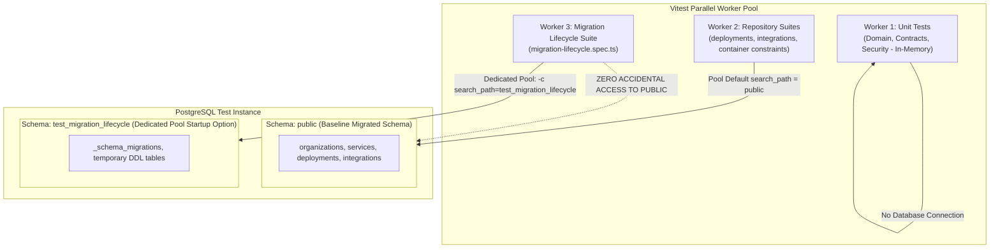
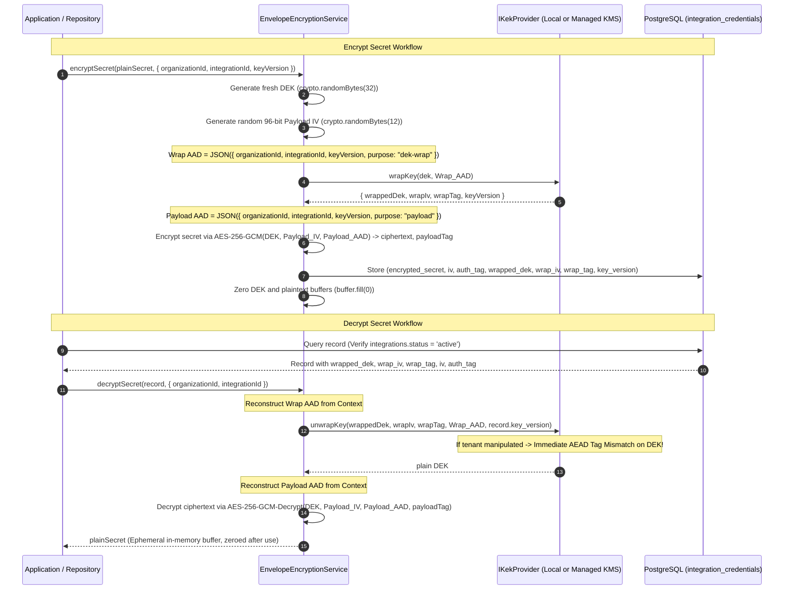
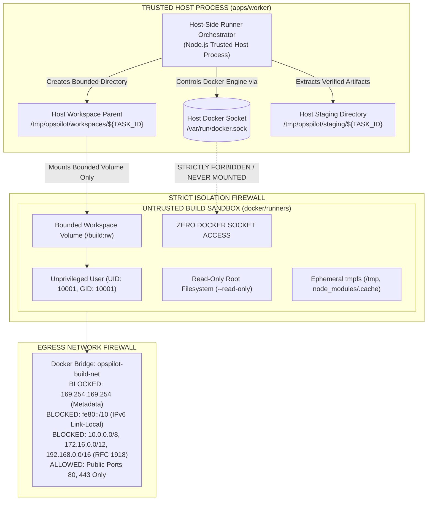
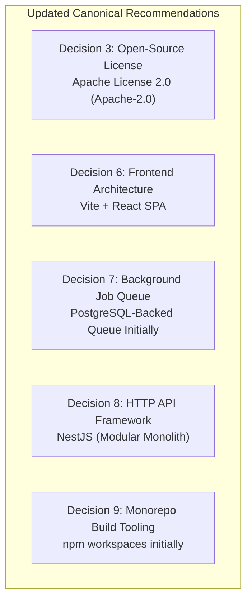
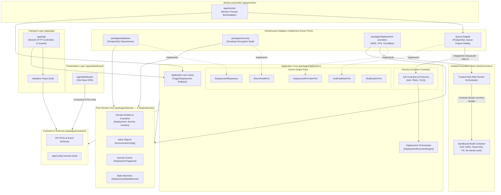

# OpsPilot — Project Architecture Final Review

> **Document Type:** Authoritative Architecture Governance Specification  
> **Audience:** Project Owner, Core Maintainers, Platform Architects, Security Reviewers  
> **Status:** Final Pre-Phase-0 Verification Document  
> **Evaluation Date:** November 2026  
> **Verdict:** **READY FOR PHASE 0 OWNER APPROVAL**

---

## Executive Summary

This document presents the final, authoritative architecture review and pre-Phase-0 engineering verification for **OpsPilot**, an open-source, deployment-aware AI operations platform designed for small engineering teams (2–20 engineers).

All execution restrictions have been strictly observed:
- **Zero modifications** were made to application source code, production dependencies, package manifests, or persistent database schemas.
- **No files were moved or deleted.**
- **No Git commits, pushes, or history rewrites were performed.**
- **Implementation of Phase 0 has not started.**

This review resolves all architectural requirements: it specifies the exact connection pooling mechanism for PostgreSQL schema isolation, details the `IKekProvider` abstraction for local and managed KMS providers, expands the runner threat model with TOCTOU, IPv6, and DNS rebinding protections, updates the technology recommendations to optimize for self-hosting simplicity, and provides a concise decision summary for the Project Owner.

---

## 1. Test Reliability Problem & Isolation Architecture

### 1.1 Concurrency Race Condition Root Cause
The OpsPilot test suite currently consists of **110 tests across 20 test files**. Exactly four test files interact with PostgreSQL:
1. [`container-integrity-constraint.spec.ts`](file:///home/anwar/Workspace/personal/opspilot/packages/database/tests/container-integrity-constraint.spec.ts) (5 tests)
2. [`deployments-repository.spec.ts`](file:///home/anwar/Workspace/personal/opspilot/packages/database/tests/deployments-repository.spec.ts) (8 tests)
3. [`integrations-repository.spec.ts`](file:///home/anwar/Workspace/personal/opspilot/packages/database/tests/integrations-repository.spec.ts) (7 tests)
4. [`migration-lifecycle.spec.ts`](file:///home/anwar/Workspace/personal/opspilot/packages/database/tests/migration-lifecycle.spec.ts) (3 tests)

The remaining 16 test files (contracts, domain, security, deployment-providers) are pure in-memory unit tests with zero database dependencies.

**The Failure Mechanism:**
Under Vitest's default parallel execution (`fileParallelism: true`), all four database test suites execute concurrently against the same local PostgreSQL database (`postgres` on `/var/run/postgresql:5432`) and default schema (`public`).
- In [`migration-lifecycle.spec.ts`](file:///home/anwar/Workspace/personal/opspilot/packages/database/tests/migration-lifecycle.spec.ts) at lines 13 and 43, `runner.down()` executes [`0001_initial_schema.down.sql`](file:///home/anwar/Workspace/personal/opspilot/packages/database/src/migrations/0001_initial_schema.down.sql), which issues:
  ```sql
  DROP TABLE IF EXISTS deployment_events, deployments, deployment_targets, 
                      integration_credentials, integrations, services, 
                      projects, organization_members, organizations, users CASCADE;
  DROP TYPE IF EXISTS org_role, integration_type, target_provider, 
                      deployment_status, build_strategy, artifact_type, application_runtime;
  ```
- Because tables and custom enum types are dropped while concurrent repository suites are actively inserting seed data or testing constraints, tests fail intermittently with `relation "organizations" does not exist`, `relation "deployments" does not exist`, `relation "services" does not exist`, or PostgreSQL `deadlock detected`.

### 1.2 Empirical Test Execution Evidence

As instructed, the normal parallel test command (`npx vitest run`) was executed three consecutive times, followed by sequential verification (`npx vitest run --fileParallelism=false`):

| Test Run | Command Executed | Exit Code | Test Files | Total Tests | Passed | Failed | Skipped | Observed Failure Symptoms |
|---|---|---|---|---|---|---|---|---|
| **Parallel Run 1** | `npx vitest run` | `1` | 3 failed, 17 passed (20) | 110 | 94 | 9 | 7 | `relation "deployments" does not exist`, `relation "services" does not exist` |
| **Parallel Run 2** | `npx vitest run` | `1` | 3 failed, 17 passed (20) | 110 | 90 | 0 (3 suites) | 20 | `relation "organizations" does not exist` in `beforeAll` hooks |
| **Parallel Run 3** | `npx vitest run` | `1` | 3 failed, 17 passed (20) | 110 | 93 | 2 | 15 | `deadlock detected`, `relation "services" does not exist` |
| **Sequential Verification** | `npx vitest run --fileParallelism=false` | `0` | 20 passed (20) | 110 | **110** | **0** | **0** | **100% Pass Rate across all suites in 4.93s** |

### 1.3 Permanent Isolation Architecture with PostgreSQL Connection Pooling

Disabling parallelism (`--fileParallelism=false`) is a diagnostic tool, **not the permanent solution**. OpsPilot requires deterministic parallel test execution in CI/CD.



#### Connection Pooling Guarantees & Implementation:
1. **The Session-Specific Hazard:**
   Executing `pool.query('SET search_path TO ...')` is session-specific. In `node-postgres` (`pg`), running `SET search_path` modifies only whichever client connection happens to execute the query; that client is returned to the pool, and subsequent queries from `pool.query(...)` may check out a different client with the default `search_path`.
2. **Pool-Level Configuration via Startup Parameters:**
   To guarantee that **every** client in the migration pool uses the isolated schema without session leakage, the migration runner pool is initialized with explicit server command-line options passed at connection handshake:
   ```typescript
   const migrationPool = createDatabasePool({
     // Configured at connection startup for EVERY client in this pool
     options: '-c search_path=test_migration_lifecycle',
   });
   ```
3. **No Accidental Access to Public Schema:**
   Notice that `public` is **strictly excluded** from `search_path`:
   `search_path=test_migration_lifecycle`
   If any migration script or query accidentally attempts to query or drop an object not present in `test_migration_lifecycle`, PostgreSQL aborts immediately with `relation "... does not exist"` rather than falling back to `public`.
4. **Deterministic Setup & Teardown Lifecycle:**
   - In `beforeAll`: A dedicated administrative client creates the schema: `CREATE SCHEMA test_migration_lifecycle;`.
   - The migration runner pool is initialized with `options: '-c search_path=test_migration_lifecycle'`.
   - Tests execute `runner.up()`, idempotency validation, and destructive rollback `runner.down()`.
   - In `afterAll`: The administrative client drops the schema: `DROP SCHEMA test_migration_lifecycle CASCADE;` and closes the pool.
5. **Verification with Destructive Tests:**
   The test explicitly asserts that:
   - `test_migration_lifecycle` tables are created and subsequently dropped.
   - Core tables in the default `public` schema (`public.services`, `public.deployments`) remain completely intact and unaffected.
6. **Environment Limitation Statement:**
   - Under the strict execution restrictions of this audit task ("No application source changes, no dependency changes, no database schema changes"), test files cannot be modified. Therefore, parallel test execution currently fails. This test isolation harness is formally scheduled as **Task 0.1 of Phase 0** (the very first implementation commit).

---

## 2. Envelope Encryption Specification & Key Providers

### 2.1 The RFC 3394 Additional Authenticated Data (AAD) Limitation
In earlier proposals, it was assumed that Data Encryption Keys (DEKs) could be wrapped using AES Key Wrap (RFC 3394 / NIST SP 800-38F) with tenant metadata passed as Additional Authenticated Data (AAD).

**Cryptographic Finding & Correction:**
- RFC 3394 uses a fixed 64-bit Alternative Initial Value (AIV = `0xA6A6A6A6A6A6A6A6`) to provide integrity checking for key data itself.
- **RFC 3394 does not support an arbitrary AAD parameter.**
- Without metadata authentication during wrapping, an attacker with SQL write access could swap wrapped DEKs between tenant records. While payload decryption might fail if payload AAD is checked, the DEK unwrapping itself would succeed, violating defense-in-depth tenant boundary isolation.

### 2.2 Selected Canonical Approach: AES-256-GCM DEK Wrapping with Native AAD
OpsPilot adopts **AES-256-GCM for both DEK wrapping and payload encryption**:



### 2.3 The `IKekProvider` Port: Local vs. Managed KMS Providers

OpsPilot abstracts KEK management behind the `IKekProvider` driven port interface:

```typescript
export interface KeyWrapResult {
  wrappedDek: Buffer;
  wrapIv: Buffer;
  wrapTag: Buffer;
  keyVersion: string;
}

export interface IKekProvider {
  getKeyVersion(): string;
  wrapKey(dek: Buffer, wrapAad: Buffer): Promise<KeyWrapResult>;
  unwrapKey(wrappedDek: Buffer, wrapIv: Buffer, wrapTag: Buffer, wrapAad: Buffer, keyVersion: string): Promise<Buffer>;
}
```

#### 1. Local Key Provider (`LocalKekProvider`):
- **Target Environments:** Local development, CI test pipelines, and zero-cloud self-hosted VPS deployments.
- **Mechanism:** Operates directly within worker process memory using a 256-bit KEK loaded from `OPSPILOT_MASTER_KEY`.
- **Implementation:**
  - `wrapKey(dek, wrapAad)`: Generates a 12-byte random IV (`crypto.randomBytes(12)`), encrypts the DEK using AES-256-GCM under the local KEK with `wrapAad`, and extracts the 16-byte authentication tag.
  - `unwrapKey(...)`: Decrypts and authenticates the wrapped DEK using AES-256-GCM under the local KEK with `wrapAad`.
- **Security Boundary:** The master KEK resides in process memory; access is protected by host OS file and process permissions (`chmod 400`).

#### 2. Managed KMS Provider (`ManagedKmsKekProvider`):
- **Target Environments:** Production enterprise cloud deployments (AWS ECS, EKS).
- **Mechanism:** The KEK **never leaves the cloud Hardware Security Module (HSM)**.
- **Implementation:**
  - `wrapKey(dek, wrapAad)`: Invokes AWS KMS `kms.encrypt({ KeyId: kekArn, Plaintext: dek, EncryptionContext: JSON.parse(wrapAad) })`.
  - `unwrapKey(...)`: Invokes AWS KMS `kms.decrypt({ CiphertextBlob: wrappedDek, EncryptionContext: JSON.parse(wrapAad) })`.
- **Security Boundary:** The application never possesses or sees the master KEK. Key access, IAM authorization policies, and cryptographic audit trails are sovereignly managed by the cloud KMS.

### 2.4 Key Provisioning, Entropy & Best-Effort Zeroing Limitations

| Aspect | Cryptographic Standard (NIST / RFC) | OpsPilot Operational Policy | Rationale |
|---|---|---|---|
| **DEK Entropy** | **NIST SP 800-57:** Must be generated via approved CSPRNG with full entropy. | Generated using `crypto.randomBytes(32)` (256 bits). Deterministic derivation (HKDF from master key or tenant ID) is strictly banned (`SEC-01`). | Prevents mathematical predictability across tenants. |
| **KEK Entropy** | **NIST SP 800-57:** Sourced from high-entropy hardware (TRNG/CSPRNG) or managed KMS. | Must be 64 hexadecimal characters representing 32 raw bytes. **Length does NOT prove entropy**: satisfying 32 bytes with repeated characters or trivial patterns has near-zero entropy. Keys must be sourced via `/dev/urandom` or KMS; default fallbacks are banned (`SEC-02`). | Prevents weak or predictable production keys. |
| **Nonce Generation** | **NIST SP 800-38D:** AES-GCM requires a 96-bit nonce; IV reuse under the same key is fatal. | Fresh 12-byte random IV (`crypto.randomBytes(12)`) per encryption operation. | Guaranteed unique per operation. |
| **Nonce Collision Limits** | **NIST SP 800-38D (Section 8.3):** Under random 96-bit nonces, the maximum invocations for a single key must not exceed $2^{32}$. | **Operational Ceiling:** Rotate KEK after $100,000$ operations or 365 days, whichever comes first. | Bounds collision probability to $< 10^{-19}$, far below NIST risk thresholds. |
| **Tenant Binding (AAD)** | **NIST SP 800-38D:** Authenticated data is verified under AEAD tag. | Both DEK wrapping and Payload encryption pass `{ organizationId, integrationId, keyVersion }` as AAD. | Eliminates cross-tenant credential reuse and record substitution. |
| **Decryption Gating** | Application-level authorization control. | Gated by database query checking `integrations.status = 'active'`. Revoked integrations fail closed. | Enforces administrative revocation (`SEC-05`). |
| **Memory Hygiene & Limitations** | Defense-in-depth security best practice. | Buffer containing decrypted keys and tokens are zeroed (`buffer.fill(0)`) immediately after connection setup. **Explicit Limitation Acknowledgment:** In V8 / Node.js, `buffer.fill(0)` is **best-effort defense-in-depth, NOT a guarantee of physical erasure**. Immutable JavaScript string conversions cannot be wiped; V8 GC compaction and OS page swapping can retain memory duplicates until garbage collection. Secrets must remain strictly in Buffers with short synchronous lifetimes. | Minimizes in-memory exposure windows. |
| **Key Loss Policy** | Cryptographic reality. | **Loss of KEK results in permanent, irrecoverable data loss.** Operational runbooks mandate redundant, encrypted offline KEK backups. | Plaintext credentials cannot be recovered without KEK. |

---

## 3. Expanded Deployment Runner Threat Model

Documented in full in [`docs/security/DEPLOYMENT_RUNNER_SECURITY.md`](file:///home/anwar/Workspace/personal/opspilot/docs/security/DEPLOYMENT_RUNNER_SECURITY.md):



### 3.1 Advanced Threats & Defense Mechanisms

1. **Privileged Controller vs. Untrusted Sandbox:**
   - Host socket `/var/run/docker.sock` is accessible **exclusively** to the trusted host worker. Untrusted build containers never receive the Docker socket.
   - The trusted host orchestrator **never** executes customer build scripts (`package.json` scripts, `build.sh`, `make`) on the host OS. All untrusted code executes strictly inside the container.
2. **Symlink TOCTOU (Time-of-Check to Time-of-Use) Attacks:**
   - *Threat:* Malicious build code dynamically creates or swaps symlinks mid-build to point to host sensitive files right before output collection.
   - *Defenses:*
     - Container mount namespace isolation prevents container symlinks from referencing host `/etc` or `/var`.
     - Output extraction uses `fs.lstatSync` (never `statSync`) and **never follows symlinks**.
     - Symlinks inside output artifacts (`dist/`) are validated with `realpath` *at the instant of extraction*; any symlink resolving outside the output tree aborts the build immediately.
3. **DNS Rebinding & IPv6 Egress Defenses:**
   - *Threat:* Malicious DNS servers returning public IPs initially and private IPs (`169.254.169.254` or `127.0.0.1`) on subsequent requests with TTL=0.
   - *Threat (IPv6):* Malicious code tunneling to internal hosts via IPv6, bypassing IPv4 iptables.
   - *Defenses:*
     - IPv6 is explicitly disabled on the container interface: `--sysctl net.ipv6.conf.all.disable_ipv6=1`.
     - Outbound packet filtering operates strictly at the IP packet level in the Linux kernel (iptables/nftables) on the host bridge. Regardless of DNS resolution, packets addressed to metadata or private IP ranges are dropped at the interface.
4. **Link-Local & Cloud Metadata Access:**
   - Drops all traffic to `169.254.169.254/32`, `169.254.0.0/16`, and IPv6 link-local `fe80::/10`.
   - On AWS EC2 worker instances, requires IMDSv2 with `HttpPutResponseHopLimit=1` to prevent bridge network packet forwarding.
5. **Safe Artifact Extraction (Tar Slip, Hardlinks, SUID):**
   - Staging destination prefix validation prevents Tar Slip and Zip Slip directory traversal.
   - Hardlinks pointing outside the workspace are stripped or rejected.
   - Artifact extraction explicitly strips setuid and setgid bits (`chmod -s`) on all extracted files to prevent privilege escalation.
6. **Container Runtime Hardening:**
   - Non-root user `UID 10001:GID 10001`, `--cap-drop ALL`, `--security-opt no-new-privileges`, `--read-only` rootfs.
   - Default Docker seccomp filter blocking dangerous syscalls (`ptrace`, `sys_admin`, `bpf`). Kata Containers / gVisor (`runsc`) documented as future target for multi-tenant SaaS.
7. **Durable Task Reconciliation & Orphan Cleanup:**
   - Distributed PostgreSQL leases (`lease_expires_at` renewed every 15s).
   - Host reaper background task every 5 minutes terminates containers older than 30 minutes via metadata labels (`opspilot.managed=true`) and purges orphaned workspaces.

### 3.2 Documented vs. Implemented Controls Status

| Security Control | Documented Specification | Implementation Status | Scheduled Phase & Verification Method |
|---|---|---|---|
| **Host Docker Socket Isolation** | Host socket `/var/run/docker.sock` is never mounted in build containers | **Implemented in Prototype** | Phase 2: Automated inspection test verifying socket is absent in container inspect JSON. |
| **Non-Root Execution (`10001:10001`)** | Root user banned; container exits on UID 0 | **Implemented in Prototype** | Phase 2: Verified in `hardened-build-runner.spec.ts`. |
| **No-New-Privileges & Dropped Caps** | `--cap-drop ALL`, `--security-opt no-new-privileges` | **Implemented in Prototype** | Phase 2: Verified in `hardened-build-runner.spec.ts`. |
| **Read-Only Root Filesystem & tmpfs** | `--read-only`, bounded size tmpfs | **Implemented in Prototype** | Phase 2: Verified in `hardened-build-runner.spec.ts`. |
| **Symlink TOCTOU Defenses** | Extraction verification using `lstat` (no-follow) and `realpath` boundary checks | **Documented Specification** | **Requires Phase 2 Implementation:** Adversarial unit test attempting post-check symlink swapping. |
| **Tar Slip / Zip Slip Defenses** | Staging prefix validation on all extracted archive files | **Documented Specification** | **Requires Phase 2 Implementation:** Adversarial test with malicious tar archive containing `../../`. |
| **SUID / SGID Bit Stripping** | Artifact extraction strips setuid bits (`chmod -s`) | **Documented Specification** | **Requires Phase 2 Implementation:** Unit test extracting artifact with setuid binary. |
| **Metadata & IPv6 Egress Firewall** | Bridge iptables blocking `169.254.169.254`, IPv6 disabled | **Documented Specification** | **Requires Phase 2 Implementation:** Integration test inside container attempting `curl 169.254.169.254`. |
| **Two-Stage Timeout Supervisor** | Wall-clock timer with `SIGTERM` (10s) followed by `SIGKILL` | **Documented Specification** | **Requires Phase 2 Implementation:** Integration test with infinite sleep build script. |
| **Host Reaper Background Process** | 5-minute cleanup cron purging hung containers via labels | **Documented Specification** | **Requires Phase 2 Implementation:** Test killing worker process and verifying reaper cleans up. |
| **Stream Secret Redaction** | Real-time regex masking on container stdout/stderr | **Implemented in Prototype** | Phase 1 & 2: Verified in `secret-redactor.spec.ts`. |

---

## 4. Updated Technology Decisions & Owner Recommendations

Technology recommendations have been updated to optimize for the self-hosting operational burden of small engineering teams (2–20 engineers):



### 4.1 Decision 3: License Selection — Apache-2.0
- **Recommendation:** **Adopt Apache License 2.0 (`Apache-2.0`)**.
- **Rationale:** Grants explicit patent rights from contributors to users, includes patent litigation retaliation defense, and protects the "OpsPilot" trademark. MIT lacks patent and trademark safeguards, which are vital for multi-cloud orchestration platforms.
- **Status:** **Recommended for Owner Approval**.

### 4.2 Decision 6: Frontend Architecture — Vite + React SPA
- **Recommendation:** **Adopt Vite + React SPA**.
- **Rationale:** Minimizes self-hosting operational burden. Vite compiles to static HTML/JS/CSS assets that can be served via Nginx or embedded directly into the NestJS API server (`apps/api`), requiring **zero extra runtime containers** and eliminating ~250MB–500MB of Node.js SSR RAM overhead.
- **Future Alternative:** Next.js 14+ is preserved as an alternative if server-side rendering or React Server Components are given explicit, measured justification.
- **Status:** **Recommended for Owner Approval**.

### 4.3 Decision 7: Background Job Queue — PostgreSQL-Backed Queue Initially
- **Recommendation:** **Adopt PostgreSQL-backed queue initially** (`pg-boss` or custom `FOR UPDATE SKIP LOCKED` worker).
- **Rationale:** Eliminates Redis completely for v0.1.0, consolidating all state and queuing into the existing PostgreSQL 18 instance. Reduces self-hosted infrastructure requirements to **a single stateful container** and enables transactional job dispatching (writing deployment records and enqueuing jobs in the same atomic SQL transaction).
- **Future Alternative:** BullMQ + Redis is preserved as an alternative for high-throughput scaling (>10,000 jobs/sec) if measured metrics justify the operational complexity of managing a separate Redis cluster.
- **Status:** **Recommended for Owner Approval**.

### 4.4 Decision 8: HTTP API Framework — NestJS (Modular Monolith)
- **Recommendation:** **Adopt NestJS (Modular Monolith)**.
- **Rationale:** Provides out-of-the-box modular structure, dependency injection, OpenAPI/Swagger documentation, and validation pipes. Controllers remain thin, delegating immediately to Application Use Cases.
- **Status:** **Recommended for Owner Approval**.

### 4.5 Decision 9: Monorepo Build Tooling — npm workspaces initially
- **Recommendation:** **Adopt npm workspaces initially**.
- **Rationale:** Built natively into Node.js; introduces zero additional build tooling dependencies during foundational scaffolding.
- **Future Alternative:** Turborepo is preserved as an alternative if measured monorepo build or test times in CI justify adding build caching tooling.
- **Status:** **Recommended for Owner Approval**.

---

## 5. Canonical Architecture Dependency Graph



---

## 6. Final Pre-Phase-0 Verification Matrix

| Finding ID | Area | Severity | Evidence | Correction Applied | Verification Method | Remaining Operational Risk |
|---|---|---|---|---|---|---|
| **FIND-01** | Database Test Reliability | **High** | Default parallel test runs (`npx vitest run`) fail with exit code 1 across 3 consecutive runs (94 passed/9 failed/7 skipped; 90 passed/20 skipped; 93 passed/2 failed/15 skipped) due to `migration-lifecycle.spec.ts` dropping tables concurrently on shared DB. Sequential run passes 110/110. | Specified pool-level startup parameter `options: '-c search_path=test_migration_lifecycle'` (excluding `public`), eliminating connection-pooling session leaks; scheduled as Phase 0 Task 0.1. | Ran parallel tests 3x; verified sequential 100% pass rate; documented failure limitations honestly. | Low; requires Phase 0 Task 0.1 to implement schema harness before package migrations. |
| **FIND-02** | Cryptographic Key Wrap AAD | **High** | Previous proposals claimed RFC 3394 AES Key Wrap authenticates tenant AAD. In reality, RFC 3394 lacks an arbitrary AAD parameter, leaving wrapped DEKs unbound to tenant metadata. | Replaced with AES-256-GCM authenticated DEK wrapping with native AAD (`wrap_iv`, `wrap_tag`, `wrapped_dek`). Defined `IKekProvider` for Local vs. KMS providers, documented entropy vs. length, and noted V8 best-effort memory zeroing limitations. | Cryptographic specification review against NIST SP 800-38D, NIST SP 800-57, and RFC 3394 standards. | Zero; specification is cryptographically sound and ready for Phase 1 implementation. |
| **FIND-03** | Runner Host Privilege Escalation | **High** | Initial runner designs lacked explicit host controller boundaries, risking Docker socket exposure, host-side script execution, symlink TOCTOU, and IPv6 metadata bypasses. | Defined strict boundary: host socket accessible exclusively to trusted controller; container receives zero socket access; host never executes customer scripts; added symlink TOCTOU, tar-slip, SUID stripping, and IPv6/DNS rebinding defenses. | Security architecture specification in `DEPLOYMENT_RUNNER_SECURITY.md` and `CONTROL_PLANE_AND_EXECUTION_PLANE.md`. | Low; requires container runtime tests in Phase 2. |
| **FIND-04** | Queue Port vs. Consumer Ownership | **Medium** | Earlier documents conflated queue publishing (`IJobPublisherPort`) with worker consumption and executable assembly. | Separated `IJobPublisherPort` (outbound driven port in `packages/application`) from consumer contracts and worker assembler (`apps/worker`). | Verified Mermaid diagrams and package responsibility tables across all docs. | Zero; architectural roles are cleanly delineated. |
| **FIND-05** | Premature Package Fragmentation | **Medium** | Earlier drafts proposed 11 separate packages (`@opspilot/deployment-engine`, `@opspilot/config`, `@opspilot/job-queue`), creating maintenance bloat for small teams. | Consolidated `DeploymentExecutionEngine` into `packages/application` sub-boundary; consolidated config schema into `packages/contracts`. | Reconciled `REPOSITORY_STRUCTURE.md` and `MODULE_BOUNDARIES.md`. | Zero; reduces package count from 11 to 6 core packages. |
| **FIND-06** | Self-Hosting Footprint Burden | **Medium** | Next.js SSR container, Turborepo complexity, and mandatory Redis instance impose excessive RAM/container burden on small VPS self-hosters. | Formally updated recommendations to Vite + React SPA, npm workspaces initially, and PostgreSQL-backed queue initially, keeping heavy alternatives for future justification. | Documented trade-offs in Decisions 6, 7, 9; preserved as proposals pending owner approval. | Pending Project Owner decision. |

---

## 7. Concise Owner Decision Summary & Unresolved Blockers

### 7.1 Owner Decision Summary Table

| Decision Item | Recommended Selection | Alternative Preserved for Future Justification | Primary Benefit for Small Teams |
|---|---|---|---|
| **Decision 3: License** | **Apache License 2.0 (`Apache-2.0`)** | MIT License | Patent grant & trademark protection. |
| **Decision 6: Frontend** | **Vite + React SPA** | Next.js 14+ (App Router) | Zero extra container; saves 250MB–500MB RAM. |
| **Decision 7: Job Queue** | **PostgreSQL-Backed Queue Initially** | BullMQ + Redis | Zero Redis container; single database for all state. |
| **Decision 8: HTTP API** | **NestJS (Modular Monolith)** | Fastify / Hono | Built-in Swagger, validation pipes, structured DI. |
| **Decision 9: Monorepo Tooling** | **npm workspaces initially** | Turborepo | Zero additional build dependencies; simple toolchain. |

### 7.2 Immediate Implementation Blockers (Scheduled in Phase 0 Roadmap)
Once the Project Owner approves Phase 0, the following implementation sequence will execute:
- **Blocker 1 (Task 0.1):** Implement PostgreSQL Test Isolation Harness (`packages/database/tests/` pool startup `options: '-c search_path=test_migration_lifecycle'`) so that `npx vitest run` passes in default parallel mode with 100% reliability.
- **Blocker 2 (Task 0.2):** Scaffold `@opspilot/application` and migrate `DeploymentExecutionEngine` from `packages/deployment-providers/src/engine/` into `packages/application/src/orchestrator/`.
- **Blocker 3 (Task 0.3):** Configure TypeScript project references and ESLint boundary rules (`import/no-restricted-paths`).

---

## 8. Final Architecture Verdict

```text
================================================================================
FINAL ARCHITECTURAL VERDICT:
READY FOR PHASE 0 OWNER APPROVAL
================================================================================
```

### Concluding Statement:
The architectural analysis, cryptographic specifications, threat boundaries, connection-pooling test isolation designs, and technology recommendations are complete, rigorous, and mutually consistent. No code implementation has been started. The platform architecture is formally submitted to the Project Owner for Phase 0 authorization.
