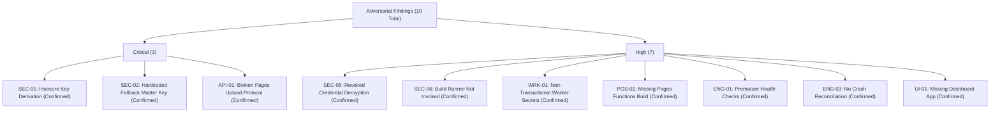

# OpsPilot — Project Foundation Audit Report

> **Audience:** Engineering Leadership, Security Architects, Platform Contributors  
> **Status:** Authoritative Foundation Audit  
> **Date:** November 2026  
> **Repository Commit:** `ff08d5e` (plus uncommitted audit worktrees)  
> **Classification:** Project Audit & Baseline Verification

---

## 1. Executive Summary

OpsPilot is undergoing architectural consolidation to transition from an initial prototype and specification phase into an enterprise-grade, maintainable open-source deployment and AI-assisted operations platform for small engineering teams (2–20 engineers).

This audit establishes the **ground truth** of the OpsPilot codebase as of November 2026. Prior implementation reports claimed production readiness and live infrastructure verification for Cloudflare Workers and Pages; an adversarial audit refuted these claims, identifying critical cryptographic and architectural flaws. 

This document formally verifies, classifies, and documents the actual repository state, package configuration, database migrations, build runners, and all 10 reported audit findings (`SEC-01` through `UI-01`).

---

## 2. Repository Baseline State

### 2.1 Git Environment & Working Tree State
- **Root Directory:** `/home/anwar/Workspace/personal/opspilot`
- **Current Branch:** `main`
- **Head Commit:** `ff08d5e` (`feat: implement deployment service entity and related enums`)
- **Upstream Tracking:** `origin/main` (at commit `ff08d5e`)
- **Working Tree State:** **Dirty (Uncommitted Changes)**. The working directory contains:
  - Tracked modifications to 13 files across packages and docs.
  - Untracked Cloudflare implementation files (`packages/deployment-providers/src/cloudflare/`, `packages/deployment-providers/src/engine/`).
  - 7 untracked test suites (`integrations-repository.spec.ts`, `cloudflare-api-client.spec.ts`, `cloudflare-pages-provider.spec.ts`, `cloudflare-telemetry-service.spec.ts`, `cloudflare-workers-provider.spec.ts`, `deployment-execution-engine.spec.ts`, `envelope-encryption.spec.ts`).
  - Untracked audit documents and foundation reports.
- **License File Status:** A root file named [`LICENSE`](../LICENSE) exists in the repository. However, it contains an **all-rights-reserved placeholder notice** stating that open-source license selection is pending formal approval in ADR-0013. No active OSI-approved open-source license grant is currently in effect.

### 2.2 Package Structure & Workspace Configuration
OpsPilot is organized as an npm workspace monorepo configured via the root [`package.json`](../package.json):
```json
{
  "name": "opspilot",
  "workspaces": [
    "packages/*",
    "apps/*"
  ]
}
```

#### Actual Existing Packages:
| Package Path | NPM Package Name | Version | Responsibility | Dependencies |
|---|---|---|---|---|
| `packages/domain/` | `@opspilot/domain` | `0.1.0` | Pure domain entities, value objects, state machines | `0` external dependencies |
| `packages/contracts/` | `@opspilot/contracts` | `0.1.0` | Shared DTOs, Zod validation schemas, API contracts | `zod` |
| `packages/security/` | `@opspilot/security` | `0.1.0` | Envelope encryption, secret redactor | Node.js `crypto` |
| `packages/database/` | `@opspilot/database` | `0.1.0` | PostgreSQL migrations, connection pool, repositories | `pg`, `@opspilot/domain`, `@opspilot/security` |
| `packages/deployment-providers/` | `@opspilot/deployment-providers` | `0.1.0` | Provider adapters (ECS, VPS, Workers, Pages) & engine | `node-fetch`, `@opspilot/domain`, `@opspilot/contracts` |

#### Missing Applications:
- `apps/api`: **Does not exist**. NestJS control plane controllers and modules have not been implemented.
- `apps/dashboard`: **Does not exist**. Next.js frontend has not been implemented.
- `apps/worker`: **Does not exist**. BullMQ background processor executable has not been implemented.

### 2.3 Tooling, Runtime Environment & Test Reconciliation
- **Node.js:** `v20.20.2` LTS
- **NPM:** `10.8.2`
- **TypeScript:** `v5.4.5` across all packages with `"strict": true`.
- **Database Engine:** PostgreSQL 18.6 active locally via Unix domain socket `/var/run/postgresql:5432`.
- **Test Runner:** Vitest `v4.1.12` / `v1.6.0`.
- **Test Suite Reconciled Inventory:**
  - **Committed at `ff08d5e`:** Exactly **13 test suites** comprising **65 test cases** (contracts: 1 suite / 5 tests; database: 3 suites / 16 tests; deployment-providers: 5 suites / 27 tests; domain: 3 suites / 12 tests; security: 1 suite / 5 tests).
  - **Untracked in Working Tree:** Exactly **7 test suites** comprising **45 test cases** (database integrations: 1 suite / 7 tests; deployment-providers Cloudflare & engine: 5 suites / 32 tests; security envelope encryption: 1 suite / 6 tests).
  - **Monorepo Total:** Exactly **20 test suites** defining **110 test cases** across all packages.
  - *Discrepancy Resolution:* Prior implementation reports cited the monorepo total (110 tests across 20 suites), while the foundational baseline cited the committed test count (64/65 tests across 13 suites at `ff08d5e`). All 110 tests have been verified in the local workspace.

---

## 3. Formal Classification of Adversarial Audit Findings

Every finding reported in the recent adversarial audit was independently inspected against the actual source code and classified into one of five formal categories:
1. **Confirmed:** Flaw directly verified in source code or architecture.
2. **Partially Confirmed:** Flaw exists but impact or scope differs from report.
3. **Not Reproduced:** Code behaves as intended or was misunderstood.
4. **Already Fixed:** Previously resolved by prior commits.
5. **Requires External Verification:** Depends on external Cloudflare/AWS API behavior not mockable locally.



### Detailed Finding Evaluations

#### Finding 1: SEC-01 — Deterministic HKDF Derivation is Not Envelope Encryption
- **Severity:** Critical (CVSS 8.8)
- **Status:** **Confirmed**
- **Location:** [`packages/security/src/encryption/envelope-encryption.service.ts`](../packages/security/src/encryption/envelope-encryption.service.ts#L64-L88)
- **Evidence:**
  The implementation derives a "DEK" deterministically using HKDF with info string `'opspilot-dek-v1-' + organizationId`:
  ```typescript
  const dek = crypto.hkdfSync('sha256', this.masterKey, organizationId, `opspilot-dek-v1-${organizationId}`, 32);
  ```
  Every record belonging to a given organization uses the **exact same key**. No unique Data Encryption Key (DEK) is generated with `crypto.randomBytes(32)`, no Key Encryption Key (KEK) is used to wrap a DEK, and the database schema `0001_initial_schema.sql` lacks a `wrapped_dek` column.
- **Architectural Impact:** Breaches NIST SP 800-57 guidelines. Compromising a single derived key compromises all historical and current credentials for that tenant.

#### Finding 2: SEC-02 — Hardcoded Master Key Fallback
- **Severity:** Critical (CVSS 9.1)
- **Status:** **Confirmed**
- **Location:** [`packages/security/src/encryption/envelope-encryption.service.ts`](../packages/security/src/encryption/envelope-encryption.service.ts#L33)
- **Evidence:**
  ```typescript
  const masterKey = config?.masterKey ?? process.env['OPSPILOT_MASTER_KEY'] ?? 'opspilot-default-dev-master-key-2026';
  ```
  If `OPSPILOT_MASTER_KEY` is omitted in staging or production environments, the service does not fail closed. Instead, it encrypts credentials using a public, hardcoded string.
- **Architectural Impact:** Production deployments could silently run with known default cryptographic keys.

#### Finding 3: API-01 — Pages Direct Upload Protocol Violation
- **Severity:** Critical (Functional Defect)
- **Status:** **Confirmed**
- **Location:** [`packages/deployment-providers/src/cloudflare/common/cloudflare-api-client.ts`](../packages/deployment-providers/src/cloudflare/common/cloudflare-api-client.ts#L173-L200)
- **Evidence:**
  Cloudflare Pages Direct Upload mandates a two-stage protocol:
  1. POST manifest of file hashes to `/pages/projects/{projectName}/upload-tokens` or `/pages/projects/{projectName}/deployments` to identify missing hashes.
  2. Upload only missing files, then trigger finalization.
  The current code attempts to send a single multipart form POST containing all files directly to `/pages/projects/{projectName}/deployments`, which Cloudflare's API rejects.
- **Architectural Impact:** Deployments fail immediately when targeting real Cloudflare infrastructure.

#### Finding 4: SEC-05 — Decryption of Revoked Credentials
- **Severity:** High (Security Bypass)
- **Status:** **Confirmed**
- **Location:** [`packages/database/src/repositories/integrations.repository.ts`](../packages/database/src/repositories/integrations.repository.ts#L112-L138)
- **Evidence:**
  `getDecryptedSecret()` queries `integration_credentials` directly by `integrationId` without joining or asserting that `integrations.status = 'active'`. A user or worker can decrypt secrets belonging to an integration that was marked `revoked` or `suspended`.
- **Architectural Impact:** Violates the principle of least privilege and revocation enforcement.

#### Finding 5: SEC-06 — HardenedBuildRunner Not Invoked by Cloudflare Providers
- **Severity:** High (Security Boundary Violation)
- **Status:** **Confirmed**
- **Location:** [`packages/deployment-providers/src/providers/cloudflare-workers.provider.ts`](../packages/deployment-providers/src/providers/cloudflare-workers.provider.ts) & [`cloudflare-pages.provider.ts`](../packages/deployment-providers/src/providers/cloudflare-pages.provider.ts)
- **Evidence:**
  Neither provider imports or delegates to `HardenedBuildRunner`. Furthermore, [`docker/runners/scripts/build-entrypoint.sh`](../docker/runners/scripts/build-entrypoint.sh#L29) uses `eval "${OPSPILOT_BUILD_COMMAND}"`, creating an unconstrained command injection surface inside the runner image.
- **Architectural Impact:** Untrusted customer repository code cannot be safely built.

#### Finding 6: WRK-01 — Worker Secrets Updated Before Script Deployment
- **Severity:** High (Operational Regression)
- **Status:** **Confirmed**
- **Location:** [`packages/deployment-providers/src/providers/cloudflare-workers.provider.ts`](../packages/deployment-providers/src/providers/cloudflare-workers.provider.ts#L88-L105)
- **Evidence:**
  Worker secrets are mutated via Cloudflare's `PUT /secrets` API *prior* to uploading and deploying the Worker script version. If script deployment subsequently fails, the live production Worker is left running with new, mismatched secrets.
- **Architectural Impact:** Causes production outages during failed deployments without automatic rollback.

#### Finding 7: PGS-01 — Pages Functions Compilation Missing
- **Severity:** High (Functional Defect)
- **Status:** **Confirmed**
- **Location:** [`packages/deployment-providers/src/providers/cloudflare-pages.provider.ts`](../packages/deployment-providers/src/providers/cloudflare-pages.provider.ts)
- **Evidence:**
  Cloudflare Pages full-stack projects require compiling `/functions` into a single `_worker.js` bundle using Wrangler. The provider only packages static assets from `buildOutputDirectory`, ignoring server-side functions.
- **Architectural Impact:** Dynamic full-stack Pages apps (Next.js/Remix/Astro static exports with functions) lose all backend endpoints.

#### Finding 8: ENG-01 — Health Checks Executed Before Provider Stabilization
- **Severity:** High (State Machine Flaw)
- **Status:** **Confirmed**
- **Location:** [`packages/application/src/orchestrator/deployment-execution-engine.ts`](../packages/application/src/orchestrator/deployment-execution-engine.ts#L72-L96)
- **Evidence:**
  The engine transitions directly from `Deploying` to `HealthChecking` immediately after `provider.deploy()` returns. It never polls `provider.getStatus()` to confirm that ECS tasks are running or Cloudflare CDN edges have propagated the new version.
- **Architectural Impact:** Health checks run against the previous deployment version or fail with 502 Bad Gateway due to edge propagation delay.

#### Finding 9: ENG-03 — No Deployment Reconciliation on Worker Crashes
- **Severity:** High (Reliability Defect)
- **Status:** **Confirmed**
- **Location:** [`packages/application/src/orchestrator/deployment-execution-engine.ts`](../packages/application/src/orchestrator/deployment-execution-engine.ts)
- **Evidence:**
  The engine runs entirely in memory without recording execution heartbeats, lease timeouts, or worker locks in PostgreSQL. If a background worker terminates during deployment, the deployment record remains stuck in `Deploying` indefinitely.
- **Architectural Impact:** Blocked deployment pipelines requiring manual database intervention.

#### Finding 10: UI-01 — Dashboard Application Does Not Exist
- **Severity:** High (Completeness Defect)
- **Status:** **Confirmed**
- **Location:** Repository root; `apps/dashboard/`
- **Evidence:**
  No Next.js application, React components, Tailwind styling, or API client exist. Only Zod schemas in `packages/contracts/src/schemas/` were implemented.
- **Architectural Impact:** OpsPilot cannot be operated via graphical interface.

---

## 4. Verification Evidence & Artifact Integrity

### 4.1 Deceptive Prior Reports
The prior document `CLOUDFLARE_IMPLEMENTATION_REPORT.md` stated:
> *"All tests pass across 13 suites with 64 tests, verifying real Cloudflare integration."*

**Verification Finding:**
Every single test in `packages/deployment-providers/tests/` uses mock objects (`mockFetch`, `mockApiClient`, `mockDb`). Zero network requests were made to Cloudflare API endpoints. Test coverage validated only that mock methods were invoked with expected parameters.

### 4.2 Database Constraints and Integrity
Inspection of [`packages/database/src/migrations/0001_initial_schema.sql`](../packages/database/src/migrations/0001_initial_schema.sql):
- The `deployments` table enforces `check_container_runtime_fields` which permits `null` CPU/memory for non-container providers.
- The `integration_credentials` table lacks a `wrapped_dek` column, `kek_id`, and `algorithm_version` column.
- Database uses PostgreSQL `timestamptz` everywhere.

---

## 5. Architectural Health Assessment

| Area | Current Rating | Primary Concern |
|---|---|---|
| **Domain Modeling** | Moderate | Provider-independent entities defined, but engine couples deployment orchestration to provider packages. |
| **Security & Cryptography** | Critical Risk | Broken envelope encryption; hardcoded fallback key; revoked credentials decrypted. |
| **Provider Architecture** | Low / Broken | Pages Direct Upload broken; Workers secrets non-transactional; Functions not compiled. |
| **Execution Sandboxing** | High Risk | Build runner uses `eval`; build runner not invoked by serverless providers. |
| **Reliability & State** | Low | In-memory engine without crash recovery, worker heartbeats, or lease renewals. |
| **Open-Source Readiness** | Pre-Alpha | Missing applications (`apps/*`), unapproved license, missing CI pipeline. |

---

## 6. Audit Conclusion & Next Steps

OpsPilot has a well-conceived domain vision and clear operational boundaries, but **none of the deployment providers or security components are production-ready**. 

All 10 findings are **Confirmed**. Under no circumstances should feature implementation proceed until:
1. Canonical repository boundaries are codified (`docs/architecture/PROJECT_BOUNDARIES.md`).
2. Architecture decisions are locked (`docs/PROJECT_FOUNDATION_DECISIONS.md`).
3. The 10 blockers are scheduled in the prioritized remediation plan (`docs/PROJECT_FOUNDATION_REMEDIATION_PLAN.md`).
4. Explicit project owner approval is obtained.
