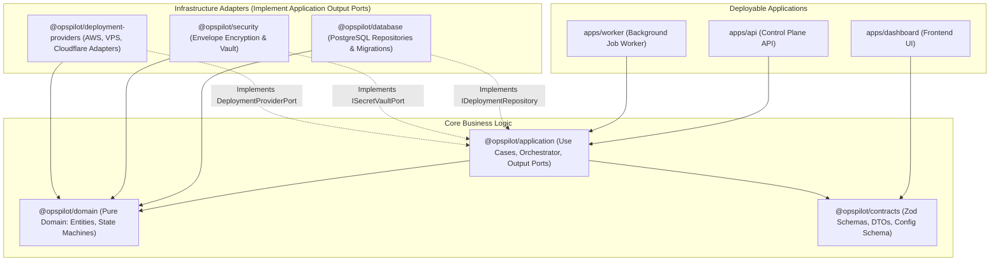
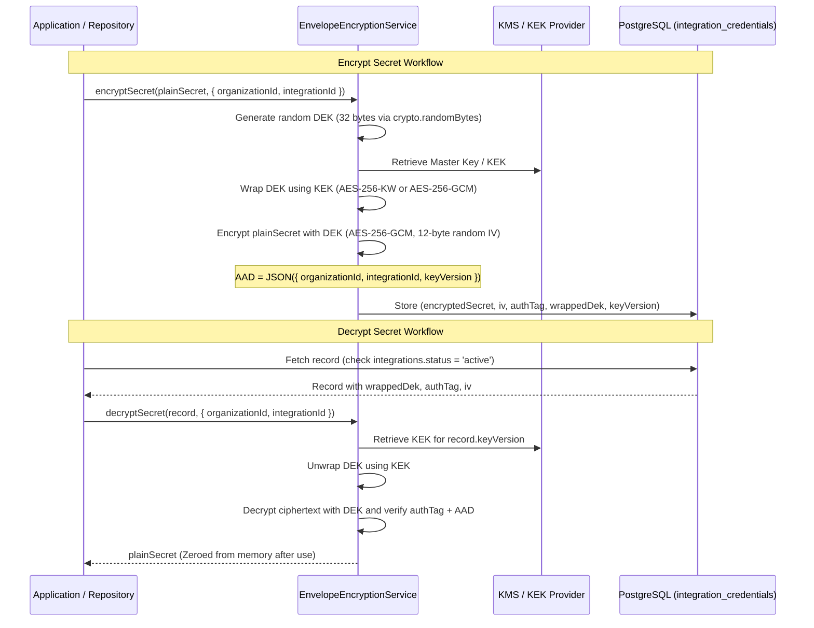

# OpsPilot — Project Foundation Architectural Decisions

> **Audience:** Engineering Leadership, Security Architects, Core Maintainers  
> **Status:** Authoritative Foundation Decisions  
> **Date:** November 2026  
> **Scope:** Monorepo Topology, Decoupling, Cryptography, Licensing, Plane Isolation

---

## 1. Overview & Context

This document codifies the foundational architectural decisions governing OpsPilot. These decisions resolve structural ambiguities, eliminate security vulnerabilities uncovered during the adversarial audit, and define the boundaries that will govern all future implementation phases.

---

## 2. Decision 1: Monorepo Package Topology & Package Separation

### 2.1 Problem Statement
The current repository places both provider adapters (AWS, VPS, Cloudflare Workers, Cloudflare Pages) and the deployment execution engine (`DeploymentExecutionEngine`) inside a single package: `packages/deployment-providers`. 

This creates tight coupling:
- Provider adapters depend on orchestration concepts.
- Orchestration logic cannot be reused across different runner processes or worker binaries without importing all external provider SDKs and dependencies.
- Adding a new provider requires touching the core engine package.

### 2.2 Decision: Pragmatic Hexagonal Monorepo Topology
OpsPilot adopts a clean **Hexagonal / Clean Architecture Monorepo Topology**, avoiding speculative package proliferation while strictly enforcing inward dependency flow:



1. **Application Owns Orchestration & Ports:**
   - The deployment orchestration workflow (`DeploymentExecutionEngine`) lives directly within `@opspilot/application` as an orchestrator use case service. Creating a separate `@opspilot/deployment-engine` package is not justified initially and would introduce unnecessary packaging overhead.
   - `DeploymentProviderPort` is an **Application Output Port** owned by `@opspilot/application/src/ports/deployment-provider.port.ts`, NOT a domain interface.
2. **Provider Adapters Implement Ports:**
   - `@opspilot/deployment-providers` contains **only** adapter implementations (AWS ECS, VPS Docker, Cloudflare Workers, Cloudflare Pages) that implement `DeploymentProviderPort`.
3. **Consolidate Ancillary Packages:**
   - Configuration schema lives in `@opspilot/contracts`; configuration loading utility lives in `@opspilot/application` / app entrypoints. An independent `@opspilot/config` package is not justified.
   - Job queue publishing port (`IJobPublisherPort`) and driving job consumer contracts live inside `@opspilot/application`, with the queue consumer engine composed in worker infrastructure (`apps/worker`), deferring a dedicated `@opspilot/job-queue` package until worker scale demands it.
   - `@opspilot/observability` (Phase 4) and `@opspilot/ai` (Phase 6) are deferred to their respective roadmap phases.
4. **Explicit Domain Purity:**
   - `@opspilot/domain` contains zero external dependencies. No NestJS, no Zod, no SQL, no cloud provider SDKs.

---

## 3. Decision 2: Cryptographic Envelope Encryption Architecture (NIST SP 800-57 Compliant)

### 3.1 Problem Statement
The adversarial audit (`SEC-01`, `SEC-02`) revealed that `EnvelopeEncryptionService` derived keys deterministically from `OPSPILOT_MASTER_KEY` and tenant ID via HKDF without generating unique Data Encryption Keys (DEKs). Furthermore, it silently fell back to a hardcoded string when the environment variable was missing.

### 3.2 Decision: Genuine Multi-Tier Envelope Encryption
OpsPilot implements genuine NIST SP 800-57 envelope encryption:



#### Invariants & Cryptographic Safeguards:
1. **Cryptographically Secure DEK Generation:** Every credential record generates a fresh, independent 256-bit Data Encryption Key using an approved CSPRNG (`crypto.randomBytes(32)`). Deterministic derivation (HKDF from master key or tenant identifier) is strictly forbidden (`SEC-01`).
2. **Protected KEK Provisioning & Entropy Verification:** The Key Encryption Key (`OPSPILOT_MASTER_KEY`) must be provisioned via an external KMS/HSM or high-entropy environment injection. Note that satisfying a 32-byte length check (64 hex characters) is a necessary syntactic precondition, but does **not** prove sufficient entropy; keys must be generated using an approved cryptographically secure randomness source.
3. **Authenticated DEK Wrapping with Native AAD (Addressing the RFC 3394 Limitation):**
   - *RFC 3394 Limitation:* RFC 3394 (AES Key Wrap) provides integrity checking for the key payload itself using a fixed 64-bit Alternative Initial Value (AIV), but **does not provide a general-purpose Additional Authenticated Data (AAD) parameter**.
   - *Selected Architecture:* OpsPilot uses **AES-256-GCM for DEK wrapping**. The DEK is wrapped using the KEK via AES-256-GCM with a fresh 12-byte random IV (`wrap_iv`) and Wrap AAD containing `JSON({ organizationId, integrationId, keyVersion, purpose: "dek-wrap" })`. This cryptographically binds the DEK wrapping itself to the specific tenant and integration, causing cross-tenant unwrapping attempts to fail immediately at the AEAD tag verification step.
   - *Alternative Considered:* RFC 3394 with synthetic metadata binding (e.g. prepending an HMAC-SHA256 of the AAD) was evaluated and rejected due to dual-key complexity and lack of native support across standard Node.js crypto implementations.
4. **Random 96-Bit AES-GCM Nonces:** Every secret payload encryption and DEK wrap operation generates an independent, random 12-byte initialization vector (`crypto.randomBytes(12)`).
5. **Strict No-Reuse Requirement per Key:** Under NIST SP 800-38D guidelines, an AES-GCM key must never be used with the same IV twice. Because random 96-bit nonces carry a collision probability governed by the birthday paradox, key invocation counts must be strictly bounded.
6. **Key Usage & Rotation Limits:** A single AES-GCM key must not encrypt more than $2^{32}$ invocations under random 96-bit nonces per NIST SP 800-38D. OpsPilot enforces an operational defense-in-depth policy rotating KEKs annually or after $100,000$ operations, whichever occurs first (bounding collision probability to $< 10^{-19}$).
7. **Tenant-Bound Context (Payload AAD):** `organizationId`, `integrationId`, and `keyVersion` are also passed as Additional Authenticated Data (AAD) to the payload AES-256-GCM cipher, providing independent double-layer cryptographic tenant binding.
8. **Database Storage Schema:** The `integration_credentials` table stores:
   - `encrypted_secret`: `TEXT` (ciphertext).
   - `initialization_vector`: `VARCHAR(64)` (hex IV).
   - `authentication_tag`: `VARCHAR(64)` (hex auth tag).
   - `wrapped_dek`: `TEXT` (wrapped DEK ciphertext).
   - `wrap_iv`: `VARCHAR(64)` (hex wrap IV).
   - `wrap_tag`: `VARCHAR(64)` (hex wrap auth tag).
   - `key_version`: `VARCHAR(32)` (identifies KEK version).
   - `algorithm`: `VARCHAR(32)` (`'aes-256-gcm-envelope-v1'`).
9. **Strict Fail-Closed Enforcement:** The service throws `MissingMasterKeyException` immediately upon startup if `OPSPILOT_MASTER_KEY` is undefined or has fewer than 32 bytes of entropy. Default fallback strings are banned (`SEC-02`).
10. **Active Status Verification:** Decryption is gated by an active integration check (`integrations.status = 'active'`). Revoked integrations cannot be decrypted (`SEC-05`).
11. **Key Rotation Without Plaintext Re-Encryption:** KEK rotation involves re-wrapping the stored DEKs with the new KEK (`kek-2026-v2`) without decrypting or exposing the underlying sensitive secrets.
12. **Disaster Recovery & Key-Loss Safeguard:** Because ciphertexts cannot be decrypted without the KEK, **loss of the KEK results in permanent, irrecoverable loss of all integration secrets**. Production runbooks mandate redundant, encrypted KEK backups (e.g. AWS KMS multi-region keys or offline secret escrows).
13. **Local KEK Provider vs. Managed KMS Provider:**
    - OpsPilot defines the driven port `IKekProvider` implemented by two distinct providers:
      * `LocalKekProvider`: Sourced from `OPSPILOT_MASTER_KEY` in environment variables for local development and zero-cloud self-hosted deployments. Performs local AES-256-GCM wrapping directly in worker process memory.
      * `ManagedKmsKekProvider`: Integrates with AWS KMS or GCP Cloud KMS for production deployments. The KEK never leaves the cloud Hardware Security Module (HSM). DEKs are wrapped using `kms.encrypt` and unwrapped via `kms.decrypt` with `EncryptionContext` enforcing tenant AAD at the KMS service layer.
14. **Best-Effort Memory Zeroing Limitations:**
    - Decrypted key Buffers are zeroed in memory via `buffer.fill(0)` immediately after use.
    - *Runtime Limitation Acknowledgment:* In managed, garbage-collected runtimes like Node.js / V8, string conversions (e.g. `secret.toString('utf8')`) create immutable string primitives in the V8 heap that cannot be zeroed in place. Furthermore, V8 garbage collector heap compaction and OS page swapping can duplicate memory pages before garbage collection. Therefore, `buffer.fill(0)` is documented as **best-effort defense-in-depth**, not an absolute guarantee of physical erasure. To minimize exposure, decrypted secrets must be kept strictly as Buffers and scoped to short synchronous lifetimes.
15. **Structured Audit Logging:** Every decryption event emits a structured audit log containing `organizationId`, `integrationId`, `keyVersion`, and `actorId`. Plaintext keys and credentials are never logged.

---

## 4. Decision 3: Open-Source License Selection (Evaluation & Recommendation)

### 4.1 Evaluation: Apache License 2.0 vs. MIT License

| Evaluation Criterion | MIT License | Apache License 2.0 | OpsPilot Impact |
|---|---|---|---|
| **Simplicity & Adoption** | Extremely simple; maximum developer familiarity. | Slightly longer, formal legal language. | MIT offers marginally lower adoption friction for casual hobbyists. |
| **Explicit Patent Grant** | **None.** Silent on patent rights. Users risk patent infringement claims from contributors. | **Explicit grant** of patent rights from every contributor to each user. | **Critical:** OpsPilot coordinates cloud deployments and AI agents; patent protection is essential for enterprise self-hosters. |
| **Patent Retaliation Defense** | **None.** A contributor can sue a user for patent infringement without losing their license. | **Automatic termination** of patent license if a user initiates patent litigation against OpsPilot. | Protects the project and its user community from aggressive patent assertion entities. |
| **Trademark Protection** | Silent on trademarks. Users could commercially market fork as "OpsPilot". | **Explicit reservation:** Does not grant trademark rights to project name or logos. | Protects the "OpsPilot" brand and community identity from confusing forks. |
| **Contribution Terms** | Ambiguous licensing of incoming pull requests unless CLA is signed. | Section 5 explicitly specifies contributions are under the same terms. | Streamlines open-source contribution without requiring heavy legal CLAs. |
| **GPL Compatibility** | Compatible with GPLv2 and GPLv3. | Compatible with GPLv3 (one-way). | Both allow integration into broader open-source ecosystems. |

### 4.2 Recommendation & Approval Requirement
- **Architectural Recommendation:** **Apache License 2.0 (`Apache-2.0`)**.
  Given that OpsPilot interfaces with cloud infrastructure APIs, container runtimes, and proprietary AI endpoints, Apache-2.0 provides crucial patent peace, trademark protection, and contributor clarity that MIT completely lacks.
- **Decision Status:** **Requires Project Owner Approval**.
  Per open-source governance rules, no license file (`LICENSE`) will be generated or committed until the Project Owner explicitly reviews and accepts this recommendation.

---

## 5. Decision 4: Control Plane vs. Execution Plane Isolation

### 5.1 Architecture Separation

```mermaid
flowchart LR
    subgraph Control Plane ["Control Plane (High Trust / Trusted Zone)"]
        API["API Server (NestJS)"]
        DB[(PostgreSQL 18)]
        VAULT["Cryptographic Vault (Security Pkg)"]
        ORCH["Deployment Engine"]
    end

    subgraph Boundary ["Credential & Network Isolation Firewall"]
        REDIS[(Redis / BullMQ)]
        PRE["Ephemeral Presigned URLs"]
    end

    subgraph Execution Plane ["Execution Plane (Zero Trust / Sandboxed Zone)"]
        RUNNER["Hardened Build Runner (Docker/cgroups)"]
        WORKER["Task Workers (Non-Root)"]
    end

    ORCH -->|Enqueue Job with Task ID| REDIS
    REDIS -->|Dequeue Job Payload| WORKER
    VAULT -.->|NEVER EXPOSED TO| RUNNER
    API --> DB
    VAULT --> DB
    WORKER -->|Fetch Code via Presigned URL| PRE
    RUNNER -->|Isolated Build (No Net / Egress Filtered)| WORKER
```

### 5.2 Isolation Invariants:
1. **Zero Credential Propagation:** Master keys, database credentials, AWS IAM role secrets, and Cloudflare API tokens **never** enter the execution runner environment.
2. **Build Execution:** Builds run in isolated container environments with:
   - Non-root user (`UID 10001`).
   - Read-only root filesystem (`--read-only`).
   - Memory (`2GB`) and CPU (`2.0 vCPU`) limits.
   - PIDs limit (`100`).
   - Network egress restricted (metadata endpoints `169.254.169.254` blocked, private subnets blocked, only approved package registries reachable during dependency phase).
3. **Asynchronous Communication:** The Control Plane communicates with the Execution Plane solely via serialized BullMQ jobs in Redis. No direct RPC or shared memory.

---

## 6. Decision 5: Deployment Reconciliation & State Recovery

### 6.1 Problem Statement
`ENG-03` identified that worker crashes leave deployments in `Deploying` indefinitely because state transitions happen in memory without distributed leases or heartbeats.

### 6.2 Decision
1. **Lease Mechanism:** Every active deployment job in the queue acquires a PostgreSQL advisory lock or updates a `lease_expires_at` timestamp every 15 seconds.
2. **Reconciliation Cron:** A dedicated background reconciliation process runs every 60 seconds:
   - Queries `deployments` where `status = 'deploying'` and `lease_expires_at < NOW() - INTERVAL '45 seconds'`.
   - Inspects the provider status to determine whether the deployment succeeded externally.
   - If unconfirmed, marks the deployment as `Failed` with reason `WORKER_CRASHED_DURING_EXECUTION` and initiates rollback if configured.

---

---

## 7. Technology Architecture Decisions & Updated Recommendations

To prevent premature lock-in on heavy dependencies before Phase 0 approval, key technology choices have been rigorously evaluated against the self-hosting operational burden for small teams (2–20 engineers). The canonical recommendations are updated as follows:

### 7.1 Decision 3: Open-Source License — Apache-2.0 vs. MIT
- **Recommendation:** **Adopt Apache License 2.0 (`Apache-2.0`)**.
- **Rationale:** Grants explicit patent rights from contributors to users, includes automatic patent litigation defense, and explicitly reserves trademark rights for "OpsPilot". MIT lacks patent and trademark safeguards, which are vital for multi-cloud orchestration platforms.
- **Status:** **Recommended for Owner Approval**.

### 7.2 Decision 6: Frontend Architecture — Vite + React SPA vs. Next.js 14+
- **Recommendation:** **Adopt Vite + React SPA**.
- **Rationale:** Minimizes self-hosting operational burden. Vite compiles to static HTML/JS/CSS assets that can be served via Nginx or embedded directly into the NestJS API server (`apps/api`), requiring **zero extra runtime containers** and eliminating ~250MB–500MB of Node.js SSR RAM overhead.
- **Future Alternative:** Next.js 14+ is preserved as an alternative if server-side rendering or React Server Components are given explicit, measured justification.
- **Status:** **Recommended for Owner Approval**.

### 7.3 Decision 7: Background Job Queue — PostgreSQL-Backed Queue Initially vs. BullMQ + Redis
- **Recommendation:** **Adopt PostgreSQL-backed queue initially** (`pg-boss` or custom `FOR UPDATE SKIP LOCKED` worker).
- **Rationale:** Eliminates Redis completely for v0.1.0, consolidating all state and queuing into the existing PostgreSQL 18 instance. Reduces self-hosted infrastructure requirements to **a single stateful container** and enables transactional job dispatching (writing deployment records and enqueuing jobs in the same atomic SQL transaction).
- **Future Alternative:** BullMQ + Redis is preserved as an alternative for high-throughput scaling (>10,000 jobs/sec) if measured metrics justify the operational complexity of managing a separate Redis cluster.
- **Status:** **Recommended for Owner Approval**.

### 7.4 Decision 8: HTTP API Framework — NestJS vs. Fastify / Hono
- **Recommendation:** **Adopt NestJS (Modular Monolith)**.
- **Rationale:** Provides out-of-the-box modular structure, dependency injection, OpenAPI/Swagger documentation, and validation pipes. Controllers remain thin, delegating immediately to Application Use Cases.
- **Status:** **Recommended for Owner Approval**.

### 7.5 Decision 9: Monorepo Build Tooling — npm workspaces initially vs. Turborepo
- **Recommendation:** **Adopt npm workspaces initially**.
- **Rationale:** Built natively into Node.js; introduces zero additional build tooling dependencies during foundational scaffolding.
- **Future Alternative:** Turborepo is preserved as an alternative if measured monorepo build or test times in CI justify adding build caching tooling.
- **Status:** **Recommended for Owner Approval**.

---

## 8. Summary of Decision Authorities

| Decision | Proposed By | Approved By | Status |
|---|---|---|---|
| Monorepo Package Topology | Principal Architect | Architecture Review | **Accepted** |
| Deployment Engine Decoupling | Principal Architect | Architecture Review | **Accepted** |
| NIST SP 800-57 Envelope Encryption | Security Architect | Architecture Review | **Accepted** |
| Apache-2.0 License Selection | Staff Platform Engineer | Project Owner | **Recommended for Owner Approval** |
| Control vs. Execution Plane Isolation | Platform Security Specialist | Architecture Review | **Accepted** |
| Database Lease Reconciliation | Reliability Engineer | Architecture Review | **Accepted** |
| Frontend: Vite + React SPA | Platform Architect | Project Owner | **Recommended for Owner Approval** |
| Queue: PostgreSQL-Backed Queue Initially | Platform Architect | Project Owner | **Recommended for Owner Approval** |
| HTTP: NestJS (Modular Monolith) | Platform Architect | Project Owner | **Recommended for Owner Approval** |
| Monorepo Tooling: npm workspaces initially | Platform Architect | Project Owner | **Recommended for Owner Approval** |
| Monorepo: Turborepo vs. Workspaces | DevOps Engineer | Architecture Review | **Proposed** |
