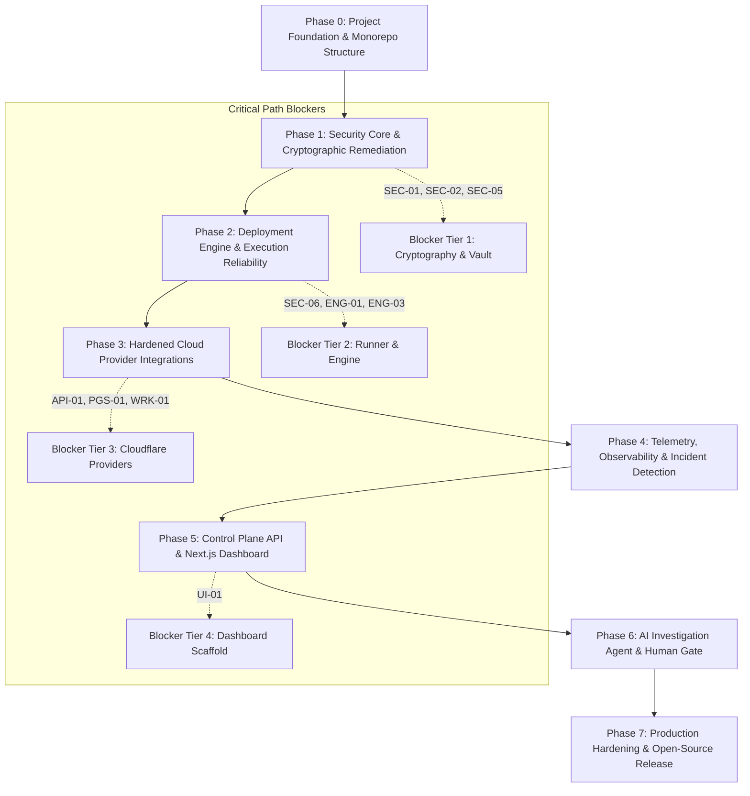

# OpsPilot — Phased Implementation Roadmap

> **Audience:** Engineering Leadership, Contributors, Platform Engineers  
> **Status:** Authoritative Implementation Roadmap  
> **Date:** November 2026

---

## 1. Roadmap Architecture & Critical Path

OpsPilot's path to production readiness is organized into eight sequential phases (Phases 0 through 7). Each phase establishes an immutable layer of verified capabilities, prioritizing foundational security, cryptographic integrity, and architectural boundaries before feature or UI expansion.

---

## 2. Phase-by-Phase Implementation Specifications

---

### Phase 0: Project Foundation, Governance, Test Isolation & Monorepo Structure

#### 1. Objectives
Establish test infrastructure isolation, define project boundaries, scaffold `@opspilot/application`, move deployment orchestration into application, configure monorepo tooling, enforce hexagonal import boundaries, and obtain Project Owner approval for open-source licensing.

#### 2. Scope
- Obtain Project Owner approval on Apache License 2.0.
- Implement PostgreSQL Test Isolation Harness (per-suite schema or disposable database isolation) so that `migration-lifecycle.spec.ts` executes safely alongside repository tests without race conditions.
- Scaffold `packages/application` (housing Use Cases, driven Output Ports, driving Consumer Contracts, and moving `DeploymentExecutionEngine` into `packages/application/src/orchestrator/`).
- Clean `packages/deployment-providers` to contain solely provider adapters implementing `DeploymentProviderPort`.
- Configure TypeScript project references and ESLint boundary rules (`import/no-restricted-paths`).
- Setup pre-commit hooks (Husky, lint-staged).

#### 3. Explicit Exclusions
- No changes to persistent production database schemas or encryption code.
- No cloud provider feature work or UI component building.

#### 4. Dependencies
- Final architecture review approved by Project Owner.

#### 5. Required Architectural Decisions
- Decision 1 (Monorepo Topology), Decision 3 (License Selection), and Decision 7 (Job Queue Ports).

#### 6. Files & Packages Affected
- `package.json`, `tsconfig.json`, `.eslintrc.js`
- `packages/database/tests/` (test isolation harness)
- `packages/deployment-providers/` (move engine to application)
- `packages/application/` (new package)

#### 7. Implementation Tasks
1. Execute license creation (`LICENSE`) once approved.
2. Implement test harness isolation in `packages/database/tests/`: isolate `migration-lifecycle.spec.ts` to a dedicated test schema (`CREATE SCHEMA test_migration_lifecycle`) or disposable test database, eliminating the parallel execution race condition.
3. Initialize `packages/application/package.json` and move `DeploymentExecutionEngine` from `packages/deployment-providers/src/engine/` into `packages/application/src/orchestrator/`.
4. Define driven output ports (`IDeploymentRepository`, `DeploymentProviderPort`, `ISecretVaultPort`, `IJobPublisherPort`, `INotificationPort`) and driving job consumer contracts in `packages/application/src/ports/`.
5. Update `packages/deployment-providers` to implement `DeploymentProviderPort`.
6. Configure ESLint rule `import/no-restricted-paths` enforcing inward hexagonal dependencies.
7. Verify clean build and 100% test pass rate in default parallel mode (`npx vitest run`) across all suites.

#### 8. Test Strategy
- Verify test harness isolation: run `npx vitest run` in parallel 3 consecutive times with 0 failures.
- Boundary linter tests; compilation checks (`tsc --build`).

#### 9. Security Considerations
- Ensure no sensitive environment files are committed during scaffolding.

#### 10. Documentation Requirements
- Update `REPOSITORY_STRUCTURE.md` with final directory layout.

#### 11. Atomic Commit Sequence
- `chore(governance): add Apache-2.0 license after owner approval`
- `test(database): implement isolated schema harness for migration lifecycle tests`
- `feat(application): scaffold @opspilot/application and migrate deployment engine`
- `refactor(providers): adapt deployment-providers to implement application ports`
- `chore(ci): configure typescript project references and boundary linting`

#### 12. Pull Request Boundaries
- PR #1: Governance & Monorepo Package Scaffolding.

#### 13. Acceptance Criteria
- All packages build cleanly with TypeScript 5.4.
- Monorepo boundary checks prevent illegal inward imports.

#### 14. Exit Criteria
- Zero circular dependencies; all packages pass type checking.

#### 15. Known Risks
- Workspace link resolution issues during initial package creation.

---

### Phase 1: Security Core, Cryptographic Remediation & Database Integrity

#### 1. Objectives
Eliminate all critical cryptographic flaws (`SEC-01`, `SEC-02`), enforce active integration status (`SEC-05`), and implement NIST SP 800-57 compliant envelope encryption.

#### 2. Scope
- Author and execute Migration `0002_envelope_encryption_and_leases.sql`.
- Overhaul `EnvelopeEncryptionService` with per-record random DEKs and fail-closed key loading.
- Update `IntegrationsRepository` to enforce tenant isolation and active status checks.
- Build secret redactor audit suite.

#### 3. Explicit Exclusions
- Cloud provider deployments.
- Build runner changes.

#### 4. Dependencies
- Phase 0 completed.

#### 5. Required Architectural Decisions
- Decision 2 (NIST SP 800-57 Envelope Encryption).

#### 6. Files & Packages Affected
- `packages/database/src/migrations/0002_envelope_encryption_and_leases.sql`
- `packages/security/src/encryption/envelope-encryption.service.ts`
- `packages/database/src/repositories/integrations.repository.ts`

#### 7. Implementation Tasks
1. Write and run migration adding `wrapped_dek`, `kek_id`, `algorithm_version`, `lease_expires_at`, `worker_id`.
2. Rewrite `EnvelopeEncryptionService.encryptSecret` to generate random 32-byte DEK, wrap with Master KEK, and encrypt with AES-256-GCM using AAD.
3. Remove fallback key string `'opspilot-default-dev-master-key-2026'`; fail closed on missing `OPSPILOT_MASTER_KEY`.
4. Update `IntegrationsRepository.getDecryptedSecret` to join `integrations` table and require `status = 'active'`.

#### 8. Test Strategy
- Unit test suite testing missing key exception.
- Cryptographic test proving ciphertext unpredictability and unique DEKs.
- Tampering test verifying AAD mismatch throws authentication failure.
- Revocation test verifying revoked integration decryption throws.

#### 9. Security Considerations
- Zero plaintext DEKs in memory after wrapping; zero sensitive keys in error logs.

#### 10. Documentation Requirements
- Update `docs/security/CREDENTIAL_MANAGEMENT.md` with envelope encryption spec.

#### 11. Atomic Commit Sequence
- `feat(database): add migration 0002 for wrapped DEK and lease tracking`
- `fix(security): remove default master key fallback and enforce fail-closed (SEC-02)`
- `fix(security): implement per-record random DEK envelope encryption (SEC-01)`
- `fix(database): restrict secret decryption to active integrations only (SEC-05)`

#### 12. Pull Request Boundaries
- PR #2: NIST SP 800-57 Envelope Encryption & Integration Revocation Enforcement.

#### 13. Acceptance Criteria
- 100% test pass on envelope encryption test suite.
- Unset `OPSPILOT_MASTER_KEY` halts process immediately.

#### 14. Exit Criteria
- `SEC-01`, `SEC-02`, and `SEC-05` marked as resolved with passing regression tests.

#### 15. Known Risks
- Existing unencrypted test fixtures must be migrated or regenerated.

---

### Phase 2: Deployment Platform, Build Sandbox & Reliability Engine

#### 1. Objectives
Remediate `SEC-06`, `ENG-01`, and `ENG-03`: harden the build runner container, eliminate shell `eval`, implement distributed lease tracking, and add provider stabilization polling.

#### 2. Scope
- Fix `docker/runners/scripts/build-entrypoint.sh` to remove `eval`.
- Implement host-side Runner Orchestrator in `packages/deployment-providers/src/runners/hardened-build-runner.ts` (controlling Docker Engine via host socket, zero `/var/run/docker.sock` in container, symlink TOCTOU checks, tar-slip prevention, egress firewall).
- Implement distributed leasing, crash recovery, and PostgreSQL-backed queue processor in `packages/application/src/orchestrator/`.
- Implement provider stabilization loop in `DeploymentExecutionEngine`.

#### 3. Explicit Exclusions
- External cloud provider feature additions.
- Redis cluster infrastructure (queue is backed by PostgreSQL initially).

#### 4. Dependencies
- Phase 1 completed (database migration 0002 applied).

#### 5. Required Architectural Decisions
- Decision 4 (Control vs Execution Plane), Decision 5 (Deployment Reconciliation), and Decision 7 (PostgreSQL-backed queue initially).

#### 6. Files & Packages Affected
- `docker/runners/scripts/build-entrypoint.sh`
- `packages/deployment-providers/src/runners/hardened-build-runner.ts`
- `packages/application/src/orchestrator/deployment-execution-engine.ts`
- `packages/application/src/workers/deployment-reconciliation.worker.ts`

#### 7. Implementation Tasks
1. Replace `eval "${OPSPILOT_BUILD_COMMAND}"` with `exec "$@"`.
2. Connect `HardenedBuildRunner` to Docker daemon with `--read-only`, `--network=isolated-build-net`, `--user=10001:10001`.
3. Add heartbeat loop to `DeploymentExecutionEngine` updating `lease_expires_at` every 15s.
4. Add `AwaitingStabilization` phase polling `provider.getStatus()`.
5. Implement `DeploymentReconciliationWorker` detecting abandoned leases after 45s.

#### 8. Test Strategy
- Security tests verifying command injection fails in build runner.
- Crash recovery integration test simulating killed worker process.
- Stabilization delay test with mock provider.

#### 9. Security Considerations
- Runner egress firewall rules preventing AWS metadata (`169.254.169.254`) access.

#### 10. Documentation Requirements
- Update `docs/deployment/DEPLOYMENT_LIFECYCLE.md` with new stabilization and lease states.

#### 11. Atomic Commit Sequence
- `fix(security): remove shell eval from runner entrypoint and enforce non-root UID (SEC-06)`
- `feat(engine): integrate hardened build runner into execution lifecycle`
- `feat(engine): add provider stabilization polling before health checks (ENG-01)`
- `feat(engine): implement deployment leasing and crash reconciliation worker (ENG-03)`

#### 12. Pull Request Boundaries
- PR #3: Sandboxed Build Runner Hardening & Engine Reliability.

#### 13. Acceptance Criteria
- Runner container runs non-root and rejects network egress to metadata IPs.
- Worker crashes are automatically reconciled to `Failed` within 60s.

#### 14. Exit Criteria
- `SEC-06`, `ENG-01`, and `ENG-03` resolved with passing integration tests.

#### 15. Known Risks
- Docker socket availability in CI environments.

---

### Phase 3: Hardened Cloud Provider Integrations (AWS, VPS, Cloudflare)

#### 1. Objectives
Remediate `API-01`, `PGS-01`, `WRK-01`: implement authentic Cloudflare Pages Direct Upload protocol, add Pages Functions compilation, enforce transactional Worker versions, and verify AWS ECS and VPS Docker Compose providers.

#### 2. Scope
- Implement Cloudflare Pages two-stage hash upload protocol (`API-01`).
- Implement Pages Functions compilation into `_worker.js` (`PGS-01`).
- Implement Cloudflare Workers Versions API with transactional binding promotion (`WRK-01`).
- Build contract test suite and opt-in live infrastructure test runner.

#### 3. Explicit Exclusions
- Web API controllers and UI.

#### 4. Dependencies
- Phase 2 completed.

#### 5. Required Architectural Decisions
- Provider contract specifications (`docs/engineering/PROVIDER_CONTRACTS.md`).

#### 6. Files & Packages Affected
- `packages/deployment-providers/src/cloudflare/`
- `packages/deployment-providers/src/providers/cloudflare-workers.provider.ts`
- `packages/deployment-providers/src/providers/cloudflare-pages.provider.ts`
- `packages/deployment-providers/src/providers/aws-ecs.provider.ts`
- `packages/deployment-providers/src/providers/vps-docker.provider.ts`

#### 7. Implementation Tasks
1. Rewrite `createPagesDirectUploadDeployment` to POST hash manifest, upload missing files in parallel, and finalize.
2. In Pages build pipeline, detect `/functions` directory and trigger compilation to `_worker.js`.
3. In Workers provider, upload script version first; only promote version to traffic after health check.
4. Establish live credential test runner for opt-in execution against real Cloudflare accounts.

#### 8. Test Strategy
- Mock HTTP tests verifying two-stage Pages protocol.
- Transactional rollback test simulating failed Worker deployment.
- Live Cloudflare integration tests (manual/opt-in with developer credentials).

#### 9. Security Considerations
- Never expose Cloudflare API tokens in error messages or logs.

#### 10. Documentation Requirements
- Update `docs/integrations/cloudflare/` guides with Pages and Workers specs.

#### 11. Atomic Commit Sequence
- `fix(cloudflare): implement authentic two-stage Pages Direct Upload protocol (API-01)`
- `feat(cloudflare): add Pages Functions compilation to _worker.js (PGS-01)`
- `fix(cloudflare): enforce transactional Worker script and secret deployments (WRK-01)`
- `test(cloudflare): add live integration test suite with credential guards`

#### 12. Pull Request Boundaries
- PR #4: Cloudflare Workers & Pages Provider Remediation.

#### 13. Acceptance Criteria
- Cloudflare Pages uploads succeed without protocol errors.
- Failed Worker deployments do not alter production secrets.

#### 14. Exit Criteria
- `API-01`, `PGS-01`, `WRK-01` resolved and verified.

#### 15. Known Risks
- Cloudflare API rate limits during large directory asset uploads.

---

### Phase 4: Observability, Telemetry & Incident Correlation

#### 1. Objectives
Implement normalized telemetry ingestion across all providers, OpenTelemetry instrumentation, and automated incident correlation.

#### 2. Scope
- Package `@opspilot/observability` implementation.
- CloudWatch, Cloudflare GraphQL, and Docker stats ingestion.
- Anomaly detection rule engine (5xx error spikes, memory threshold breaches).
- Incident entity lifecycle (Triggered -> Investigating -> Mitigated -> Resolved).

#### 3. Explicit Exclusions
- AI LLM integration.

#### 4. Dependencies
- Phase 3 completed.

#### 5. Required Architectural Decisions
- ADR-0009 (OpenTelemetry Telemetry Standard).

#### 6. Files & Packages Affected
- `packages/observability/`
- `packages/domain/src/entities/incident.entity.ts`
- `packages/database/src/repositories/incidents.repository.ts`

#### 7. Implementation Tasks
1. Initialize OTel tracer and metric exporters.
2. Build Cloudflare GraphQL metric poller (edge requests, CPU time, errors).
3. Build AWS CloudWatch metric poller.
4. Implement incident threshold evaluator triggering domain incident events.

#### 8. Test Strategy
- Telemetry ingestion tests with recorded provider response fixtures.
- Anomaly detector threshold verification tests.

#### 9. Security Considerations
- Redact customer request headers and query parameters in ingested traces.

#### 10. Documentation Requirements
- Update `docs/architecture/OBSERVABILITY_ARCHITECTURE.md`.

#### 11. Atomic Commit Sequence
- `feat(observability): implement OpenTelemetry instrumentation and normalizer`
- `feat(observability): add Cloudflare and AWS metric collectors`
- `feat(incident): implement anomaly detection rule evaluator`

#### 12. Pull Request Boundaries
- PR #5: Telemetry Normalization & Incident Correlation.

#### 13. Acceptance Criteria
- Spikes in provider 5xx metrics automatically trigger an `Incident` entity in database.

#### 14. Exit Criteria
- End-to-end incident generation verified from synthetic telemetry spikes.

#### 15. Known Risks
- High metric cardinality in large customer workloads.

---

### Phase 5: Control Plane API & Next.js Dashboard (`UI-01`)

#### 1. Objectives
Build the production Control Plane API (`apps/api`) using NestJS and the graphical web user interface (`apps/dashboard`) using Next.js 14+ (`UI-01`).

#### 2. Scope
- Scaffold and implement `apps/api` with NestJS REST controllers, JWT auth, and Zod validation.
- Scaffold and implement `apps/dashboard` with Next.js App Router, React Server Components, and Tailwind CSS.
- Service management, deployment history, real-time log viewer, and incident dashboards.

#### 3. Explicit Exclusions
- Automated AI code generation or autonomous remediation.

#### 4. Dependencies
- Phases 1–4 completed.

#### 5. Required Architectural Decisions
- Hexagonal architecture boundaries; `@opspilot/contracts` consumption.

#### 6. Files & Packages Affected
- `apps/api/`
- `apps/dashboard/`

#### 7. Implementation Tasks
1. Setup NestJS application modules, controllers, guards, and Swagger docs.
2. Connect `apps/api` to `@opspilot/application` use cases.
3. Setup Next.js 14 project in `apps/dashboard/` with Tailwind CSS.
4. Build UI pages: Projects, Services, Deployment Timeline, Incident Review.

#### 8. Test Strategy
- Supertest HTTP API contract tests.
- React Testing Library component tests.
- Playwright E2E browser smoke tests.

#### 9. Security Considerations
- Strict Content Security Policy (CSP), CORS configuration, and CSRF protection.

#### 10. Documentation Requirements
- Author `docs/api/API_REFERENCE.md` and `docs/dashboard/USER_GUIDE.md`.

#### 11. Atomic Commit Sequence
- `feat(api): scaffold NestJS control plane with JWT authentication (apps/api)`
- `feat(api): implement deployment and service management endpoints`
- `feat(dashboard): scaffold Next.js 14+ App Router frontend (UI-01)`
- `feat(dashboard): implement service overview and deployment timeline views`

#### 12. Pull Request Boundaries
- PR #6: Control Plane API (`apps/api`).
- PR #7: Web Dashboard (`apps/dashboard`).

#### 13. Acceptance Criteria
- User can log in, view services, trigger deployments, and inspect logs via browser UI.

#### 14. Exit Criteria
- `UI-01` resolved with full functional dashboard.

#### 15. Known Risks
- Server-side rendering performance with high-frequency log streams.

---

### Phase 6: AI Incident Investigation Agent & Human Approval Gate

#### 1. Objectives
Implement the read-only AI investigation engine in `packages/ai` adhering to zero-trust constraints, bounded tools, secret redaction, and mandatory human approval gates for remediation.

#### 2. Scope
- Provider-independent LLM gateway (Anthropic Claude, OpenAI, Google Gemini).
- Bounded read-only tools inheriting `BaseInvestigationTool` (Log Inspector, Telemetry Correlator, Diff Analyzer).
- Automatic secret redaction before LLM inference.
- Human approval gate producing GitHub Pull Requests with diagnosis and diff patches.

#### 3. Explicit Exclusions
- Autonomous or unattended execution of infrastructure mutations without human approval.

#### 4. Dependencies
- Phases 1–5 completed.

#### 5. Required Architectural Decisions
- ADR-0010 (Provider-Independent AI Gateway), ADR-0011 (Read-Only AI Agent), ADR-0012 (Human Approval Gate).

#### 6. Files & Packages Affected
- `packages/ai/`
- `apps/worker/src/processors/ai-investigation.processor.ts`

#### 7. Implementation Tasks
1. Implement LLM Gateway abstraction supporting structured output.
2. Build read-only investigation tools with hard limits (max 500 lines, 100KB, 60min window).
3. Connect `SecretRedactor` to sanitize all tool outputs before context insertion.
4. Build PR generation workflow proposing remediation code patches.

#### 8. Test Strategy
- Deterministic mock LLM prompt/response tests.
- Security tests verifying mutating operations are rejected.
- Redaction verification tests ensuring API keys are replaced with `[REDACTED]`.

#### 9. Security Considerations
- Prompt injection defenses; strict output schema enforcement; zero credential exposure.

#### 10. Documentation Requirements
- Update `docs/ai/AI_SECURITY.md` and `docs/ai/AGENT_EXECUTION_MODEL.md`.

#### 11. Atomic Commit Sequence
- `feat(ai): implement provider-independent LLM gateway abstraction`
- `feat(ai): implement bounded read-only investigation tools with secret redaction`
- `feat(ai): implement autonomous incident diagnosis workflow`
- `feat(ai): implement human approval gate and remediation PR generator`

#### 12. Pull Request Boundaries
- PR #8: AI Operations & Human-Gated Remediation.

#### 13. Acceptance Criteria
- Agent produces accurate incident diagnosis and proposes remediation PR without touching production infrastructure directly.

#### 14. Exit Criteria
- Zero security leaks in LLM transcripts; human approval gate verified.

#### 15. Known Risks
- LLM non-determinism and context window limitations on large log sets.

---

### Phase 7: Production Hardening, Self-Hosting & Open-Source Release

#### 1. Objectives
Execute end-to-end security audit, perform load testing, build self-hosting Docker Compose and Helm packages, finalize documentation, and publish v0.1.0 release.

#### 2. Scope
- Monorepo production Docker build (`apps/api`, `apps/dashboard`, `apps/worker`).
- One-click self-hosted `docker-compose.yml` for small engineering teams.
- Supply chain security: SBOM generation, container image signing (Cosign).
- Documentation validation and community governance launch.

#### 3. Explicit Exclusions
- Multi-region enterprise clustering (reserved for future versions).

#### 4. Dependencies
- Phases 0–6 completed.

#### 5. Required Architectural Decisions
- Release process and SemVer policies (`docs/releases/RELEASE_PROCESS.md`).

#### 6. Files & Packages Affected
- `infrastructure/docker-compose.self-hosted.yml`
- `.github/workflows/release.yml`
- Documentation suite

#### 7. Implementation Tasks
1. Build optimized multi-stage production Dockerfiles for each app.
2. Package self-hosted deployment template with PostgreSQL and Redis.
3. Run automated penetration testing and secret scanning tools (Trivy, Gitleaks).
4. Perform release dry-run and tag `v0.1.0`.

#### 8. Test Strategy
- End-to-end user journey tests on clean self-hosted virtual machine.
- Load testing under simulated concurrent deployment and incident traffic.

#### 9. Security Considerations
- Third-party dependency security review; SBOM publication.

#### 10. Documentation Requirements
- Complete public documentation in `docs/` and root `README.md`.

#### 11. Atomic Commit Sequence
- `chore(infra): add self-hosted production docker-compose bundle`
- `chore(ci): configure container signing and SBOM generation`
- `docs: finalize public documentation and quickstart guides`
- `chore(release): prepare v0.1.0 open-source release`

#### 12. Pull Request Boundaries
- PR #9: Self-Hosting Infrastructure & Release Automation.

#### 13. Acceptance Criteria
- Single command `docker compose up -d` launches fully functional OpsPilot instance locally.

#### 14. Exit Criteria
- Clean security scan; all automated tests passing; release tag published.

#### 15. Known Risks
- Host configuration differences across various Linux distributions.
