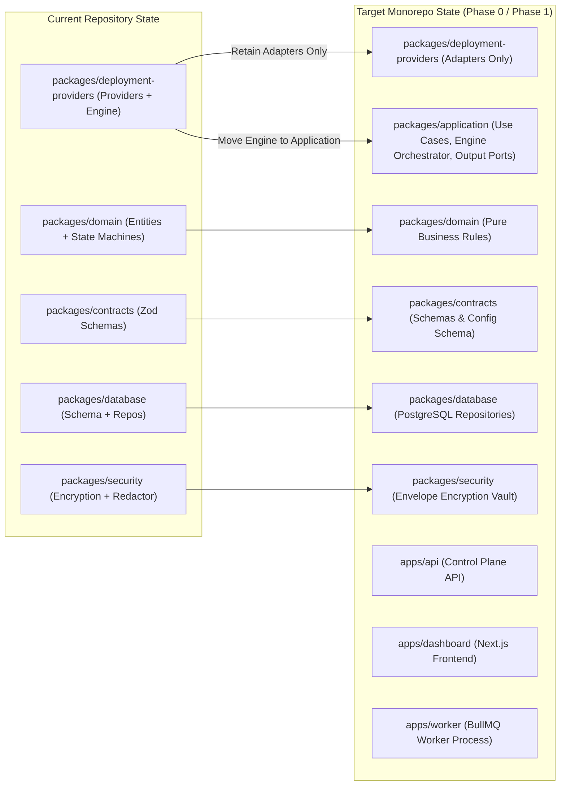

# OpsPilot — Canonical Repository Structure Specification

> **Audience:** Core Maintainers, Contributors, Software Architects  
> **Status:** Authoritative Repository Structure Specification  
> **Date:** November 2026

---

## 1. Overview & Monorepo Layout

OpsPilot is organized as an npm workspace monorepo. This document specifies the canonical repository structure, defining the precise responsibilities, dependencies, testing strategies, and interface ownership for every application and package.

```text
OpsPilot/
├── .github/                   # GitHub Actions workflows, issue templates, CODEOWNERS
├── apps/                      # Executable applications (Deployable units)
│   ├── api/                   # NestJS Core Application API (Control Plane)
│   ├── dashboard/             # Next.js 14+ App Router Frontend
│   └── worker/                # BullMQ Background Worker Process
├── packages/                  # Shared modular libraries and adapters
│   ├── domain/                # Pure domain entities, value objects, domain events (0 deps)
│   ├── contracts/             # Shared DTOs, API contracts, Zod schemas, Config schema
│   ├── application/           # Application use cases, orchestrator, output ports
│   ├── database/              # PostgreSQL schema, migrations, connection pool, repositories
│   ├── security/              # Envelope encryption, secret redactor, deterministic RBAC
│   ├── deployment-providers/  # Cloud provider adapters (AWS ECS, VPS, Workers, Pages)
│   ├── observability/         # [Phase 4] OpenTelemetry instrumentation & normalizer
│   └── ai/                    # [Phase 6] Read-only AI investigation engine
├── docker/                    # Container definitions and execution runners
│   └── runners/               # Hardened build sandbox Dockerfiles and entrypoints
├── infrastructure/            # Local development compose, Helm charts, terraform
├── docs/                      # Authoritative Technical Documentation & ADRs
├── scripts/                   # Development, CI, and maintenance helper scripts
└── tests/                     # Monorepo-wide E2E and cross-package contract test suites
```

---

## 2. Package Responsibility Matrix

### 2.1 Applications (`apps/`)

#### 1. `apps/api`
1. **Responsibility:** Serves the public and internal REST/GraphQL APIs. Manages authentication, request validation, rate limiting, and routes commands to application use cases.
2. **What belongs inside:** NestJS modules, controllers, guards, interceptors, middleware, Swagger/OpenAPI annotations.
3. **What must never belong inside:** Direct SQL queries, domain logic, long-running deployment operations, container management.
4. **Public exports:** None (deployable binary).
5. **Allowed dependencies:** `@opspilot/contracts`, `@opspilot/application`, `@opspilot/config`, NestJS core packages, `@nestjs/swagger`.
6. **Forbidden dependencies:** `@opspilot/deployment-providers`, `pg`, Docker SDK, AWS SDK.
7. **Package type:** Executable application.
8. **Testing:** Unit tests with mocked use cases; Supertest HTTP integration tests.
9. **Interface ownership:** Owns HTTP route schemas conforming to `@opspilot/contracts`.

#### 2. `apps/dashboard`
1. **Responsibility:** Web graphical user interface for engineering teams to monitor services, trigger deployments, inspect incidents, and review AI diagnosis.
2. **What belongs inside:** Next.js 14+ App Router pages, React Server/Client Components, Tailwind CSS styles, frontend state stores.
3. **What must never belong inside:** Database queries, server-side secrets, provider SDKs, backend business logic.
4. **Public exports:** None (deployable frontend).
5. **Allowed dependencies:** `@opspilot/contracts`, Next.js, React, Lucide icons, Tailwind CSS.
6. **Forbidden dependencies:** All backend packages (`@opspilot/database`, `@opspilot/security`, `@opspilot/domain`).
7. **Package type:** Web application.
8. **Testing:** React Testing Library unit tests; Playwright end-to-end browser tests.
9. **Interface ownership:** Consumes contracts from `@opspilot/contracts`.

#### 3. `apps/worker`
1. **Responsibility:** Headless execution process running BullMQ job processors for deployments, incident telemetry correlation, and AI investigations.
2. **What belongs inside:** Worker bootstrapper, BullMQ job processors, worker signal handlers, heartbeat emitters.
3. **What must never belong inside:** HTTP controllers, UI components, HTML templates.
4. **Public exports:** None (deployable worker binary).
5. **Allowed dependencies:** `@opspilot/contracts`, `@opspilot/application`, `@opspilot/database`, `@opspilot/security`, `@opspilot/deployment-providers`, `@opspilot/observability`, `@opspilot/config`.
6. **Forbidden dependencies:** NestJS HTTP controllers, React, Next.js.
7. **Package type:** Executable worker process.
8. **Testing:** Integration tests with real Redis/PostgreSQL test containers; job execution tests.
9. **Interface ownership:** Composes queue consumer adapter with application driving job contracts and use cases (`DeploymentExecutionEngine`).

---

### 2.2 Shared Packages (`packages/`)

#### 4. `packages/domain`
1. **Responsibility:** Core enterprise domain model, state machines, entity validation invariants, domain events.
2. **What belongs inside:** Entities (`Service`, `Deployment`, `Incident`, `Organization`), value objects (`EnvironmentConfig`), state transition logic, domain event classes.
3. **What must never belong inside:** External libraries, database drivers, HTTP frameworks, filesystem operations.
4. **Public exports:** Domain entities, value objects, domain events, interface definitions (`DeploymentProvider`).
5. **Allowed dependencies:** **None (0 dependencies)**.
6. **Forbidden dependencies:** Everything outside TypeScript standard library.
7. **Package type:** Pure domain library.
8. **Testing:** 100% in-memory unit tests; state machine transition property tests.
9. **Interface ownership:** Owns all core domain interfaces, including `DeploymentProvider`.

#### 5. `packages/contracts`
1. **Responsibility:** Canonical data transfer objects (DTOs), API request/response schemas, webhook payloads, and Zod validation schemas.
2. **What belongs inside:** Zod schemas, TypeScript types derived via `z.infer`, event payload schemas.
3. **What must never belong inside:** Implementation logic, database queries, framework controllers.
4. **Public exports:** Zod schemas and TypeScript DTO types.
5. **Allowed dependencies:** `zod`.
6. **Forbidden dependencies:** `@opspilot/database`, `@opspilot/application`, UI libraries.
7. **Package type:** Shared schema library.
8. **Testing:** Schema validation unit tests; positive and negative parsing tests.
9. **Interface ownership:** Defines the public API contracts consumed by `apps/api` and `apps/dashboard`.

#### 6. `packages/application`
1. **Responsibility:** Coordinates business workflows, executes use cases (`TriggerDeploymentUseCase`, `RollbackServiceUseCase`), houses the deployment orchestration workflow (`DeploymentExecutionEngine`), enforces tenant authorization, and defines outbound infrastructure ports.
2. **What belongs inside:** Use case classes, deployment orchestrator service (`DeploymentExecutionEngine`), driven output port interfaces (`IDeploymentRepository`, `DeploymentProviderPort`, `ISecretVaultPort`, `IJobPublisherPort`, `INotificationPort`), and driving job consumer contracts (`JobPayload`, `JobResult`, ack/retry/DLQ specifications).
3. **What must never belong inside:** Concrete SQL queries, NestJS controllers, external cloud SDKs, direct PostgreSQL pool handles.
4. **Public exports:** Use case classes, orchestrator service, port interfaces, command/query models.
5. **Allowed dependencies:** `@opspilot/domain`, `@opspilot/contracts`.
6. **Forbidden dependencies:** `pg`, `redis`, AWS SDK, Cloudflare API client, NestJS HTTP decorators.
7. **Package type:** Application core library.
8. **Testing:** Unit tests with mock ports (mock repositories, mock deployment provider ports).
9. **Interface ownership:** Owns outbound Port interfaces implemented by `@opspilot/database`, `@opspilot/security`, and `@opspilot/deployment-providers`.

#### 7. `packages/database`
1. **Responsibility:** Persistent relational state management, PostgreSQL connection pooling, migrations, and repository implementations.
2. **What belongs inside:** SQL migration scripts, PostgreSQL connection pool, concrete repository classes implementing application ports.
3. **What must never belong inside:** Presentation logic, provider-specific deployment logic, HTTP handlers.
4. **Public exports:** Database connection factory, repository classes, migration runner.
5. **Allowed dependencies:** `@opspilot/domain`, `@opspilot/application`, `@opspilot/security`, `pg`.
6. **Forbidden dependencies:** `apps/*`, `@opspilot/deployment-providers`, `@opspilot/ai`.
7. **Package type:** Infrastructure adapter.
8. **Testing:** Database integration tests against real PostgreSQL test instance (Unix socket or test container).
9. **Interface ownership:** Implements repository ports defined in `@opspilot/application`.

#### 8. `packages/security`
1. **Responsibility:** Cryptographic services, envelope encryption (NIST SP 800-57), secret redaction, and deterministic RBAC policy evaluation.
2. **What belongs inside:** `EnvelopeEncryptionService`, `SecretRedactor`, RBAC evaluator, key rotation helpers.
3. **What must never belong inside:** Plaintext credential storage, cloud deployment execution, HTTP controllers.
4. **Public exports:** `EnvelopeEncryptionService`, `SecretRedactor`, cryptographic types.
5. **Allowed dependencies:** `@opspilot/domain`, Node.js `crypto`.
6. **Forbidden dependencies:** Network libraries, HTTP frameworks, database drivers.
7. **Package type:** Infrastructure security adapter.
8. **Testing:** Cryptographic unit tests (tamper detection, AAD validation, fail-closed verification).
9. **Interface ownership:** Implements key vault and redaction ports defined in `@opspilot/application`.

#### 9. `packages/deployment-providers`
1. **Responsibility:** Adapters for external deployment platforms: AWS ECS/Fargate, VPS Docker Compose, Cloudflare Workers, Cloudflare Pages.
2. **What belongs inside:** Concrete implementations of `DeploymentProviderPort`, cloud API clients, provider capability descriptors.
3. **What must never belong inside:** Core deployment orchestration state machine, database connection handles, UI components.
4. **Public exports:** Provider adapter classes (`AwsEcsProvider`, `CloudflareWorkersProvider`, `CloudflarePagesProvider`, `VpsDockerProvider`), provider registry.
5. **Allowed dependencies:** `@opspilot/domain`, `@opspilot/application`, `@opspilot/contracts`, `node-fetch`, provider-specific SDKs.
6. **Forbidden dependencies:** `@opspilot/database`, `apps/*`, direct PostgreSQL drivers.
7. **Package type:** Infrastructure adapter.
8. **Testing:** Contract tests against mock API servers; opt-in live tests against real cloud infrastructure.
9. **Interface ownership:** Implements `DeploymentProviderPort` defined in `@opspilot/application`.

#### 10. `packages/observability` (Required Later — Phase 4)
1. **Responsibility:** Telemetry ingestion, OpenTelemetry instrumentation, trace correlation, and metrics normalization.
2. **What belongs inside:** OTel tracer and meter initialization, provider telemetry normalizers, incident log analyzers.
3. **What must never belong inside:** Mutating database commands, deployment execution logic.
4. **Public exports:** Tracer provider, metric collectors, normalized telemetry types.
5. **Allowed dependencies:** `@opspilot/domain`, `@opspilot/contracts`, `@opentelemetry/api`.
6. **Forbidden dependencies:** `@opspilot/deployment-providers`, UI components.
7. **Package type:** Infrastructure adapter.
8. **Testing:** Ingestion pipeline tests; metric aggregation unit tests.
9. **Interface ownership:** Provides telemetry ports.

#### 11. `packages/ai` (Required Later — Phase 6)
1. **Responsibility:** Provider-independent AI investigation engine, prompt engineering, read-only diagnostic tools, and human approval gates.
2. **What belongs inside:** LLM gateway client, agent state graph, tool definitions inheriting `BaseInvestigationTool`, prompt templates.
3. **What must never belong inside:** Mutating execution tools, database write connections, unredacted secrets.
4. **Public exports:** `IncidentInvestigationAgent`, investigation tool registry.
5. **Allowed dependencies:** `@opspilot/domain`, `@opspilot/application`, `@opspilot/contracts`, `@opspilot/security`.
6. **Forbidden dependencies:** Direct cloud deployment adapters, `apps/api`.
7. **Package type:** AI application service.
8. **Testing:** Deterministic mock LLM response tests; tool boundary and secret redaction verification tests.
9. **Interface ownership:** Implements AI investigation ports.
2. **What belongs inside:** LLM gateway client, agent state graph, tool definitions inheriting `BaseInvestigationTool`, prompt templates.
3. **What must never belong inside:** Mutating execution tools, database write connections, unredacted secrets.
4. **Public exports:** `IncidentInvestigationAgent`, investigation tool registry.
5. **Allowed dependencies:** `@opspilot/domain`, `@opspilot/contracts`, `@opspilot/security`, `@opspilot/observability`.
6. **Forbidden dependencies:** `@opspilot/deployment-engine`, `apps/api`.
7. **Package type:** AI application service.
8. **Testing:** Deterministic mock LLM response tests; tool boundary and secret redaction verification tests.
9. **Interface ownership:** Implements AI investigation ports.

---

## 3. Package Boundary Reassessment & Pragmatic Classification

To avoid premature package fragmentation and empty repository directories, each proposed package is evaluated against strict necessity criteria:

| Package | Classification | Justification & Architectural Boundary |
|---|---|---|
| **`@opspilot/domain`** | **Required Now** | Core enterprise business rules, entities, state machines. Zero external dependencies. |
| **`@opspilot/contracts`** | **Required Now** | Canonical Zod DTOs, request/response validation schemas, and configuration schema. |
| **`@opspilot/application`** | **Required Now** | Application use cases, command handlers, deployment orchestrator, and driven port interfaces. |
| **`@opspilot/database`** | **Required Now** | PostgreSQL schema migrations, connection pool, and repository implementations. |
| **`@opspilot/security`** | **Required Now** | Envelope encryption vault (NIST SP 800-57), secret redactor, and RBAC evaluator. |
| **`@opspilot/deployment-providers`** | **Required Now** | Provider adapters (AWS, VPS, Cloudflare) implementing `DeploymentProviderPort`. |
| **`deployment-engine`** | **Remain in `application` initially** | Deployment orchestration is application workflow logic. Keeping it in `@opspilot/application` avoids premature package fragmentation and circular dependency risks. |
| **`job-queue`** | **Remain in application/worker initially** | Queue publishing is an application port (`IJobPublisherPort`), and queue consumption is implemented directly in worker infrastructure until scale justifies a dedicated package. |
| **`config`** | **Not Justified** | Config schema belongs in `@opspilot/contracts`; config loader belongs in `@opspilot/application` or app entrypoints. A separate 1-file package is unjustified. |
| **`observability`** | **Required Later (Phase 4)** | OpenTelemetry exporters and telemetry normalizers are scheduled for Phase 4. |
| **`ai`** | **Required Later (Phase 6)** | Read-only AI investigation engine and human approval gates are scheduled for Phase 6. |

---

## 4. Restructuring & Migration Plan



### Migration Steps (Scheduled for Phase 0 / Phase 1):
1. **No file moves during foundation assignment.** All moves are documented here and will be executed atomically in Phase 0.
2. **Move Engine to Application:** Move `packages/deployment-providers/src/engine/` into `packages/application/src/orchestrator/`.
3. **Scaffold `@opspilot/application`:** Define driven port interfaces (`DeploymentProviderPort`, `IDeploymentRepository`, `ISecretVaultPort`, `IJobPublisherPort`, `INotificationPort`) and driving job consumer contracts.
4. **Clean Provider Adapters:** Update `@opspilot/deployment-providers` to implement `DeploymentProviderPort` and reference domain entities.
5. **Scaffold Executables:** Scaffold `apps/api/`, `apps/dashboard/`, and `apps/worker/` during their respective roadmap phases.

---

## 4. Boundary Enforcement Rules

To ensure dependencies only flow inward (towards `packages/domain`):
- `packages/domain` imports **nothing**.
- `packages/application` imports `packages/domain` and `packages/contracts`.
- Infrastructure packages (`packages/database`, `packages/deployment-providers`, etc.) import `packages/domain` and `packages/application`.
- Applications (`apps/api`, `apps/worker`) import infrastructure and application packages.
- `apps/dashboard` imports **only** `packages/contracts`.

Enforced via `eslint-plugin-import` boundary rules and TypeScript project references.
