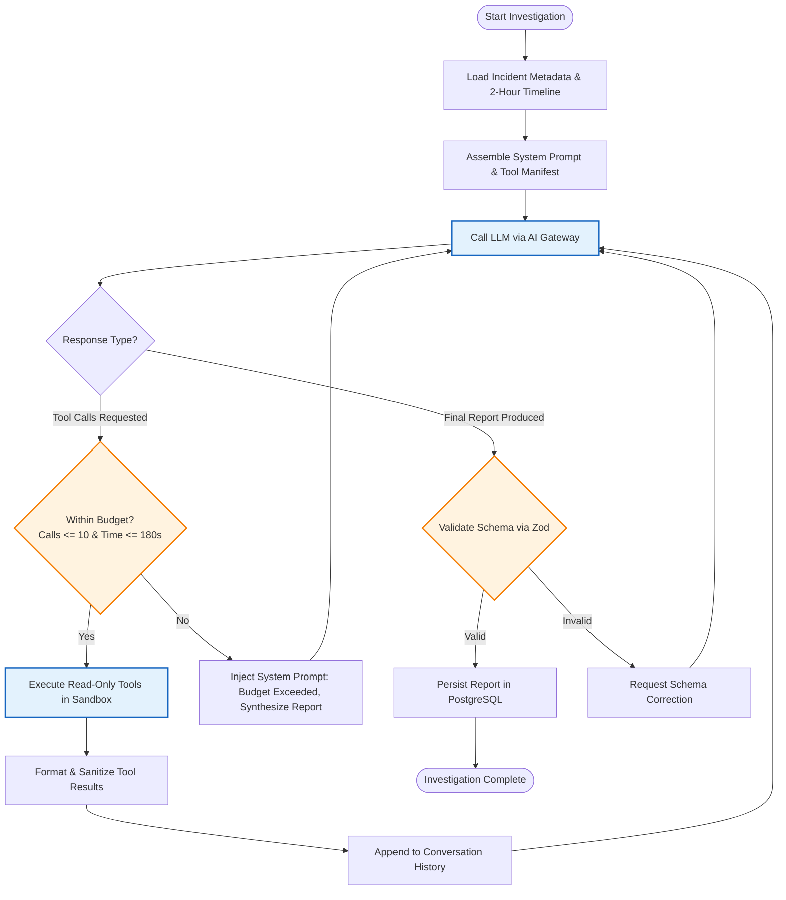

# Agent Execution Model & Orchestration Loop

> **Worker Process:** `apps/workers/ai-worker`  
> **Execution Strategy:** Bounded Single-Agent Reasoning Loop  
> **Status:** Approved Baseline

The OpsPilot AI Agent operates within a deterministic, multi-turn tool calling loop managed by the `InvestigationOrchestrator`.

---

## 1. Investigation Lifecycle Flow

---

## 2. Stopping Conditions

The agent execution loop terminates when any of the following conditions are met:

1. **Hypothesis Confirmed:** The model outputs a complete, structured investigation report citing verifiable observations and supporting evidence.
2. **Tool Call Ceiling Reached:** When the agent reaches **10 tool calls**, the orchestrator rejects further tool requests and instructs the model to generate its final report based on the evidence collected so far.
3. **Execution Timeout (180s):** If the total wall-clock duration reaches 180 seconds, the orchestrator terminates the loop, saves partial evidence, and marks the run as `TimedOut`.
4. **Token Budget Exceeded:** If total token consumption exceeds 30,000 prompt tokens or 4,000 completion tokens, the loop halts immediately.

---

## 3. Context Assembly Strategy

To maximize diagnostic accuracy while remaining well within token budgets, context is assembled hierarchically:
- **System Prompt:** Core instructions, role definition, formatting constraints, and rules separating hypotheses from observations.
- **Incident Brief:** Service name, environment, alert trigger rule, breach timestamp, and active deployment metadata.
- **Deployment & Git Timeline:** Summary of recent deployments and commits within the 2-hour window.
- **Dynamic Tool History:** Ingests only the specific logs and metrics queried by the model, automatically truncated to 500 lines per call.
