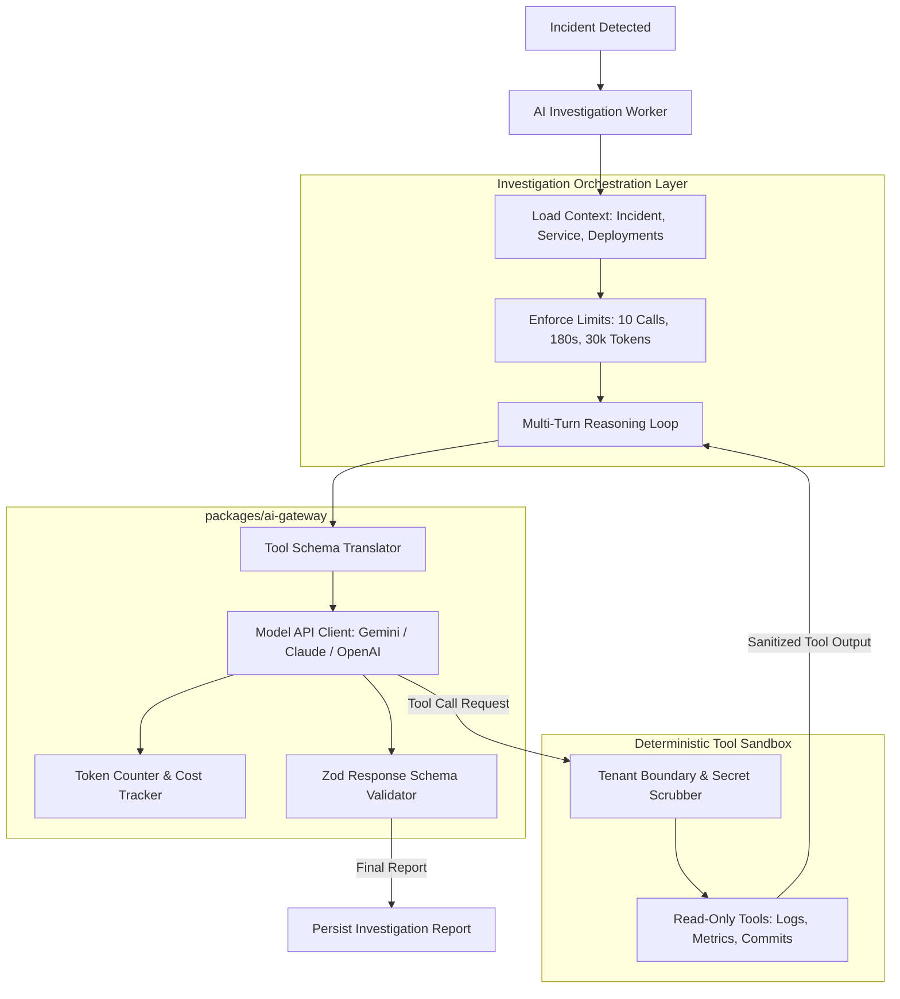

# AI System Overview

> **Subsystem:** AI Operations & Investigation Engine  
> **Core Package:** `packages/ai-gateway` & `apps/workers/ai-worker`  
> **Supported Models:** Gemini 1.5/2.0, Claude 3.5 Sonnet, GPT-4o

The OpsPilot AI System is an automated, read-only operations investigator designed to diagnose production incidents by correlating runtime telemetry with deployment history and git diffs.

---

## 1. High-Level AI Architecture

---

## 2. Core Capabilities & Responsibilities

1. **Autonomous Evidence Gathering:** Given an incident, the agent queries application logs, container metrics, health check probe histories, and recent Git commits.
2. **Contextual Correlation:** Correlates the exact timestamp of an error spike with recent code changes, environment variable updates, or deployment completions.
3. **Hypothesis Formulation:** Produces an evidence-backed hypothesis distinguishing observable facts from inferred probable causes.
4. **Remediation Recommendation:** Recommends the safest, lowest-risk mitigation (e.g., immediate rollback vs. configuration patch).
5. **No Autonomous Write Access:** The AI system cannot modify production infrastructure directly.

---

## 3. Supported Model Providers & Configuration

OpsPilot uses standard function-calling (tool use) capabilities natively supported by modern frontier models:
- **Google Gemini (Recommended Default):** `gemini-1.5-pro` / `gemini-2.0-flash` (via `@google/genai`). High context window, low latency, structured JSON output.
- **Anthropic Claude:** `claude-3-5-sonnet` (via `@anthropic-ai/sdk`). Exceptional code analysis and reasoning accuracy.
- **OpenAI:** `gpt-4o` (via `openai`). Robust function-calling support.
