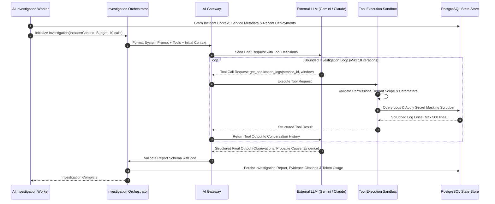
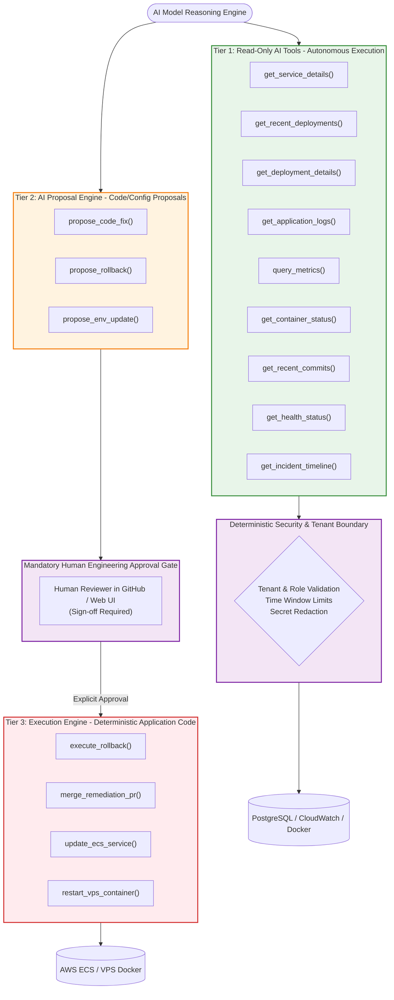

# AI Agent Architecture & Tool Execution Sandbox

> **Document Type:** Core AI Architecture Specification  
> **Pattern:** Single Bounded Autonomous Investigation Agent  
> **Status:** Approved Baseline

The OpsPilot AI Agent is an automated operations investigator designed to rapidly identify the root causes of production incidents. It operates under strict security and operational constraints: it is **read-only**, deterministic, bounded by execution limits, and completely separated from destructive infrastructure execution.

---

## 1. AI Investigation Sequence Diagram

The following diagram details the execution flow between the background worker, orchestrator, AI Gateway, external LLM, and read-only tools:

---

## 2. AI Tool Permission Boundary

To guarantee that the AI model can never accidentally or maliciously alter production infrastructure, OpsPilot categorizes operational capabilities into three strictly segregated tiers:

### Safety Principles:
1. **The Model Has No Credentials:** The LLM receives zero AWS access keys, SSH keys, or database credentials. It only receives sanitized tool responses.
2. **Deterministic Tool Execution:** Tool calls are executed by compiled backend TypeScript code that strictly verifies the caller's `organization_id` against the target resource.
3. **No Direct Execution:** The AI Agent is physically incapable of triggering a rollback or updating a task definition. It can only propose an action for human review.

---

## 3. Investigation Orchestrator Constraints

The investigation orchestrator enforces strict resource budgets to prevent infinite looping, runaway token spend, and latency spikes:

- **Maximum Tool Calls:** Hard ceiling of **10 tool calls** per investigation. If the limit is reached, the model is forced to synthesize its findings with available evidence.
- **Maximum Execution Duration:** 180 seconds total investigation timeout.
- **Token Budget:** Maximum **30,000 prompt tokens** and **4,000 completion tokens** per run.
- **Log Retrieval Bounds:** Maximum **500 log lines** or **100 KB** per tool call.
- **Time Window Ceiling:** Tool queries cannot look back further than **120 minutes** prior to the incident start timestamp.

---

## 4. Distinguishing Observations from Hypotheses

A primary failure mode of LLM troubleshooting is asserting an unverified guess as an absolute fact. OpsPilot prompt engineering strictly enforces the separation of:
- **Observations:** Empirical facts directly supported by tool call output (e.g., *"Application log line 42 at 10:24 UTC shows `ConnectionTimeoutError: pool exhausted`"*).
- **Hypotheses:** Inferences drawn from correlated observations (e.g., *"The recent commit 8fa2b reduced `max_connections` from 20 to 2, which likely caused pool exhaustion under peak load."*).
- **Confidence Scoring:** Explicitly tagged as `High` (direct evidence in code diff and logs), `Medium` (correlated timing but indirect evidence), or `Low` (inconclusive evidence; recommends broader manual investigation).
