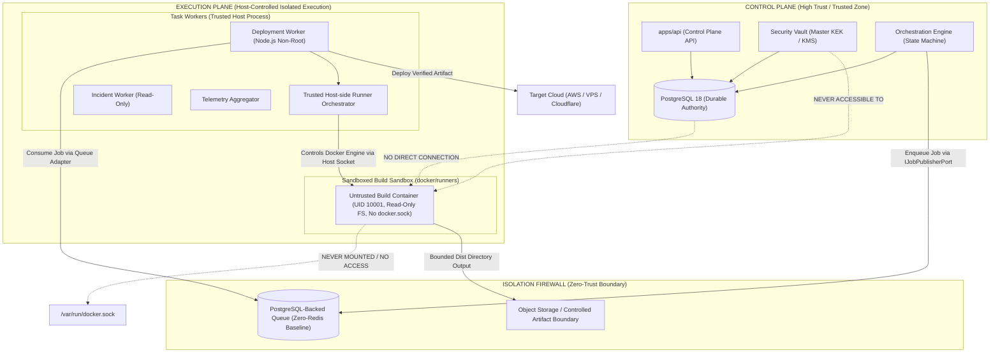
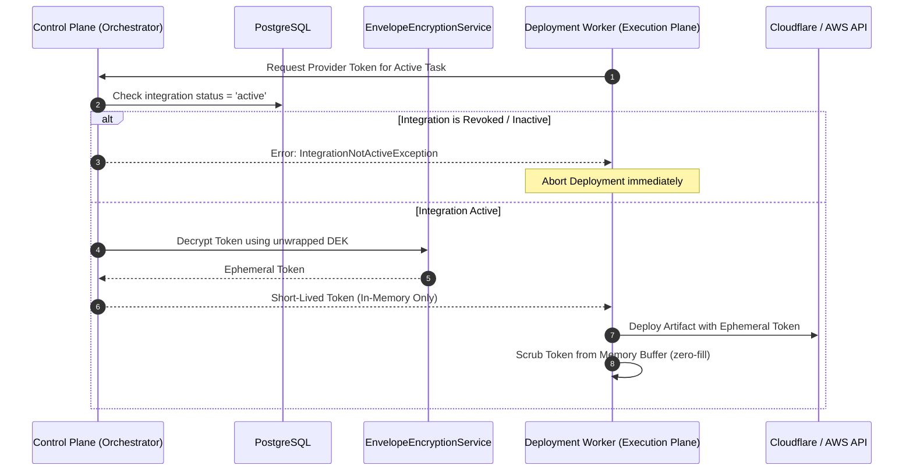

# OpsPilot — Control Plane vs. Execution Plane Architecture

> **Audience:** Platform Architects, Security Specialists, SREs  
> **Status:** Authoritative Architectural Specification  
> **Date:** November 2026

---

## 1. Executive Summary

OpsPilot enforces a strict architectural dichotomy between the **Control Plane** (the trusted brain that manages state, authentication, policy, and cryptographic keys) and the **Execution Plane** (the zero-trust execution environment that runs untrusted customer code, builds Docker containers, and deploys artifacts to cloud providers).

This separation guarantees that even if a customer repository contains malicious code or an exploit in an npm dependency escapes the build process, the attacker cannot access database credentials, decrypt other tenant secrets, or compromise the OpsPilot control infrastructure.

---

## 2. Architectural Comparison & Trust Levels



| Dimension | Control Plane (`apps/api`, `packages/database`, `packages/security`) | Execution Plane (`apps/worker`, `docker/runners`) |
|---|---|---|
| **Trust Classification** | **High Trust (Trusted Authority)** | **Zero Trust (Untrusted Execution)** |
| **Identity & Access** | Full access to PostgreSQL, Master Key (KEK), and Redis. | No access to PostgreSQL or Master KEK. Isolated DB user if needed. |
| **Runtime Environment** | Fixed, trusted Node.js NestJS runtime on private subnet. | Ephemeral container sandbox (`docker/runners`) with dropped capabilities. |
| **Credentials Held** | Master KEK, PostgreSQL root credentials, JWT signing keys. | Ephemeral, single-use, scoped provider tokens decrypted just-in-time. |
| **Network Egress** | Internal private network only; database port 5432. | Restricted egress: AWS metadata endpoint (`169.254.169.254`) blocked. |
| **Tenant Scope** | Multi-tenant with strict database-level tenancy filtering. | Single-job isolated scope. Discarded immediately after execution. |

---

## 3. The Credential Firewall & Zero-Exposure Policy

### 3.1 What the Execution Plane Never Sees
The build runner and untrusted execution environment **never** receive:
1. `OPSPILOT_MASTER_KEY` or any Key Encryption Key (KEK).
2. PostgreSQL connection strings or credentials.
3. Redis authorization passwords.
4. Cloud provider account root keys or persistent IAM user access keys.
5. Other tenants' credentials, identifiers, or project metadata.

### 3.2 Ephemeral Token Delivery Pattern
When a deployment job requires cloud provider authorization (e.g. to upload a Cloudflare Worker script or update an AWS ECS task definition):



---

## 4. Failure Isolation & Crash Recovery

### 4.1 Distributed Lease Heartbeating
Because execution workers can terminate abruptly due to OOM kills, node preemptions, or network partitions, the Control Plane treats all worker execution as potentially unstable.
- Every executing deployment acquires a distributed lease in PostgreSQL:
  ```sql
  UPDATE deployments 
  SET lease_expires_at = NOW() + INTERVAL '30 seconds',
      worker_id = $1
  WHERE id = $2 AND status = 'deploying';
  ```
- The active worker must renew this lease every 15 seconds.

### 4.2 Reconciliation Engine
A background reconciliation job runs in the Control Plane every 60 seconds:
1. Identifies deployments stuck in `deploying` with expired leases:
   ```sql
   SELECT id, provider_id, external_deployment_id 
   FROM deployments 
   WHERE status = 'deploying' AND lease_expires_at < NOW() - INTERVAL '45 seconds';
   ```
2. Queries the provider adapter to determine if the deployment finalized in the cloud.
3. If the provider reports healthy completion, updates status to `active`.
4. If unconfirmed, marks the deployment as `failed` with reason `WORKER_HEARTBEAT_TIMEOUT` and triggers configured alert channels.

---

## 5. Host-Side Runner Orchestrator & Sandbox Security Controls

Build processes (such as `npm run build`, `vite build`, or `wrangler deploy`) execute inside ephemeral container sandboxes managed by a **trusted host-side Runner Orchestrator**:

### 5.1 Orchestrator vs. Container Boundary
1. **Trusted Host-Side Orchestrator:** The worker process on the host controls the Docker Engine via the host's `/var/run/docker.sock`. It creates, monitors, limits, and terminates build containers.
2. **Zero Docker Socket Exposure:** Untrusted build containers **never receive `/var/run/docker.sock`**. The container cannot control the host Docker daemon, inspect other containers, or spawn sibling containers.
3. **Bounded Workspace Mounts:** The container receives only a single bounded directory mount (`-v "${WORKSPACE_DIR}:/build:rw"`). Host system directories (`/etc`, `/var`, `/proc`) are never mounted.
4. **Controlled Output Boundary & Tar-Slip Protection:** Build artifacts (`dist/` or `.worker/`) are collected strictly through the bounded workspace directory. The orchestrator validates target paths to prevent tar slip/path traversal, validates that no symlinks point outside the workspace, calculates artifact SHA-256 digests, and unmounts the workspace before passing artifacts to deployment adapters.
5. **No Host-Side Script Execution:** The trusted host orchestrator **never** executes arbitrary customer build scripts (`package.json` scripts, `build.sh`, `make`) on the host operating system. All untrusted code executes strictly inside the container.
6. **Mandatory Container Resource & Security Constraints:**

```bash
# Executed by the trusted host-side Runner Orchestrator:
docker run \
  --rm \
  --name "opspilot-build-${TASK_ID}" \
  --read-only \
  --tmpfs /tmp:rw,noexec,nosuid,size=512m \
  --tmpfs /build/node_modules/.cache:rw,size=512m \
  --user 10001:10001 \
  --cap-drop ALL \
  --security-opt no-new-privileges \
  --memory 2g \
  --cpus 2.0 \
  --pids-limit 100 \
  --network isolated-build-net \
  -v "${WORKSPACE_DIR}:/build:rw" \
  opspilot-runner:node20 \
  "$@"
```

### 5.2 Security Defenses:
- **No Root User:** Enforced UID `10001`. `build-entrypoint.sh` exits immediately if run as UID `0`.
- **Read-Only Root Filesystem:** Prevents tampering with system libraries, installing backdoors, or mutating the container base image.
- **Egress Firewall Rules:** The bridge network `isolated-build-net` rejects packets to:
  - `169.254.169.254/32` (AWS / GCP / Cloudflare metadata service).
  - `10.0.0.0/8`, `172.16.0.0/12`, `192.168.0.0/16` (Private RFC 1918 subnets).
  - Only ports 80 and 443 to public IP ranges are permitted during dependency installation.
- **No Command String Eval:** Arbitrary shell `eval` is strictly forbidden. Commands are passed as structured argv arrays via `exec "$@"`.
