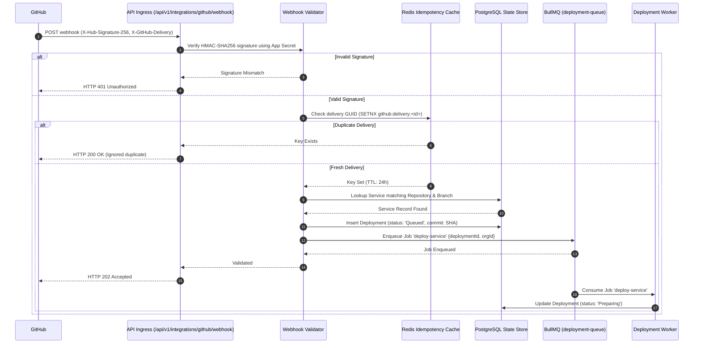
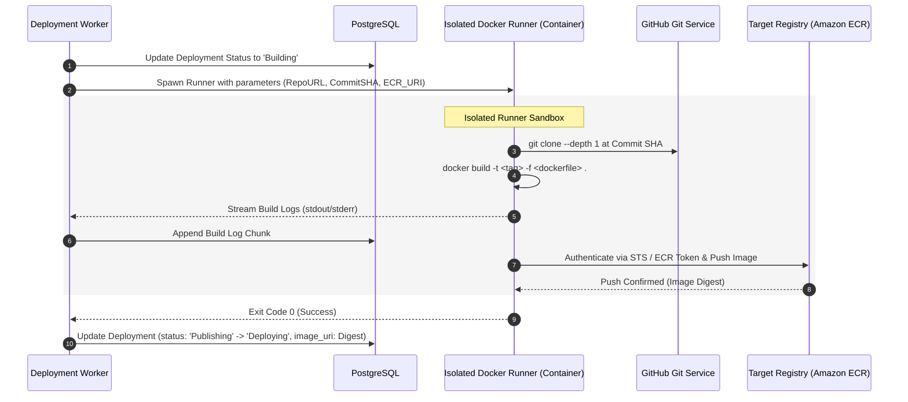
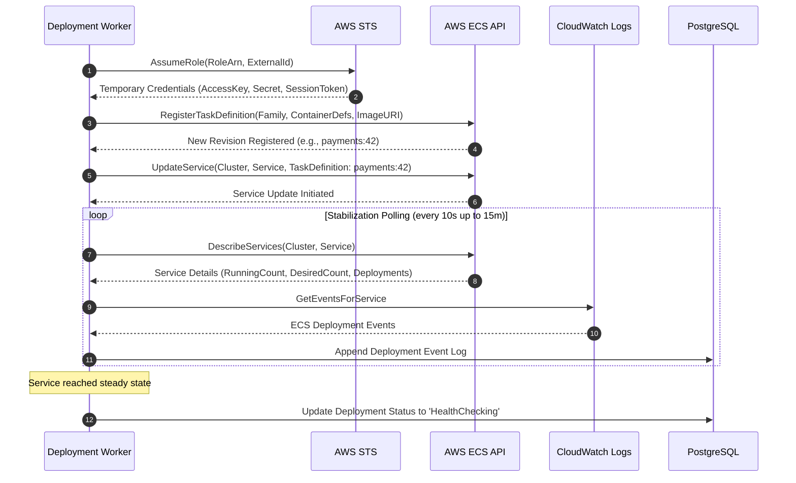
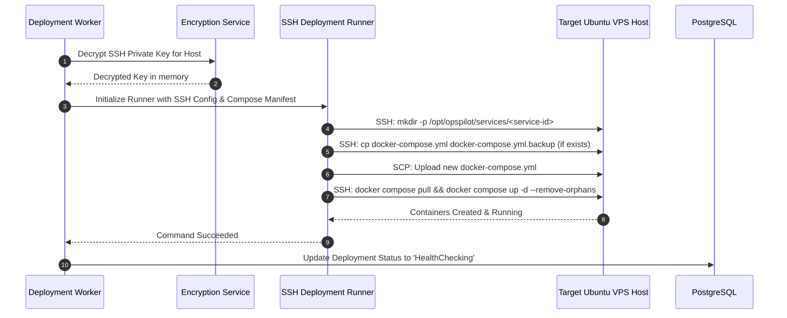
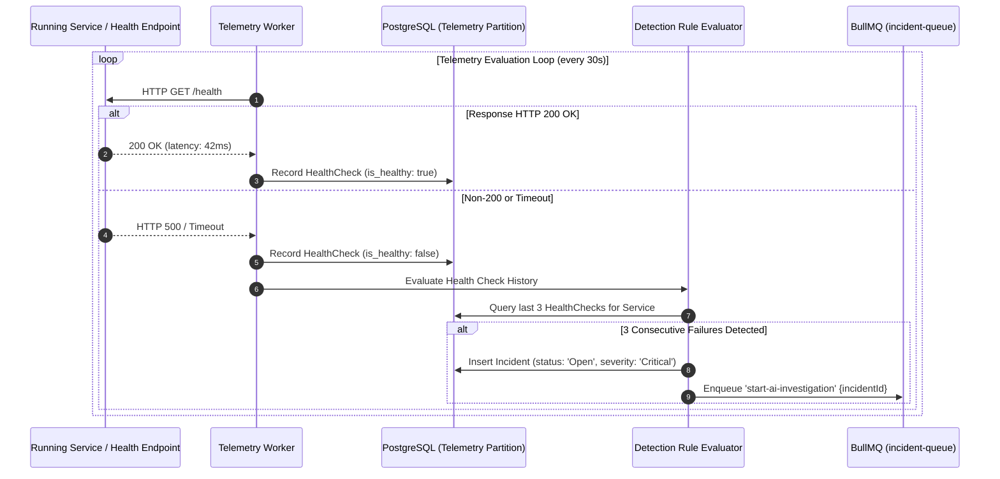
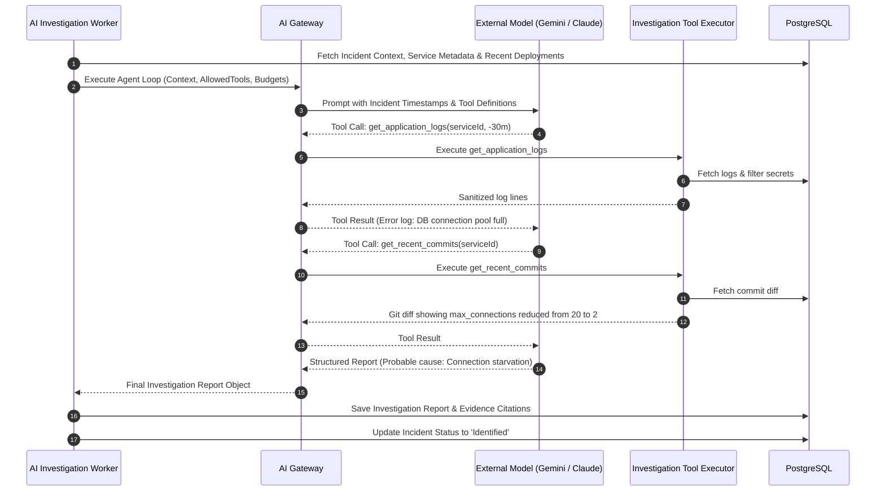

# End-to-End Data Flow Specifications

This document details the critical sequence of data events across external systems, the OpsPilot control plane, background workers, and target infrastructure.

---

## 1. GitHub Webhook Ingestion & Deployment Trigger Flow

The following sequence details how GitHub push events are securely received, verified, deduplicated, and converted into deployment jobs:

---

## 2. Docker Image Build & Execution Flow

---

## 3. AWS ECS / Fargate Deployment Flow

---

## 4. VPS Docker Compose Deployment Flow

---

## 5. Telemetry Ingestion & Automated Incident Detection Flow

---

## 6. AI Incident Investigation Flow

