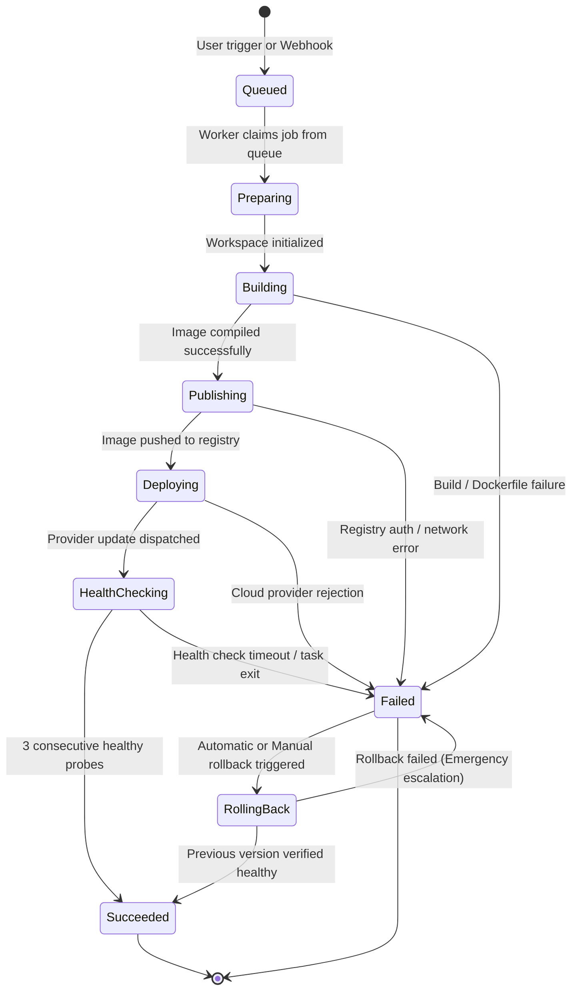
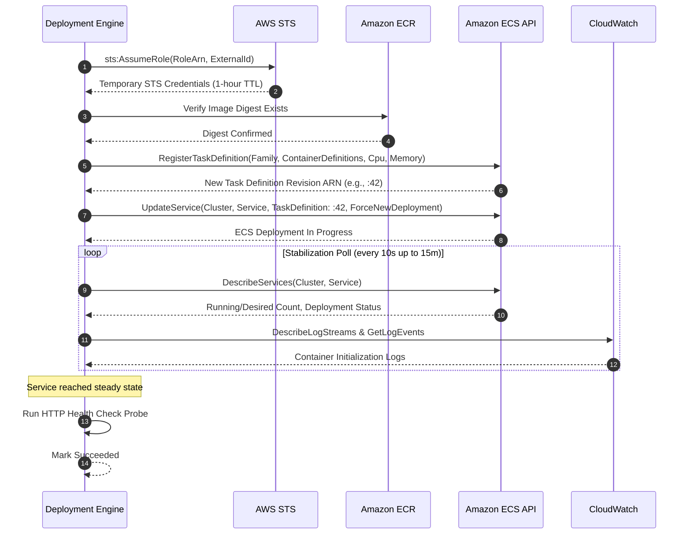
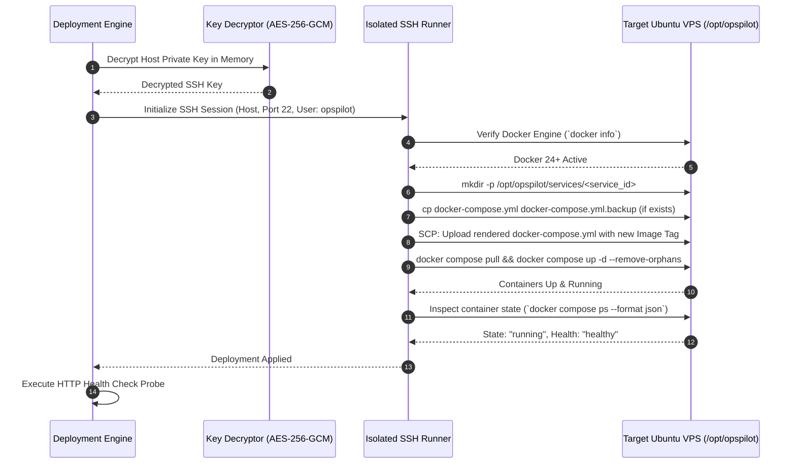

# Unified Deployment Architecture

> **Document Type:** Core Architectural Specification  
> **Status:** Approved Baseline  
> **Supported Targets:** AWS ECS / Fargate, Ubuntu VPS (Docker Engine + Docker Compose)

The OpsPilot Deployment Engine provides a unified control plane abstraction over divergent cloud and bare-metal container runtimes. Rather than building separate, disconnected deployment pipelines for AWS and VPS hosts, OpsPilot establishes a single polymorphic provider contract.

---

## 1. Unified Deployment Lifecycle State Machine

Every deployment—regardless of target provider—progresses through an immutable, strictly validated state machine:



### State Definitions:
1. `Queued`: Stored in PostgreSQL, awaiting worker pickup.
2. `Preparing`: Deployment worker has claimed the job and verified tenant credentials.
3. `Building`: Source code checked out in an isolated runner; Docker build executing.
4. `Publishing`: Image pushed to container registry (Amazon ECR or private registry).
5. `Deploying`: Target provider executing task update or container recreation.
6. `HealthChecking`: Application runtime active; polling health check endpoint.
7. `Succeeded`: Verified healthy and receiving production traffic.
8. `Failed`: Build error, cloud API failure, or post-deployment health check failure.
9. `RollingBack`: Reverting infrastructure to prior known-good deployment artifact.

---

## 2. Common Deployment Provider Contract

All infrastructure adapters must implement the `IDeploymentProvider` interface defined in `packages/deployment-providers`:

```typescript
export interface IDeploymentProvider {
  readonly providerType: TargetProvider;
  readonly capabilities: DeploymentCapabilities;

  /** Validates authentication credentials and connectivity to remote infrastructure */
  validateConnection(
    credentials: Readonly<Record<string, unknown>>,
    targetConfig?: Readonly<Record<string, unknown>>
  ): Promise<ConnectionResult>;

  /** Validates and prepares target manifests or task definitions */
  prepareDeployment(config: DeploymentConfig): Promise<PreparedDeployment>;

  /** Dispatches deployment artifact/manifest to the target infrastructure */
  deploy(
    deployment: PreparedDeployment,
    credentials: Readonly<Record<string, unknown>>
  ): Promise<DeploymentResult>;

  /** Queries real-time progress and event streams from the target provider */
  getStatus(
    deploymentId: string,
    externalId: string,
    credentials: Readonly<Record<string, unknown>>
  ): Promise<DeploymentStatusResult>;

  /** Executes an immediate rollback to the preceding immutable artifact version */
  rollback(
    deploymentId: string,
    targetVersionIdentifier: string,
    credentials: Readonly<Record<string, unknown>>
  ): Promise<RollbackResult>;

  /** Probes the deployed service health endpoint until verified or timed out */
  checkHealth(targetUrl: string): Promise<HealthCheckResult>;
}
```

### 2.1 Polymorphic Deployment Configuration & Capabilities

Deployment configurations are discriminated polymorphically by `targetProvider` (`aws_ecs | vps_docker | cloudflare_workers | cloudflare_pages`), separating **build strategy**, **artifact format**, and **application runtime** into independent domain attributes rather than coupling to a single runtime string. Providers declare explicit `DeploymentCapabilities` defining container support, port requirements, and rollback modes.

---

## 3. AWS ECS / Fargate Adapter (`AwsEcsProvider`)

### Architecture Overview
The AWS ECS adapter targets serverless container hosting using **AWS Fargate** and **Amazon ECR**. It operates with least privilege via AWS STS cross-account IAM role assumption using an external ID.



### Rollback Mechanism on ECS:
When a rollback is triggered, `AwsEcsProvider` does not rebuild code or re-push images. It issues an `UpdateService` API call referencing the previous Task Definition Revision ARN (e.g., reverting from `:42` back to `:41`). This executes in seconds.

---

## 4. VPS Docker Compose Adapter (`VpsDockerProvider`)

### Architecture Overview
The VPS adapter manages standard Ubuntu Linux instances running Docker Engine and Docker Compose. Communication occurs over an isolated SSH connection using public-key authentication.



### Rollback Mechanism on VPS:
`VpsDockerProvider` restores `docker-compose.yml.backup` to `docker-compose.yml` and executes `docker compose up -d --remove-orphans`. The previous container image is already present in the local Docker image cache, ensuring near-instantaneous restoration.
