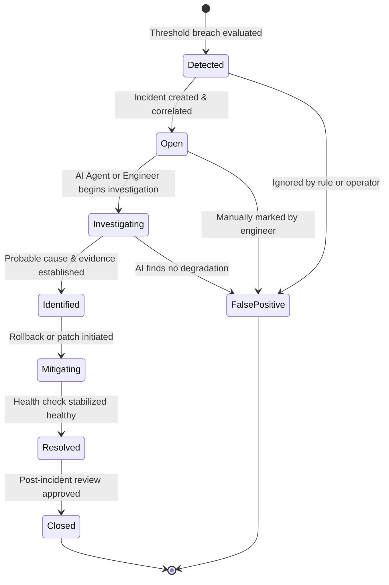
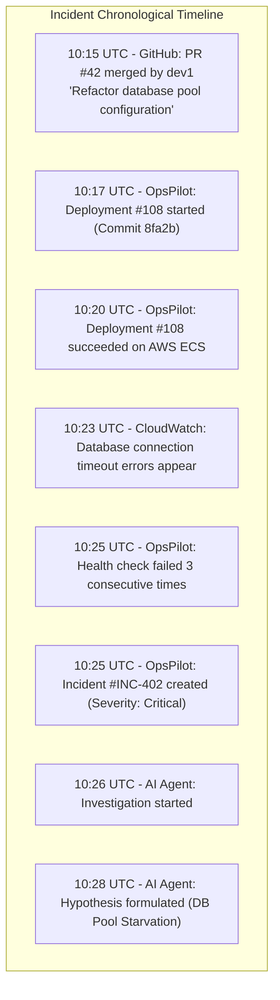

# Incident Detection & Correlation Architecture

> **Document Type:** Architectural Specification  
> **Status:** Approved Baseline

The OpsPilot Incident Engine is responsible for automated threshold evaluation, incident lifecycle management, alert deduplication, deployment correlation, and launching AI-driven investigations.

---

## 1. Incident Lifecycle State Machine

Incidents transition through a deterministic lifecycle, as illustrated below:

### State Definitions:
- `Detected`: Rule breach evaluated by the telemetry worker; undergoing deduplication.
- `Open`: Unassigned or unacknowledged active incident with linked deployment context.
- `Investigating`: Bounded AI Investigation Worker (or human engineer) actively executing diagnostic queries.
- `Identified`: Root cause hypothesis produced with supporting evidence citations.
- `Mitigating`: Remediation action (deployment rollback, configuration change) in progress.
- `Resolved`: Health check probes have returned HTTP 200 continuously for 5 minutes.
- `Closed`: Incident closed and permanently archived for audit and evaluation metrics.
- `FalsePositive`: Breach determined to be transient network blip or misconfigured threshold.

---

## 2. Detection Trigger Rules & Severity Matrix

Severity is assigned deterministically based on empirical evidence, never by arbitrary LLM judgment:

| Severity | Triggering Criteria | Automatic Action |
|---|---|---|
| **Critical** | • Service health check returns non-200 for 3 consecutive probes (90s). • Container crash-looping or exit code 137 (OOMKilled). • HTTP 5xx error rate > 10% over 3 minutes. | Immediate incident creation, push WebSocket alert, trigger AI investigation job. |
| **High** | • HTTP 5xx error rate between 5% and 10% over 5 minutes. • P95 latency exceeds 2000ms for 5 minutes. • Sustained Memory or CPU > 90% for 5 minutes. | Create incident, trigger AI investigation job, notify on-call channel. |
| **Medium** | • Health check probe intermittent (1 failure followed by recovery). • Memory utilization between 80% and 90%. | Record warning event, flag service as `Degraded`. |
| **Low** | • Deployment warning event (e.g., slow container startup). | Append event to deployment log. |

---

## 3. Alert Deduplication & Flapping Prevention

To prevent alert storms when an unhealthy service oscillates around a threshold:
1. **Deduplication Key:** An incident is uniquely keyed by `(organization_id, service_id, alert_type)`.
2. **Coalescing Window:** If an alert of the same type fires for a service that already has an `Open` or `Investigating` incident, OpsPilot does not create a new incident. Instead, it appends an `incident_event` to the existing incident timeline.
3. **Flapping Cooldown:** Once an incident is marked `Resolved`, a 15-minute cooldown timer prevents re-opening. A new breach within that window re-activates the existing incident with an "Incident Flapped" annotation.

---

## 4. Deployment Correlation Engine

When an incident is created, the correlation engine executes the following query logic:
1. Identifies the affected `service_id`.
2. Queries the `deployments` table for the most recent deployment completed within the preceding **2 hours**.
3. If a deployment occurred within that window:
   - Associates the `deployment_id`, commit SHA, commit author, and commit message with the incident record.
   - Extracts git diff metadata from the deployment artifact.
   - Flags the deployment on the timeline as a **Primary Correlation Candidate**.
4. If no deployment occurred in the 2-hour window, flags the incident as an **Environmental / External Dependency Incident**.

---

## 5. Incident Timeline Assembly

The timeline represents a chronological log of events starting 60 minutes prior to the first alert:

