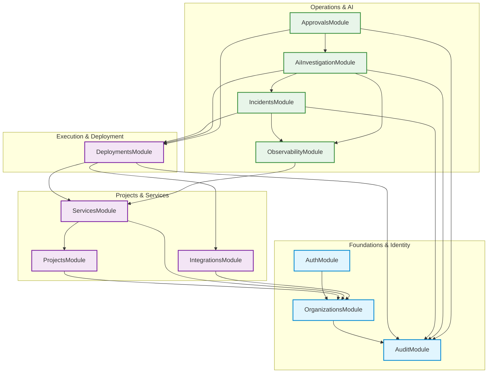

# Backend Module Boundaries & Domain Encapsulation

> **Document Type:** Architectural Specification  
> **Pattern:** Modular Monolith Domain Boundaries  
> **Target Framework:** NestJS / TypeScript

To prevent code degradation, maintain clean separation of concerns, and allow seamless extraction into independent services in the future, OpsPilot defines strict boundaries across its internal modules.

---

## 1. Module Dependency Graph (Strict Directed Acyclic Graph)

The following diagram defines the **only permitted dependencies** between backend modules. Circular dependencies are strictly forbidden.

---

## 2. Module Specifications

### 2.1 AuthModule (`apps/api/src/modules/auth`)
- **Primary Responsibility:** User identity, password verification, session issuance, and tenant context propagation.
- **Owned Entities:** `users`, `user_sessions`, `refresh_tokens`.
- **Public Interface:** `AuthService.validateToken(token: string): Promise<TenantContext>`.
- **Dependencies:** `OrganizationsModule`.
- **Events Published:** `user.registered`, `user.logged_in`, `user.password_reset`.
- **Forbidden:** Must never access deployment, infrastructure, or incident entities directly.

---

### 2.2 OrganizationsModule (`apps/api/src/modules/organizations`)
- **Primary Responsibility:** Organization lifecycle, membership records, role assignment, and tenant boundary verification.
- **Owned Entities:** `organizations`, `organization_members`, `invitations`.
- **Public Interface:** `OrganizationsService.verifyMembership(userId: string, orgId: string): Promise<Role>`.
- **Dependencies:** `AuditModule`.
- **Events Published:** `organization.created`, `member.invited`, `member.role_updated`.
- **Forbidden:** Must never invoke deployment adapters or AI tools.

---

### 2.3 IntegrationsModule (`apps/api/src/modules/integrations`)
- **Primary Responsibility:** Managing connections to GitHub Apps, AWS accounts (IAM roles), VPS hosts, and Cloudflare accounts (scoped API tokens). Secure envelope encryption and decryption of credentials (`AES-256-GCM` with tenant-specific HKDF keys). Deep permission probing via `CloudflareApiClient`.
- **Owned Entities:** `integrations`, `integration_credentials`, `deployment_targets`.
- **Public Interface:**
  - `IntegrationsService.getDecryptedCredential(integrationId: string, orgId: string): Promise<DecryptedSecret>`.
  - `IntegrationsService.validateConnection(integrationId: string): Promise<ConnectionStatus>`.
  - `IntegrationsService.probeCloudflareCapabilities(accountId: string, token: string): Promise<CloudflareProbedCapabilities>`.
- **Dependencies:** `OrganizationsModule`, `AuditModule`.
- **Events Published:** `integration.connected`, `integration.validated`, `integration.revoked`.
- **Forbidden:** Must never expose unencrypted credentials to controllers or external API responses.

---

### 2.4 DeploymentsModule (`apps/api/src/modules/deployments`)
- **Primary Responsibility:** Deployment state machine, dispatching build and deployment jobs to BullMQ, monitoring stabilization, and executing rollbacks. Houses concrete provider adapters: `AwsEcsProvider`, `VpsDockerProvider`, `CloudflareWorkersProvider` (Workers Versions & Deployments API), and `CloudflarePagesProvider` (Direct Upload API).
- **Owned Entities:** `deployments`, `deployment_events`, `deployment_artifacts`.
- **Public Interface:**
  - `DeploymentsService.triggerDeployment(serviceId: string, commitSha: string): Promise<Deployment>`.
  - `DeploymentsService.rollback(deploymentId: string, targetVersion?: string): Promise<RollbackResult>`.
  - `DeploymentsService.getDeploymentHistory(serviceId: string, limit: number): Promise<Deployment[]>`.
- **Dependencies:** `ServicesModule`, `IntegrationsModule`, `AuditModule`.
- **Events Published:** `deployment.requested`, `deployment.started`, `deployment.succeeded`, `deployment.failed`, `deployment.rolled_back`.
- **Forbidden:** Must not parse application runtime logs or evaluate incident rules.

---

### 2.5 ObservabilityModule (`apps/api/src/modules/observability`)
- **Primary Responsibility:** Ingesting health check results, polling container metrics, and storing sanitized application log references.
- **Owned Entities:** `health_checks`, `metric_snapshots`, `log_references`.
- **Public Interface:**
  - `ObservabilityService.getServiceHealth(serviceId: string): Promise<HealthStatus>`.
  - `ObservabilityService.getLogs(serviceId: string, window: TimeWindow): Promise<SanitizedLogLine[]>`.
  - `ObservabilityService.getMetrics(serviceId: string, metric: string, window: TimeWindow): Promise<MetricPoint[]>`.
- **Dependencies:** `ServicesModule`.
- **Events Published:** `telemetry.health_check_failed`, `telemetry.metric_threshold_breached`.
- **Forbidden:** Must not create incidents directly; only emits telemetry breach events.

---

### 2.6 IncidentsModule (`apps/api/src/modules/incidents`)
- **Primary Responsibility:** Evaluates threshold breach events, creates and manages incident lifecycles, correlates recent deployments, and builds incident timelines.
- **Owned Entities:** `incidents`, `incident_events`, `incident_timelines`.
- **Public Interface:**
  - `IncidentsService.createIncident(dto: CreateIncidentDto): Promise<Incident>`.
  - `IncidentsService.getIncidentTimeline(incidentId: string): Promise<TimelineEvent[]>`.
  - `IncidentsService.updateStatus(incidentId: string, status: IncidentStatus): Promise<Incident>`.
- **Dependencies:** `ObservabilityModule`, `DeploymentsModule`, `AuditModule`.
- **Events Published:** `incident.created`, `incident.status_changed`, `incident.resolved`.
- **Forbidden:** Must not call LLMs directly; delegates investigation to `AiInvestigationModule`.

---

### 2.7 AiInvestigationModule (`apps/api/src/modules/ai-investigation`)
- **Primary Responsibility:** Coordinates read-only incident investigations via the AI Gateway, executing authorized tools within strict limits, and generating structured diagnostic reports.
- **Owned Entities:** `agent_runs`, `agent_tool_calls`, `investigation_reports`.
- **Public Interface:**
  - `AiInvestigationService.startInvestigation(incidentId: string): Promise<string>`.
  - `AiInvestigationService.getReport(investigationId: string): Promise<InvestigationReport>`.
- **Dependencies:** `IncidentsModule`, `ObservabilityModule`, `DeploymentsModule`, `AuditModule`.
- **Events Published:** `investigation.started`, `investigation.tool_executed`, `investigation.completed`.
- **Forbidden:** Strictly read-only. Must never invoke deployment creation, server restart, or code commits.

---

### 2.8 AuditModule (`apps/api/src/modules/audit`)
- **Primary Responsibility:** Recording immutable, append-only logs for all sensitive system and user operations.
- **Owned Entities:** `audit_logs`.
- **Public Interface:** `AuditService.record(entry: AuditLogEntry): Promise<void>`.
- **Dependencies:** Core database only (No domain module dependencies).
- **Events Consumed:** Subscribes to all state-changing domain events.
- **Forbidden:** Cannot modify or delete existing audit logs.
