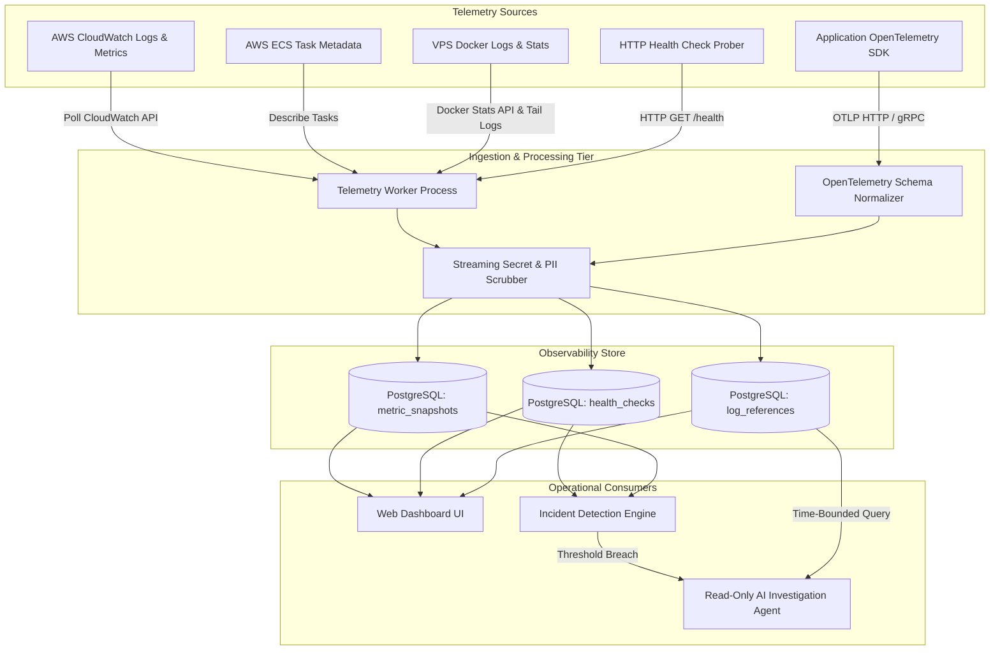

# Observability Architecture

> **Document Type:** Architectural Specification  
> **Telemetry Standards:** OpenTelemetry (OTLP), AWS CloudWatch, Docker Daemon Logs  
> **Status:** Approved Baseline

OpsPilot is a **deployment-aware** operational platform. Unlike traditional APM tools that treat observability as an isolated island, OpsPilot connects runtime telemetry directly to the software delivery lifecycle.

---

## 1. Observability Architecture Diagram

The following diagram illustrates how telemetry is collected across AWS and VPS targets, normalized, scrubbed of secrets, stored, and consumed by the dashboard and incident engine:

---

## 2. Telemetry Ingestion Channels

### 2.1 AWS CloudWatch Integration
- **Metrics Collected:**
  - `CPUUtilization`: Percent of task vCPU consumed.
  - `MemoryUtilization`: Percent of task memory consumed.
  - `NetworkRxBytes` / `NetworkTxBytes`: Network throughput.
- **Log Collection:** CloudWatch Log Groups associated with ECS Task Definitions (via `awslogs` log driver). Polled on-demand during active incidents or streamed in rolling 1-minute windows.

### 2.2 VPS Docker Integration
- **Metrics Collected:** Polled via the Docker Engine API socket (`GET /containers/{id}/stats?stream=false`). Calculates CPU percentage using container delta over system delta.
- **Log Collection:** Reads `stdout` and `stderr` streams directly from the container via Docker multiplexed stream reader (`GET /containers/{id}/logs?stdout=true&stderr=true&tail=500`).

### 2.3 HTTP Health Check Probing
- Independent, active synthetic probing executed by the `Telemetry Worker` at 30-second intervals.
- Measures DNS lookup latency, TLS handshake latency, time-to-first-byte (TTFB), and HTTP response status code.

---

## 3. Secret Scrubbing & Data Sanitization

All telemetry entering OpsPilot passes through an inline, zero-allocation streaming scrubber before being written to database tables or forwarded to LLM context:

| Category | Regex / Matching Pattern | Replacement |
|---|---|---|
| **AWS Access Keys** | `(?<![A-Z0-9])[A-Z0-9]{20}(?![A-Z0-9])` | `[REDACTED_AWS_KEY]` |
| **AWS Secret Keys** | `(?<![A-Za-z0-9/+=])[A-Za-z0-9/+=]{40}(?![A-Za-z0-9/+=])` | `[REDACTED_AWS_SECRET]` |
| **Bearer Tokens** | `(?i)bearer\s+[A-Za-z0-9_\-\.~+/]+=*` | `Bearer [REDACTED_TOKEN]` |
| **Private Keys** | `-----BEGIN (?:RSA \|EC \|DSA \|OPENSSH )?PRIVATE KEY-----[\s\S]+?-----END` | `[REDACTED_PRIVATE_KEY]` |
| **Database URIs** | `(?:postgres\|mysql\|mongodb):\/\/[^:]+:[^@]+@` | `protocol://user:[REDACTED]@` |
| **Credit Cards** | `\b(?:\d{4}[ -]?){3}\d{4}\b` | `[REDACTED_PAN]` |

---

## 4. Time-Windowed Log & Metric Querying

OpsPilot does not attempt to be a multi-terabyte log warehouse in version 1.0. Instead, it maintains a sliding 7-day window of indexed logs and a 30-day window of roll-up metrics:
- **Partitioning:** PostgreSQL tables `metric_snapshots` and `log_references` are partitioned by `RANGE (created_at)` in 1-week increments.
- **Dropped Partitions:** Automated pg_cron or maintenance jobs drop partitions older than the retention threshold, ensuring bounded storage costs.
- **Query Limits:** AI agent and user queries are strictly bounded to a maximum 60-minute window and a maximum limit of 500 log lines per request.
