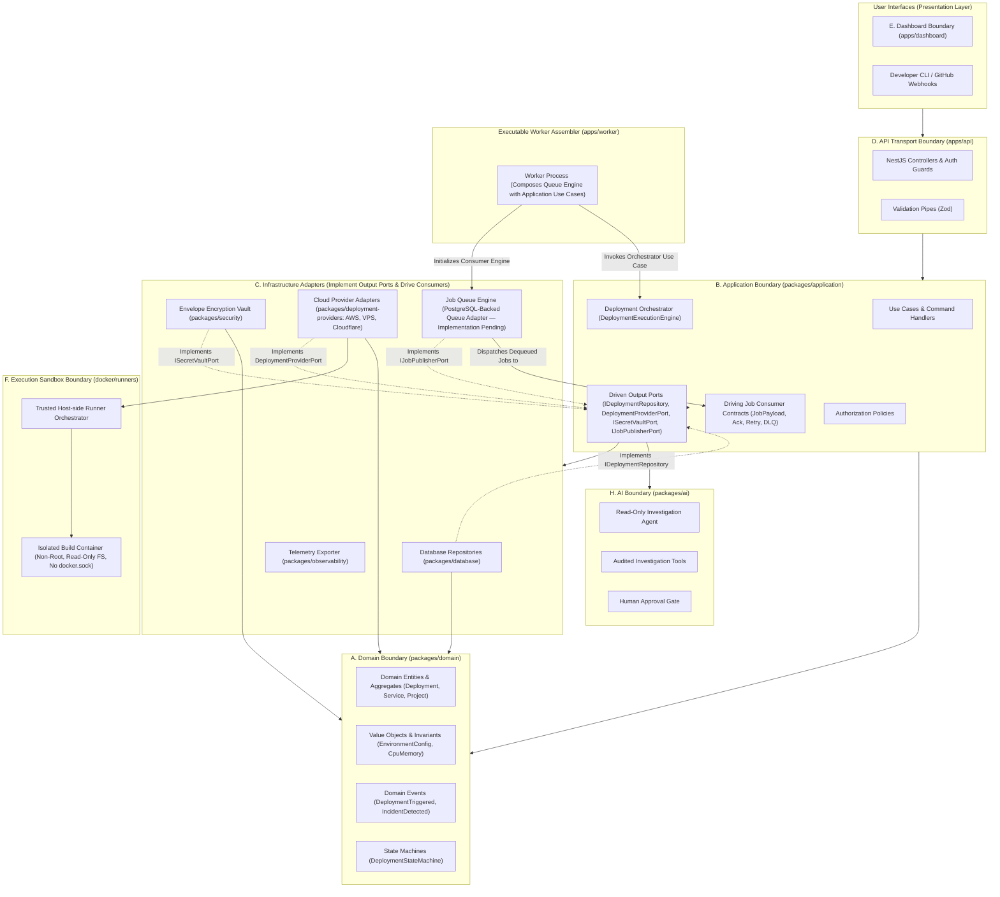
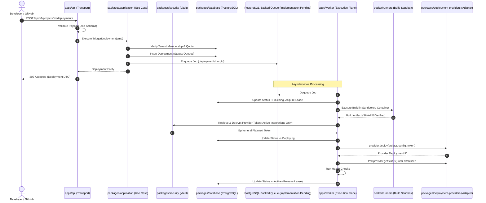

# OpsPilot — Architectural Project Boundaries

> **Audience:** Software Architects, Platform Engineers, Security Reviewers  
> **Status:** Authoritative Architectural Specification  
> **Date:** November 2026

---

## 1. Architectural Purpose & Boundaries Overview

OpsPilot follows a strict **Modular Monolith** and **Hexagonal (Ports and Adapters)** architectural pattern. To prevent architectural erosion, spaghetti dependencies, and security breaches, the system is segmented into ten explicit boundaries.

---

## 2. Boundary Definitions & Invariants

### A. Domain Boundary (`packages/domain`)
- **Responsibilities:** Encapsulates core enterprise business rules, domain entities (`Project`, `Service`, `Deployment`, `Incident`, `Organization`), value objects (`DeploymentId`, `EnvironmentConfig`, `CpuMemoryConfig`), state machines, and domain events.
- **Strict Invariants:**
  1. **Zero External Dependencies:** Must contain zero dependencies outside of standard TypeScript utilities.
  2. **No I/O or Frameworks:** Strictly forbidden from importing NestJS, Express, PostgreSQL (`pg`), Redis, HTTP clients (`fetch`, `axios`), or Zod.
  3. **Self-Validating:** Enforces structural invariants within domain constructors and factory methods.

### B. Application Boundary (`packages/application`)
- **Responsibilities:** Houses all orchestration workflows and use cases. Defines four explicit internal sub-boundaries:
  1. **Driven (Output) Ports:** Abstract interfaces required by application workflows, implemented by infrastructure adapters:
     - `IDeploymentRepository`: Interface for persisting and querying deployment state and events.
     - `DeploymentProviderPort`: Interface for target cloud delivery mechanisms (AWS, VPS, Cloudflare).
     - `ISecretVaultPort`: Interface for decrypting ephemeral provider credentials just-in-time.
     - `IJobPublisherPort`: Interface for enqueuing asynchronous background tasks.
     - `INotificationPort`: Interface for external alerting and webhook delivery.
  2. **Driving (Input) Consumer Contracts:** Contracts defining background job payloads, processing handlers, message acknowledgement (`ack`), failure handling (`nack`), retries, and dead-letter queue (DLQ) behavior.
  3. **Use Cases & Command Handlers:** Specific business operations (`TriggerDeploymentUseCase`, `RollbackServiceUseCase`, `InvestigateIncidentUseCase`).
  4. **Deployment Orchestration Engine:** `DeploymentExecutionEngine`, coordinating the multi-stage deployment lifecycle (Validate -> Build -> Deploy -> Await Stabilization -> HealthCheck -> Promote / Rollback) and managing distributed database leases.
- **Strict Invariants:**
  1. Depends only on `packages/domain` and `packages/contracts`.
  2. Does not know how persistence, queues, or external cloud APIs are implemented.
  3. Contains **zero cloud provider SDKs** (no AWS SDK, no Cloudflare client) and **zero direct SQL/database drivers** (`pg`).
  4. All interactions with infrastructure occur exclusively through driven Port interfaces.

### C. Infrastructure Boundary (`packages/database`, `packages/deployment-providers`, `packages/security`)
- **Responsibilities:** Implements the output ports defined by the application layer using concrete technologies: PostgreSQL connection pool, external cloud provider SDKs, and cryptographic encryption vaults.
- **Strict Invariants:**
  1. SQL queries, database migrations, connection lifecycle, and transaction management are confined to this boundary.
  2. Cloud provider SDKs (AWS SDK, Cloudflare API client, Docker Engine API) are encapsulated within provider adapters.
  3. Never leaks database connection handles (`pg.PoolClient`) or raw SDK clients into domain or API layers.

### D. API Boundary (`apps/api`)
- **Responsibilities:** HTTP protocol handling, NestJS controllers, authentication middleware (JWT / session extraction), request validation via Zod pipes, rate limiting, and HTTP response mapping.
- **Strict Invariants:**
  1. Controllers never execute business logic; they validate input against contracts and delegate immediately to Application Use Cases.
  2. Never exposes raw database entities or internal stack traces in HTTP responses.

### E. Dashboard Boundary (`apps/dashboard`)
- **Responsibilities:** Web frontend application (Next.js or Vite + React SPA, Tailwind CSS). Renders application metrics, deployment progress, incident timelines, and remediation diffs.
- **Strict Invariants:**
  1. Interacts with the backend solely via the typed API client generated from `packages/contracts`.
  2. Never accesses the database or cryptographic vault directly.

### F. Execution & Worker Boundary (`apps/worker`, `docker/runners`)
- **Responsibilities:** 
  1. **Worker Executable (`apps/worker`):** An application assembler/composer executable (Planned — Phase 2) that initializes the infrastructure queue consumer engine (PostgreSQL-backed queue — selected architecture, implementation pending) and routes dequeued jobs to application use cases (`DeploymentExecutionEngine`).
  2. **Host-side Runner Orchestrator:** A trusted host-side service controlling the Docker daemon to spawn, monitor, and clean up isolated build containers.
  3. **Sandboxed Build Container (`docker/runners`):** Ephemeral leaf container executing untrusted repository code with non-root UID 10001, `--read-only` root filesystem, network egress restrictions, and **zero access to `/var/run/docker.sock`**.
- **Strict Invariants:**
  1. Untrusted build containers never receive Docker socket access or host system credentials.
  2. The worker executable does not implement the queue port itself; it composes the queue adapter with application use cases.

### G. Security Boundary (`packages/security`)
- **Responsibilities:** Secret redaction and credential encryption (target architecture: NIST SP 800-57 multi-tier envelope encryption; Phase 0 implementation: static tenant HKDF derivation service retained under scope exception, refactoring scheduled for Phase 2). Implements `ISecretVaultPort` and `ISecretRedactor`.
- **Strict Invariants:**
  1. Key material is cleared from memory buffers after cryptographic operations.
  2. Encrypted payloads must include tenant and integration IDs as Additional Authenticated Data (AAD) to prevent cross-tenant decryption.
  3. Fails closed with fatal startup exceptions if master keys are missing or compromised.

### H. AI Boundary (`packages/ai`)
- **Responsibilities:** LLM gateway, autonomous incident investigation workflows, bounded diagnostic tools (`BaseInvestigationTool`), and prompt construction.
- **Strict Invariants:**
  1. **Strictly Read-Only:** The AI agent possesses zero write or mutating tools during investigation.
  2. **Mandatory Human Gate:** Any remediation patch, script, or configuration change proposed by AI must be reviewed and explicitly approved by a human engineer via PR before execution.
  3. **No Direct Secret Access:** Application secrets, API tokens, and customer credentials are unconditionally stripped by the secret redactor before feeding context to LLMs.

### I. Provider Boundary (`packages/deployment-providers`)
- **Responsibilities:** Concrete deployment provider adapters (AWS ECS/Fargate, VPS Docker Compose, Cloudflare Workers, Cloudflare Pages) implementing the application `DeploymentProviderPort` interface.
- **Strict Invariants:**
  1. Encapsulates all third-party provider SDKs (AWS SDK, Cloudflare API client, Docker Engine API).
  2. Translates provider-specific errors into standard domain exceptions (`DeploymentFailedException`, `ProviderAuthenticationException`).
  3. Does not own orchestration logic; orchestration is driven by the application layer.

### J. Control Plane vs. Execution Plane Boundary
- Separates high-trust central management (database, secrets, API) from zero-trust execution (sandboxed build runners and task workers). Documented in detail in [`CONTROL_PLANE_AND_EXECUTION_PLANE.md`](CONTROL_PLANE_AND_EXECUTION_PLANE.md).

---

## 3. Boundary Interaction & Data Flow

---

## 4. Enforcement Mechanisms

1. **TypeScript Project References:** Each package defines a `tsconfig.json` with strict `references` declaring allowed dependencies.
2. **ESLint Boundary Rules:** `import/no-restricted-paths` configured to fail CI if an inner boundary (e.g. `domain`) imports from an outer boundary (e.g. `api`, `database`).
3. **Automated CI Checks:** Dedicated monorepo boundary linter runs on every pull request.
