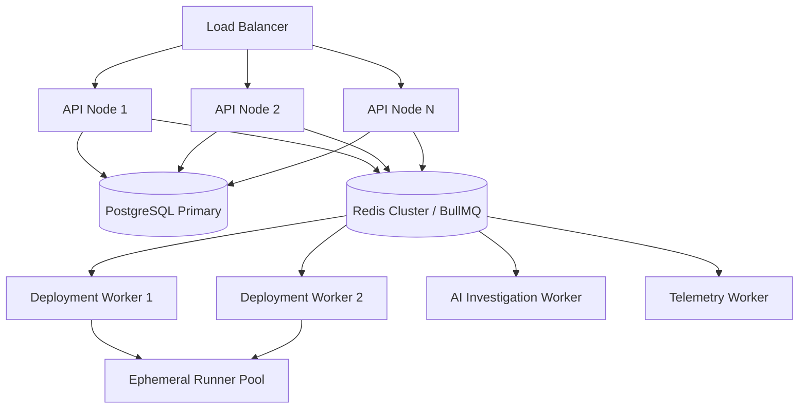

# Scalability & Reliability Architecture

> **Document Type:** Non-Functional Architecture Specification  
> **Targets:** 99.5% Control Plane Availability, Linear Horizontal Scaling for Workers

OpsPilot is engineered to scale gracefully from single-server development instances to distributed production workloads supporting dozens of concurrent engineering teams.

---

## 1. Reliability & Availability Targets

- **Control Plane Availability Target:** 99.5% uptime for the REST API and web dashboard.
- **Data Durability:** Zero loss of completed deployment records or audit logs. PostgreSQL Write-Ahead Logging (WAL) and automated snapshots ensure point-in-time recovery.
- **Job Survivability:** Background jobs in BullMQ survive worker restarts. If a worker process terminates abruptly during an active deployment or AI investigation, a heartbeat timeout (120s) triggers automatic reassignment to a healthy worker.
- **Fail-Open Application Runtimes:** OpsPilot is purely a control plane. If OpsPilot experiences an outage, customer applications deployed on AWS ECS or VPS instances continue running without degradation.

---

## 2. Horizontal Scaling Topology

The architecture separates stateless web/API traffic from resource-intensive background processing:

### Scaling Characteristics:
- **Stateless API Tier:** The NestJS API nodes do not hold local session state (sessions are JWT/Redis backed). Nodes scale horizontally behind standard ALB/NLB.
- **Worker Concurrency & Autoscaling:** Workers scale independently based on BullMQ queue depth (`deployment-queue`, `ai-investigation-queue`).
- **Database Connection Pooling:** Managed through PgBouncer or NestJS ORM connection pooling to prevent PostgreSQL connection saturation under high concurrency.

---

## 3. Graceful Degradation & Failure Handling

| Failure Scenario | Impact | System Reaction & Recovery |
|---|---|---|
| **Redis Outage** | Job processing paused; session verification falls back. | API returns HTTP 503 for deployment triggers; existing deployments in AWS/VPS continue running; BullMQ retries connection with exponential backoff. |
| **Worker Process Crash** | Active job stalled. | BullMQ stalled job detector identifies missing heartbeat after 120s; re-enqueues job or transitions deployment to `Failed` with diagnostic message. |
| **CloudWatch API Rate Limit (AWS 429)** | Metrics collection delayed. | Telemetry worker applies jittered exponential backoff; caches last known metrics. |
| **LLM Provider Outage** | AI investigations cannot complete. | AI Gateway catches provider timeout; marks investigation as `Inconclusive`; notifies user that manual investigation is required. |
| **PostgreSQL Transient Disconnect** | API read/write errors. | Built-in connection pool retry logic; health check endpoint `/health` flags degraded status to load balancer. |
