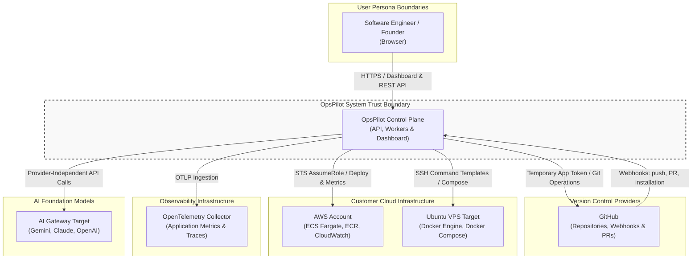

# System Architecture Blueprint

> **Product:** OpsPilot  
> **Architecture Pattern:** Modular Monolith + Independent Background Workers + Isolated Deployment Runners  
> **Status:** Authoritative Architecture Blueprint

---

## 1. Architectural Philosophy & Principles

OpsPilot adopts the **Modular Monolith** architectural style paired with asynchronous worker processes and isolated execution runners. This approach provides significant engineering advantages for an early-stage, high-complexity platform:
1. **Single Deployable Unit for Core API:** Fast developer feedback loops, simplified shared domain models, straightforward transaction boundaries, and low operational overhead compared to premature microservices.
2. **Strict Module Encapsulation:** Clear boundaries inside the monolith (see [Module Boundaries](MODULE_BOUNDARIES.md)) to prevent spaghetti code and allow individual modules to be extracted into independent microservices later if scaling demands dictate.
3. **Asynchronous Execution for Heavy Operations:** Long-running Docker builds, cloud deployments, and multi-step AI investigations are offloaded to asynchronous background workers and isolated container runners (PostgreSQL-backed queue — selected architecture, implementation pending), preventing API thread-pool starvation.
4. **PostgreSQL as the Durable Source of Truth:** All business state, deployment records, incident histories, audit logs, and queue entries reside durably in PostgreSQL. Redis is retained as a future high-throughput scale tier if queue throughput exceeds 5,000 jobs/minute.
5. **Zero Infrastructure Access for AI:** The AI model is treated as an untrusted reasoning engine. It interacts solely through deterministic, read-only tools mediated by application authorization logic.

---

## 2. System Context (C4 Context Diagram)

The following diagram illustrates how users, OpsPilot, and external platforms interact across organizational and trust boundaries:



---

## 3. Container & Component Architecture

The following diagram details the runtime container architecture of OpsPilot:

```mermaid
flowchart TD
    User([Engineer / User]) -->|HTTPS:443| LB[Load Balancer / Ingress]

    subgraph FrontendApp [Frontend Tier]
        LB -->|Routes /| Web[Next.js 14 Dashboard<br/>React, Tailwind CSS, App Router]
    end

    subgraph CoreBackend [Core Application Tier]
        LB -->|Routes /api/v1| API[NestJS Modular API Gateway<br/>TypeScript, Node.js 20 LTS]
    end

    subgraph DataStorage [Data & Messaging Tier]
        API -->|Relational Queries & Transactions| PG[(PostgreSQL 16 Database<br/>State, Tenants, Audit, Logs)]
        API -->|Enqueue Jobs| Queue[(PostgreSQL-Backed Queue<br/>Selected Architecture - Implementation Pending)]
    end

    subgraph WorkerTier [Asynchronous Worker Tier (Planned)]
        Queue -->|Pulls deployment-queue| DepWorker[Deployment Worker]
        Queue -->|Pulls incident-queue| IncWorker[Incident Worker]
        Queue -->|Pulls ai-investigation-queue| AIWorker[AI Investigation Worker]
        Queue -->|Pulls telemetry-queue| TelWorker[Telemetry Worker]

        DepWorker -->|Updates State| PG
        IncWorker -->|Updates State| PG
        AIWorker -->|Updates State| PG
        TelWorker -->|Aggregates Metrics| PG
    end

    subgraph ExecutionSandbox [Isolated Execution Runners]
        DepWorker -->|Launches Ephemeral Container| Runner[Dockerized Build Runner<br/>Clones Repo, Builds Image, Pushes]
        AIWorker -->|Invokes Tool Sandbox| AIGateway[AI Gateway Service<br/>Sanitizes Context & Calls Model]
    end

    subgraph TargetEnvironments [Customer Runtime Targets]
        Runner -->|ECR Push & Task Def Update| AWS_ECS[AWS ECS / Fargate]
        Runner -->|SSH Deploy /opt/opspilot/| VPS_Host[VPS Docker Compose]
        AIGateway -->|HTTPS Prompt with Tools| ModelAPI[LLM API Endpoint]
    end
```

---

## 4. Major System Components & Responsibilities

### 4.1 Next.js 14 Dashboard (`apps/dashboard`)
- **Role:** Web presentation layer.
- **Responsibilities:**
  - Authenticated user interface for multi-project management.
  - Streaming deployment build logs and real-time health badges.
  - Incident timeline visualization and interactive AI diagnostic reports.
  - One-click deployment rollback and human approval workflows for remediation PRs.

### 4.2 NestJS Modular API (`apps/api`)
- **Role:** Control plane orchestrator and REST interface.
- **Responsibilities:**
  - Authentication, session validation, and tenant context propagation.
  - CRUD operations on projects, services, environments, and deployment targets.
  - GitHub webhook ingestion, signature validation, and event dispatching.
  - Enqueueing asynchronous background jobs to BullMQ.
  - Envelope encryption management for infrastructure credentials.

### 4.3 Background Worker Processes (`apps/workers`)
- **Deployment Worker:** Manages deployment lifecycles, orchestrates image builds via isolated runners, calls provider adapters, and polls post-deployment stabilization.
- **Telemetry Worker:** Gathers health check results, queries CloudWatch/Docker metrics, and checks threshold breach rules.
- **Incident Worker:** Correlates alerts with recent deployments, generates chronological incident timelines, and enqueues investigations.
- **AI Investigation Worker:** Executes bounded AI agent loops, dispatches read-only tool calls, verifies evidence, and formats the diagnostic report.

### 4.4 PostgreSQL State Store (`packages/database`)
- **Role:** Durable system of record.
- **Responsibilities:**
  - Enforces relational integrity and foreign key constraints across organizations, projects, and deployments.
  - Stores time-partitioned metrics snapshots and sanitized log records.
  - Maintains immutable, append-only audit trails of all user and system actions.

### 4.5 Asynchronous Queue Architecture
- **Role:** Task distribution and asynchronous coordination.
- **Specification:** **PostgreSQL-backed queue — selected architecture, implementation pending** (Project Foundation Decision 7).
- **Responsibilities:**
  - Priority queues for deployments, incident checks, and AI investigations.
  - Consolidates state into PostgreSQL to eliminate Redis operational overhead for small teams and enable single-transaction outbox persistence.
  - Preserves BullMQ and Redis as a future high-throughput scale tier if throughput exceeds 5,000 jobs/minute.

---

## 5. Architectural Trade-offs & Rationale

| Decision | Selected Approach | Alternative Considered | Rationale & Trade-off |
|---|---|---|---|
| **Monolith vs Microservices** | Modular Monolith | Microservices (Auth, Deploy, AI as separate apps) | Faster development, unified deployment, zero network serialization latency between core modules. Avoids microservices overhead before reaching scale. |
| **State Storage** | PostgreSQL Relational | MongoDB / Document DB | Strong schema enforcement, foreign key guarantees, and reliable ACID transactions are essential when managing production infrastructure state. |
| **Job Orchestration** | PostgreSQL-Backed Queue | Redis + BullMQ / Temporal / AWS SQS | PostgreSQL-backed queue — selected architecture, implementation pending (Decision 7). Eliminates separate Redis container overhead for small teams and enables single-transaction outbox persistence. BullMQ/Redis retained as future scale tier. |
| **Untrusted Builds** | Isolated Docker Runners | In-Process Child Process (`child_process.exec`) | User repositories contain arbitrary Dockerfiles and build scripts. Running builds in-process would expose the API to arbitrary remote code execution (RCE). |
| **AI Investigation** | Single Bounded Agent | Multi-Agent Collaborative System | Multi-agent setups introduce unpredictable looping, high token costs, and difficulty in debugging. A single bounded agent with deterministic tools is predictable and cost-effective. |
