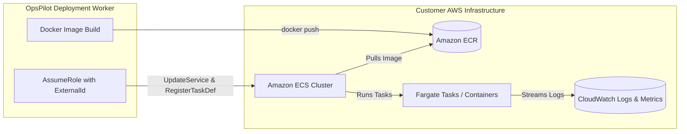

# AWS ECS Fargate Deployment Guide

This guide details how OpsPilot configures, authenticates with, deploys to, and rolls back applications hosted on **AWS ECS with AWS Fargate**.

---

## 1. Prerequisites & AWS Architecture

OpsPilot requires:
- An AWS Account with permissions to create IAM roles, ECR repositories, and ECS services.
- An Amazon ECS Cluster configured for the **FARGATE** launch type.
- An Application Load Balancer (ALB) or direct container port mapping for health check probing.



---

## 2. Cross-Account IAM Role Setup (Least Privilege)

To avoid storing permanent AWS Access Keys, OpsPilot uses **cross-account IAM role assumption** with a unique `ExternalId` to prevent the Confused Deputy problem.

### 2.1 Trust Relationship Policy
Attach this trust policy to the IAM role in the customer's AWS account:

```json
{
  "Version": "2012-10-17",
  "Statement": [
    {
      "Effect": "Allow",
      "Principal": {
        "AWS": "arn:aws:iam::112233445566:role/OpsPilotControlPlaneRole"
      },
      "Action": "sts:AssumeRole",
      "Condition": {
        "StringEquals": {
          "sts:ExternalId": "opspilot-org-8f7e6d5c-4b3a-2f1e-0d9c-8b7a6f5e4d3c"
        }
      }
    }
  ]
}
```

### 2.2 Permissions Policy (`OpsPilotDeploymentPolicy`)
Grant least-privilege permissions required to push images, update task definitions, and monitor deployment status:

```json
{
  "Version": "2012-10-17",
  "Statement": [
    {
      "Sid": "ECRAuthorization",
      "Effect": "Allow",
      "Action": [
        "ecr:GetAuthorizationToken"
      ],
      "Resource": "*"
    },
    {
      "Sid": "ECRImageManagement",
      "Effect": "Allow",
      "Action": [
        "ecr:BatchCheckLayerAvailability",
        "ecr:GetDownloadUrlForLayer",
        "ecr:BatchGetImage",
        "ecr:PutImage",
        "ecr:InitiateLayerUpload",
        "ecr:UploadLayerPart",
        "ecr:CompleteLayerUpload"
      ],
      "Resource": "arn:aws:ecr:*:*:repository/opspilot/*"
    },
    {
      "Sid": "ECSDeployment",
      "Effect": "Allow",
      "Action": [
        "ecs:RegisterTaskDefinition",
        "ecs:DescribeTaskDefinition",
        "ecs:DeregisterTaskDefinition",
        "ecs:DescribeServices",
        "ecs:UpdateService"
      ],
      "Resource": "*"
    },
    {
      "Sid": "CloudWatchTelemetry",
      "Effect": "Allow",
      "Action": [
        "logs:DescribeLogStreams",
        "logs:GetLogEvents",
        "cloudwatch:GetMetricData"
      ],
      "Resource": "*"
    },
    {
      "Sid": "PassRoleForTaskExecution",
      "Effect": "Allow",
      "Action": "iam:PassRole",
      "Resource": "arn:aws:iam::*:role/ecsTaskExecutionRole",
      "Condition": {
        "StringLike": {
          "iam:PassedToService": "ecs-tasks.amazonaws.com"
        }
      }
    }
  ]
}
```

---

## 3. Deployment & Rollback Lifecycle on ECS

### Step 1: Task Definition Revision Creation
`AwsEcsProvider` clones the existing Task Definition family, increments the revision number, updates the container image URI to the new ECR digest, and injects updated environment variables.

### Step 2: Service Update
Issues `ecs.updateService({ cluster, service, taskDefinition: newArn, forceNewDeployment: true })`.

### Step 3: Stabilization Monitoring
Polls `DescribeServices` every 10 seconds. The deployment reaches steady state when:
- `deployments` array contains only 1 entry with `status: "PRIMARY"`.
- `runningCount` equals `desiredCount`.
- Health check probes pass for 3 consecutive intervals.

### Step 4: Deterministic Rollback
If health checks fail or task crashes occur, rollback invokes:
```typescript
await ecsClient.send(new UpdateServiceCommand({
  cluster: config.clusterArn,
  service: config.serviceName,
  taskDefinition: previousTaskDefArn // Reverts directly to previous revision
}));
```
Reverting to the previous revision takes effect immediately without rebuilding or re-pushing images.
