# Continuous Integration & Delivery (CI/CD)

> **CI Engine:** GitHub Actions  
> **Release Model:** Trunk-Based Development with Semantic Versioning

This document outlines the automated testing, verification, and deployment pipelines for the OpsPilot platform.

---

## 1. End-to-End CI/CD Pipeline

```mermaid
flowchart LR
    subgraph PullRequest [Pull Request Validation Gate]
        PR[PR Created] --> Lint[ESLint & Markdown Check]
        PR --> Typecheck[tsc --noEmit]
        PR --> UnitTests[Unit Tests & Coverage]
        
        Lint --> IntTests[Integration & Multi-Tenant Tests]
        Typecheck --> IntTests
        UnitTests --> IntTests

        IntTests --> SecurityScan[CodeQL & Secret Scan]
    end

    subgraph MergeAndRelease [Main Branch Release Pipeline]
        SecurityScan -->|PR Approved & Merged| Main[Push to main branch]
        Main --> BuildImages[Build Multi-Arch Docker Images]
        BuildImages --> PushRegistry[Push to Docker Hub / ECR]
        PushRegistry --> TagRelease[Create GitHub Release & Changelog]
    end

    subgraph DeployControlPlane [Self-Hosted Production Deploy]
        TagRelease --> DeployStage[Deploy Staging Control Plane]
        DeployStage --> SmokeTests[Run Smoke Tests]
        SmokeTests --> DeployProd[Deploy Production Control Plane]
    end

    classDef pr fill:#e3f2fd,stroke:#1565c0,stroke-width:2px;
    classDef release fill:#f3e5f5,stroke:#7b1fa2,stroke-width:2px;
    classDef deploy fill:#e8f5e9,stroke:#388e3c,stroke-width:2px;

    class PullRequest pr;
    class MergeAndRelease release;
    class DeployControlPlane deploy;
```

---

## 2. GitHub Actions Workflow Configuration

The primary CI pipeline is defined in `.github/workflows/ci.yml`.

### Key Pipeline Jobs:
1. **`validate-docs`:** Ensures markdown linting, internal document link resolution, and verification that core architectural files exist.
2. **`code-quality`:** Executes `npm run lint` and `npx tsc --noEmit` across all workspace packages.
3. **`unit-tests`:** Executes Jest unit tests with code coverage reporting. Requires `>= 80%` branch coverage on domain packages (`packages/domain`).
4. **`tenant-isolation-tests`:** Runs integration tests against an ephemeral PostgreSQL instance to verify that cross-organization access is blocked at the database level.
5. **`secret-scan`:** Uses TruffleHog or Gitleaks to detect accidental credential leaks before merging.

---

## 3. Branching & Release Strategy

- **`main` Branch:** Protected. Direct pushes are disabled. Requires:
  - All CI status checks green.
  - Review and approval from at least one Core Maintainer.
  - Squash and Merge to maintain linear git history.
- **Feature Branches:** `feat/<name>`, `fix/<name>`, `docs/<name>`.
- **Releases:** Semantic versioning (`v0.1.0`, `v0.2.0`). Creating a git tag triggers the automated container publishing workflow.
