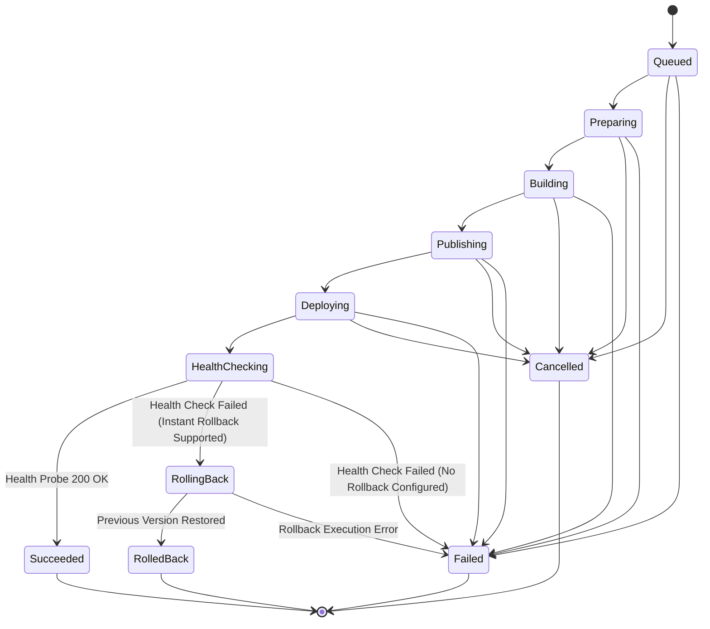
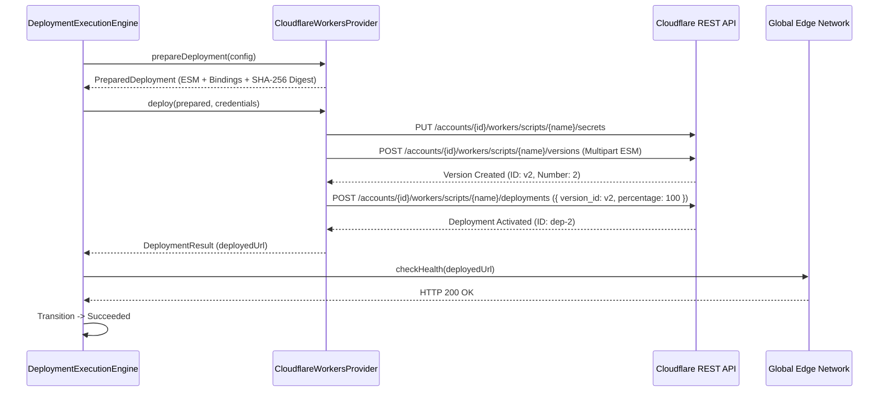
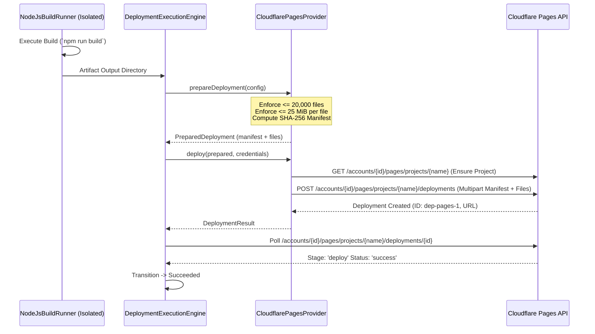

# OpsPilot Deployment Lifecycle & State Machine Specification

> **Document Type:** Architecture & Operational Specification  
> **Package:** `@opspilot/domain`, `@opspilot/database`, `@opspilot/deployment-providers`  
> **Status:** Implemented & Verified (November 2026)

This document specifies the lifecycle stages, state transitions, idempotency guarantees, and concrete execution flows for container and serverless/edge workloads in OpsPilot.

---

## 1. Universal Deployment State Machine

OpsPilot enforces an 8-stage deployment state machine governed by `DeploymentStateMachine` (`packages/domain/src/deployment/state-machine/deployment-state-machine.ts`).



### Idempotency & Concurrency Rules
1. **Idempotent Self-Transitions:** Attempting to transition a deployment to its current status (e.g. `Deploying` $\to$ `Deploying`) is treated as a valid, idempotent no-op.
2. **Conditional Atomic State Updates:** Database state updates in `DeploymentsRepository.transitionStatus` use optimistic concurrency checks:
   ```sql
   UPDATE deployments
   SET status = $1::deployment_status,
       failure_reason = $2,
       updated_at = NOW()
   WHERE id = $3 AND organization_id = $4 AND status = $5::deployment_status
   RETURNING *;
   ```
   If another worker has already transitioned the state, the update affects 0 rows, triggering an `InvalidStateTransitionException` and preventing race conditions.

---

## 2. Cloudflare Workers Deployment Lifecycle

Cloudflare Workers uses modern immutable Script Versioning and Deployments APIs:



### Instant Rollback Flow
If the edge health probe fails:
1. `DeploymentExecutionEngine` transitions to `RollingBack`.
2. `CloudflareWorkersProvider.rollback(deploymentId, targetVersionId)` calls `POST /accounts/{id}/workers/scripts/{name}/deployments` with `{ version_id: targetVersionId, percentage: 100 }`.
3. Cloudflare immediately switches global edge traffic back to the previous version with zero build latency.
4. `DeploymentExecutionEngine` transitions to `RolledBack`.

---

## 3. Cloudflare Pages Deployment Lifecycle (Direct Upload)

Pursuant to ADR-0015, OpsPilot strictly rejects Cloudflare-managed Git builds, retaining control plane sovereignty through the **Direct Upload Strategy**:



---

## 4. Lifecycle Comparison Across All Providers

| Lifecycle Stage | AWS ECS (`aws_ecs`) | VPS Docker (`vps_docker`) | Cloudflare Workers (`cloudflare_workers`) | Cloudflare Pages (`cloudflare_pages`) |
|---|---|---|---|---|
| **Build & Packaging** | Docker build $\to$ OCI Image | Docker build $\to$ OCI Image | Wrangler/esbuild $\to$ ESM Bundle | Framework build $\to$ Static Directory |
| **Artifact Storage** | Amazon ECR | Private Docker Registry | Cloudflare Script Versions | Direct Upload Manifest |
| **Deployment Mechanism** | ECS Service update (new Task Definition) | SSH Compose transfer $\to$ `docker compose up -d` | Workers Deployments API (100% traffic shift) | Pages Direct Upload Multipart API |
| **Stabilization Wait** | Polling ECS Task desired/running counts | Polling Docker container health status | Instant edge propagation | Polling Pages build stage status |
| **Rollback Execution** | Revert ECS Service to previous Task Def | SSH Compose transfer of previous compose file | Instant 100% traffic shift to previous Version ID | Pages Rollback API call |
| **Rollback Speed** | 1 - 3 minutes (container pull/drain) | 10 - 30 seconds | Sub-second (< 1s) | 2 - 5 seconds |
