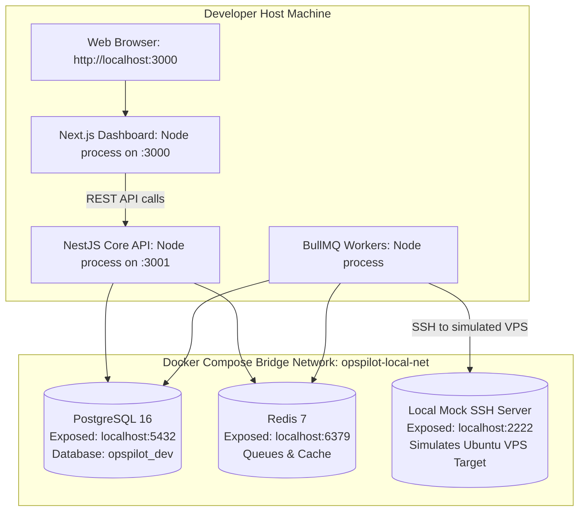

# Local Development with Docker Compose

> **Document Type:** Deployment Topology & Local Container Infrastructure
> **Workstation Setup Guide:** For host machine prerequisites (Node.js, npm, environment variables, and local test execution), see [`docs/development/LOCAL_DEVELOPMENT.md`](../development/LOCAL_DEVELOPMENT.md).

This guide details how OpsPilot runs in a local development environment, including container architecture, service ports, and volume persistence.

---

## 1. Local Development Topology Diagram



---

## 2. Docker Compose Manifest (`docker/docker-compose.dev.yml`)

The local compose file provides all necessary backing dependencies:

```yaml
version: '3.8'

services:
  postgres:
    image: postgres:16-alpine
    container_name: opspilot-postgres
    environment:
      POSTGRES_USER: postgres
      POSTGRES_PASSWORD: postgrespassword
      POSTGRES_DB: opspilot_dev
    ports:
      - "5432:5432"
    volumes:
      - postgres_data:/var/lib/postgresql/data
    healthcheck:
      test: ["CMD-SHELL", "pg_isready -U postgres"]
      interval: 5s
      timeout: 5s
      retries: 5

  # Optional / Future Scale: Superseded by Decision 7 for v0.1.0 (PostgreSQL-backed queue used initially)
  # redis:
  #   image: redis:7-alpine
  #   container_name: opspilot-redis
  #   ports:
  #     - "6379:6379"
  #   volumes:
  #     - redis_data:/data
  #   healthcheck:
  #     test: ["CMD", "redis-cli", "ping"]
  #     interval: 5s
  #     timeout: 3s
  #     retries: 5

volumes:
  postgres_data:
  # redis_data:
```

---

## 3. Starting the Local Environment

1. **Start Backing Services:**
   ```bash
   docker compose -f docker/docker-compose.dev.yml up -d
   ```
2. **Apply Database Migrations:**
   ```bash
   npm run db:migrate:up
   ```
3. **Start Core Services in Dev Mode:**
   ```bash
   npm run dev
   ```
4. **Tear Down and Clear Volumes:**
   ```bash
   docker compose -f docker/docker-compose.dev.yml down -v
   ```
