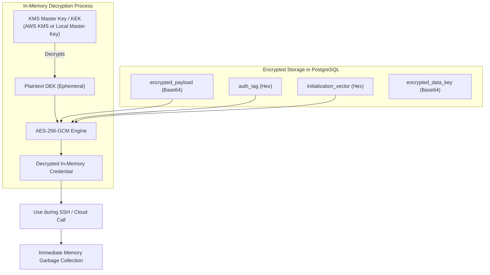

# Secrets Management & Cryptographic Operations

> **Standard:** AES-256-GCM Envelope Encryption & AWS KMS Integration  
> **Status:** Mandatory Security Specification

This document details how OpsPilot stores, encrypts, and decrypts infrastructure credentials, API keys, and environment variables.

---

## 1. Envelope Encryption Architecture

To eliminate the catastrophic risk of database dumps leaking plaintext credentials, OpsPilot uses **Envelope Encryption**:

---

## 2. Cryptographic Implementation Details

- **Algorithm:** AES-256-GCM (Galois/Counter Mode).
- **IV Size:** 12 bytes (96 bits) generated using a cryptographically secure pseudorandom number generator (`crypto.randomBytes(12)`). An IV is **never** reused across credentials.
- **Authentication Tag:** 16 bytes (128 bits) ensuring ciphertext integrity and authenticity.
- **Key Hierarchy:**
  - **Data Encryption Key (DEK):** Unique 256-bit symmetric key per credential record.
  - **Key Encryption Key (KEK):** Master key stored in AWS KMS (ARN configured in `AWS_KMS_KEY_ARN`) or locally via `MASTER_ENCRYPTION_KEY`.

---

## 3. Credential Lifecycle & Rotation

1. **Storage:** When an SSH key or AWS credential is saved via `POST /integrations`, it is encrypted immediately in the service layer before reaching database insert operations.
2. **Access:** Decryption occurs exclusively in background worker memory at the exact moment of deployment execution.
3. **Rotation:** OpsPilot supports multi-version key rotation. Each credential records a `key_version`. When the master key is rotated, background maintenance re-encrypts stored records using the new key version without service downtime.
