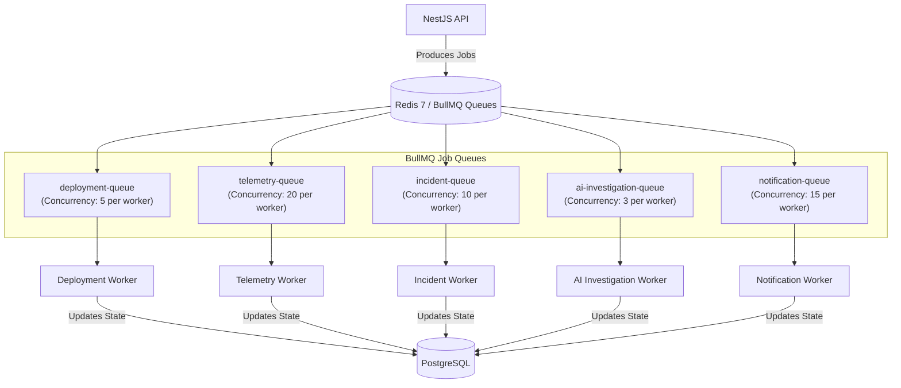

# Background Job & Queue Specifications

> **Engine:** BullMQ 5.x on Redis 7  
> **Status:** Mandatory Operational Specification  
> **Pattern:** Transactional Enqueueing & Idempotent Consumer Workers

All long-running, asynchronous, and scheduled workflows in OpsPilot are processed through dedicated BullMQ queues backed by Redis.

---

## 1. Queue Architecture Overview



---

## 2. Queue Specifications

### 2.1 `deployment-queue`
- **Purpose:** Orchestrating the end-to-end build, publishing, deployment, and health check stabilization for a service.
- **Worker Process:** `apps/workers/deployment-worker`
- **Concurrency:** 5 jobs per worker instance.
- **Timeout:** 900,000 ms (15 minutes).
- **Job Name:** `deploy-service`
- **Payload Schema:**
```typescript
interface DeployServiceJobPayload {
  organizationId: string;
  projectId: string;
  serviceId: string;
  deploymentId: string;
  commitSha: string;
  triggeredByUserId?: string;
  environment: string;
}
```
- **Retry Strategy:** 3 attempts with exponential backoff:
  ```typescript
  attempts: 3,
  backoff: { type: 'exponential', delay: 10000 } // 10s, 20s, 40s
  ```
- **Idempotency Strategy:** Job ID formatted as `deploy:${serviceId}:${commitSha}:${deploymentId}`. Redis distributed lock (`SETNX lock:service:deploy:${serviceId}`) prevents concurrent deployments of the same service.

---

### 2.2 `telemetry-queue`
- **Purpose:** Polling service health checks and gathering CloudWatch/Docker stats.
- **Worker Process:** `apps/workers/telemetry-worker`
- **Concurrency:** 20 jobs per worker instance.
- **Timeout:** 30,000 ms (30 seconds).
- **Job Name:** `probe-service-health`
- **Payload Schema:**
```typescript
interface ProbeServiceHealthPayload {
  organizationId: string;
  serviceId: string;
  healthcheckUrl: string;
  containerPort: number;
}
```
- **Retry Strategy:** 1 attempt (telemetry is ephemeral; missed probes are simply recorded as timeouts).

---

### 2.3 `incident-queue`
- **Purpose:** Evaluating threshold breach events, deduplicating alerts, creating incidents, and assembling timelines.
- **Worker Process:** `apps/workers/incident-worker`
- **Concurrency:** 10 jobs per worker instance.
- **Timeout:** 60,000 ms (60 seconds).
- **Job Name:** `evaluate-alert-breach`
- **Payload Schema:**
```typescript
interface EvaluateAlertPayload {
  organizationId: string;
  serviceId: string;
  alertType: 'health_check_failure' | '5xx_rate_spike' | 'oom_crash';
  metricValue: number;
  threshold: number;
  breachTimestamp: string;
}
```
- **Retry Strategy:** 5 attempts with fixed 5-second backoff.

---

### 2.4 `ai-investigation-queue`
- **Purpose:** Executing the multi-turn AI investigation loop, calling read-only tools, and generating diagnostic reports.
- **Worker Process:** `apps/workers/ai-worker`
- **Concurrency:** 3 jobs per worker instance (governed by LLM provider rate limits).
- **Timeout:** 180,000 ms (3 minutes).
- **Job Name:** `investigate-incident`
- **Payload Schema:**
```typescript
interface InvestigateIncidentPayload {
  organizationId: string;
  incidentId: string;
  serviceId: string;
  preferredModel?: string; // Optional provider override
}
```
- **Retry Strategy:** 2 attempts (retries only on transient network / 5xx provider errors; never retries prompt validation errors).

---

## 3. Reliability & Crash Recovery

### 3.1 Worker Heartbeats & Stalled Job Detection
BullMQ automatically monitors worker heartbeats. If a worker node crashes mid-deployment:
1. BullMQ detects the missing heartbeat after **120 seconds**.
2. The job is marked as `stalled`.
3. If attempts remain, BullMQ re-assigns the job to an active worker.
4. The worker checks PostgreSQL: if the deployment was partially completed, it resumes from the last confirmed stage (e.g., skips build if image digest is already in PostgreSQL).

### 3.2 Dead-Letter Queue (DLQ) & Failure Handling
Jobs that exhaust all retry attempts are moved to the BullMQ failed set:
- An audit event `job.failed_permanently` is recorded in PostgreSQL.
- Associated entity status is updated (e.g., deployment marked `Failed` with `failure_reason: "Worker execution timed out or crashed repeatedly"`).
- Alert dispatched to team notification webhooks.
