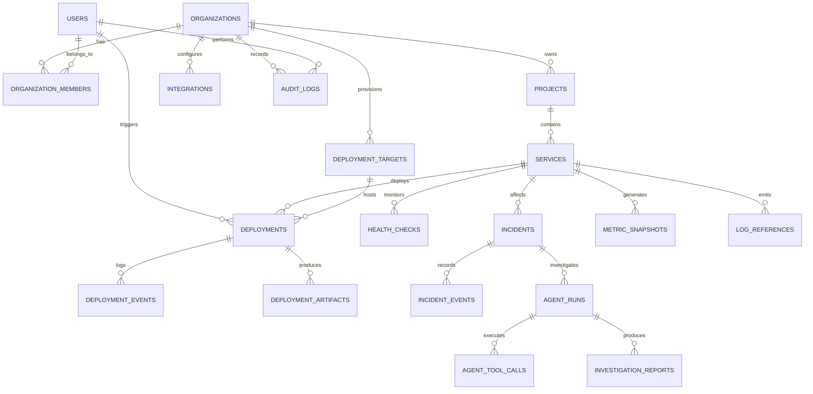

# Database Design & Relational Schema

> **Database Engine:** PostgreSQL 16  
> **Schema Management:** Prisma / Kysely Migrations  
> **Tenant Scoping:** Mandatory `organization_id` on all tenant-owned entities

This document serves as the authoritative specification for OpsPilot's relational database architecture.

---

## 1. Entity-Relationship (ER) Diagram



---

## 2. Relational Table Specifications

### 2.1 Core Identity & Organization Tables

#### `users`
Stores user profile credentials and system-wide identity.
```sql
CREATE TABLE users (
    id UUID PRIMARY KEY DEFAULT gen_random_uuid(),
    email VARCHAR(255) NOT NULL UNIQUE,
    password_hash VARCHAR(255) NOT NULL,
    full_name VARCHAR(255) NOT NULL,
    is_active BOOLEAN NOT NULL DEFAULT TRUE,
    created_at TIMESTAMPTZ NOT NULL DEFAULT NOW(),
    updated_at TIMESTAMPTZ NOT NULL DEFAULT NOW()
);
CREATE INDEX idx_users_email ON users(email);
```

#### `organizations`
Top-level multi-tenant boundary.
```sql
CREATE TABLE organizations (
    id UUID PRIMARY KEY DEFAULT gen_random_uuid(),
    name VARCHAR(255) NOT NULL,
    slug VARCHAR(100) NOT NULL UNIQUE,
    created_at TIMESTAMPTZ NOT NULL DEFAULT NOW(),
    updated_at TIMESTAMPTZ NOT NULL DEFAULT NOW()
);
CREATE UNIQUE INDEX idx_organizations_slug ON organizations(slug);
```

#### `organization_members`
Role-based tenant membership.
```sql
CREATE TYPE org_role AS ENUM ('Owner', 'Admin', 'Engineer', 'Viewer');

CREATE TABLE organization_members (
    id UUID PRIMARY KEY DEFAULT gen_random_uuid(),
    organization_id UUID NOT NULL REFERENCES organizations(id) ON DELETE CASCADE,
    user_id UUID NOT NULL REFERENCES users(id) ON DELETE CASCADE,
    role org_role NOT NULL DEFAULT 'Engineer',
    created_at TIMESTAMPTZ NOT NULL DEFAULT NOW(),
    updated_at TIMESTAMPTZ NOT NULL DEFAULT NOW(),
    CONSTRAINT uq_org_user UNIQUE (organization_id, user_id)
);
CREATE INDEX idx_org_members_user ON organization_members(user_id);
```

---

### 2.2 Project & Service Tables

#### `projects`
Logical groupings of services.
```sql
CREATE TABLE projects (
    id UUID PRIMARY KEY DEFAULT gen_random_uuid(),
    organization_id UUID NOT NULL REFERENCES organizations(id) ON DELETE CASCADE,
    name VARCHAR(255) NOT NULL,
    slug VARCHAR(100) NOT NULL,
    description TEXT,
    created_at TIMESTAMPTZ NOT NULL DEFAULT NOW(),
    updated_at TIMESTAMPTZ NOT NULL DEFAULT NOW(),
    CONSTRAINT uq_org_project_slug UNIQUE (organization_id, slug)
);
CREATE INDEX idx_projects_org ON projects(organization_id);
```

#### `services`
The atomic unit of deployment and operational monitoring.
```sql
CREATE TABLE services (
    id UUID PRIMARY KEY DEFAULT gen_random_uuid(),
    organization_id UUID NOT NULL REFERENCES organizations(id) ON DELETE CASCADE,
    project_id UUID NOT NULL REFERENCES projects(id) ON DELETE CASCADE,
    name VARCHAR(255) NOT NULL,
    slug VARCHAR(100) NOT NULL,
    repository_name VARCHAR(255) NOT NULL, -- e.g. "acme/payments-api"
    branch VARCHAR(100) NOT NULL DEFAULT 'main',
    dockerfile_path VARCHAR(255) NOT NULL DEFAULT 'Dockerfile',
    build_context VARCHAR(255) NOT NULL DEFAULT '.',
    container_port INT NOT NULL DEFAULT 8080,
    healthcheck_path VARCHAR(255) NOT NULL DEFAULT '/health',
    cpu_units INT NOT NULL DEFAULT 512,      -- 512 = 0.5 vCPU
    memory_mb INT NOT NULL DEFAULT 1024,     -- 1024 MB
    is_active BOOLEAN NOT NULL DEFAULT TRUE,
    created_at TIMESTAMPTZ NOT NULL DEFAULT NOW(),
    updated_at TIMESTAMPTZ NOT NULL DEFAULT NOW(),
    CONSTRAINT uq_project_service_slug UNIQUE (project_id, slug)
);
CREATE INDEX idx_services_org ON services(organization_id);
CREATE INDEX idx_services_project ON services(project_id);
```

---

### 2.3 Integration & Infrastructure Tables

#### `integrations`
Connections to GitHub, AWS, and VPS targets.
```sql
CREATE TYPE integration_type AS ENUM ('github', 'aws', 'vps');

CREATE TABLE integrations (
    id UUID PRIMARY KEY DEFAULT gen_random_uuid(),
    organization_id UUID NOT NULL REFERENCES organizations(id) ON DELETE CASCADE,
    name VARCHAR(255) NOT NULL,
    type integration_type NOT NULL,
    status VARCHAR(50) NOT NULL DEFAULT 'active',
    metadata JSONB NOT NULL DEFAULT '{}'::jsonb,
    created_at TIMESTAMPTZ NOT NULL DEFAULT NOW(),
    updated_at TIMESTAMPTZ NOT NULL DEFAULT NOW()
);
CREATE INDEX idx_integrations_org ON integrations(organization_id);
```

#### `integration_credentials`
Envelope-encrypted credentials stored securely.
```sql
CREATE TABLE integration_credentials (
    id UUID PRIMARY KEY DEFAULT gen_random_uuid(),
    organization_id UUID NOT NULL REFERENCES organizations(id) ON DELETE CASCADE,
    integration_id UUID NOT NULL REFERENCES integrations(id) ON DELETE CASCADE,
    encrypted_payload TEXT NOT NULL,       -- Base64 AES-256-GCM ciphertext
    auth_tag VARCHAR(64) NOT NULL,         -- Hex GCM tag
    initialization_vector VARCHAR(64) NOT NULL, -- Hex IV
    key_version INT NOT NULL DEFAULT 1,
    created_at TIMESTAMPTZ NOT NULL DEFAULT NOW(),
    updated_at TIMESTAMPTZ NOT NULL DEFAULT NOW(),
    CONSTRAINT uq_integration_cred UNIQUE (integration_id)
);
```

#### `deployment_targets`
Target destinations for deployments.
```sql
CREATE TYPE target_provider AS ENUM ('aws_ecs', 'vps_docker');

CREATE TABLE deployment_targets (
    id UUID PRIMARY KEY DEFAULT gen_random_uuid(),
    organization_id UUID NOT NULL REFERENCES organizations(id) ON DELETE CASCADE,
    name VARCHAR(255) NOT NULL,
    provider target_provider NOT NULL,
    configuration JSONB NOT NULL, -- ECS cluster ARN or VPS host IP/port
    created_at TIMESTAMPTZ NOT NULL DEFAULT NOW(),
    updated_at TIMESTAMPTZ NOT NULL DEFAULT NOW()
);
CREATE INDEX idx_targets_org ON deployment_targets(organization_id);
```

---

### 2.4 Deployment Tables

#### `deployments`
Immutable record of an application deployment.
```sql
CREATE TYPE deployment_status AS ENUM (
    'Queued', 'Preparing', 'Building', 'Publishing', 
    'Deploying', 'HealthChecking', 'Succeeded', 'Failed', 'RollingBack'
);

CREATE TABLE deployments (
    id UUID PRIMARY KEY DEFAULT gen_random_uuid(),
    organization_id UUID NOT NULL REFERENCES organizations(id) ON DELETE CASCADE,
    project_id UUID NOT NULL REFERENCES projects(id) ON DELETE CASCADE,
    service_id UUID NOT NULL REFERENCES services(id) ON DELETE CASCADE,
    deployment_target_id UUID NOT NULL REFERENCES deployment_targets(id),
    provider target_provider NOT NULL,
    environment VARCHAR(50) NOT NULL DEFAULT 'production',
    commit_sha VARCHAR(64) NOT NULL,
    commit_message TEXT,
    commit_author VARCHAR(255),
    image_uri TEXT,
    status deployment_status NOT NULL DEFAULT 'Queued',
    failure_reason TEXT,
    started_at TIMESTAMPTZ,
    completed_at TIMESTAMPTZ,
    triggered_by UUID REFERENCES users(id),
    created_at TIMESTAMPTZ NOT NULL DEFAULT NOW()
);
CREATE INDEX idx_deployments_service ON deployments(service_id, created_at DESC);
CREATE INDEX idx_deployments_status ON deployments(status);
```

#### `deployment_events`
Chronological log of events occurring during a deployment.
```sql
CREATE TABLE deployment_events (
    id BIGSERIAL PRIMARY KEY,
    organization_id UUID NOT NULL REFERENCES organizations(id) ON DELETE CASCADE,
    deployment_id UUID NOT NULL REFERENCES deployments(id) ON DELETE CASCADE,
    stage VARCHAR(50) NOT NULL,
    message TEXT NOT NULL,
    level VARCHAR(20) NOT NULL DEFAULT 'INFO',
    timestamp TIMESTAMPTZ NOT NULL DEFAULT NOW()
);
CREATE INDEX idx_dep_events_dep ON deployment_events(deployment_id);
```

---

### 2.5 Observability Tables (Time-Partitioned)

#### `health_checks`
```sql
CREATE TABLE health_checks (
    id BIGSERIAL,
    organization_id UUID NOT NULL,
    service_id UUID NOT NULL,
    status_code INT NOT NULL,
    latency_ms INT NOT NULL,
    is_healthy BOOLEAN NOT NULL,
    error_message TEXT,
    created_at TIMESTAMPTZ NOT NULL DEFAULT NOW(),
    PRIMARY KEY (id, created_at)
) PARTITION BY RANGE (created_at);

CREATE INDEX idx_health_checks_service ON health_checks(service_id, created_at DESC);
```

#### `metric_snapshots`
```sql
CREATE TABLE metric_snapshots (
    id BIGSERIAL,
    organization_id UUID NOT NULL,
    service_id UUID NOT NULL,
    cpu_utilization_pct NUMERIC(5, 2) NOT NULL,
    memory_used_mb INT NOT NULL,
    memory_limit_mb INT NOT NULL,
    p95_latency_ms INT,
    http_2xx_count INT DEFAULT 0,
    http_4xx_count INT DEFAULT 0,
    http_5xx_count INT DEFAULT 0,
    created_at TIMESTAMPTZ NOT NULL DEFAULT NOW(),
    PRIMARY KEY (id, created_at)
) PARTITION BY RANGE (created_at);

CREATE INDEX idx_metrics_service ON metric_snapshots(service_id, created_at DESC);
```

---

### 2.6 Incident & AI Investigation Tables

#### `incidents`
```sql
CREATE TYPE incident_severity AS ENUM ('Critical', 'High', 'Medium', 'Low');
CREATE TYPE incident_status AS ENUM (
    'Detected', 'Open', 'Investigating', 'Identified', 
    'Mitigating', 'Resolved', 'Closed', 'FalsePositive'
);

CREATE TABLE incidents (
    id UUID PRIMARY KEY DEFAULT gen_random_uuid(),
    organization_id UUID NOT NULL REFERENCES organizations(id) ON DELETE CASCADE,
    service_id UUID NOT NULL REFERENCES services(id) ON DELETE CASCADE,
    correlated_deployment_id UUID REFERENCES deployments(id),
    title VARCHAR(255) NOT NULL,
    severity incident_severity NOT NULL,
    status incident_status NOT NULL DEFAULT 'Open',
    trigger_rule VARCHAR(100) NOT NULL,
    started_at TIMESTAMPTZ NOT NULL DEFAULT NOW(),
    resolved_at TIMESTAMPTZ,
    created_at TIMESTAMPTZ NOT NULL DEFAULT NOW(),
    updated_at TIMESTAMPTZ NOT NULL DEFAULT NOW()
);
CREATE INDEX idx_incidents_service ON incidents(service_id, created_at DESC);
CREATE INDEX idx_incidents_status ON incidents(status);
```

#### `agent_runs`
Tracks AI Investigation Agent executions.
```sql
CREATE TABLE agent_runs (
    id UUID PRIMARY KEY DEFAULT gen_random_uuid(),
    organization_id UUID NOT NULL REFERENCES organizations(id) ON DELETE CASCADE,
    incident_id UUID NOT NULL REFERENCES incidents(id) ON DELETE CASCADE,
    model_provider VARCHAR(50) NOT NULL,
    model_name VARCHAR(100) NOT NULL,
    status VARCHAR(30) NOT NULL DEFAULT 'Running', -- Running, Completed, Failed
    prompt_tokens INT NOT NULL DEFAULT 0,
    completion_tokens INT NOT NULL DEFAULT 0,
    total_cost_usd NUMERIC(8, 6) NOT NULL DEFAULT 0.000000,
    duration_ms INT,
    created_at TIMESTAMPTZ NOT NULL DEFAULT NOW(),
    completed_at TIMESTAMPTZ
);
CREATE INDEX idx_agent_runs_incident ON agent_runs(incident_id);
```

#### `investigation_reports`
Final structured report produced by the AI Agent.
```sql
CREATE TABLE investigation_reports (
    id UUID PRIMARY KEY DEFAULT gen_random_uuid(),
    organization_id UUID NOT NULL REFERENCES organizations(id) ON DELETE CASCADE,
    agent_run_id UUID NOT NULL REFERENCES agent_runs(id) ON DELETE CASCADE,
    incident_id UUID NOT NULL REFERENCES incidents(id) ON DELETE CASCADE,
    summary TEXT NOT NULL,
    observations JSONB NOT NULL DEFAULT '[]'::jsonb,
    probable_cause JSONB NOT NULL,
    supporting_evidence JSONB NOT NULL DEFAULT '[]'::jsonb,
    recommended_remediation JSONB NOT NULL,
    created_at TIMESTAMPTZ NOT NULL DEFAULT NOW()
);
CREATE INDEX idx_reports_incident ON investigation_reports(incident_id);
```

---

### 2.7 Audit Tables

#### `audit_logs`
Immutable record of all state-changing platform operations.
```sql
CREATE TABLE audit_logs (
    id BIGSERIAL PRIMARY KEY,
    organization_id UUID NOT NULL REFERENCES organizations(id) ON DELETE CASCADE,
    actor_id UUID REFERENCES users(id),
    actor_email VARCHAR(255),
    action VARCHAR(100) NOT NULL,     -- e.g., 'deployment.rollback', 'integration.connect'
    resource_type VARCHAR(50) NOT NULL, -- e.g., 'service', 'deployment', 'credential'
    resource_id VARCHAR(100) NOT NULL,
    details JSONB NOT NULL DEFAULT '{}'::jsonb,
    ip_address VARCHAR(45),
    user_agent TEXT,
    created_at TIMESTAMPTZ NOT NULL DEFAULT NOW()
);
CREATE INDEX idx_audit_org_created ON audit_logs(organization_id, created_at DESC);
```
