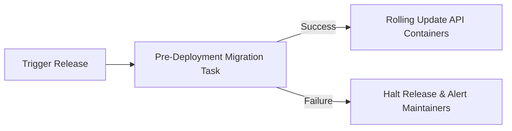

# Database Migration Strategy & Lifecycle

> **Engine:** PostgreSQL 16  
> **Tooling:** Prisma Migrate / Kysely / node-pg-migrate  
> **Pattern:** Zero-Downtime Expand-and-Contract Migrations

Database migrations in OpsPilot manage state-critical production tables. A botched migration can interrupt ongoing deployments, break incident investigations, or corrupt tenant data. This document outlines the mandatory rules for proposing, authoring, and executing migrations.

---

## 1. Golden Rules of Database Migrations

1. **Forward and Backward Compatibility:** Code must always be compatible with both the previous and current database schema versions (Two-Phase / Expand-and-Contract rollout).
2. **Never Drop Columns Directly:** Never execute `ALTER TABLE ... DROP COLUMN` in the same deployment where application code stops reading the column.
3. **No Long-Lived Table Locks:** Avoid `ADD COLUMN ... DEFAULT` with volatile defaults on large tables. In PostgreSQL 11+, non-volatile constant defaults are metadata-only operations, but non-constant defaults take an exclusive table lock.
4. **Always Create Indexes Concurrently:** Use `CREATE INDEX CONCURRENTLY` in production environments to avoid locking tables against writes.
5. **Mandatory Rollback Script:** Every migration file `XXXX_migration.sql` must have a corresponding rollback test verifying clean reversibility.

---

## 2. Migration Execution in Environments

### Local & CI Development
```bash
# Generate a new migration after editing schema
npm run db:migrate:dev -- --name add_incident_confidence_score

# Run pending migrations against local PostgreSQL
npm run db:migrate:up

# Verify schema drift
npm run db:migrate:status
```

### Production Deployment
In production, database migrations execute as an isolated pre-deployment job (e.g., an AWS ECS task or Kubernetes initContainer) before the updated application API containers receive traffic:


---

## 3. Partition Management for Telemetry Tables

Tables partitioned by range (`health_checks`, `metric_snapshots`) require future partition creation and automated cleanup of expired partitions.

### Monthly Partition Creation Script
OpsPilot includes a background maintenance job (or `pg_partman` setup) that executes weekly to ensure partitions exist 30 days into the future:

```sql
-- Example creating monthly partition for health_checks
CREATE TABLE IF NOT EXISTS health_checks_y2026m11 PARTITION OF health_checks
    FOR VALUES FROM ('2026-11-01 00:00:00+00') TO ('2026-12-01 00:00:00+00');

CREATE TABLE IF NOT EXISTS health_checks_y2026m12 PARTITION OF health_checks
    FOR VALUES FROM ('2026-12-01 00:00:00+00') TO ('2027-01-01 00:00:00+00');
```

### Partition Retention & Drop Policy
Partitions older than 30 days are automatically detached and dropped:
```sql
ALTER TABLE health_checks DETACH PARTITION health_checks_y2026m09;
DROP TABLE health_checks_y2026m09;
```
