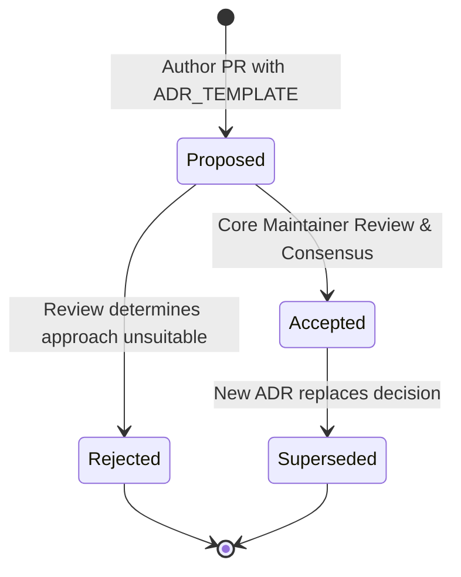

# OpsPilot — Documentation Standards & Taxonomy

> **Audience:** All Contributors, Technical Writers, Software Architects  
> **Status:** Mandatory Documentation Specification  
> **Date:** November 2026

---

## 1. Documentation Taxonomy & Directory Hierarchy

All project documentation resides in the `docs/` directory and is organized into nine canonical functional domains. To eliminate fragmentation and maintain a single source of truth, files must be placed in their exact designated taxonomy directory:

```text
docs/
├── README.md                  # Authoritative documentation index & site map
├── product/                   # Product vision, user personas, roadmap context
│   └── PRODUCT_OVERVIEW.md    # High-level product definition and market focus
├── architecture/              # High-level system design, boundaries, topology
│   ├── SYSTEM_ARCHITECTURE.md # System context and high-level components
│   ├── PROJECT_BOUNDARIES.md  # Hexagonal boundary specifications and invariants
│   ├── CONTROL_PLANE_AND_EXECUTION_PLANE.md # Isolation and trust model
│   └── MODULE_BOUNDARIES.md   # Module ownership and code boundaries
├── engineering/               # Implementation rules and technical standards
│   ├── ENGINEERING_STANDARDS.md # Code quality, API, DB, security standards
│   ├── CODING_CONVENTIONS.md  # TypeScript style guide and error patterns
│   ├── GIT_AND_COMMIT_CONVENTIONS.md # Conventional Commits and branch rules
│   ├── TESTING_STANDARDS.md   # Staged testing pyramid and coverage rules
│   ├── CI_CD_STANDARDS.md     # GitHub Actions pipeline specifications
│   └── DOCUMENTATION_STANDARDS.md # This document
├── security/                  # Threat modeling, cryptographic standards
│   ├── SECURITY_ARCHITECTURE.md # Threat analysis, attack trees, defenses
│   ├── THREAT_MODEL.md        # STRIDE assessment of system components
│   └── CREDENTIAL_MANAGEMENT.md # Envelope encryption and vault design
├── decisions/                 # Architecture Decision Records (ADRs)
│   ├── README.md              # ADR index and submission workflow
│   ├── ADR_TEMPLATE.md        # Standard ADR template
│   └── ADR-0001-...           # Individual immutable records
├── development/               # Contributor environment setup and workflows
│   ├── LOCAL_DEVELOPMENT.md   # Prerequisites, database setup, local run
│   └── ENVIRONMENT_CONFIGURATION.md # Environment variables catalog
├── testing/                   # Test architecture and runner guides
│   └── TEST_STRATEGY.md       # Test harness architecture and mock guidelines
├── releases/                  # Release engineering and versioning
│   └── RELEASE_PROCESS.md     # SemVer, signing, and artifact publication
└── operations/                # Production runbooks and troubleshooting
    └── TROUBLESHOOTING.md     # Common operational failure diagnosis
```

---

## 2. Documentation Governance Rules

### 2.1 Single Source of Truth
- **No Duplicate Documents:** Never create multiple documents explaining the same concept. If information applies across areas, create one authoritative document and cross-reference it via markdown links.
- **Deprecate Rather Than Delete:** When an architecture document or decision is superseded, mark its status as `Superseded by ADR-XXXX` rather than deleting its history.

### 2.2 Factual Rigor & Transparency
All documentation, audits, and implementation reports must strictly distinguish between:
1. **Verified Facts:** Directly verified against actual code, passing tests, or live API responses.
2. **Architectural Recommendations:** Proposed designs awaiting implementation or review.
3. **Assumptions:** Unverified premises requiring validation.
4. **Open Questions:** Unresolved trade-offs requiring consensus.
5. **Owner Decisions:** Policy choices requiring Project Owner sign-off (e.g., license choice).

### 2.3 Formatting Standards
- **Standard Markdown:** Adhere to GitHub Flavored Markdown (GFM).
- **GitHub Alerts:** Use GitHub alerts (`> [!NOTE]`, `> [!WARNING]`, `> [!CAUTION]`, `> [!IMPORTANT]`) strategically. Do not nest alerts or use them consecutively.
- **Mermaid Diagrams:**
  - Supported types: `flowchart TD`/`LR`, `sequenceDiagram`, `stateDiagram-v2`, `erDiagram`.
  - Always quote node labels containing special characters or punctuation: `id["Label (Extra)"]`.
- **LaTeX Math:** Where mathematical or cryptographic formulas are required, use standard KaTeX syntax (`\(...\)` inline, `\[...\]` block).

---

## 3. Architecture Decision Record (ADR) Lifecycle

OpsPilot documents significant architectural, security, and tooling choices via Architecture Decision Records in `docs/decisions/`.



### Mandatory ADR Sections:
1. **Title:** `ADR-XXXX-<descriptive-slug>.md`
2. **Status:** `Proposed` | `Accepted` | `Rejected` | `Superseded`
3. **Context & Problem Statement:** What problem are we solving?
4. **Decision Drivers:** Constraints, goals, security requirements.
5. **Considered Options:** What alternative approaches were evaluated?
6. **Decision Outcome:** What was chosen and why?
7. **Consequences:** Positive, negative, and operational trade-offs.
