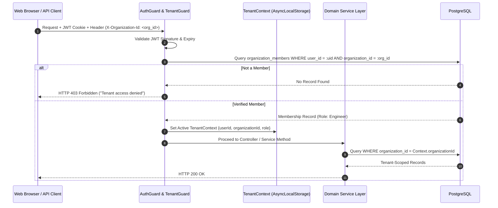

# Multi-Tenancy & Tenant Isolation Architecture

> **Pattern:** Shared Database, Shared Process, Strict Discriminator Column Isolation  
> **Status:** Mandatory Security Specification

OpsPilot is a multi-tenant platform. Because users connect production AWS accounts, private VPS servers, and sensitive codebases, **tenant isolation is our absolute highest security priority**.

---

## 1. Tenant Isolation Principles

1. **Mandatory Tenant Discriminator:** Every single database table storing customer data contains an `organization_id UUID NOT NULL` column referencing `organizations(id)`.
2. **Zero Trust for Client-Supplied Tenant Identifiers:** Never trust an `organization_id` supplied in request headers or JSON bodies without verifying that the authenticated user is an active member of that organization.
3. **Application-Level Enforced Scoping:** All queries executed via Prisma/ORM query builders must include `where: { organizationId: context.organizationId }`.
4. **Isolated Cache Keys:** All Redis keys must be namespaced with the organization ID: `org:{organizationId}:*`.
5. **No Cross-Tenant Sharing:** In-memory caches, background worker execution contexts, and temporary directories on disk must never be shared across tenant boundaries.

---

## 2. Request Lifecycle & Context Injection



---

## 3. Defense Against IDOR (Insecure Direct Object References)

An IDOR vulnerability occurs when an API allows a user from Organization A to view or mutate a resource belonging to Organization B simply by guessing or supplying Organization B's UUID.

### The Anti-Pattern (Vulnerable to IDOR):
```typescript
// DANGEROUS: Querying by ID alone bypasses tenant boundary!
const service = await prisma.service.findUnique({
  where: { id: serviceId }
});
```

### The OpsPilot Standard (Immune to IDOR):
```typescript
// SECURE: Enforces tenant boundary directly in the WHERE clause
const service = await prisma.service.findFirst({
  where: {
    id: serviceId,
    organizationId: tenantContext.organizationId, // Mandatory check
  }
});

if (!service) {
  // Returns generic 404 to avoid leaking existence of other tenants' resources
  throw new NotFoundException(`Service ${serviceId} not found`);
}
```

---

## 4. Testing Multi-Tenant Isolation

Every domain service must include automated integration tests specifically designed to verify that cross-tenant access is blocked:

```typescript
describe('Tenant Isolation Tests for DeploymentsService', () => {
  it('should prevent User from Org A from viewing deployments in Org B', async () => {
    // 1. Create two isolated test organizations
    const orgA = await createTestOrg('org-a');
    const orgB = await createTestOrg('org-b');

    // 2. Create service and deployment in Org B
    const deploymentB = await createTestDeployment(orgB.id);

    // 3. Authenticate context as a member of Org A
    const contextOrgA = { organizationId: orgA.id, userId: 'user-a', role: 'Engineer' };

    // 4. Attempt to fetch Org B deployment using Org A context
    await expect(
      deploymentsService.getDeployment(deploymentB.id, contextOrgA)
    ).rejects.toThrow(NotFoundException);
  });
});
```
