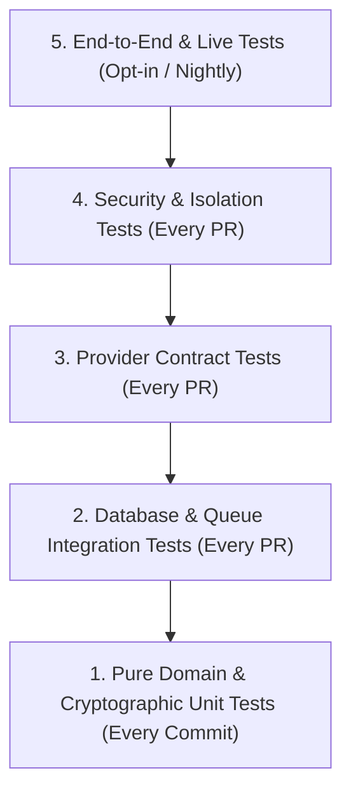

# OpsPilot — Testing Standards & Quality Assurance

> **Audience:** All Software Engineers, QA Engineers, SREs, AI Agents  
> **Status:** Mandatory Quality Specification  
> **Date:** November 2026

---

## 1. Testing Philosophy: The Staged Testing Pyramid

OpsPilot employs a risk-weighted testing pyramid. Because the platform executes infrastructure mutations and manages cloud credentials, test quality is measured by **behavioral correctness under failure**, not merely by line coverage percentages.

---

## 2. Test Classification by Tier

### Tier 1: Pure Domain & Cryptographic Unit Tests
- **Target:** `packages/domain`, `packages/contracts`, `packages/security`.
- **Characteristics:** 100% in-memory, deterministic, zero network I/O, executes in `< 5 seconds`.
- **Mandatory Requirements:**
  - Complete branch coverage on state machines (all valid transitions and invalid transitions tested).
  - Cryptographic tamper detection tests: modifying ciphertext, auth tag, or AAD must fail.
  - Fail-closed tests: missing master key or configuration must immediately halt execution.

### Tier 2: Database & Queue Integration Tests
- **Target:** `packages/database`, `packages/job-queue`.
- **Characteristics:** Executes against a real PostgreSQL 18 instance (Unix socket or local Docker container) and Redis.
- **Mandatory Requirements:**
  - Every repository query must be tested with multiple tenants to prove tenant isolation.
  - Multi-table operations must test transaction rollbacks upon query failure.
  - Distributed lease tests: verify lease expiry and heartbeat updates.

### Tier 3: Provider Contract Tests
- **Target:** `packages/deployment-providers`.
- **Characteristics:** Runs against mock HTTP servers (e.g. MSW or wiremock) using recorded real-world API schemas.
- **Mandatory Requirements:**
  - Verifies exact header negotiation, multipart uploads, and error payload parsing.
  - Must test provider rate-limiting (HTTP 429) and retry backoff behavior.

### Tier 4: Security & Sandbox Isolation Tests
- **Target:** `docker/runners`, `packages/security/src/redactor`.
- **Characteristics:** Executes inside ephemeral Docker containers.
- **Mandatory Requirements:**
  - Verifies non-root UID execution (`UID != 0`).
  - Verifies read-only root filesystem prevents file modification.
  - Verifies network firewall blocks AWS metadata (`169.254.169.254`).
  - Verifies secret redactor masks AWS keys, GitHub tokens, and Cloudflare tokens in log streams.

### Tier 5: Live Infrastructure Tests (Opt-In / Nightly)
- **Target:** Real AWS ECS, VPS Docker, and Cloudflare accounts.
- **Characteristics:** Gated behind environment variables (`OPSPILOT_LIVE_TESTS=true`) and dedicated secrets.
- **Mandatory Requirements:**
  - **Never run automatically on unvetted public PRs.**
  - Executed nightly on a dedicated, isolated test AWS/Cloudflare account with automatic teardown of provisioned resources.

---

## 3. Mocking Rules & Anti-Deception Standards

The previous adversarial audit revealed that test suites mocked all Cloudflare endpoints while the implementation report falsely claimed live infrastructure verification. To prevent deceptive reporting:

1. **Mock Transparency:** Any test utilizing `mockFetch`, `mockApiClient`, or in-memory stubs must be named `*.spec.ts` and reside in `tests/unit/` or `tests/contract/`.
2. **Never Mock What You Are Testing:** If testing the Cloudflare client's network resilience, do not mock the client itself; mock the underlying transport (`fetch`) with realistic network dropouts.
3. **Never Claim Live Verification Without Evidence:** No commit, pull request, or documentation report may claim "verified on cloud" unless live test suite logs showing external Cloudflare or AWS response IDs are attached.

---

## 4. Risk-Based Coverage Benchmarks

OpsPilot does not mandate arbitrary 100% line coverage across the entire monorepo. Instead, coverage requirements are weighted by system risk:

| Area | Risk Level | Minimum Branch Coverage | Mandatory Scenarios |
|---|---|---|---|
| **Envelope Encryption (`packages/security`)** | Critical | **98%** | Tamper detection, missing key fail-closed, unique DEKs |
| **Tenant Isolation (`packages/database`)** | Critical | **95%** | Cross-tenant queries, revoked integration access |
| **Build Sandbox (`docker/runners`)** | High | **90%** | Non-root check, egress firewall, command injection |
| **State Machine (`packages/deployment-engine`)** | High | **90%** | Worker crash reconciliation, rollback, stabilization |
| **HTTP Transport (`apps/api`)** | Moderate | **80%** | Validation pipes, error contracts, auth guards |
| **UI Components (`apps/dashboard`)** | Low | **70%** | Component rendering, state changes, error boundaries |
