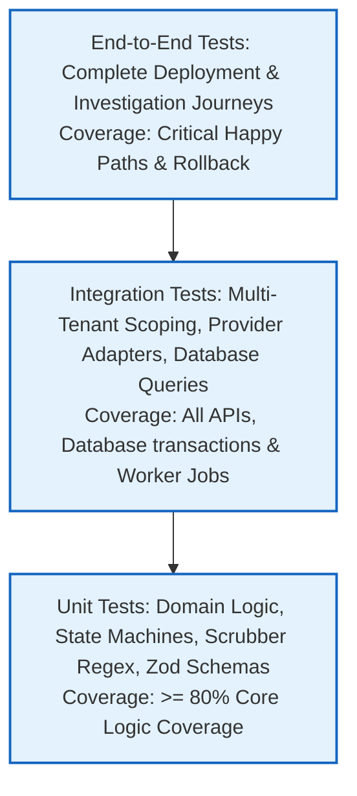
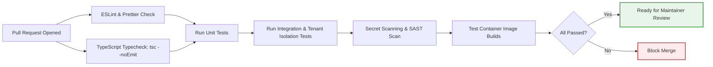

# Testing Strategy & Quality Assurance Framework

> **Test Runner:** Jest / Vitest  
> **Container Testing:** Testcontainers (PostgreSQL & Redis)  
> **Status:** Mandatory Quality Specification

Because OpsPilot automates infrastructure deployments and coordinates incident responses, a comprehensive, multi-tiered testing strategy is essential to prevent outages and tenant security breaches.

---

## 1. Testing Pyramid Overview

---

## 2. CI/CD Testing Pipeline

The following sequence details the automated quality gates executed on every Pull Request before code can be merged into `main`:

---

## 3. Test Categories & Implementation Standards

### 3.1 Unit Testing
- **Target:** Domain entities, deployment state machine transitions, secret scrubbing regex, Zod validation schemas.
- **Rules:** Must execute in milliseconds without external network or database dependencies. Use in-memory mocks for repositories and external adapters.

### 3.2 Multi-Tenant Isolation Testing (Mandatory)
Every API endpoint and service method must have an integration test verifying that a user from `Organization A` cannot read or mutate entities belonging to `Organization B`. Tests must verify that attempting cross-tenant access returns HTTP 403 or 404.

### 3.3 Provider Adapter Integration Testing
- **AWS ECS Provider:** Tested against mock AWS STS and ECS API responses using AWS SDK v3 mocks or LocalStack.
- **VPS Docker Provider:** Tested using an ephemeral local Docker container running an OpenSSH server (`docker/ssh-runner.Dockerfile`) to verify command execution, compose backups, and rollback commands over an authentic SSH tunnel.

### 3.4 AI Evaluation Testing
The AI Investigation Agent is tested against the 15 standardized scenarios defined in the [Incident Simulator](../ai/INCIDENT_SIMULATOR.md) to ensure diagnosis accuracy, tool selection correctness, and absence of hallucinated facts.
