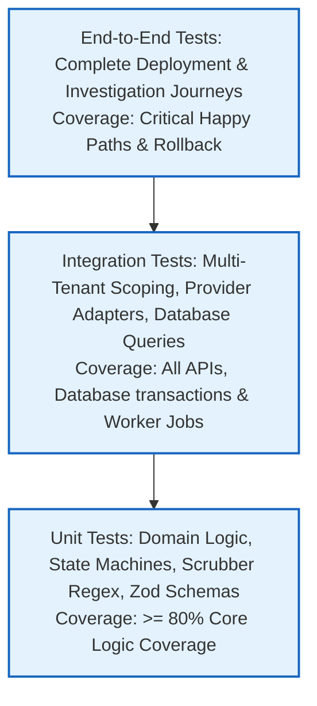

# Testing Strategy & Quality Assurance Framework (Deprecated Reference)

> [!NOTE]
> **Canonical Document Locations:**
> - **Testing Strategy (Philosophy, Harness Architecture & Execution):** [`docs/testing/TEST_STRATEGY.md`](../testing/TEST_STRATEGY.md)
> - **Testing Standards (Enforceable Gates, Mocks & CI Tiers):** [`docs/engineering/TESTING_STANDARDS.md`](TESTING_STANDARDS.md)
>
> This engineering document has been superseded. Testing responsibilities are divided into:
> 1. **Testing Strategy** ([`docs/testing/TEST_STRATEGY.md`](../testing/TEST_STRATEGY.md)): Authoritative guide for Vitest workspace architecture, test execution commands, database transaction isolation, and flaky-test prevention.
> 2. **Testing Standards** ([`docs/engineering/TESTING_STANDARDS.md`](TESTING_STANDARDS.md)): Mandatory quality gates, branch coverage benchmarks, tenant isolation assertions, and anti-deception rules.

---

## Historical Context & Initial QA Framework (Archived)

> [!WARNING]
> **Historical Artifact Notice:** The section below represents early project planning documentation. Note that OpsPilot standardizes on **Vitest** across all workspaces (not Jest), and executes integration tests against PostgreSQL 18 with schema/transaction isolation rather than Testcontainers.

### 1. Initial Testing Pyramid Overview

### 2. Historical PR Quality Gates
The initial pipeline executed linting, typecheck, unit tests, tenant isolation integration tests, secret scanning, and container build checks before maintainer review. Current enforceable gates are codified in [`docs/engineering/TESTING_STANDARDS.md`](TESTING_STANDARDS.md).
