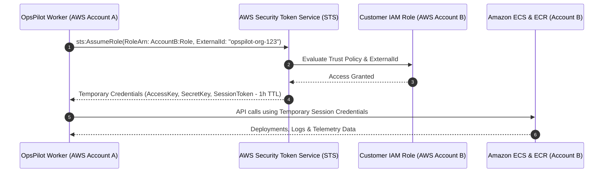

# AWS Integration Architecture & Cross-Account Access

> **Authentication Method:** AWS STS Cross-Account IAM Role Assumption  
> **Security Guard:** Mandatory External ID (Anti-Confused Deputy)  
> **Supported Services:** ECS (Fargate), ECR, CloudWatch (Logs & Metrics)

OpsPilot connects to customer AWS accounts without storing long-lived AWS Access Keys or Secret Keys. This document specifies the cross-account architecture and setup flow.

---

## 1. Cross-Account STS AssumeRole Architecture

---

## 2. Onboarding Workflow

1. **Organization Registration:** When an organization connects AWS via `POST /integrations/aws/connect`, OpsPilot generates a cryptographically random, unique `ExternalId` associated with the tenant.
2. **CloudFormation / Terraform Template:** OpsPilot presents the user with a pre-configured CloudFormation template that provisions the IAM role in their AWS account with the exact trust policy and permissions.
3. **Validation Probe:** OpsPilot issues an `sts:AssumeRole` call and tests permissions against Amazon ECR and ECS. If successful, the integration is marked `active`.

---

## 3. Disconnection & Credential Cleanup

When a customer disconnects an AWS integration:
- Stored Role ARN and External ID records are purged from `integrations`.
- Temporary STS credentials are not cached beyond their 1-hour expiration.
- The customer can delete the IAM role in their AWS account, immediately revoking all access.
