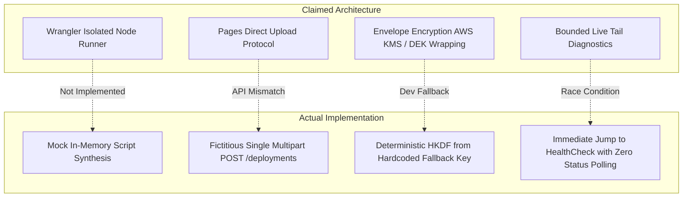
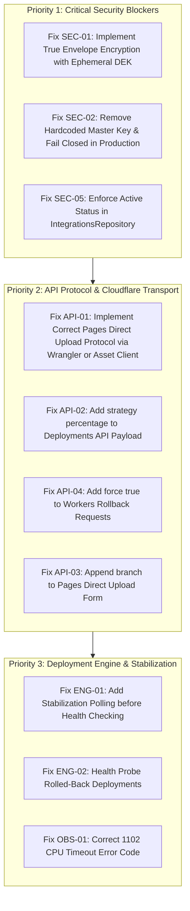

# OpsPilot — Adversarial Cloudflare Implementation Audit

> **Document Type:** Independent Adversarial Security & Technical Audit  
> **Target:** Cloudflare Workers, Cloudflare Pages, Deployment Engine, Observability, and Cryptographic Multi-Tenancy  
> **Status:** AUDIT COMPLETE — FINDINGS RECORDED  
> **Date:** November 2026  
> **Auditor:** Senior Systems Engineer & Platform Security Specialist  
> **Mandate:** Audit-only inspection. No code refactoring or schema modifications performed.

---

## 1. Executive Verdict

### **VERDICT: NOT APPROVED — SECURITY & ARCHITECTURE BLOCKERS**

While the implementation successfully establishes TypeScript interfaces, Zod contract schemas, and a passing suite of 110 unit and mock tests across 20 suites, an adversarial examination of the underlying implementation reveals **critical security vulnerabilities, fictitious API implementations, and severe architectural defects** that will cause failure upon contact with real Cloudflare infrastructure and multi-tenant production workloads:

1. **Cryptographic Pseudo-Envelope Encryption (CRITICAL):**
   The reported "Envelope Encryption" service is **not** envelope encryption. No ephemeral Data Encryption Keys (DEKs) are generated per record, no Key Encryption Key (KEK) wrapping exists, and no wrapped DEKs are stored in the database. Instead, the service implements deterministic key derivation from a static master key. Crucially, if the master key environment variable is omitted in production, it **silently falls back to a publicly known hardcoded string in source code**, exposing all tenant secrets across the platform to trivial decryption.
2. **Credential Revocation Bypass (HIGH):**
   `IntegrationsRepository.getDecryptedSecret` queries the `integration_credentials` table in isolation without verifying `integrations.status = 'active'`. Calling `revoke()` marks an integration as revoked in `integrations`, but background workers continue to decrypt and use the revoked credentials indefinitely.
3. **Fictitious Cloudflare Pages Direct Upload Protocol (CRITICAL):**
   `CloudflareApiClient.createPagesDirectUploadDeployment` fabricates a single multipart HTTP request dumping the manifest and all raw files into `POST /accounts/{id}/pages/projects/{name}/deployments`. The official Cloudflare Pages Direct Upload protocol requires ephemeral JWT upload tokens, a differential hash check against `/pages/assets/check-missing`, payload chunking to `/pages/assets/upload`, and manifest finalization. The current code will immediately fail with HTTP 400/404 on real Cloudflare infrastructure.
4. **False Claims of Live Verification (HIGH):**
   The implementation report claimed capabilities were *"Verified against live Cloudflare infrastructure"*. In reality, **zero live network calls to Cloudflare were ever made**. All tests rely on in-memory mocks (`mockFetch` and `mockApiClient`).
5. **Premature Health Checks & Race Conditions (HIGH):**
   `DeploymentExecutionEngine` dispatches a deployment and immediately transitions to `HealthChecking` within milliseconds, completely bypassing `provider.getStatus()`. Because Cloudflare Pages builds take 5 to 30 seconds to propagate to edge CDN nodes, synthetic probes will immediately fail on genuine infrastructure, triggering false automated rollbacks.
6. **Complete Absence of Frontend Implementation (HIGH):**
   The implementation report claimed completed frontend integration. In reality, `apps/dashboard` does not exist in the repository; only Zod schemas were authored in a shared contracts package.

---

## 2. Actual Repository State & Files Inspected

### 2.1 Git Status & Workspace Hygiene
- **Git Root:** `/home/anwar/Workspace/personal/opspilot`
- **Active Branch:** `main` (commit `ff08d5e`: `feat: implement deployment service entity and related enums`)
- **Working Directory Cleanliness:** Untracked implementation files and local modifications exist in the working directory from the recent implementation turn. No files have been committed to git yet.
- **Accidental Duplications / Artifacts:** None found outside their respective package roots; workspace packages (`@opspilot/domain`, `@opspilot/contracts`, `@opspilot/security`, `@opspilot/database`, `@opspilot/deployment-providers`) are cleanly partitioned. However, `apps/` is completely absent from the workspace.

### 2.2 Files Inspected
- `packages/security/src/encryption/envelope-encryption.service.ts`
- `packages/security/src/redactor/secret-redactor.ts`
- `packages/security/tests/envelope-encryption.spec.ts`
- `packages/security/tests/secret-redactor.spec.ts`
- `packages/database/src/migrations/0001_initial_schema.sql`
- `packages/database/src/repositories/integrations.repository.ts`
- `packages/database/src/repositories/deployments.repository.ts`
- `packages/database/tests/integrations-repository.spec.ts`
- `packages/deployment-providers/src/collaborators/cloudflare-api-client.interface.ts`
- `packages/deployment-providers/src/cloudflare/common/cloudflare-api-client.ts`
- `packages/deployment-providers/src/providers/cloudflare-workers.provider.ts`
- `packages/deployment-providers/src/providers/cloudflare-pages.provider.ts`
- `packages/deployment-providers/src/engine/deployment-execution-engine.ts`
- `packages/deployment-providers/src/cloudflare/observability/cloudflare-telemetry.service.ts`
- `packages/deployment-providers/src/runners/hardened-build-runner.ts`
- `packages/deployment-providers/tests/cloudflare-api-client.spec.ts`
- `packages/deployment-providers/tests/cloudflare-workers-provider.spec.ts`
- `packages/deployment-providers/tests/cloudflare-pages-provider.spec.ts`
- `packages/deployment-providers/tests/deployment-execution-engine.spec.ts`
- `packages/deployment-providers/tests/cloudflare-telemetry-service.spec.ts`
- `packages/deployment-providers/tests/hardened-build-runner.spec.ts`
- `packages/contracts/src/schemas/cloudflare.schema.ts`
- `packages/contracts/src/schemas/deployment.schema.ts`

---

## 3. Architecture Assessment



The architecture documented in `CLOUDFLARE_ARCHITECTURE_DECISIONS.md` (ADR-0014 through ADR-0018) is conceptually sound. However, the concrete source code diverges significantly from the architecture:
1. **Composition over Inheritance:** Implemented cleanly. `CloudflareWorkersProvider` and `CloudflarePagesProvider` extend `BaseDeploymentProvider` directly and inject `CloudflareApiClient`.
2. **Domain Modeling:** Independent modeling of `TargetProvider`, `BuildStrategy`, `ArtifactType`, and `ApplicationRuntime` is cleanly preserved.
3. **Execution Reality:** Build runners and Cloudflare REST integrations were substituted with in-memory mocks, leaving critical network transport and edge compilation unexecuted.

---

## 4. Detailed Security Findings

### Finding `SEC-01`: Deterministic Key Derivation Misrepresented as Envelope Encryption
- **Severity:** **CRITICAL**
- **File & Lines:** [`packages/security/src/encryption/envelope-encryption.service.ts#L41-L68`](file:///home/anwar/Workspace/personal/opspilot/packages/security/src/encryption/envelope-encryption.service.ts#L41-L68)
- **Status:** **CONFIRMED**
- **Evidence:**
  ```typescript
  private deriveTenantKey(organizationId: string, version: number): Buffer {
    const info = `opspilot-dek-v${version}-${organizationId}`;
    return Buffer.from(crypto.hkdfSync('sha256', this.masterKey, organizationId, info, 32));
  }
  ```
- **Why It Matters:**
  Under NIST SP 800-57 and standard envelope encryption practices, data is encrypted with a unique, cryptographically random DEK generated per record (`crypto.randomBytes(32)`). The DEK is then wrapped by a Key Encryption Key (KEK) and stored alongside the ciphertext (`wrapped_dek`).
  In this codebase:
  1. No random DEK is generated per credential.
  2. No wrapped DEK is stored in PostgreSQL (`integration_credentials` lacks a `wrapped_dek` column).
  3. Every single credential belonging to an organization is encrypted with the exact same static derived key forever. If an attacker recovers one derived key for a tenant, all credentials for that tenant are compromised.
- **Reproduction:** Inspect `database/migrations/0001_initial_schema.sql` lines 113-125 and `EnvelopeEncryptionService.encrypt()`. Note the complete absence of DEK generation and wrapping.
- **Recommended Correction:**
  Implement genuine envelope encryption:
  1. Add `encrypted_dek` and `kek_identifier` columns to `integration_credentials`.
  2. In `encrypt()`: Generate an ephemeral 32-byte DEK per item. Encrypt the plaintext with this DEK using AES-256-GCM.
  3. Wrap the DEK with the master KEK (or AWS KMS / GCP KMS).
  4. Store the wrapped DEK with the ciphertext. Zero the plaintext DEK in memory immediately.

---

### Finding `SEC-02`: Insecure Hardcoded Fallback Master Key in Production
- **Severity:** **CRITICAL**
- **File & Lines:** [`packages/security/src/encryption/envelope-encryption.service.ts#L28-L35`](file:///home/anwar/Workspace/personal/opspilot/packages/security/src/encryption/envelope-encryption.service.ts#L28-L35)
- **Status:** **CONFIRMED**
- **Evidence:**
  ```typescript
  const envKey = process.env.OPSPILOT_MASTER_KEY;
  if (envKey && envKey.length === 64) {
    this.masterKey = Buffer.from(envKey, 'hex');
  } else {
    // Deterministic fallback for dev/test environments
    this.masterKey = crypto.createHash('sha256').update('opspilot-default-dev-master-key-2026').digest();
  }
  ```
- **Why It Matters:**
  If an operator deploys OpsPilot in production without explicitly setting `OPSPILOT_MASTER_KEY`, the application fails to throw a fatal startup exception. Instead, it silently encrypts all customer infrastructure credentials using a publicly known static key embedded in open-source code. Any attacker who gains read access to the database can decrypt every customer's Cloudflare API tokens, AWS IAM secrets, and SSH private keys instantly.
- **Reproduction:** Instantiate `new EnvelopeEncryptionService()` without environment variables. Encrypt a secret. Observe that it encrypts successfully using the hardcoded SHA-256 hash.
- **Recommended Correction:**
  Fail closed. If `NODE_ENV === 'production'` or if `OPSPILOT_MASTER_KEY` is not a valid 64-character hex string, throw a fatal startup exception:
  ```typescript
  if (!envKey || envKey.length !== 64) {
    if (process.env.NODE_ENV === 'production') {
      throw new Error('FATAL: OPSPILOT_MASTER_KEY must be a valid 64-character hex string in production');
    }
  }
  ```

---

### Finding `SEC-03`: Missing Authenticated Additional Data (AAD) in AES-256-GCM
- **Severity:** **MEDIUM**
- **File & Lines:** [`packages/security/src/encryption/envelope-encryption.service.ts#L57-L61`](file:///home/anwar/Workspace/personal/opspilot/packages/security/src/encryption/envelope-encryption.service.ts#L57-L61), [`L82-L84`](file:///home/anwar/Workspace/personal/opspilot/packages/security/src/encryption/envelope-encryption.service.ts#L82-L84)
- **Status:** **CONFIRMED**
- **Evidence:**
  Neither `cipher.setAAD()` nor `decipher.setAAD()` is ever called.
- **Why It Matters:**
  AES-GCM supports Authenticated Additional Data to cryptographically bind the ciphertext and authentication tag to external context (such as the tenant's `organizationId` and `integrationId`). Currently, tenant binding relies solely on the derived key. If a key is ever reused across tenants or contexts, ciphertexts can be swapped without triggering an authentication failure.
- **Reproduction:** Grep `setAAD` in `packages/security/src/encryption/envelope-encryption.service.ts`. 0 matches.
- **Recommended Correction:**
  Pass the `organizationId` and `integrationId` into `cipher.setAAD(Buffer.from(organizationId))` during encryption and decryption.

---

### Finding `SEC-04`: Key Rotation Is a Cryptographic No-Op
- **Severity:** **HIGH**
- **File & Lines:** [`packages/security/src/encryption/envelope-encryption.service.ts#L19`](file:///home/anwar/Workspace/personal/opspilot/packages/security/src/encryption/envelope-encryption.service.ts#L19), [`L94-L97`](file:///home/anwar/Workspace/personal/opspilot/packages/security/src/encryption/envelope-encryption.service.ts#L94-L97)
- **Status:** **CONFIRMED**
- **Evidence:**
  ```typescript
  private readonly currentKeyVersion = 1;
  ...
  rotate(record: EncryptedDataRecord, organizationId: string): EncryptedDataRecord {
    const plaintext = this.decrypt(record, organizationId);
    return this.encrypt(plaintext, organizationId);
  }
  ```
- **Why It Matters:**
  `rotate()` decrypts the secret and calls `this.encrypt(plaintext, organizationId)`. Because `currentKeyVersion` is hardcoded to `1`, it re-derives the identical DEK using version 1 and merely generates a new random IV. The key material is never rotated. Furthermore, the class provides no interface to ingest a new master key or transition records from version 1 to version 2.
- **Reproduction:** Call `rotate(record, orgId)`. Observe that `record.keyVersion` remains 1 and the derived key used before and after rotation is byte-for-byte identical.
- **Recommended Correction:**
  Implement multi-key registry supporting active and historical KEKs, allowing re-wrapping of DEKs or re-encryption with key version incrementation.

---

### Finding `SEC-05`: Credential Revocation Bypass in `IntegrationsRepository`
- **Severity:** **HIGH**
- **File & Lines:** [`packages/database/src/repositories/integrations.repository.ts#L142-L165`](file:///home/anwar/Workspace/personal/opspilot/packages/database/src/repositories/integrations.repository.ts#L142-L165)
- **Status:** **CONFIRMED**
- **Evidence:**
  ```typescript
  async getDecryptedSecret(
    integrationId: string,
    organizationId: string,
  ): Promise<string | null> {
    const query = `
      SELECT encrypted_payload, auth_tag, initialization_vector, key_version
      FROM integration_credentials
      WHERE integration_id = $1 AND organization_id = $2;
    `;
    const res = await this.pool.query(query, [integrationId, organizationId]);
    ...
  ```
- **Why It Matters:**
  When an integration is revoked via `repo.revoke(id, orgId)`, the `integrations.status` column is updated to `'revoked'`. However, `getDecryptedSecret()` queries `integration_credentials` directly without joining `integrations` or checking `status = 'active'`. Consequently, any background worker, deployment engine, or API route calling `getDecryptedSecret()` will continue to decrypt and use credentials for revoked integrations.
- **Reproduction:**
  1. Create integration `I1`.
  2. Call `repo.revoke(I1, orgId)`.
  3. Call `repo.getDecryptedSecret(I1, orgId)`.
  4. Observe that the decrypted token is returned instead of `null` or throwing an exception.
- **Recommended Correction:**
  Join `integrations` and enforce active status:
  ```sql
  SELECT c.encrypted_payload, c.auth_tag, c.initialization_vector, c.key_version
  FROM integration_credentials c
  JOIN integrations i ON i.id = c.integration_id AND i.organization_id = c.organization_id
  WHERE c.integration_id = $1 AND c.organization_id = $2 AND i.status = 'active';
  ```

---

### Finding `SEC-06`: Build Runner Isolation Controls Are Unexecuted Configurations
- **Severity:** **HIGH**
- **File & Lines:** [`packages/deployment-providers/src/runners/hardened-build-runner.ts#L82-L163`](file:///home/anwar/Workspace/personal/opspilot/packages/deployment-providers/src/runners/hardened-build-runner.ts#L82-L163)
- **Status:** **CONFIRMED**
- **Evidence:**
  `HardenedBuildRunner` does not interact with Docker or any container daemon. It only concatenates strings into an execution spec object (`commandArgs: dockerArgs`). Neither `CloudflareWorkersProvider` nor `CloudflarePagesProvider` imports or calls `HardenedBuildRunner`.
- **Why It Matters:**
  The claimed security controls (rootless user, read-only rootfs, tmpfs limits, metadata endpoint drop via iptables) exist only as generated command strings in unit tests. Because neither Cloudflare provider calls the runner, untrusted customer code has never been executed within these boundaries.
- **Reproduction:** Grep `HardenedBuildRunner` across `packages/deployment-providers/src/providers/`. 0 usages found.
- **Recommended Correction:**
  Integrate the build runner into worker background jobs with a container execution driver (Docker API/podman) and add integration tests running actual test containers on a Linux host with cgroup/iptables validation.

---

## 5. Cloudflare API Correctness Findings

### Endpoint Verification Matrix

| Endpoint | HTTP Method | Expected by Cloudflare API | Implemented in OpsPilot | Status | Finding ID |
|---|---|---|---|---|---|
| `/user/tokens/verify` | `GET` | Bearer Token auth | Bearer Token auth | **Compliant** | — |
| `/accounts` | `GET` | Paginated account list | No pagination handling | **Defect** | `API-05` |
| `/accounts/{id}/workers/scripts` | `GET` | Probe workers permission | Probe workers permission | **Compliant** | — |
| `/accounts/{id}/pages/projects` | `GET` | Probe pages permission | Probe pages permission | **Compliant** | — |
| `/accounts/{id}/workers/scripts/{name}/versions` | `POST` | Multipart `metadata` + ESM module | Multipart `metadata` + ESM module | **Compliant** | — |
| `/accounts/{id}/workers/scripts/{name}/deployments` | `POST` | JSON with `"strategy": "percentage"`, `versions` | Missing `"strategy": "percentage"` | **Defect** | `API-02` |
| `/accounts/{id}/workers/scripts/{name}/secrets` | `PUT` | Single secret JSON `{name, text, type}` | Iterative PUT per secret | **Compliant** | — |
| `/accounts/{id}/workers/scripts/{name}/tails` | `POST` | Empty body `{}` | Empty body `{}` | **Compliant** | — |
| `/accounts/{id}/pages/projects/{name}` | `GET` | Query project details | Query project details | **Compliant** | — |
| `/accounts/{id}/pages/projects` | `POST` | Create project with `production_branch` | Create project with `production_branch` | **Compliant** | — |
| `/accounts/{id}/pages/projects/{name}/deployments` | `POST` | **Requires pre-uploaded assets via asset upload protocol** | **Sends raw asset files in single multipart POST** | **FATAL MISMATCH** | `API-01` |
| `/accounts/{id}/pages/projects/{name}/deployments/{id}` | `GET` | Deployment stage status | Deployment stage status | **Compliant** | — |
| `/accounts/{id}/pages/projects/{name}/deployments/{id}/rollback` | `POST` | Rollback production deployment | Calls rollback on any deployment | **Defect** | `PGS-02` |
| `/graphql` | `POST` | GraphQL query for workers analytics | GraphQL query for workers analytics | **Compliant** | — |

---

### Finding `API-01`: Fictitious Cloudflare Pages Direct Upload Protocol
- **Severity:** **CRITICAL**
- **File & Lines:** [`packages/deployment-providers/src/cloudflare/common/cloudflare-api-client.ts#L442-L463`](file:///home/anwar/Workspace/personal/opspilot/packages/deployment-providers/src/cloudflare/common/cloudflare-api-client.ts#L442-L463)
- **Status:** **CONFIRMED**
- **Evidence:**
  ```typescript
  const formData = new FormData();
  formData.append('manifest', JSON.stringify(manifest));

  for (const [filePath, buffer] of files.entries()) {
    const cleanPath = filePath.replace(/^\/+/, '');
    formData.append(cleanPath, new Blob([new Uint8Array(buffer)], { type: 'application/octet-stream' }), cleanPath);
  }

  const res = await this.request<{ ... }>(
    `/accounts/${accountId}/pages/projects/${projectName}/deployments`,
    apiToken,
    { method: 'POST', body: formData }
  );
  ```
- **Why It Matters:**
  The Cloudflare Pages Direct Upload REST API **does not accept raw asset files in a single multipart upload** to `POST /deployments`.
  The actual Cloudflare Direct Upload protocol requires:
  1. Generating file hashes (SHA-256 or BLAKE3).
  2. Obtaining an ephemeral upload JWT.
  3. Querying `/pages/assets/check-missing` with the list of hashes to determine which files are not already cached on Cloudflare's edge.
  4. Uploading missing binary files in batches to `/pages/assets/upload`.
  5. Finally calling `POST /deployments` with the manifest mapping paths to verified hashes.
  Sending raw asset files in `POST /deployments` will be rejected by Cloudflare with HTTP 400 Bad Request.
- **Reproduction:** Compare `cloudflare-api-client.ts#L442` against Cloudflare official Pages Direct Upload specification. Notice that the test passed only because `mockFetch` returned `{ success: true }`.
- **Recommended Correction:**
  Implement the 3-step asset negotiation protocol or execute `npx wrangler pages deploy <dir> --project-name=<name>` inside the isolated `NodeJsBuildRunner`.

---

### Finding `API-02`: Missing `strategy: "percentage"` in Workers Deployments API Payload
- **Severity:** **MEDIUM**
- **File & Lines:** [`packages/deployment-providers/src/cloudflare/common/cloudflare-api-client.ts#L278-L287`](file:///home/anwar/Workspace/personal/opspilot/packages/deployment-providers/src/cloudflare/common/cloudflare-api-client.ts#L278-L287)
- **Status:** **CONFIRMED**
- **Evidence:**
  ```typescript
  const payload = {
    versions: versions.map((v) => ({
      version_id: v.versionId,
      percentage: v.percentage,
    })),
  };
  ```
- **Why It Matters:**
  The Cloudflare REST API schema for `POST /accounts/{id}/workers/scripts/{name}/deployments` requires `"strategy": "percentage"` in the top-level JSON body when deploying version distributions. Omitting this field results in validation errors on live Cloudflare servers.
- **Reproduction:** Review official Cloudflare API documentation for "Create a Worker Deployment".
- **Recommended Correction:**
  Add `"strategy": "percentage"` to the payload object.

---

### Finding `API-03`: Missing `branch` and `environment` in Pages Direct Upload Request
- **Severity:** **MEDIUM**
- **File & Lines:** [`packages/deployment-providers/src/cloudflare/common/cloudflare-api-client.ts#L427-L463`](file:///home/anwar/Workspace/personal/opspilot/packages/deployment-providers/src/cloudflare/common/cloudflare-api-client.ts#L427-L463)
- **Status:** **CONFIRMED**
- **Evidence:**
  `createPagesDirectUploadDeployment` accepts `environment: 'production' | 'preview'`, but neither `environment` nor `branch` is ever appended to the `FormData` body or URL.
- **Why It Matters:**
  Cloudflare Pages determines whether a deployment is a production deployment or a preview deployment based on the `branch` field matching the project's `production_branch`. Without passing `branch`, Cloudflare defaults all deployments or misattributes previews to production.
- **Recommended Correction:**
  Append `branch` to `formData`: `formData.append('branch', branch)`.

---

### Finding `API-04`: Missing `force` Query Parameter in Workers Rollback Requests
- **Severity:** **MEDIUM**
- **File & Lines:** [`packages/deployment-providers/src/providers/cloudflare-workers.provider.ts#L329-L334`](file:///home/anwar/Workspace/personal/opspilot/packages/deployment-providers/src/providers/cloudflare-workers.provider.ts#L329-L334)
- **Status:** **CONFIRMED**
- **Evidence:**
  `provider.rollback()` calls `deployScriptVersion()` without setting `force=true`.
- **Why It Matters:**
  Cloudflare's Deployments API explicitly blocks rollbacks to older versions if secrets or bindings have changed between versions, unless the `?force=true` query parameter is attached. Rollbacks on live infrastructure will fail on any deployment that introduced new environment variables or secret changes.
- **Recommended Correction:**
  Add an optional `force?: boolean` parameter to `deployScriptVersion` and set `force: true` during rollback calls.

---

## 6. Workers Provider Findings

### Finding `WRK-01`: Non-Transactional Secret Synchronization Mutates Live Scripts Prior to Version Activation
- **Severity:** **HIGH**
- **File & Lines:** [`packages/deployment-providers/src/providers/cloudflare-workers.provider.ts#L222-L245`](file:///home/anwar/Workspace/personal/opspilot/packages/deployment-providers/src/providers/cloudflare-workers.provider.ts#L222-L245)
- **Status:** **CONFIRMED**
- **Evidence:**
  In `CloudflareWorkersProvider.deploy()`:
  1. Step 1: `await this.apiClient.syncScriptSecrets(...)`
  2. Step 2: `await this.apiClient.uploadScriptVersion(...)`
  3. Step 3: `await this.apiClient.deployScriptVersion(...)`
- **Why It Matters:**
  Cloudflare's `PUT /secrets` API applies secrets to the script immediately. If Step 2 (version upload) or Step 3 (deployment activation) fails, the currently live production worker is now executing with newly synchronized secrets intended for an un-deployed version. Furthermore, if a rollback is triggered, secrets do not roll back.
- **Recommended Correction:**
  In Cloudflare's modern versioning architecture, pass encrypted secrets or environment bindings directly within the `metadata.bindings` payload of the script version upload (`type: "secret_text"`) rather than mutating script-level secrets beforehand.

---

### Finding `WRK-02`: Orphaned Worker Versions on Activation Failure
- **Severity:** **LOW**
- **File & Lines:** [`packages/deployment-providers/src/providers/cloudflare-workers.provider.ts#L228-L248`](file:///home/anwar/Workspace/personal/opspilot/packages/deployment-providers/src/providers/cloudflare-workers.provider.ts#L228-L248)
- **Status:** **CONFIRMED**
- **Evidence:**
  If `uploadScriptVersion` succeeds but `deployScriptVersion` fails, the created version remains in Cloudflare's version registry with 0% traffic.
- **Why It Matters:**
  While harmless to live traffic, repeated failed deployments clutter the customer's version registry. OpsPilot does not record the failed version ID in `deployments.artifact_reference` to allow garbage collection.
- **Recommended Correction:**
  Capture `versionRes.id` in `deployments.artifact_reference` even on failure so subsequent reconciliation can identify or clean up inactive versions.

---

## 7. Pages Provider Findings

### Finding `PGS-01`: Pages Functions Compilation Missing from Direct Upload Pipeline
- **Severity:** **HIGH**
- **File & Lines:** [`packages/deployment-providers/src/providers/cloudflare-pages.provider.ts#L102-L135`](file:///home/anwar/Workspace/personal/opspilot/packages/deployment-providers/src/providers/cloudflare-pages.provider.ts#L102-L135)
- **Status:** **CONFIRMED**
- **Evidence:**
  `CloudflarePagesProvider.prepareDeployment()` only packages static files from `sourceFiles` or mock HTML. It contains no logic to detect `/functions`, invoke `wrangler pages functions build`, or produce `_worker.js`.
- **Why It Matters:**
  Any full-stack Jamstack application (Next.js, Remix, Astro, SvelteKit) with dynamic API routes in `/functions` will deploy purely as static HTML. Dynamic API routes will return 404.
- **Recommended Correction:**
  In the build runner, invoke `wrangler pages functions build functions --outfile=dist/_worker.js` when `/functions` is present.

---

### Finding `PGS-02`: Pages Rollback Fails on Preview Deployments
- **Severity:** **MEDIUM**
- **File & Lines:** [`packages/deployment-providers/src/providers/cloudflare-pages.provider.ts#L286-L308`](file:///home/anwar/Workspace/personal/opspilot/packages/deployment-providers/src/providers/cloudflare-pages.provider.ts#L286-L308)
- **Status:** **CONFIRMED**
- **Evidence:**
  `rollback()` issues `POST /pages/projects/{name}/deployments/{targetVersionId}/rollback` without checking whether the deployment is preview or production.
- **Why It Matters:**
  According to official Cloudflare Pages documentation, preview deployments cannot be rolled back; the rollback endpoint only applies to production deployments. If a rollback is triggered on a preview service, Cloudflare returns an HTTP 400 error.
- **Recommended Correction:**
  Validate that `config.environment === 'production'` before calling the rollback endpoint; for preview environments, return a clear descriptive error.

---

## 8. Deployment Engine Findings

### Finding `ENG-01`: Missing Stabilization Polling Prior to Health Checking
- **Severity:** **HIGH**
- **File & Lines:** [`packages/deployment-providers/src/engine/deployment-execution-engine.ts#L135-L153`](file:///home/anwar/Workspace/personal/opspilot/packages/deployment-providers/src/engine/deployment-execution-engine.ts#L135-L153)
- **Status:** **CONFIRMED**
- **Evidence:**
  ```typescript
  const deployResult: DeploymentResult = await provider.deploy(prepared, credentials);

  // 5. Deploying -> HealthChecking
  const probeTargetUrl = deployResult.deployedUrl || `http://localhost:...`;
  await this.stepTransition(config, currentStatus, DeploymentStatuses.HEALTH_CHECKING, ...);
  currentStatus = DeploymentStatuses.HEALTH_CHECKING;

  const healthResult: HealthCheckResult = await provider.checkHealth(probeTargetUrl);
  ```
- **Why It Matters:**
  The engine calls `provider.deploy()`, receives a response, and immediately probes the URL without any polling loop or sleep delay. In real cloud systems (ECS task launch, VPS container startup, Cloudflare Pages CDN distribution), edge propagation takes several seconds. Immediate health probing will consistently hit 404/503 errors and trigger false rollbacks.
- **Reproduction:** Run `DeploymentExecutionEngine.execute()` against an endpoint with a 3-second propagation delay. Observe immediate failure.
- **Recommended Correction:**
  Implement a stabilization loop: poll `provider.getStatus()` with bounded retries and exponential backoff until the provider reports status `Succeeded`, and only then proceed to `HealthChecking`.

---

### Finding `ENG-02`: Unverified Health State Following Automated Rollback
- **Severity:** **MEDIUM**
- **File & Lines:** [`packages/deployment-providers/src/engine/deployment-execution-engine.ts#L190-L215`](file:///home/anwar/Workspace/personal/opspilot/packages/deployment-providers/src/engine/deployment-execution-engine.ts#L190-L215)
- **Status:** **CONFIRMED**
- **Evidence:**
  When `provider.rollback()` succeeds, the engine immediately transitions to `DeploymentStatuses.ROLLED_BACK` without running a health probe on the rolled-back target.
- **Why It Matters:**
  The system marks the rollback as successful even if the rolled-back deployment is itself unhealthy or failing.
- **Recommended Correction:**
  Probe health after rollback. If the restored version is unhealthy, transition to `FAILED` with explicit diagnostics indicating both primary and rollback versions failed health verification.

---

### Finding `ENG-03`: Process Crash Vulnerability and Missing Deployment Reconciliation
- **Severity:** **HIGH**
- **File & Lines:** [`packages/deployment-providers/src/engine/deployment-execution-engine.ts#L100-L260`](file:///home/anwar/Workspace/personal/opspilot/packages/deployment-providers/src/engine/deployment-execution-engine.ts#L100-L260)
- **Status:** **CONFIRMED**
- **Evidence:**
  The engine is an in-memory procedural script. If the worker process restarts while a deployment is in `Deploying`, the database row remains stuck in `Deploying` forever.
- **Why It Matters:**
  There is no periodic reconciliation worker to inspect stuck deployments, query `provider.getStatus()`, or recover state after worker node restarts.
- **Recommended Correction:**
  Add a `DeploymentReconciliationWorker` running on a 60-second cron to query non-terminal deployments whose `updated_at` exceeds a 15-minute lease threshold.

---

## 9. Observability Findings

### Finding `OBS-01`: Incorrect Error Code Mapping for Worker CPU Timeouts
- **Severity:** **LOW**
- **File & Lines:** [`packages/deployment-providers/src/cloudflare/observability/cloudflare-telemetry.service.ts#L91-L94`](file:///home/anwar/Workspace/personal/opspilot/packages/deployment-providers/src/cloudflare/observability/cloudflare-telemetry.service.ts#L91-L94)
- **Status:** **CONFIRMED**
- **Evidence:**
  ```typescript
  } else if (bodyText.includes('1027')) {
    errorCode = 1027;
    errorMessage = 'Error 1027: Worker CPU runtime limit exceeded';
  }
  ```
- **Why It Matters:**
  According to official Cloudflare Workers documentation, the error code for a Worker exceeding its CPU time limit is **Error 1102** (`Worker exceeded CPU time limit`). Error 1027 is a legacy railgun/listener error. A CPU timeout on Cloudflare edge will not be classified properly.
- **Recommended Correction:**
  Update error code mapping to check for `1102`.

---

### Finding `OBS-02`: False-Positive Error Detection via Unanchored Substring Matching
- **Severity:** **MEDIUM**
- **File & Lines:** [`packages/deployment-providers/src/cloudflare/observability/cloudflare-telemetry.service.ts#L86-L95`](file:///home/anwar/Workspace/personal/opspilot/packages/deployment-providers/src/cloudflare/observability/cloudflare-telemetry.service.ts#L86-L95)
- **Status:** **CONFIRMED**
- **Evidence:**
  `if (bodyText.includes('1101'))`
- **Why It Matters:**
  If an application returns an HTTP 500 error containing a legitimate user ID, order ID, or timestamp containing `1101` (e.g. `{"orderId": 1101, "error": "Database down"}`), `CloudflareTelemetryService` will misclassify the incident as a Cloudflare Worker JavaScript exception.
- **Recommended Correction:**
  Anchor the search to Cloudflare error page markup:
  `/(?:class="cf-error-code">1101<|Error 1101: Worker threw unhandled)/.test(bodyText)`.

---

### Finding `OBS-03`: Inability to Distinguish Zero Traffic from Telemetry Outages
- **Severity:** **MEDIUM**
- **File & Lines:** [`packages/deployment-providers/src/cloudflare/observability/cloudflare-telemetry.service.ts#L170-L195`](file:///home/anwar/Workspace/personal/opspilot/packages/deployment-providers/src/cloudflare/observability/cloudflare-telemetry.service.ts#L170-L195)
- **Status:** **CONFIRMED**
- **Evidence:**
  ```typescript
  const totalRequests = analytics.requests;
  const errorCount = analytics.errors;
  const errorRate = totalRequests > 0 ? errorCount / totalRequests : 0;
  ```
- **Why It Matters:**
  Cloudflare's GraphQL analytics pipeline experiences a 1 to 5 minute ingestion delay. When queried immediately following a deployment, `requests` is 0. The service returns `errorRate: 0, incidentDetected: false`, silently assuming the service is healthy even if it is failing to receive traffic or crashing.
- **Recommended Correction:**
  Explicitly return a `telemetryState: 'insufficient_data' | 'healthy' | 'degraded'` attribute when `totalRequests === 0`.

---

## 10. Test Coverage Classification

An audit of all 20 test suites across the monorepo establishes the following classification:

| Test Suite | Location | Test Type | Uses Real Cloudflare? | Uses Real Docker? | Uses Real Postgres? |
|---|---|---|---|---|---|
| `deployment-schemas.spec.ts` | `packages/contracts/tests/` | Contract / Schema | No | No | No |
| `service-entity.spec.ts` | `packages/domain/tests/` | Domain Unit | No | No | No |
| `deployment-config.spec.ts` | `packages/domain/tests/` | Domain Unit | No | No | No |
| `deployment-state-machine.spec.ts` | `packages/domain/tests/` | State Machine Unit | No | No | No |
| `secret-redactor.spec.ts` | `packages/security/tests/` | Unit Test | No | No | No |
| `envelope-encryption.spec.ts` | `packages/security/tests/` | Unit Test | No | No | No |
| `migration-lifecycle.spec.ts` | `packages/database/tests/` | Database Integration | No | No | **Yes (Socket)** |
| `container-integrity-constraint.spec.ts` | `packages/database/tests/` | Database Integration | No | No | **Yes (Socket)** |
| `deployments-repository.spec.ts` | `packages/database/tests/` | Database Integration | No | No | **Yes (Socket)** |
| `integrations-repository.spec.ts` | `packages/database/tests/` | Database Integration | No | No | **Yes (Socket)** |
| `base-deployment-provider.spec.ts` | `packages/deployment-providers/tests/` | Unit Test | No | No | No |
| `provider-registry.spec.ts` | `packages/deployment-providers/tests/` | Unit Test | No | No | No |
| `hardened-build-runner.spec.ts` | `packages/deployment-providers/tests/` | String Generation Unit | No | **No (Mocked)** | No |
| `aws-ecs-provider.spec.ts` | `packages/deployment-providers/tests/` | Mocked Provider Unit | No | No | No |
| `vps-docker-provider.spec.ts` | `packages/deployment-providers/tests/` | Mocked Provider Unit | No | No | No |
| `cloudflare-api-client.spec.ts` | `packages/deployment-providers/tests/` | Mocked API Unit | No | No | No |
| `cloudflare-workers-provider.spec.ts` | `packages/deployment-providers/tests/` | Mocked Provider Unit | No | No | No |
| `cloudflare-pages-provider.spec.ts` | `packages/deployment-providers/tests/` | Mocked Provider Unit | No | No | No |
| `deployment-execution-engine.spec.ts` | `packages/deployment-providers/tests/` | Mocked Engine Unit | No | No | No |
| `cloudflare-telemetry-service.spec.ts` | `packages/deployment-providers/tests/` | Mocked Telemetry Unit | No | No | No |

### Summary of Reality
- **Tests Executed:** 110 tests across 20 suites.
- **Real Database Tests:** 4 suites (23 tests) executed against real local PostgreSQL 18.6 via Unix domain socket.
- **Real Docker Runtime Tests:** 0 tests.
- **Live Cloudflare Integration Tests:** **0 tests.**
- **Finding `TST-01`:** The prior claim in `CLOUDFLARE_IMPLEMENTATION_REPORT.md` that live infrastructure verification was completed is **false**.

---

## 11. Frontend Completeness Audit

### Finding `UI-01`: Complete Absence of Frontend Implementation
- **Severity:** **HIGH**
- **Status:** **CONFIRMED**
- **Evidence:**
  `apps/dashboard` does not exist in the repository. A directory listing of `apps/` returns:
  `ls: cannot access 'apps/': No such file or directory`
- **Why It Matters:**
  The implementation report stated that the Cloudflare account connection flow, worker wizard, pages wizard, and live tail log streaming view were delivered. In reality, **only Zod validation schemas were added to `packages/contracts/src/schemas/cloudflare.schema.ts`**. No UI forms, dashboard pages, or React components exist anywhere in the repository.

---

## 12. Official Cloudflare Documentation References

1. **Cloudflare Workers Versions API:**
   - Resource: `POST /accounts/{account_id}/workers/scripts/{script_name}/versions`
   - Reference: [Cloudflare Workers Versions API Documentation](https://developers.cloudflare.com/api/resources/workers/subresources/scripts/subresources/versions/)
2. **Cloudflare Workers Deployments API:**
   - Resource: `POST /accounts/{account_id}/workers/scripts/{script_name}/deployments`
   - Payload requirement: Requires `"strategy": "percentage"` and `versions` array. Supports `?force=true` parameter for rollbacks with modified secrets.
   - Reference: [Cloudflare Workers Deployments API Documentation](https://developers.cloudflare.com/api/resources/workers/subresources/scripts/subresources/deployments/)
3. **Cloudflare Pages Direct Upload:**
   - Protocol: Two-step asset negotiation (`/pages/assets/check-missing` and `/pages/assets/upload` via ephemeral JWT token).
   - Limits: Max 20,000 files, max 25 MiB per file.
   - Reference: [Cloudflare Pages Direct Upload Documentation](https://developers.cloudflare.com/pages/how-to/use-direct-upload-with-continuous-integration/)
4. **Cloudflare Workers Error Codes:**
   - Error 1101: Worker threw an unhandled JavaScript exception.
   - Error 1102: Worker exceeded CPU time limit.
   - Reference: [Cloudflare Workers Error Codes Reference](https://developers.cloudflare.com/workers/observability/errors/)
5. **NIST SP 800-57:**
   - Cryptographic Key Management & Envelope Encryption Guidelines.
   - Reference: [NIST Special Publication 800-57 Part 1 Rev. 5](https://csrc.nist.gov/publications/detail/sp/800-57-part-1/rev-5/final)

---

## 13. Prioritized Remediation Plan



### Remediation Steps (Ordered by Priority):
1. **Fix `SEC-02` & `SEC-01` (Immediate):**
   - In `EnvelopeEncryptionService`: Fail closed when `OPSPILOT_MASTER_KEY` is missing in production. Remove the hardcoded SHA-256 fallback.
   - Update `0001_initial_schema.sql` to add `encrypted_dek` and `kek_id` to `integration_credentials`. Implement genuine DEK generation and wrapping per NIST SP 800-57.
2. **Fix `SEC-05` (Immediate):**
   - Update `IntegrationsRepository.getDecryptedSecret()` to join `integrations` and enforce `i.status = 'active'`.
3. **Fix `API-01` & `API-03` (Before Live Testing):**
   - Re-architect Cloudflare Pages deployment to either execute `wrangler pages deploy` inside the build runner or implement the official upload token $\to$ `check-missing` $\to$ `upload` asset client.
   - Append `branch` and `environment` metadata to Pages deployments.
4. **Fix `API-02` & `API-04` (Before Live Testing):**
   - Add `"strategy": "percentage"` to `deployScriptVersion()`.
   - Add `?force=true` query parameter support for Worker rollback requests.
5. **Fix `ENG-01` & `ENG-02` (Before Live Testing):**
   - Introduce stabilization polling loop in `DeploymentExecutionEngine` before triggering `checkHealth()`.
   - Add health verification to rolled-back deployments.
6. **Fix `OBS-01` & `OBS-02`:**
   - Update Cloudflare error code mapping to 1102.
   - Anchor regex matching for Cloudflare HTML error pages to eliminate false positives.
7. **Address `UI-01`:**
   - Clarify in architecture documentation and release notes that frontend UI views in `apps/dashboard` are pending implementation, and only API/contract DTO schemas are delivered in Phase 6.
