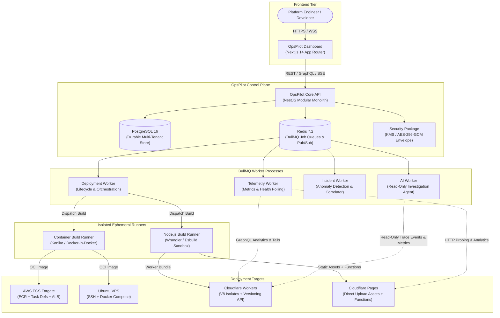
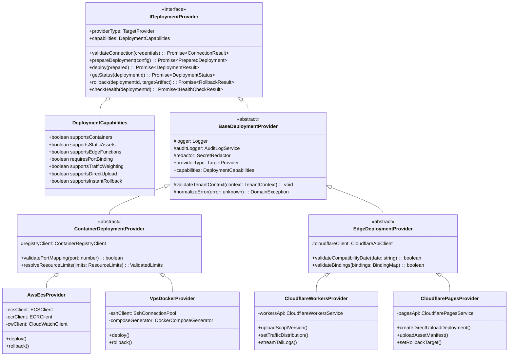
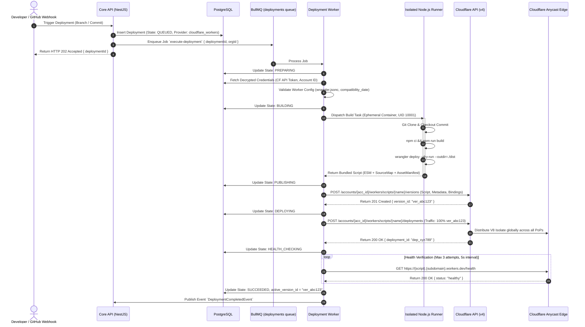
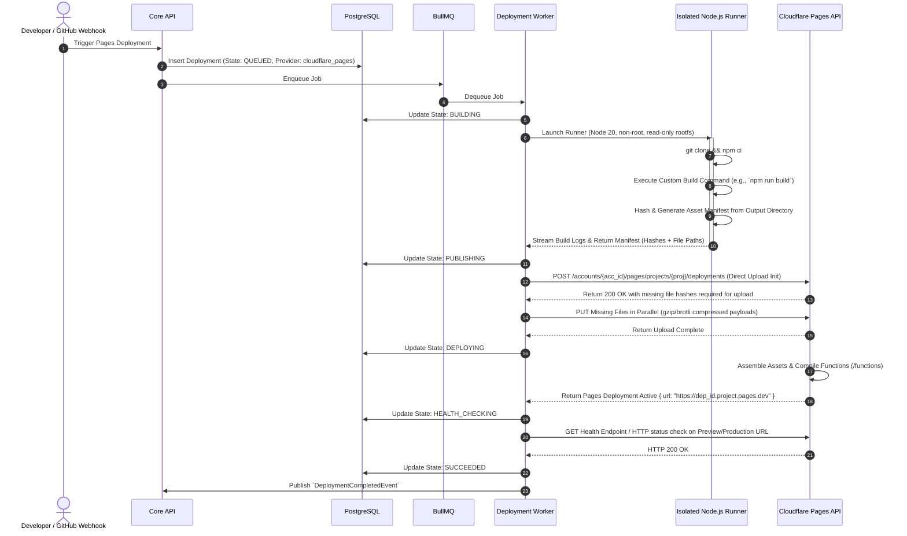
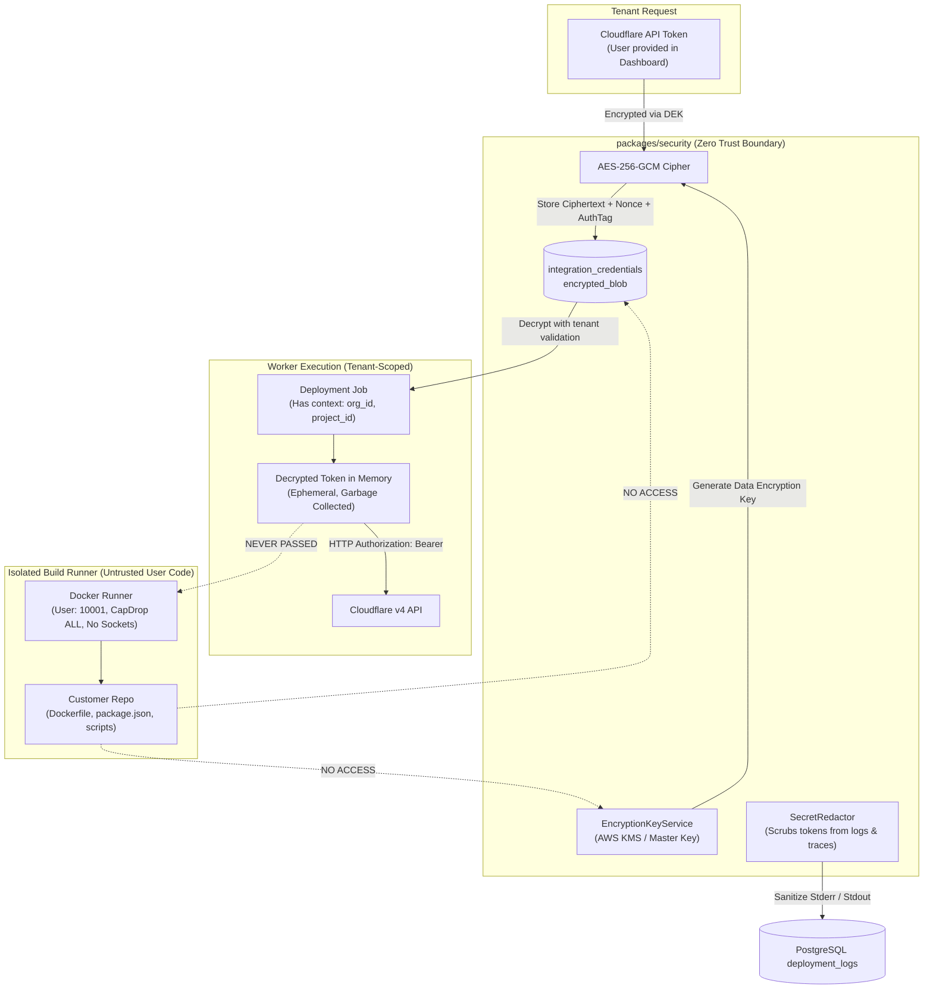
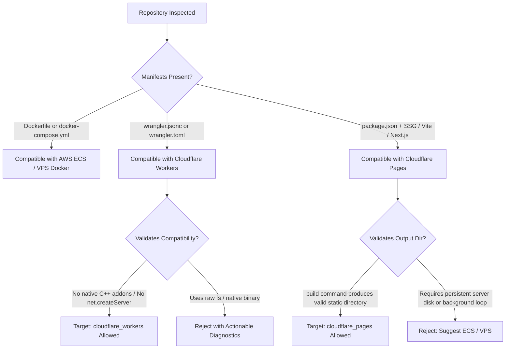

# OpsPilot — Cloudflare Architecture Proposal & Integration Design

> **Document Type:** System Architecture Proposal & Technical Design  
> **Status:** Proposed Specification  
> **Authors:** Principal Platform Engineer, DevOps Architect, Senior Software Engineer  
> **Date:** November 2026  
> **Target Subsystems:** `packages/deployment-providers`, `apps/api/src/modules/deployments`, `apps/workers/deployment-worker`, `packages/database`, `packages/security`

---

## 1. Architectural Vision & Monolith Extension

OpsPilot is engineered as a **modular monolith** with decoupled background workers running on BullMQ. It unifies application deployments and AI-assisted production incident investigation for small SaaS teams.

To date, OpsPilot's deployment architecture has supported two containerized targets:
1. **AWS ECS Fargate:** Serverless container execution with automated Elastic Container Registry (ECR) image publishing, task definition revisioning, and Application Load Balancer routing.
2. **VPS Docker Compose:** Bare-metal or virtual server container execution managed over isolated SSH connections with local Docker daemon orchestration.

This proposal incorporates two non-containerized, edge-native targets into OpsPilot:
1. **Cloudflare Workers:** Serverless JavaScript/TypeScript execution environments powered by the V8 isolate runtime across Cloudflare's global anycast edge.
2. **Cloudflare Pages:** Global edge-hosted static websites, Jamstack frontends, and dynamic full-stack applications powered by Pages Functions.

### 1.1 Core Principles of the Extension

1. **Zero Degradation of Existing Targets:** AWS ECS Fargate and VPS Docker Compose flows must remain 100% operational, backward-compatible, and unencumbered by edge-specific concerns.
2. **Polymorphism over Container Dogmatism:** Decouple the deployment domain model from the assumption that every deployable artifact is an OCI container image running on a TCP port.
3. **Control Plane Sovereignty:** Build execution, artifact generation, log collection, secret injection, and state transitions remain strictly within OpsPilot's sovereign control plane. Cloudflare-managed Git hooks are rejected in favor of **Direct Uploads** to preserve unified tenant audit logs, ephemeral build sandboxing, and deterministic rollback histories.
4. **Tenant Isolation & Zero Trust:** Cloudflare credentials (API tokens and Account IDs) are treated as high-risk secrets, stored via AES-256-GCM envelope encryption, validated for least-privilege scoping, and never exposed to the AI investigation engine or untrusted build scripts.

---

## 2. System Architecture & Visual Topology

### 2.1 System Context with Cloudflare Integration



---

### 2.2 Provider Class Hierarchy

To incorporate non-container edge environments, the `packages/deployment-providers` package is structured into an extensible, capability-driven class hierarchy:



---

### 2.3 Cloudflare Workers Deployment Sequence



---

### 2.4 Cloudflare Pages Deployment Sequence



---

### 2.5 Security Boundaries & Envelope Encryption



---

## 3. Decoupling the Provider Abstraction

### 3.1 Polymorphic `DeploymentProvider` Interface

The current interface in `docs/architecture/DEPLOYMENT_ARCHITECTURE.md` mandates `imageUri`, `containerPort`, and `resourceLimits`. The updated, decoupled interface definition is detailed below:

```typescript
// packages/deployment-providers/src/interfaces/deployment-provider.interface.ts

export type TargetProvider = 
  | 'aws_ecs' 
  | 'vps_docker' 
  | 'cloudflare_workers' 
  | 'cloudflare_pages';

export type RuntimeType = 'container' | 'edge_worker' | 'static_pages';

export interface DeploymentCapabilities {
  readonly runtimeType: RuntimeType;
  readonly supportsContainers: boolean;
  readonly supportsStaticAssets: boolean;
  readonly supportsEdgeFunctions: boolean;
  readonly requiresPortBinding: boolean;
  readonly supportsTrafficWeighting: boolean;
  readonly supportsDirectUpload: boolean;
  readonly supportsInstantRollback: boolean;
}

export interface BaseDeploymentConfig {
  readonly deploymentId: string;
  readonly organizationId: string;
  readonly projectId: string;
  readonly serviceId: string;
  readonly environment: 'production' | 'staging' | 'preview';
  readonly commitSha: string;
  readonly branch: string;
}

export interface ContainerDeploymentConfig extends BaseDeploymentConfig {
  readonly runtimeType: 'container';
  readonly imageUri: string;
  readonly containerPort: number;
  readonly resourceLimits: {
    readonly cpuUnits: number;
    readonly memoryMb: number;
  };
  readonly environmentVariables: Record<string, string>;
  readonly secrets: Record<string, string>;
}

export interface CloudflareWorkersConfig extends BaseDeploymentConfig {
  readonly runtimeType: 'edge_worker';
  readonly scriptName: string;
  readonly mainEntrypoint: string; // e.g. "src/index.ts"
  readonly compatibilityDate: string; // e.g. "2024-11-01"
  readonly compatibilityFlags?: string[];
  readonly routes?: string[];
  readonly customDomains?: string[];
  readonly environmentVariables: Record<string, string>;
  readonly encryptedSecrets: Record<string, string>;
  readonly kvNamespaces?: Record<string, string>;
  readonly d1Databases?: Record<string, string>;
  readonly r2Buckets?: Record<string, string>;
}

export interface CloudflarePagesConfig extends BaseDeploymentConfig {
  readonly runtimeType: 'static_pages';
  readonly projectName: string;
  readonly buildCommand: string; // e.g. "npm run build"
  readonly outputDirectory: string; // e.g. "dist" or "out"
  readonly rootDirectory?: string;
  readonly customDomains?: string[];
  readonly environmentVariables: Record<string, string>;
  readonly encryptedSecrets: Record<string, string>;
}

export type DeploymentConfig = 
  | ContainerDeploymentConfig 
  | CloudflareWorkersConfig 
  | CloudflarePagesConfig;

export interface PreparedArtifact {
  readonly artifactType: 'oci_image' | 'worker_bundle' | 'pages_manifest';
  readonly artifactReference: string; // Image URI or Bundle Hash or Build ID
  readonly metadata: Record<string, unknown>;
}

export interface PreparedDeployment {
  readonly deploymentId: string;
  readonly targetId: string;
  readonly artifact: PreparedArtifact;
  readonly providerPayload: Record<string, unknown>;
}

export interface DeploymentResult {
  readonly success: boolean;
  readonly externalDeploymentId: string;
  readonly deployedUrl?: string;
  readonly versionIdentifier: string; // E.g., ECS task def ARN or Worker version ID
  readonly metadata: Record<string, unknown>;
}

export interface RollbackResult {
  readonly success: boolean;
  readonly activeVersionIdentifier: string;
  readonly executedAt: string; // UTC ISO 8601
  readonly message?: string;
}

export interface DeploymentStatus {
  readonly state: 'queued' | 'preparing' | 'building' | 'publishing' | 'deploying' | 'health_checking' | 'succeeded' | 'failed' | 'rolled_back';
  readonly externalStatusMessage?: string;
  readonly activeReplicas?: number;
  readonly targetUrl?: string;
  readonly timestamp: string;
}

export interface HealthCheckResult {
  readonly isHealthy: boolean;
  readonly httpStatusCode?: number;
  readonly latencyMs?: number;
  readonly errorMessage?: string;
  readonly timestamp: string;
}

export interface IDeploymentProvider {
  readonly providerType: TargetProvider;
  readonly capabilities: DeploymentCapabilities;

  validateConnection(credentials: Record<string, unknown>): Promise<{ valid: boolean; message?: string }>;
  prepareDeployment(config: DeploymentConfig): Promise<PreparedDeployment>;
  deploy(deployment: PreparedDeployment, credentials: Record<string, unknown>): Promise<DeploymentResult>;
  getStatus(deploymentId: string, externalId: string, credentials: Record<string, unknown>): Promise<DeploymentStatus>;
  rollback(deploymentId: string, targetVersionIdentifier: string, credentials: Record<string, unknown>): Promise<RollbackResult>;
  checkHealth(targetUrl: string): Promise<HealthCheckResult>;
}
```

---

## 4. Build Execution & Packaging Strategy

OpsPilot enforces strict sandboxing for untrusted build scripts. Customer repositories contain arbitrary code (`package.json`, custom scripts) that must never run directly on the host machine or have access to Docker sockets.

### 4.1 Node.js Ephemeral Build Runner (`NodeJsBuildRunner`)

For Cloudflare Workers and Cloudflare Pages builds, OpsPilot introduces an ephemeral containerized Node.js runner:

```dockerfile
# docker/runners/nodejs-build-runner.Dockerfile
FROM node:20-alpine AS runner

# Security: drop root privileges, create dedicated unprivileged builder user
RUN addgroup -g 10001 opspilot && \
    adduser -u 10001 -G opspilot -s /bin/sh -D builder

# Install core build utilities and Wrangler globally
RUN apk add --no-cache git bash python3 make g++ && \
    npm install -g wrangler@3.88.0 esbuild@0.24.0

USER builder
WORKDIR /workspace

# Container entrypoint handles repo checkout, environment injection, build, and bundle export
ENTRYPOINT ["/usr/local/bin/build-entrypoint.sh"]
```

### 4.2 Security Constraints for Build Runners:
1. **Unprivileged Execution:** Runs strictly under UID `10001` (builder), `CapDrop=ALL`, and `no-new-privileges: true`.
2. **Filesystem Constraints:** Read-only root filesystem with isolated ephemeral `tmpfs` mounts for `/tmp` and `/workspace`.
3. **Network Isolation:** Outbound access is permitted solely to npm registry (`registry.npmjs.org`), GitHub, and Cloudflare API endpoints. Inbound traffic is blocked.
4. **No Secret Ingestion in Artifacts:** Build-time environment variables are strictly limited to variables marked `is_build_time = true`. Cloudflare API tokens are **never mounted or injected** into the runner container. The runner produces static assets or JS bundles and writes them to a shared volume or output tarball; the `DeploymentWorker` subsequently reads the output and executes authenticated Cloudflare API calls.

---

## 5. Security Architecture & Scoped Credentials

### 5.1 Cloudflare API Token Least-Privilege Policy

OpsPilot integrates with Cloudflare via **API Tokens** rather than Global API Keys. An API Token must be configured with minimal required permissions:

| Permission Group | Scope | Access Level | Purpose |
|---|---|:---:|---|
| **Account.Workers Scripts** | Specific Account | `Edit` | Upload worker versions, set bindings, update scripts |
| **Account.Workers Routes** | Specific Account | `Edit` | Bind workers to custom routes/domains |
| **Account.Workers Tail** | Specific Account | `Read` | Stream real-time log traces for deployment validation |
| **Account.Pages** | Specific Account | `Edit` | Create projects, upload direct upload assets, manage deployments |
| **Zone.Analytics** (Optional) | Specific Zones | `Read` | Query edge invocation metrics, error rates, and latency |

### 5.2 Storage & Envelope Encryption

1. When a user configures a Cloudflare integration in the OpsPilot Dashboard:
   - The user supplies: `accountId` and `apiToken`.
   - Backend validation tests the token against `GET https://api.cloudflare.com/client/v4/user/tokens/verify`.
   - The API Token is encrypted using the `packages/security` envelope encryption service (AES-256-GCM with a tenant-unique Data Encryption Key derived from AWS KMS or the Master Key).
   - Encrypted token, initialization vector (nonce), and authentication tag are stored in `integration_credentials`.
2. When the `DeploymentWorker` executes:
   - Credentials are decrypted in-memory inside the worker process.
   - The token is passed via `Authorization: Bearer <token>` directly to Cloudflare REST APIs.
   - All logs generated by the worker are processed through `SecretRedactor` to ensure API tokens, secrets, and authorization headers are expunged prior to database storage or WebSocket streaming.

---

## 6. Runtime Compatibility & Validation Gate

OpsPilot implements a **Deterministic Runtime Validation Gate** before creating or updating a service. This prevents users from deploying unsupported runtimes to Cloudflare.



### 6.1 Validation Rules:
- **Cloudflare Workers:**
  - Mandatory `compatibility_date` formatted as `YYYY-MM-DD`.
  - Prohibits dependencies relying on native Node.js C++ bindings (`sharp` native binaries without wasm, `better-sqlite3`, etc.).
  - Prohibits continuous background daemons or long-running child processes.
- **Cloudflare Pages:**
  - Mandatory verified `build_command` and non-empty `output_directory`.
  - Pages Functions (`/functions`) must use Web Fetch standard signatures (`onRequest`, `onRequestGet`, etc.).

---

## 7. Failure Handling & Instant Rollback Architecture

### 7.1 Cloudflare Workers Instant Version Rollback

Traditional container rollbacks require provisioning new task definitions or executing `docker compose up -d` against an older image, taking between 30 seconds and 3 minutes.

Cloudflare Workers Versioning provides **instant sub-second rollbacks**:
1. During deployment, OpsPilot captures the immutable `version_id` returned by Cloudflare's Version API (`POST /accounts/{acc_id}/workers/scripts/{name}/versions`).
2. When a rollback is triggered (manually or via automated incident remediation):
   - The `CloudflareWorkersProvider` issues:
     ```http
     POST /accounts/{account_id}/workers/scripts/{script_name}/deployments
     Content-Type: application/json
     Authorization: Bearer {token}

     {
       "versions": [
         {
           "version_id": "previous_successful_version_id",
           "percentage": 100
         }
       ],
       "annotations": {
         "opspilot.rollback_from": "failed_version_id",
         "opspilot.reason": "Automated incident remediation health failure"
       }
     }
     ```
   - Cloudflare activates the previous version globally across all edge locations within ~50 milliseconds.
   - OpsPilot updates the `deployments` record to `rolled_back` and records the transition in `audit_logs`.

### 7.2 Cloudflare Pages Rollback
1. OpsPilot stores the immutable `deployment_id` for every Pages direct upload.
2. Rollback invokes:
   ```http
   POST /accounts/{account_id}/pages/projects/{project_name}/deployments/{target_deployment_id}/rollback
   Authorization: Bearer {token}
   ```
3. Cloudflare redirects the project's production domain to the target deployment instant snapshot.

---

## 8. Telemetry, Observability & Incident Detection

OpsPilot's incident detection and AI investigation engine require metrics, logs, and traces.

### 8.1 Observability Ingestion Architecture

| Ingestion Channel | Cloudflare Technology | OpsPilot Component | Telemetry Produced |
|---|---|---|---|
| **Real-Time Deployment Logs** | Cloudflare Workers Tail API (`/tails`) | `DeploymentWorker` / `TelemetryWorker` | `stdout`, `stderr`, unhandled exceptions, console logs |
| **Edge Metrics** | Cloudflare GraphQL Analytics API | `TelemetryWorker` (5-min polling cron) | Request count, HTTP status codes (2xx, 4xx, 5xx), CPU execution duration, wall-clock duration |
| **Active Probing** | HTTP Edge Health Checks | `TelemetryWorker` (1-min interval) | Latency, SSL status, HTTP response status, body assertion |
| **Audit Events** | Cloudflare Audit Logs API | `OpsPilot Audit Engine` | API token modifications, DNS changes, manual config alterations |

### 8.2 AI Agent Investigation Integration

When an incident is detected on a Cloudflare-backed service:
- The AI Agent invokes `GetLogsTool` and `GetMetricsTool` via the `BaseInvestigationTool` contract.
- The tools interface with OpsPilot's local PostgreSQL telemetry tables populated by the `TelemetryWorker`.
- The AI Agent receives structured logs containing Cloudflare request IDs (`cf-ray`), edge colocation IDs (`iad`, `lhr`, `sjc`), status codes, and execution exceptions.
- The AI correlates errors against recent Worker Version deployments and code diffs in GitHub, proposing actionable remediations (e.g. instant rollback or code PR) subject to human approval gates.

---

## 9. Architectural Feasibility Verdict

The proposed architecture integrates Cloudflare Workers and Cloudflare Pages cleanly into OpsPilot:
- **Preserves existing AWS ECS and VPS Docker adapters** without regression.
- **Maintains the modular monolith structure** and BullMQ worker pipeline.
- **Enforces Zero-Trust credential security** and non-root ephemeral runner sandboxing.
- **Provides superior recovery capabilities** (sub-second rollbacks via modern Cloudflare Versioning).

OpsPilot is architecturally suited to become a multi-target deployment platform spanning cloud containers and global edge runtimes.
