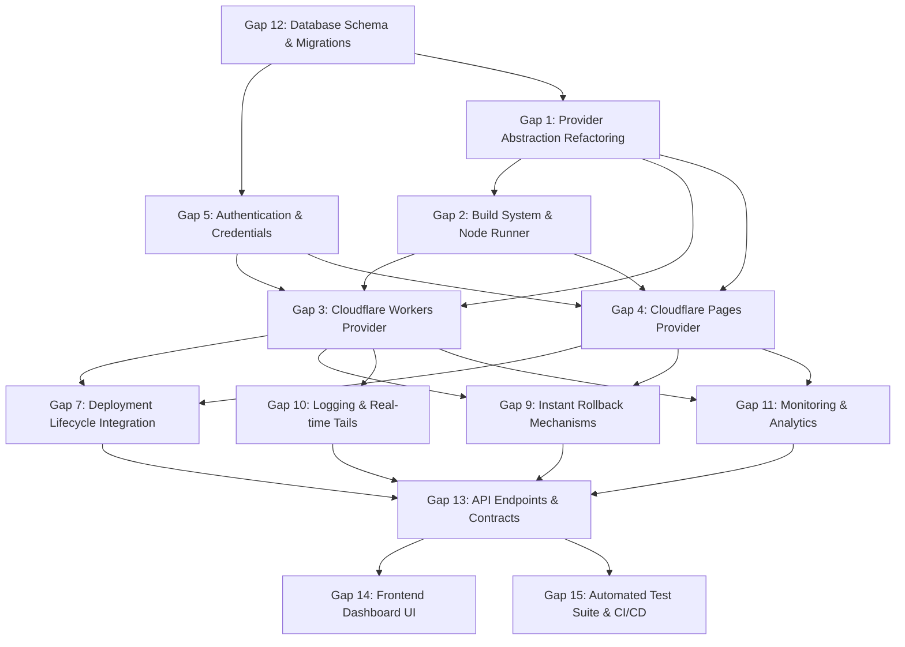

# OpsPilot — Cloudflare Gap Analysis & Architecture Assessment

> **Document Type:** Architectural Gap Analysis & Technical Feasibility Matrix  
> **Status:** Completed Baseline Analysis  
> **Authors:** Principal Platform Engineer, DevOps Architect, Senior Software Engineer  
> **Date:** November 2026  
> **Target Subsystems:** Entire OpsPilot Platform Specification & Planned Modules

---

## 1. Executive Summary

This document performs an exhaustive gap analysis between OpsPilot's baseline specification (tailored primarily for AWS ECS Fargate and Ubuntu VPS Docker Compose) and the architectural requirements necessary to support **Cloudflare Workers** and **Cloudflare Pages**.

The analysis evaluates 15 distinct functional areas, categorizing gaps by severity, implementation effort, and technical risk. It also identifies deep-seated containerization assumptions across the schema, contracts, and execution pipelines, outlines architectural bottlenecks, and maps the critical dependency path for implementation.

---

## 2. 15-Point Architectural Gap Analysis Matrix

The following matrix audits each technical area, contrasting the current state against the required state for Cloudflare support.

| # | Functional Area | Current Baseline State | Required State for Cloudflare | Gap Severity | Effort Estimate | Risk Level |
|:---:|---|---|---|:---:|:---:|:---:|
| **1** | **Deployment Provider Abstraction** | `DeploymentProvider` interface mandates `imageUri`, `containerPort`, and `resourceLimits` (`cpuUnits`, `memoryMb`). Hardcoded to `aws_ecs \| vps_docker`. | Refactored into a capability-driven abstraction (`DeploymentCapabilities`) with polymorphic `DeploymentConfig` supporting non-container edge runtimes. | **Critical** | 3–5 Days (5 SP) | **Medium** |
| **2** | **Build System & Runners** | Docker-in-Docker / Kaniko runner (`docker/build-runner.Dockerfile`) builds OCI container images and pushes them to ECR or Docker registries. | Ephemeral Node.js build runner (`NodeJsBuildRunner`) capable of executing `npm ci`, custom build commands, Wrangler bundling, and direct asset manifest hashing. | **Critical** | 4–6 Days (8 SP) | **Medium** |
| **3** | **Cloudflare Workers Support** | Non-existent. No adapter, no Wrangler integration, no V8 isolate configuration, no binding models (KV, D1, R2). | Dedicated `CloudflareWorkersProvider` implementing modern Cloudflare Versioning API (`/versions`, `/deployments`), script bundling, and secret bindings. | **Critical** | 5–7 Days (8 SP) | **Low** |
| **4** | **Cloudflare Pages Support** | Non-existent. No static asset pipeline, no Jamstack build support, no Pages Functions handling. | Dedicated `CloudflarePagesProvider` implementing Direct Upload deployments (`/pages/projects/{proj}/deployments`), manifest diffing, and preview/production environments. | **Critical** | 4–6 Days (5 SP) | **Low** |
| **5** | **Authentication & Credentials** | Supports AWS IAM Roles (External ID) and VPS SSH keys. `integration_type` ENUM allows only `'github' \| 'aws' \| 'vps'`. | Extends `integration_type` to include `'cloudflare'`. Implements Cloudflare API Token credential validation, least-privilege scoping, and secure storage in `integration_credentials`. | **High** | 2–3 Days (3 SP) | **Low** |
| **6** | **Environment Variables & Secrets** | Secrets injected as Docker container env vars or AWS SSM Parameter Store references. | Cloudflare Workers secret binding via `/secrets` API and plaintext `vars` bindings; Pages environment variable and build-time secret injection via Pages Project API. | **High** | 2–4 Days (3 SP) | **Low** |
| **7** | **Deployment Lifecycle & State Machine** | 8-stage state machine: `Queued -> Preparing -> Building -> Publishing -> Deploying -> HealthChecking -> Succeeded`. `Publishing` assumes pushing an image to ECR/Docker registry. | Retains the 8-stage state machine. Reinterprets `Publishing` as uploading the Worker Version bundle / Pages assets to Cloudflare, and `Deploying` as switching traffic weights. | **Low** | 1–2 Days (2 SP) | **Low** |
| **8** | **Deployment History & Auditing** | `deployments` table requires `image_uri`. Audit logs assume container runtime events. | Decouples `image_uri` (nullable) and adds `artifact_reference` storing immutable Worker `version_id` or Pages `deployment_id`. Extends audit logs for edge routing events. | **Medium** | 2–3 Days (3 SP) | **Low** |
| **9** | **Rollback Mechanisms** | Rollbacks require deploying previous container image/task definition (30s–3min duration). | Implements instant sub-second rollback for Workers via traffic weighting (100% to previous `version_id`) and Pages instant rollback via `/rollback` endpoint. | **High** | 2–4 Days (5 SP) | **Low** |
| **10** | **Logging & Log Streaming** | Ingests container stdout/stderr streams via CloudWatch Logs (ECS) or Docker socket (VPS). | Implements Cloudflare Workers Tail API WebSocket consumer (`/tails`) for real-time logs and Cloudflare Pages build log capture. | **High** | 4–5 Days (5 SP) | **Medium** |
| **11** | **Monitoring & Health Checks** | Container health checks via ALB target groups or Docker `HEALTHCHECK` instructions. Polling via OpenTelemetry. | Active HTTP edge probing against Worker/Pages URLs (`https://*.workers.dev`, custom domains) and integration with Cloudflare GraphQL Analytics API (`workersInvocationsAdaptive`). | **Medium** | 3–4 Days (5 SP) | **Low** |
| **12** | **Database Schema & Migrations** | Schema (`services`, `integrations`, `deployment_targets`, `deployments`) has mandatory container columns (`dockerfile_path`, `container_port`, `cpu_units`, `memory_mb`). | Backward-compatible PostgreSQL migration adding `'cloudflare'` ENUMs, relaxing container-only NOT NULL constraints, and introducing polymorphic configuration columns (`runtime_type`, JSONB `config`). | **Critical** | 2–3 Days (3 SP) | **Medium** |
| **13** | **API Endpoints & Contracts** | REST endpoints (`POST /services`, `POST /deployments`) require container parameters and validate against container schemas. | Updates REST DTOs and Zod validation schemas to accept polymorphic service configurations and target providers (`cloudflare_workers`, `cloudflare_pages`). | **High** | 2–4 Days (5 SP) | **Low** |
| **14** | **Frontend & Configuration UI** | Dashboard assumes Docker configuration (Dockerfile path, port, CPU/RAM sliders). | Adds Cloudflare connection modal, Cloudflare Workers/Pages configuration wizards, compatibility diagnostics, and real-time Tail log views. | **Medium** | 5–7 Days (8 SP) | **Low** |
| **15** | **Automated Testing & CI/CD** | Test suite targets container orchestration, ECS mock responses, and SSH mock connections. | Adds unit and integration test suites for Cloudflare providers with Mock Service Worker (MSW) or WireMock for Cloudflare v4 REST API and Tail WebSockets. | **High** | 3–5 Days (5 SP) | **Low** |

**Total Estimated Implementation Effort:** 42–63 Days (~68 Story Points across 10 Phases).

---

## 3. Deep-Dive: Containerization Assumptions Across the Platform

The primary architectural friction identified during the audit stems from the assumption that **every deployment is an OCI container image running inside a virtualized Linux operating system**.

### 3.1 Relational Schema Coupling (`docs/engineering/DATABASE_DESIGN.md`)
1. **`services` Table:**
   - `dockerfile_path VARCHAR(255) NOT NULL DEFAULT 'Dockerfile'`
   - `build_context VARCHAR(255) NOT NULL DEFAULT '.'`
   - `container_port INT NOT NULL DEFAULT 8080`
   - `cpu_units INT NOT NULL DEFAULT 512`
   - `memory_mb INT NOT NULL DEFAULT 1024`
   *Impact:* Prevents inserting a Cloudflare Worker or Pages service without storing meaningless dummy Docker data.
2. **`integrations` and `deployment_targets` ENUMs:**
   - `integration_type` is restricted to `'github', 'aws', 'vps'`.
   - `target_provider` is restricted to `'aws_ecs', 'vps_docker'`.
   *Impact:* Rejects Cloudflare API credentials and deployment targets at the database constraint level.
3. **`deployments` Table:**
   - `image_uri TEXT` represents the output of the build.
   *Impact:* Cloudflare generates JS/Wasm bundles or static directory manifests, not OCI image URIs.

### 3.2 Provider Abstraction Coupling (`docs/architecture/DEPLOYMENT_ARCHITECTURE.md`)
1. **Hardcoded Method Signatures:**
   - `DeploymentConfig` requires `imageUri`, `containerPort`, and `resourceLimits`.
   *Impact:* An edge worker has no host port or fixed hardware slice. Passing arbitrary defaults violates domain integrity.
2. **Provider Enumeration:**
   - `readonly providerType: "aws_ecs" | "vps_docker"` restricts dynamic provider discovery.

### 3.3 Build Pipeline Coupling (`docs/security/DEPLOYMENT_RUNNER_SECURITY.md`)
1. **Container-in-Container Runners:**
   - The runner specification assumes invoking `docker build` or `kaniko` to output a `.tar` or push to a container registry.
   *Impact:* Cloudflare requires `npm install`, `esbuild`, and `wrangler bundle` to produce an ESM module payload or static directory.

---

## 4. Architectural Bottlenecks & Critical Risks

### 4.1 Monolithic vs. Specialized Build Runners
- **Bottleneck:** Attempting to create a single "universal" Docker build runner that compiles both multi-gigabyte Docker images and fast Node.js/Wrangler scripts will bloat runner container images, degrade cold-start times, and increase security attack surfaces.
- **Resolution:** Decouple runners into specialized, lightweight images:
  - `ContainerBuildRunner` (for ECS and VPS)
  - `NodeJsBuildRunner` (for Cloudflare Workers, Cloudflare Pages, and frontends)

### 4.2 Cloudflare API Rate Limiting
- **Bottleneck:** Cloudflare enforces a default rate limit of 1,200 requests per 5 minutes per user/account. High-frequency health check polling, log tailing, or concurrent asset uploads could hit rate limits.
- **Resolution:**
  - Health checks must probe the deployed application URL (`https://*.workers.dev` or custom domain) directly on the edge network rather than querying the Cloudflare control plane API.
  - Implement exponential backoff with jitter for all Cloudflare REST API calls.
  - Cloudflare Pages Direct Upload must use the hash-check manifest flow to upload only modified assets.

### 4.3 Log Streaming Latency and Tail Limits
- **Bottleneck:** Cloudflare Workers Tail API allows a maximum of 2 active tails per Worker script simultaneously, and tail sessions automatically expire after 2 hours.
- **Resolution:**
  - Tail sessions must only be opened during active deployments or on-demand when an incident is actively investigated.
  - The worker process must automatically handle session renewal and graceful closure.
  - For continuous historical telemetry, OpsPilot should guide users toward Cloudflare Logpush or edge analytics polling rather than persistent open tails.

---

## 5. Dependency Graph Across Gaps

The architectural modifications follow a strict dependency order. Attempting to implement frontend UI or worker jobs before resolving the abstraction and database constraints will cause integration failures.

---

## 6. Gap Resolution & Risk Mitigation Strategy

| Risk ID | Identified Risk | Impact | Mitigation Strategy |
|:---:|---|---|---|
| **R-01** | Breaking existing AWS ECS / VPS deployments | Regression in core platform capabilities | Maintain backward compatibility in database migrations (defaults for existing rows); wrap provider logic in polymorphic interfaces; enforce end-to-end regression tests for ECS and VPS before merging. |
| **R-02** | Execution of untrusted code in Node.js build runner | Remote code execution or privilege escalation on host | Enforce non-root execution (UID 10001), drop all Linux capabilities (`CapDrop=ALL`), mount read-only rootfs, and use isolated `tmpfs` mounts. Never mount host Docker sockets or pass Cloudflare API tokens to the runner. |
| **R-03** | Incompatible workload deployed to Cloudflare Workers | Silent failures or broken deployments | Implement pre-build AST/dependency checks in the Core API; reject packages relying on unsupported native Node.js C++ bindings or raw TCP sockets with clear, actionable error messages. |
| **R-04** | Cloudflare Pages Direct Upload network timeouts | Large static sites fail during deployment upload | Implement chunked multi-file parallel uploads with md5/sha256 hash checking so only altered files are transferred; implement automatic retry with exponential backoff. |

---

## 7. Audit Conclusion

The architectural gap between OpsPilot's baseline and full Cloudflare support is significant (**4 Critical gaps, 5 High gaps**), but entirely manageable due to the modular design of the platform.

Because OpsPilot is currently at Phase 0 (Specification Baseline), addressing these gaps now in the foundational domain contracts and database schema is **10x cheaper and safer** than refactoring after application code has been authored and deployed to production.
