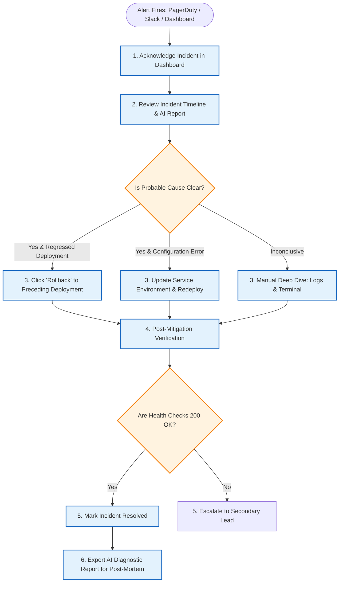

# Incident Response Playbook

> **Target Audience:** On-Call Engineers, SREs, Engineering Leads  
> **Target:** MTTA < 5 minutes, MTTR < 20 minutes

This operational runbook guides on-call engineers responding to production alerts detected by OpsPilot.

---

## 1. Incident Response Lifecycle Flowchart

---

## 2. Step-by-Step Response Procedure

### Step 1: Acknowledge the Incident
- Open the incident link in the OpsPilot dashboard (`/incidents/:id`).
- Click **"Acknowledge"** to notify teammates that investigation is in progress.

### Step 2: Review Timeline & AI Investigation Report
- Check the **Incident Timeline**: Did a deployment complete in the last 60 minutes?
- Review the **AI Diagnostic Summary**:
  - Read the **Observations** (verifiable facts).
  - Inspect the **Supporting Evidence** citations (exact log lines and commit diffs).
  - Note the **Confidence Level** (`High`, `Medium`, `Low`).

### Step 3: Mitigate the Production Outage
- **If caused by a bad deployment:** Click **"Trigger Rollback"** immediately. OpsPilot will revert the ECS Task Definition or VPS Compose file to the previous working version.
- **If caused by an external dependency outage:** Check third-party status pages; verify if circuit breakers or fallback providers can be enabled.

### Step 4: Verify Service Recovery
- Monitor the real-time health probe widget on the incident page.
- Ensure 3 consecutive probes report `200 OK` and error rates fall below 1%.

### Step 5: Post-Mortem & Remediation PR
- Export the structured AI report as a Markdown incident summary.
- If an automated code fix was proposed, review the PR in GitHub, run CI tests, and schedule a permanent fix.
