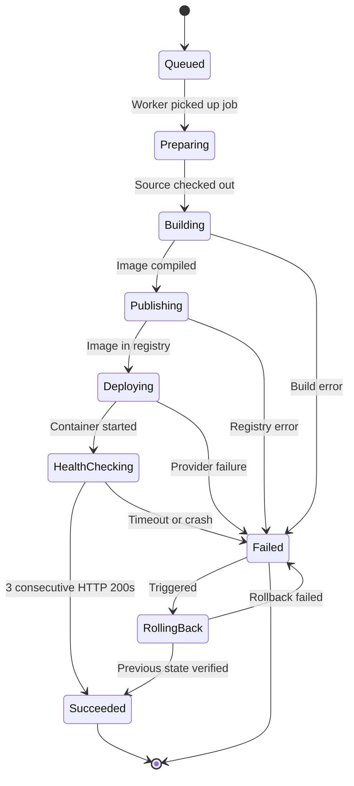

# Feature Specifications: Detailed Module Breakdown

This document provides granular specifications for each core functional module of OpsPilot.

---

## 1. Module: Authentication & RBAC (`apps/api/src/modules/auth`)

### Core Capabilities
- **Session Management:** Secure HTTP-only cookie containing a signed JWT (HMAC-SHA256 or RSA-256). Short-lived access token (15 mins) with rotating refresh tokens (7 days) stored in PostgreSQL.
- **Tenant Context Injection:** Middleware extracts user identity and verified `organization_id` from the request context, attaching a `TenantContext` object to every NestJS execution context.
- **Role Permission Matrix:**

| Permission | Owner | Admin | Engineer | Viewer |
|---|:---:|:---:|:---:|:---:|
| `org:manage` | :white_check_mark: | :x: | :x: | :x: |
| `member:invite` | :white_check_mark: | :white_check_mark: | :x: | :x: |
| `integration:connect` | :white_check_mark: | :white_check_mark: | :x: | :x: |
| `project:create` | :white_check_mark: | :white_check_mark: | :x: | :x: |
| `service:deploy` | :white_check_mark: | :white_check_mark: | :white_check_mark: | :x: |
| `incident:investigate` | :white_check_mark: | :white_check_mark: | :white_check_mark: | :x: |
| `telemetry:view` | :white_check_mark: | :white_check_mark: | :white_check_mark: | :white_check_mark: |

---

## 2. Module: Deployment Engine (`apps/api/src/modules/deployments`)

### Unified Deployment State Machine
Every deployment lifecycle transitions through strictly validated states:



### Deployment Configuration Schema
Each service stores a declarative configuration object:
```yaml
service:
  name: "payments-api"
  environment: "production"
  repository: "acme-corp/payments-service"
  branch: "main"

build:
  dockerfile: "Dockerfile"
  context: "."
  args:
    NODE_ENV: "production"

runtime:
  port: 8080
  healthcheck:
    path: "/health"
    interval_seconds: 5
    timeout_seconds: 3
    retries: 3

resources:
  cpu_units: 512       # 0.5 vCPU
  memory_mb: 1024      # 1024 MB

target:
  provider: "aws_ecs" # or "vps_docker"
  target_id: "7b4e9f82-3d21-4f11-9a74-d2e48271a093"
```

---

## 3. Module: Observability Engine (`apps/api/src/modules/observability`)

### Metrics Aggregation
- **CPU Utilization:** Percentage of allocated CPU used across tasks/containers over 1-minute buckets.
- **Memory Utilization:** Megabytes used and percentage of hard memory limit.
- **HTTP Request Metrics:** Total requests, P95 latency (ms), HTTP 2xx count, HTTP 4xx count, HTTP 5xx count.

### Log Scrubbing & Redaction
All ingested log lines pass through an in-memory streaming regex scrubber before persistence:
- Bearer tokens: `Bearer [A-Za-z0-9\-\._~\+\/]+=*` -> `Bearer [REDACTED]`
- AWS Keys: `AKIA[0-9A-Z]{16}` -> `[REDACTED_AWS_KEY]`
- Private Keys: `-----BEGIN [A-Z ]+ PRIVATE KEY-----` -> `[REDACTED_PRIVATE_KEY]`
- Passwords in connection strings: `postgres://.*:.*@` -> `postgres://[REDACTED]@`

---

## 4. Module: Incident & AI Investigation Engine (`apps/api/src/modules/incidents`)

### Automated Detection Rules
1. **Health Check Failure:** 3 consecutive failed health check probes against the configured endpoint.
2. **Container Crash / OOM:** Docker exit code `137` (SIGKILL / OOMKilled) or non-zero exit code within 5 minutes of deployment.
3. **5xx Error Spike:** Ratio of HTTP 5xx responses to total requests exceeds 5% over a sliding 5-minute window with a minimum sample size of 50 requests.

### AI Investigation Report Contract
The investigation agent outputs a structured JSON report matching this TypeScript interface:
```typescript
interface InvestigationReport {
  incidentId: string;
  serviceId: string;
  summary: string;
  timeWindow: {
    start: string; // ISO 8601
    end: string;
  };
  observations: string[];
  probableCause: {
    hypothesis: string;
    confidence: "High" | "Medium" | "Low";
    rationale: string;
  };
  supportingEvidence: Array<{
    type: "log" | "metric" | "commit" | "deployment" | "health_check";
    citation: string;
    timestamp: string;
    snippet?: string;
  }>;
  recommendedRemediation: {
    actionType: "rollback" | "code_fix" | "config_change" | "infrastructure_restart";
    description: string;
    riskAssessment: string;
  };
}
```
