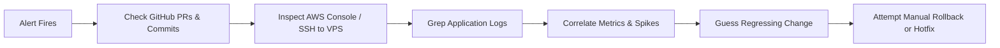
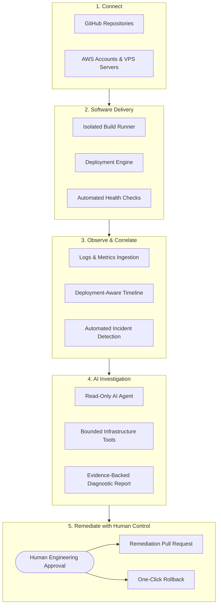

# Product Overview: OpsPilot

> **Document Type:** Product Strategy & Overview  
> **Product Name:** OpsPilot  
> **Version:** 1.0 (Proposed Specification)  
> **Target Audience:** Engineering Leads, Founders, DevOps Engineers, AI System Architects

---

## 1. Executive Summary

**OpsPilot** is an open-source, deployment-aware AI operations platform built specifically for small software engineering teams (2–20 engineers). It bridges the operational divide between application delivery (building, publishing, and deploying containers) and runtime observability (logs, metrics, and health checks), enabling teams to detect production incidents early and investigate root causes using controlled, evidence-backed AI agents.

### Product Promise
> **Deploy confidently. Understand failures faster. Resolve incidents with less manual investigation.**

---

## 2. The Problem: Operational Fragmentation

Small engineering teams rarely have dedicated platform engineering or Site Reliability Engineering (SRE) teams. When a production issue strikes, engineers undergo an exhausting, manual, and disjointed troubleshooting sequence:

### Key Operational Pain Points:
1. **Context Fragmentation:** Information is scattered across GitHub, CloudWatch, Docker logs, VPS terminals, and Slack channels.
2. **Missing Correlation:** Traditional monitoring tools report that a service is failing (e.g., HTTP 500 error spike) but lack the deployment context to pinpoint *which* recent configuration change, dependency upgrade, or commit triggered it.
3. **High MTTR (Mean Time to Resolution):** Engineers spend 80% of incident time gathering logs and building timelines, and only 20% applying the fix.
4. **Fear of Deployments:** Without automated post-deployment health verification and instant rollback triggers, deploying to production remains stressful.

---

## 3. The OpsPilot Solution

OpsPilot unifies the deployment and incident lifecycles into a single platform:

---

## 4. Target Customer Segment

OpsPilot is optimized for **small SaaS engineering teams (2–20 engineers)** deploying modern containerized web applications.

### Primary Characteristics:
- Operating 1 to 10 production services.
- Using **GitHub** for version control.
- Hosting workloads on **AWS (ECS/Fargate)** or **VPS instances (Docker Engine + Docker Compose)**.
- Operating without dedicated DevOps or platform engineers.
- Need high operational reliability without the complexity of Kubernetes or Datadog enterprise licensing.

### Explicit Customer Exclusions for Version 1.0:
- Large multi-cloud enterprises with complex compliance requirements (SOC2 Type II, FedRAMP).
- Organizations running large Kubernetes clusters.
- Regulated banking or healthcare institutions requiring on-prem air-gapped deployments.
- Teams requiring complex on-call scheduling rotations (OpsPilot integrates with alerting webhooks rather than building full PagerDuty replacements).

---

## 5. Core Value Propositions

1. **Deployment-Aware Context:** Incidents are never investigated in isolation. Every alert is immediately linked to recent deployment artifacts, commit SHAs, git diffs, and environment variable changes.
2. **Unified Multi-Target Deployment:** A single declarative model to deploy containers to either AWS ECS Fargate or an Ubuntu VPS via Docker Compose.
3. **Hallucination-Resistant AI Investigations:** The AI agent does not speculate; it queries deterministic tools (logs, metrics, container status) and produces verifiable evidence citations.
4. **Safety-First Architecture:** The AI agent possesses zero write access to production infrastructure. Remediation proposals are created as GitHub PRs requiring human review and approval.
5. **Open Source & Self-Hostable:** Full control over your operational data, API keys, and deployment credentials.

---

## 6. Architectural Boundaries: Control Plane vs. Data Plane

OpsPilot functions strictly as a **control plane**:
- It coordinates container builds and deployments; it does not replace Docker or container registries (Amazon ECR, Docker Hub).
- It configures and monitors AWS ECS tasks and VPS containers; it does not host the runtime workloads.
- It ingests and normalizes logs and metrics; it relies on CloudWatch and OpenTelemetry as telemetry sources.

This boundary ensures that if OpsPilot is temporarily unavailable, your production applications continue running smoothly without interruption.
