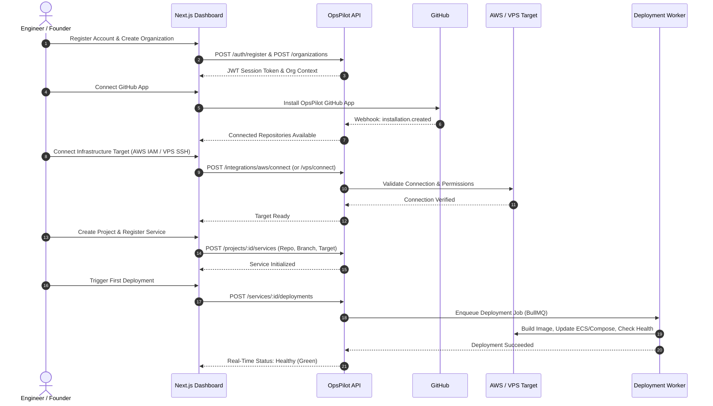
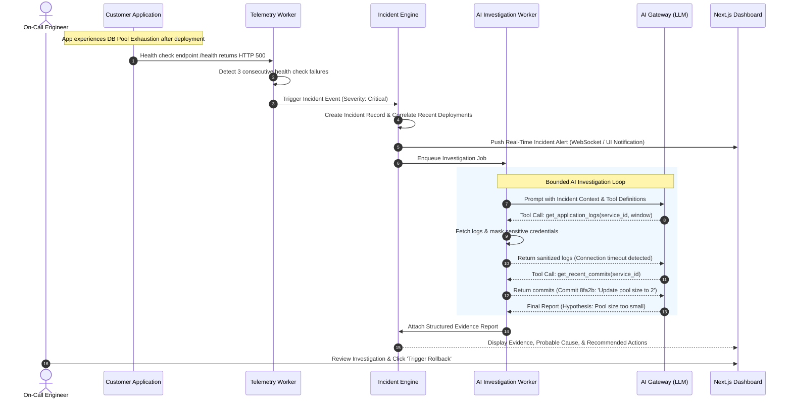
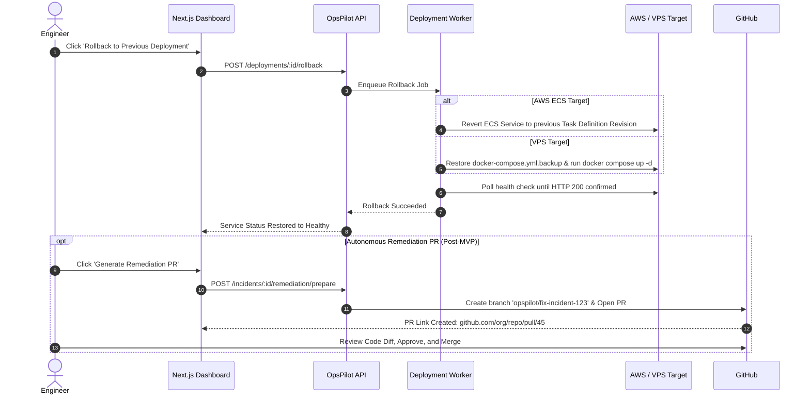

# User Flows & System Journeys

This document outlines the core end-to-end user journeys within OpsPilot.

---

## 1. Onboarding & First Service Deployment

---

## 2. Automated Incident Detection & AI Investigation

---

## 3. Rollback & Human-Approved Remediation

