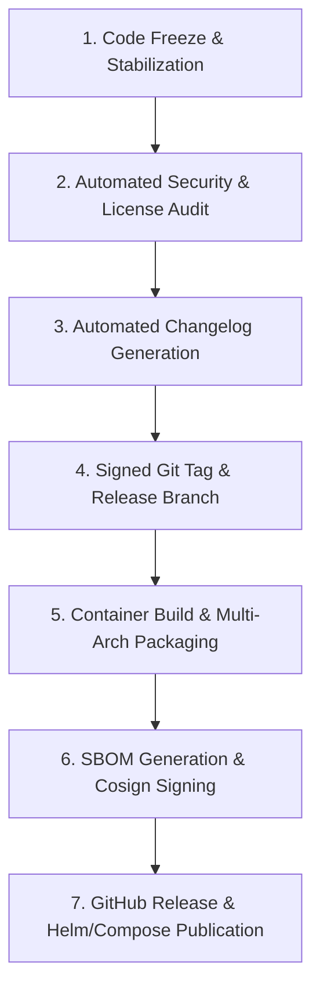

# OpsPilot — Release Engineering & Release Process

> **Audience:** Core Maintainers, Release Managers, DevOps Engineers  
> **Status:** Authoritative Release Specification  
> **Date:** November 2026

---

## 1. Semantic Versioning & Release Types

OpsPilot follows **Semantic Versioning 2.0.0 (`MAJOR.MINOR.PATCH`)**:

- **Major Releases (`X.0.0`):** Incompatible API changes, breaking database schema transitions, or deprecated provider support removal.
- **Minor Releases (`0.X.0`):** New features, newly supported cloud providers, or backward-compatible schema additions.
- **Patch Releases (`0.X.Y`):** Backward-compatible bug fixes, performance improvements, and security patches.
- **Pre-Release Channels:**
  - `0.1.0-alpha.X`: Internal development milestone releases.
  - `0.1.0-beta.X`: Public testing and community integration testing.
  - `0.1.0-rc.X`: Release candidates under final security freeze.

---

## 2. Release Lifecycle & Preparation Checklist



### Pre-Release Verification Steps:
1. **Security Scan:** Verify zero high- or critical-severity CVEs via Trivy and Gitleaks.
2. **License Check:** Ensure all dependencies conform to the project's open-source license policy (Apache-2.0 / MIT approved).
3. **Database Migration Verification:** Test upgrade and downgrade paths on PostgreSQL 18.
4. **End-to-End Smoke Test:** Verify `docker compose up` self-hosted workflow boots cleanly from scratch.

---

## 3. Automated Changelog & Tagging

Changelogs are generated automatically from Conventional Commits:
```bash
npx conventional-changelog -p angular -i CHANGELOG.md -s
```

### Tagging Procedure:
Releases are tagged on the release branch using annotated, signed Git tags:
```bash
git checkout -b release/v0.1.0
git commit -am "chore(release): bump version to v0.1.0"
git tag -s v0.1.0 -m "Release v0.1.0: OpsPilot Open-Source Milestone"
git push origin release/v0.1.0 --tags
```

---

## 4. Supply Chain Security & Artifact Signing

OpsPilot signs all published release artifacts to ensure provenance and prevent supply chain tampering:

1. **Software Bill of Materials (SBOM):**
   Generated for all production container images using Syft in SPDX JSON format:
   ```bash
   syft ghcr.io/anwar/opspilot-api:v0.1.0 -o spdx-json=opspilot-api-sbom.spdx.json
   ```
2. **Cosign Container Signing:**
   Container image digests are signed keylessly via Sigstore Cosign in GitHub Actions:
   ```bash
   cosign sign --yes ghcr.io/anwar/opspilot-api:v0.1.0
   ```
3. **Verification Command for Users:**
   Users can verify the authenticity of OpsPilot images before deploying:
   ```bash
   cosign verify ghcr.io/anwar/opspilot-api:v0.1.0 \
     --certificate-identity https://github.com/anwar/OpsPilot/.github/workflows/release.yml@refs/tags/v0.1.0 \
     --certificate-oidc-issuer https://token.actions.githubusercontent.com
   ```

---

## 5. Security Hotfix Process

When a critical vulnerability (e.g. CVSS >= 8.0) is identified in a published release:
1. Create private hotfix branch from target release tag: `git checkout -b hotfix/v0.1.1 v0.1.0`.
2. Apply minimal atomic patch with accompanying regression test.
3. Verify test suite passes.
4. Tag patch release: `v0.1.1`.
5. Publish emergency patch containers and security advisory on GitHub.
6. Forward-port fix to `main` branch.
