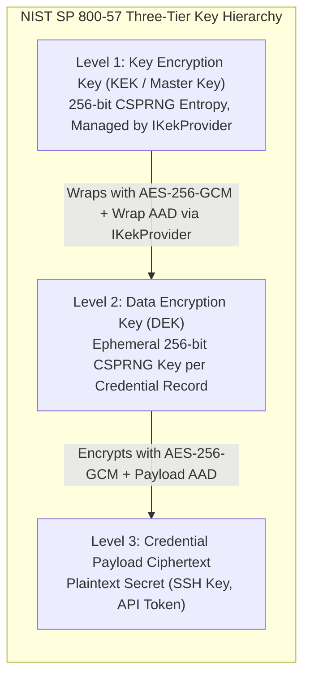
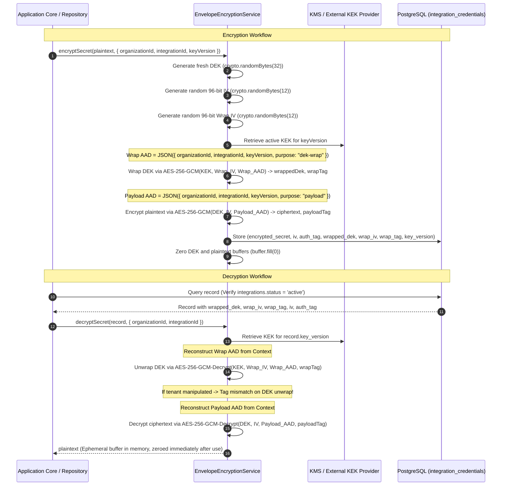

# Credential Management & Envelope Encryption Specification

> **Security Standard:** NIST SP 800-57 (Key Management Recommendations), NIST SP 800-38D (GCM Mode)  
> **Status:** Authoritative Mandatory Security Specification  
> **Date:** November 2026

This document specifies the cryptographic controls, multi-tier envelope encryption architecture, key wrapping mechanisms, rotation policies, memory hygiene, and disaster recovery procedures implemented across OpsPilot.

---

## 1. Cryptographic Architecture: Multi-Tier Envelope Encryption

OpsPilot explicitly rejects storing plaintext infrastructure credentials. When a tenant registers an SSH private key, connects an AWS IAM role, or provisions a scoped Cloudflare API token, secrets are protected via multi-tier envelope encryption.



### 1.1 Key Encryption Key Provider Interface (`IKekProvider`)

To support both cloud-native production deployments and fully offline, self-hosted installations without vendor lock-in, OpsPilot abstracts KEK operations behind the `IKekProvider` port:

```typescript
export interface KeyWrapResult {
  wrappedDek: Buffer;
  wrapIv: Buffer;
  wrapTag: Buffer;
  keyVersion: string;
}

export interface IKekProvider {
  getKeyVersion(): string;
  wrapKey(dek: Buffer, wrapAad: Buffer): Promise<KeyWrapResult>;
  unwrapKey(wrappedDek: Buffer, wrapIv: Buffer, wrapTag: Buffer, wrapAad: Buffer, keyVersion: string): Promise<Buffer>;
}
```

#### 1. Local Key Provider (`LocalKekProvider`):
- **Target Environments:** Local development, automated CI pipelines, and zero-cloud self-hosted VPS deployments.
- **Mechanism:** Operates directly within worker process memory using a 256-bit KEK loaded from `OPSPILOT_MASTER_KEY`.
- **Implementation:**
  - `wrapKey(dek, wrapAad)`: Generates a 12-byte random IV (`crypto.randomBytes(12)`), encrypts the DEK using AES-256-GCM under the local KEK with `wrapAad`, and extracts the 16-byte authentication tag.
  - `unwrapKey(...)`: Decrypts and authenticates the wrapped DEK using AES-256-GCM under the local KEK with `wrapAad`.
- **Security Boundary:** The master KEK resides in process memory; access is bounded by host OS file and process permissions.

#### 2. Managed KMS Provider (`ManagedKmsKekProvider`):
- **Target Environments:** Production enterprise cloud deployments (AWS ECS, EKS).
- **Mechanism:** The KEK **never leaves the cloud Hardware Security Module (HSM)**.
- **Implementation:**
  - `wrapKey(dek, wrapAad)`: Invokes AWS KMS `kms.encrypt({ KeyId: kekArn, Plaintext: dek, EncryptionContext: JSON.parse(wrapAad) })`.
  - `unwrapKey(...)`: Invokes AWS KMS `kms.decrypt({ CiphertextBlob: wrappedDek, EncryptionContext: JSON.parse(wrapAad) })`.
- **Security Boundary:** The application never possesses or sees the master KEK. Key access, IAM authorization policies, and cryptographic audit trails are sovereignly managed by the cloud KMS.

---

## 2. Authentication of Tenant & Integration Metadata

### 2.1 The RFC 3394 (AES Key Wrap) Limitation
RFC 3394 (NIST SP 800-38F Key Wrap) is a dedicated symmetric key wrapping algorithm. It uses a 64-bit Alternative Initial Value (AIV = `0xA6A6A6A6A6A6A6A6`) to provide integrity verification of the key data itself. 

**Critical Architectural Finding:** RFC 3394 does **not** support an arbitrary Additional Authenticated Data (AAD) parameter. Consequently, RFC 3394 alone cannot cryptographically bind the wrapped DEK to application metadata (such as `organization_id` or `integration_id`). Relying on RFC 3394 without a metadata integrity mechanism means the wrapped DEK could be swapped between tenant records in the database, relying solely on downstream payload decryption to fail.

### 2.2 Selected Canonical Approach: AES-256-GCM DEK Wrapping with Native AAD
OpsPilot adopts **AES-256-GCM authenticated wrapping** for the Data Encryption Key, combining key privacy and integrity with native, cryptographically bound Additional Authenticated Data (AAD):



### 2.3 Evaluation of Alternative: RFC 3394 with Separate Metadata Integrity
OpsPilot evaluated wrapping the DEK via RFC 3394 and enforcing metadata integrity through an external MAC (e.g. `HMAC-SHA256(KEK_mac, wrapped_dek || AAD)`).
- **Evaluation:** Rejected for core implementation. It requires deriving and managing two distinct master keys ($KEK_{enc}$ and $KEK_{mac}$), increases code complexity, requires platform-specific OpenSSL flags not cleanly supported across all Node.js runtimes, and provides no security advantage over authenticated AES-256-GCM wrapping with native AAD.

---

## 3. Cryptographic Standards vs. OpsPilot Operational Policies

To ensure strict engineering governance, cryptographic mandates derived from international standards are distinguished from OpsPilot application-level policies:

| Aspect | Cryptographic Standard (NIST / RFC) | OpsPilot Operational Policy | Rationale |
|---|---|---|---|
| **DEK Generation** | **NIST SP 800-57:** Must be generated via approved CSPRNG with full entropy. | Generated using Node.js `crypto.randomBytes(32)` (256 bits). Deterministic HKDF derivation is strictly banned (`SEC-01`). | Prevents mathematical predictability across tenants. |
| **KEK Entropy** | **NIST SP 800-57:** Sourced from high-entropy hardware (TRNG/CSPRNG) or managed KMS. | Must be 64 hexadecimal characters representing 32 raw bytes. **Length does NOT prove entropy**: satisfying 32 bytes with repeated characters or trivial patterns has near-zero entropy. Keys must be sourced via `/dev/urandom` or KMS; default fallbacks are banned (`SEC-02`). | Prevents weak or predictable production keys. |
| **Nonce Generation** | **NIST SP 800-38D:** AES-GCM requires a 96-bit nonce. Nonce reuse with the same key is catastrophic. | Fresh 12-byte random IV (`crypto.randomBytes(12)`) per encryption operation. | Guaranteed unique per operation. |
| **Nonce Collision Limits** | **NIST SP 800-38D (Section 8.3):** Under random 96-bit nonces, the maximum invocations for a single key must not exceed $2^{32}$. | **Operational Ceiling:** Rotate KEK after $100,000$ operations or 365 days, whichever comes first. | Bounds collision probability to $< 10^{-19}$, far below NIST risk thresholds. |
| **Tenant Binding (AAD)** | **NIST SP 800-38D:** Authenticated data is verified under AEAD tag. | Both DEK wrapping and Payload encryption pass `{ organizationId, integrationId, keyVersion }` as AAD. | Eliminates cross-tenant credential reuse and record substitution. |
| **Decryption Gating** | Application-level authorization control. | Gated by database query checking `integrations.status = 'active'`. Revoked integrations fail closed. | Enforces administrative revocation (`SEC-05`). |
| **Memory Hygiene & Limitations** | Defense-in-depth security best practice. | Buffer containing decrypted keys and tokens are zeroed (`buffer.fill(0)`) immediately after connection setup. **Explicit Limitation Acknowledgment:** In V8 / Node.js, `buffer.fill(0)` is **best-effort defense-in-depth, NOT a guarantee of physical erasure**. Immutable JavaScript string conversions cannot be wiped; V8 GC compaction and OS page swapping can retain memory duplicates until garbage collection. Secrets must remain strictly in Buffers with short synchronous lifetimes. | Minimizes in-memory exposure windows. |

---

## 4. Threat Model & Security Boundaries

The envelope encryption architecture addresses five explicit threat vectors:

1. **Threat 1: PostgreSQL Database Compromise (SQL Injection, Unauthorized DB Dump)**
   - *Attack:* Malicious actor dumps `integrations` and `integration_credentials` tables.
   - *Defense:* The attacker obtains ciphertexts, initialization vectors, authentication tags, and wrapped DEKs. Because the KEK is never stored in PostgreSQL, the wrapped DEKs cannot be decrypted. Brute-forcing a 256-bit AES key is computationally infeasible.
2. **Threat 2: Cross-Tenant Context Manipulation (Confused Deputy Attack)**
   - *Attack:* Tenant A attempts to decrypt Tenant B's credentials by invoking the API with Tenant B's `integration_id` while authenticated as Tenant A.
   - *Defense:* The request context injects Tenant A's `organizationId`. When unwrap or decryption is attempted, the AEAD tag verification compares the computed authentication tag against the stored tag using the provided AAD. The mismatched `organizationId` causes decryption to throw an unrecoverable `CiphertextIntegrityException`.
3. **Threat 3: Row Swapping / Substitution Attack**
   - *Attack:* An attacker with direct write access to the database attempts to copy the `wrapped_dek` and `encrypted_secret` from Tenant A's record into Tenant B's record.
   - *Defense:* Because `integrationId` is explicitly included in both the DEK Wrap AAD and Payload AAD, unwrapping the swapped record under Tenant B's integration context fails AEAD verification immediately.
4. **Threat 4: Memory Dumps and Core Dumps**
   - *Attack:* An attacker obtains a memory dump of a worker process.
   - *Defense:* DEKs and plaintext credentials exist in memory only as short-lived Buffer objects during active connection setup. Once the outbound HTTP request is dispatched or SSH session handshake completes, the memory buffer is wiped with zeroes (`buffer.fill(0)`).
5. **Threat 5: Leakage into Build Containers or AI Prompts**
   - *Attack:* An untrusted build container or AI agent attempts to read deployment credentials.
   - *Defense:* Credentials are decrypted exclusively in the Control Plane worker process. Build containers run without credentials; AI prompts are scrubbed by `SecretRedactor`.

---

## 5. Key Lifecycle, Rotation & Disaster Recovery

### 5.1 KEK Storage & Versioning
- **Production Storage:** In AWS environments, the KEK is managed by AWS KMS (`kms:Encrypt` / `kms:Decrypt`). In self-hosted environments, the KEK is provisioned via `OPSPILOT_MASTER_KEY` in protected environment configuration with restricted file permissions (`chmod 400`).
- **Key Versioning:** Stored records include `key_version` (e.g. `'kek-2026-v1'`). Multiple KEK versions can be maintained simultaneously in the key vault to support seamless rotation.

### 5.2 Key Rotation Procedure (Without Plaintext Re-Encryption)
Because OpsPilot uses envelope encryption, rotating the master key does **not** require decrypting sensitive secrets:
1. Generate new KEK version (`kek-2026-v2`) in KMS or environment.
2. Background rotation worker queries records where `key_version = 'kek-2026-v1'`.
3. For each record:
   - Unwrap the DEK using the old KEK (`kek-2026-v1`).
   - Re-wrap the DEK using the new KEK (`kek-2026-v2`) with the new `keyVersion` in the Wrap AAD.
   - Update `wrapped_dek`, `wrap_iv`, `wrap_tag`, and `key_version` in `integration_credentials`.
4. Plaintext customer secrets remain encrypted and untouched throughout the entire rotation process.

### 5.3 Disaster Recovery & Key Loss
- **Cryptographic Reality:** If the active KEK is permanently lost or destroyed, **all encrypted infrastructure credentials and integration secrets are permanently unrecoverable**.
- **Runbook Mandate:** Organizations self-hosting OpsPilot must maintain redundant, encrypted backups of the KEK in a secure, offline password vault or hardware security module (HSM). If a KEK is lost, tenant administrators must re-authenticate and re-enter all cloud provider credentials.

---

## 6. Audit Logging & Compliance

Every cryptographic operation emits a structured, immutable audit log:
```json
{
  "event": "CREDENTIAL_DECRYPTED",
  "timestamp": "2026-11-08T01:15:00.000Z",
  "organizationId": "33333333-3333-3333-3333-333333333333",
  "integrationId": "44444444-4444-4444-4444-444444444444",
  "keyVersion": "kek-2026-v1",
  "actorId": "55555555-5555-5555-5555-555555555555",
  "clientIp": "10.0.1.25",
  "status": "SUCCESS"
}
```
**Strict Audit Invariant:** Plaintext credentials, unencrypted DEKs, and master key bytes are **never** logged under any log level (including `DEBUG` or `TRACE`).
