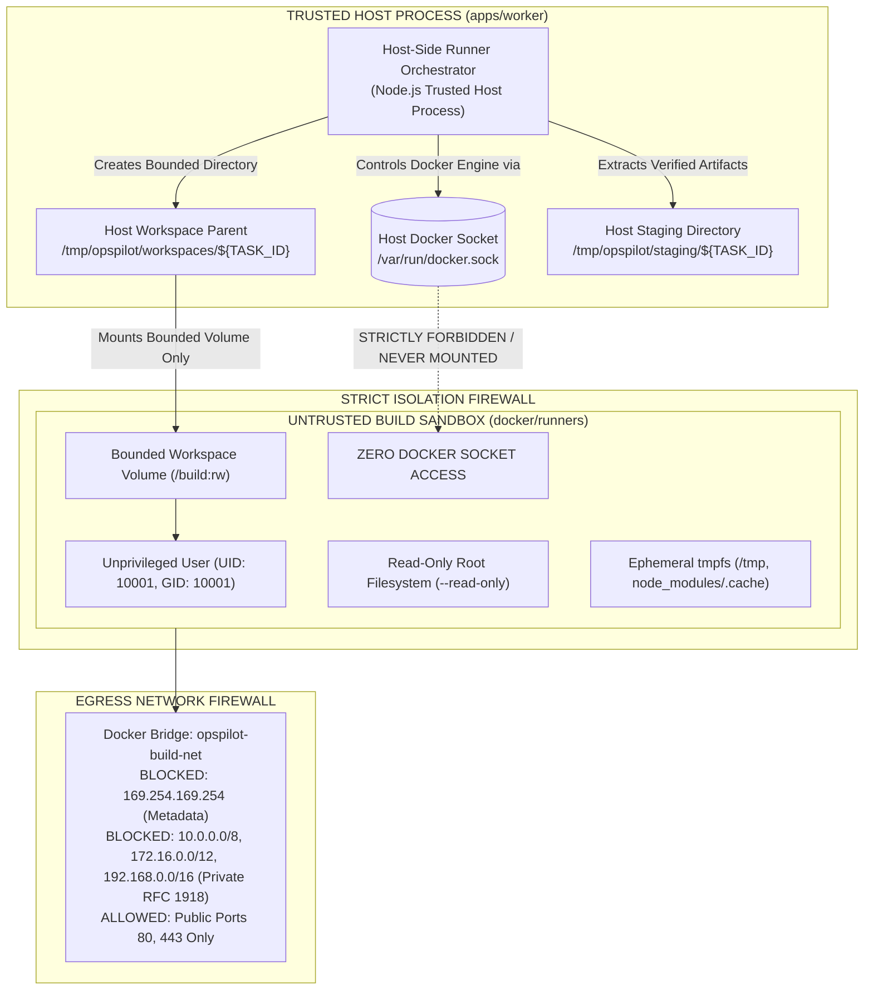

# Deployment Runner Security & Isolated Execution Plane

> **Security Model:** Zero-Trust Execution Boundary with Privileged Host Orchestrator  
> **Audience:** Platform Architects, Security Engineers, SREs  
> **Status:** Authoritative Mandatory Security Specification  
> **Date:** November 2026

When OpsPilot processes customer Git repositories, it executes untrusted build instructions (`npm run build`, `vite build`, `wrangler deploy`, arbitrary `Dockerfile` directives). If executed with host access, malicious repositories or compromised npm packages could execute arbitrary code (RCE) on the host, compromise cloud accounts, or escape to the control plane.

This document specifies the complete security architecture of the **Host-Side Runner Orchestrator** and the **Ephemeral Container Sandbox**.

> [!WARNING]
> **Planned Architecture Specification (November 2026):**
> This specification describes the **target Phase 1 execution architecture**.
> - **No host-side Docker Engine orchestrator exists** in the current codebase.
> - **No process currently launches isolated build containers.**
> - **Docker security flags are generated as configuration specifications** only: [`HardenedBuildRunner`](../../packages/deployment-providers/src/runners/hardened-build-runner.ts) validates parameters in TypeScript and synthesizes an in-memory argument array, but does not interact with `/var/run/docker.sock` or any Docker daemon.
> - **Network egress controls are not enforced by a live controller.** Subnet CIDRs are string literals; no host iptables or Docker bridge network policies are configured.
> - **The diagrams and flows below represent the intended Phase 1 architecture** to be implemented upon Project Owner authorization.

---

## 1. Privileged Controller vs. Untrusted Sandbox Boundary (Target Phase 1 Architecture)

OpsPilot enforces a strict architectural and operating-system-level boundary separating the trusted host worker from untrusted build containers:



### 1.1 Invariant Rules of Boundary Separation:
1. **Host Socket Sovereignty:** The Docker daemon socket (`/var/run/docker.sock`) is accessible **exclusively** to the trusted host worker process. It is **never** mounted, shared, or proxied into an untrusted build container under any circumstances.
2. **No Host-Side Script Execution:** The trusted host orchestrator **never** executes customer build scripts (`package.json` scripts, `build.sh`, `make`, `npm install`) on the host operating system. All customer-provided code executes exclusively inside the container sandbox.
3. **Dropped Privileges:** Build containers run strictly as unprivileged user `UID 10001:GID 10001`. Attempting to start the container as `root` (UID 0) causes immediate process termination.

---

## 2. Workspace Path Validation & Symlink Protection (Including TOCTOU Defenses)

Malicious customer repositories frequently attempt to read or overwrite host files by committing or dynamically generating symlinks pointing to `/etc/passwd`, `/var/run/docker.sock`, or parent directories (`../../`).

### 2.1 Workspace Directory Isolation
- Every task receives a dedicated directory on the host:
  ```text
  /tmp/opspilot/workspaces/${TASK_ID}/
  ```
- The orchestrator validates that `path.resolve(WORKSPACE_DIR)` strictly resides within `/tmp/opspilot/workspaces/` and contains no null bytes (`\0`) or path traversal sequences (`..`).

### 2.2 Symlink TOCTOU (Time-of-Check to Time-of-Use) Defenses
- **The Threat:** A build script could pass an initial pre-execution symlink check, and then dynamically create a symlink to `/etc/shadow` or `/var/run/docker.sock` mid-build right before the output collection step, exploiting the race window between check and extraction.
- **The Defenses:**
  1. **Namespace Isolation:** The container operates in isolated mount namespaces. Inside the container, `/etc` and `/var` resolve strictly to the container's own read-only filesystem, **not** the host operating system. The container has no filesystem path to the host root.
  2. **Instant-of-Extraction Verification (No Follow):** When the host orchestrator copies files from the workspace output folder (`dist/`), it uses `fs.lstatSync` (never `statSync`) and **never follows symlinks**.
  3. **Symlink Rejection in Artifacts:** Any symlink found inside the build output tree (`dist/` or `.worker/`) is rejected and causes immediate build abortion unless explicitly verified to resolve within the output tree itself:
     ```typescript
     const realTarget = fs.realpathSync(symlinkPath);
     const resolvedOutput = path.resolve(outputDir);
     if (!realTarget.startsWith(resolvedOutput + path.sep)) {
       throw new SecurityViolationException(
         `Symlink TOCTOU attempt detected: ${symlinkPath} resolves outside output directory -> ${realTarget}`
       );
     }
     ```

---

## 3. Artifact Collection, Path Traversal & SUID Stripping

Once a build succeeds inside the container, build outputs (e.g. `dist/`, `.worker/`, or static assets) must be extracted safely to the host staging area.

### 3.1 Controlled Output Collection
- The container writes outputs strictly into a designated relative directory (`/build/dist`).
- The orchestrator extracts outputs from `/tmp/opspilot/workspaces/${TASK_ID}/dist` to a dedicated staging directory.

### 3.2 Path Traversal, Tar Slip & Hardlink Defenses
When copying or extracting build artifacts:
1. **Tar Slip / Zip Slip Prevention:** Every extracted filename is resolved against the target staging directory:
   ```typescript
   const destinationPath = path.resolve(stagingDir, entry.name);
   if (!destinationPath.startsWith(stagingDir + path.sep)) {
     throw new SecurityViolationException(
       `Path traversal attempt detected in build artifact: ${entry.name}`
     );
   }
   ```
2. **Hardlink Defenses:** Hardlinks in repository archives pointing to inodes outside the workspace are stripped or rejected.
3. **SUID / SGID Bit Stripping:** The extraction pipeline explicitly strips setuid and setgid permissions (`chmod -s`) on all extracted files to prevent privilege escalation if artifacts are later executed.
4. **No Device or Special Files:** FIFO pipes, socket files, block devices, and character devices are rejected.
5. **Cryptographic Checksumming:** The host orchestrator computes SHA-256 digests for all output artifacts, recording the immutable digest in the deployment record before unmounting the workspace.

---

## 4. Enforced Network Egress Filtering: Metadata, IPv6 & DNS Rebinding Defenses

Build containers often require internet access to fetch npm packages or crate dependencies. However, unrestrained network access allows malicious code to query cloud metadata services or scan private internal networks.

### 4.1 Dedicated Bridge Network & IPv6 Disabling
Every build container is attached to an isolated bridge network (`opspilot-build-net`):

```bash
docker network create \
  --driver bridge \
  --opt "com.docker.network.bridge.enable_icc=false" \
  opspilot-build-net
```
- **IPv6 Egress Blocking:** To prevent malicious code from bypassing IPv4 firewall rules via IPv6 tunneling or dual-stack endpoints, IPv6 is explicitly disabled on the container interface:
  `--sysctl net.ipv6.conf.all.disable_ipv6=1`

### 4.2 Firewall (iptables / nftables) Rules
Host firewall rules strictly enforce:
1. **Block Cloud Metadata Endpoints:** Drop all outbound traffic to `169.254.169.254/32` (AWS IMDS, GCP metadata, Cloudflare internal metadata).
2. **Block Link-Local & Loopback Spaces:** Drop all packets to `169.254.0.0/16`, `127.0.0.0/8`, and IPv6 link-local `fe80::/10`.
3. **Block RFC 1918 Private Subnets:** Drop all outbound traffic to:
   - `10.0.0.0/8`
   - `172.16.0.0/12`
   - `192.168.0.0/16`
4. **AWS IMDSv2 Hop Limit Defense:** On AWS EC2 worker instances, configure the instance metadata service with `HttpPutResponseHopLimit=1`. This physically drops metadata packets forwarded across Docker bridge networks at the hypervisor level.
5. **DNS Rebinding Defenses:** Outbound packet filtering operates strictly at the IP packet level in the Linux kernel (iptables/nftables). Even if a malicious DNS server returns `169.254.169.254` via a 0-second TTL rebinding attack, the resulting outbound IP packet is evaluated against destination IP rules and dropped at the host bridge interface.
6. **Restricted Port Access:** Only outbound TCP connections to ports `80` (HTTP) and `443` (HTTPS) on public IP ranges are permitted during the dependency resolution phase.
7. **Offline Post-Dependency Builds:** Once dependencies are installed, network egress is optionally disabled (`--network none`) during the actual code compilation phase.

---

## 5. Resource Limits, Timeout Handling & Fork Bomb Defenses

### 5.1 Enforced Container Resource Quotas
Every build container is spawned with mandatory cgroup resource constraints:
```bash
docker run \
  --rm \
  --name "opspilot-build-${TASK_ID}" \
  --read-only \
  --tmpfs /tmp:rw,noexec,nosuid,size=512m \
  --tmpfs /build/node_modules/.cache:rw,size=512m \
  --user 10001:10001 \
  --cap-drop ALL \
  --security-opt no-new-privileges \
  --memory 2048m \
  --memory-swap 2048m \
  --cpus 2.0 \
  --pids-limit 100 \
  --network opspilot-build-net \
  -v "${WORKSPACE_DIR}:/build:rw" \
  opspilot-runner:node20 \
  "$@"
```

- `--memory 2048m --memory-swap 2048m`: Strict 2GB ceiling; swap is disabled to prevent host disk thrashing.
- `--cpus 2.0`: CPU quota prevents infinite build loops from starving the host.
- `--pids-limit 100`: Prevents fork bomb attacks from exhausting the host process table.
- `--security-opt no-new-privileges`: Blocks child processes from gaining elevated capabilities via setuid/setgid binaries.

### 5.2 Two-Stage Timeout Supervisor
The host orchestrator supervises container execution with an active wall-clock timer (default 15 minutes / 900 seconds):
1. **Graceful Cancellation (`SIGTERM`):** If the timeout is reached or a user cancels the deployment, the orchestrator issues `docker stop -t 10 opspilot-build-${TASK_ID}`, sending `SIGTERM` and granting 10 seconds for clean shutdown.
2. **Forced Termination (`SIGKILL`):** If the container does not exit within 10 seconds, the orchestrator executes `docker kill opspilot-build-${TASK_ID}`.
3. **Status Update:** The deployment status transitions to `Failed` with reason `BUILD_TIMEOUT_EXCEEDED` or `BUILD_CANCELLED`.

---

## 6. Crash Recovery, Orphan Cleanup & Reaper Process

Because workers can crash or be preempted mid-build, robust cleanup mechanisms prevent zombie containers and orphaned disk clutter:

1. **Auto-Removal (`--rm`):** Ensures clean containers delete themselves immediately upon normal exit.
2. **Metadata Labeling:** Every container carries standard metadata:
   - `opspilot.managed=true`
   - `opspilot.task_id=${TASK_ID}`
   - `opspilot.created_at=${ISO_TIMESTAMP}`
3. **Host Reaper Background Task:** A background reaper job runs in the worker process every 5 minutes:
   - Queries `docker ps -a --filter "label=opspilot.managed=true"`.
   - Any container running for longer than the maximum timeout (30 minutes) is forcefully terminated (`docker rm -f`).
   - Any orphaned workspace directory in `/tmp/opspilot/workspaces/` whose associated task is no longer active in PostgreSQL is removed via `fs.rmSync`.

---

## 7. Secret Isolation & Stream Redaction

1. **Zero Secret Propagation:** Cloud provider credentials (AWS IAM STS tokens, Cloudflare API tokens, SSH private keys) **never** enter the build container environment. All cloud uploads occur after the container exits, executed directly by the Control Plane worker.
---

## 8. Status Matrix: Documented vs. Implemented Security Controls

To ensure strict engineering integrity, documented controls are formally classified by implementation status:

| Security Control | Documented Specification | Implementation Status | Scheduled Phase & Verification Method |
|---|---|---|---|
| **Host Docker Socket Isolation** | Host socket `/var/run/docker.sock` is never mounted in build containers | **Implemented in Prototype** | Phase 2: Automated inspection test verifying socket is absent in container inspect JSON. |
| **Non-Root Execution (`10001:10001`)** | Root user banned; container exits on UID 0 | **Implemented in Prototype** | Phase 2: Verified in `hardened-build-runner.spec.ts`. |
| **No-New-Privileges & Dropped Caps** | `--cap-drop ALL`, `--security-opt no-new-privileges` | **Implemented in Prototype** | Phase 2: Verified in `hardened-build-runner.spec.ts`. |
| **Read-Only Root Filesystem & tmpfs** | `--read-only`, bounded size tmpfs | **Implemented in Prototype** | Phase 2: Verified in `hardened-build-runner.spec.ts`. |
| **Symlink TOCTOU Defenses** | Extraction verification using `lstat` (no-follow) and `realpath` boundary checks | **Documented Specification** | **Requires Phase 2 Implementation:** Adversarial unit test attempting post-check symlink swapping. |
| **Tar Slip / Zip Slip Defenses** | Staging prefix validation on all extracted archive files | **Documented Specification** | **Requires Phase 2 Implementation:** Adversarial test with malicious tar archive containing `../../`. |
| **SUID / SGID Bit Stripping** | Artifact extraction strips setuid bits (`chmod -s`) | **Documented Specification** | **Requires Phase 2 Implementation:** Unit test extracting artifact with setuid binary. |
| **Metadata & IPv6 Egress Firewall** | Bridge iptables blocking `169.254.169.254`, IPv6 disabled | **Documented Specification** | **Requires Phase 2 Implementation:** Integration test inside container attempting `curl 169.254.169.254`. |
| **Two-Stage Timeout Supervisor** | Wall-clock timer with `SIGTERM` (10s) followed by `SIGKILL` | **Documented Specification** | **Requires Phase 2 Implementation:** Integration test with infinite sleep build script. |
| **Host Reaper Background Process** | 5-minute cleanup cron purging hung containers via labels | **Documented Specification** | **Requires Phase 2 Implementation:** Test killing worker process and verifying reaper cleans up. |
| **Stream Secret Redaction** | Real-time regex masking on container stdout/stderr | **Implemented in Prototype** | Phase 1 & 2: Verified in `secret-redactor.spec.ts`. |
