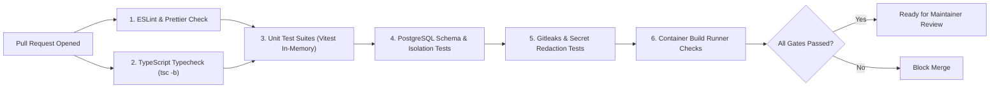

# OpsPilot — Test Strategy & Test Architecture

> **Audience:** Contributors, Platform Engineers, QA Engineers
> **Status:** Authoritative Testing Specification
> **Date:** November 2026

---

## 1. Test Harness Architecture

OpsPilot standardizes on **Vitest** as the test runner across all monorepo packages. Vitest provides native TypeScript execution, shared module configuration with `tsconfig.json` paths, and fast in-memory execution.

```mermaid
flowchart TD
    ROOT["Vitest Test Runner (vitest.workspace.ts)"]

    subgraph Unit Suites ["Fast In-Memory Unit Suites (< 5s)"]
        U1["packages/domain/tests (State machines, entities)"]
        U2["packages/contracts/tests (Zod schemas)"]
        U3["packages/security/tests (Cryptographic tampering, AAD)"]
    end

    subgraph Integration Suites ["Database & Queue Integration Suites (< 20s)"]
        I1["packages/database/tests (PostgreSQL queries, tenant isolation, schema lifecycle)"]
    end

    subgraph Contract Suites ["Provider Contract Suites (< 10s)"]
        C1["packages/deployment-providers/tests (AWS, VPS, Cloudflare)"]
    end

    subgraph Security Suites ["Sandbox & Runner Security Suites (< 30s)"]
        S1["docker/runners/tests (Non-root, read-only FS, network egress)"]
    end

    ROOT --> Unit Suites
    ROOT --> Integration Suites
    ROOT --> Contract Suites
    ROOT --> Security Suites
```

---

## 2. Test Execution Strategy

### 2.1 Workspace Configuration
The monorepo root configures `vitest.workspace.ts` allowing tests to run either individually per package or unified across the entire workspace:

```bash
# Run all unit tests across all packages
npm run test

# Run tests for a specific package
npm --workspace=@opspilot/security test

# Run tests in watch mode
npx vitest
```

### 2.2 Database Integration Test Strategy
- **Isolation via Transactions:** Integration tests interacting with PostgreSQL wrap each test case in a database transaction (`BEGIN ... ROLLBACK`) to ensure tests leave no state behind.
- **Tenant Isolation Assertions:** Every repository test must seed records for at least two different organizations (`org-a` and `org-b`) and assert that queries scoped to `org-a` never return or mutate entities belonging to `org-b`.
- **Local Connection:** Tests connect via `DATABASE_URL`, defaulting to Unix socket `/var/run/postgresql:5432` or `localhost:5432`.

### 2.3 Provider Contract Test Strategy
Cloud deployment providers (AWS ECS, VPS Docker, Cloudflare Workers, Cloudflare Pages) are tested against simulated provider endpoints:
- **Wiremock / MSW Transport Mocking:** Instead of mocking internal class methods, tests mock HTTP transport responses at the network boundary.
- **Realistic Error Conditions:** Contract suites must verify provider behavior against simulated HTTP 401 Unauthorized, HTTP 403 Forbidden, HTTP 429 Rate Limit (with `Retry-After` headers), and HTTP 500 Internal Server Errors.

### 2.4 Cryptographic Security Test Strategy
The security test suite in `packages/security/tests/envelope-encryption.spec.ts` must execute the following non-negotiable scenarios:
1. **Uniqueness:** 100 consecutive encryptions of the same plaintext string must yield 100 distinct ciphertexts, IVs, and wrapped DEKs.
2. **Tamper Resistance:** Modifying a single bit in the ciphertext, auth tag, or IV must throw `AuthenticationTagValidationException`.
3. **Tenant Boundary (AAD):** Attempting to decrypt record A using organization B's context must fail cryptographically.
4. **Fail-Closed:** Initializing the service without `OPSPILOT_MASTER_KEY` must throw `MissingMasterKeyException`.

### 2.5 AI Diagnostic Evaluation Testing
The AI Investigation Agent is benchmarked against the 15 standardized failure scenarios defined in the [Incident Simulator](../ai/INCIDENT_SIMULATOR.md) and [AI Evaluation Framework](../ai/AI_EVALUATION.md) to guarantee:
- Deterministic tool selection strictly from the approved read-only tool catalog.
- Zero credential leakage in synthesized investigation contexts or audit reports.
- Elimination of hallucinated system state or unverified root causes.

---

## 3. Flaky Test Prevention & Determinism

1. **No Fixed Sleeps:** Never use `setTimeout(..., 5000)` to wait for asynchronous jobs or queue events. Always use polling utilities with timeouts:
   ```typescript
   await waitForCondition(() => deployment.status === 'active', { timeoutMs: 5000, intervalMs: 100 });
   ```
2. **Clock Determinism:** For time-sensitive tests (e.g. lease expiration, token expiration), use Vitest fake timers (`vi.useFakeTimers()`).
3. **No Shared Global State:** Singletons with mutable in-memory state are forbidden in test harnesses.

---

## 4. Automated CI/CD Quality Pipeline Sequence

The sequence below outlines the quality gates executed on every Pull Request before code can be merged into `main`:


